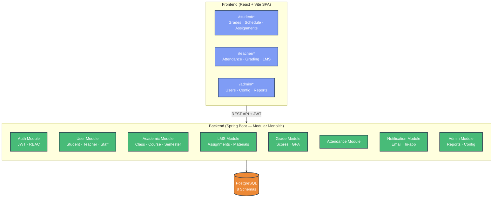

# SCHOOL MANAGEMENT SYSTEM (EduSMS)

> A modular monolith platform for school administration — managing students, teachers, academic scheduling, grading, LMS, and attendance across 3 role-based portals with JWT authentication.

[](https://spring.io/projects/spring-boot)
[](https://react.dev)
[](https://www.postgresql.org)
[](https://www.docker.com)
[](https://www.typescriptlang.org)

> 🚧 **Active Development** — Auth module complete. Currently implementing User & Academic modules.

---

## Context

School operations are fragmented across spreadsheets, paper forms, and disconnected tools. EduSMS centralizes everything: enrollment, scheduling, grade management, assignment submission, attendance tracking, and notifications — into a single platform accessible by students, teachers, and administrators.

**This is a team project built on a Modular Monolith architecture** — one deployable Spring Boot application with 8 independently bounded modules, each owning its own database schema.

---

## Architecture

### System Overview



### Backend Modules

| Module | Responsibility |
|:-------|:--------------|
| `auth` | Login, JWT, refresh token, RBAC |
| `user` | Profile management — Student, Teacher, Staff |
| `academic` | Class groups, courses, semesters, timetable |
| `lms` | Assignment submission, learning materials |
| `grade` | Score entry, GPA calculation, transcripts |
| `attendance` | Check-in, absence tracking |
| `notification` | Email alerts, in-app notifications, deadline reminders |
| `admin` | System config, aggregate reports |

### Frontend Portals

One SPA with role-based routing after login:
- `/student/*` — View grades, schedule, submit assignments
- `/teacher/*` — Enter grades, take attendance, post materials
- `/admin/*` — Manage users, configure system, view reports

---

## Tech Stack

```
Frontend      React · TypeScript · Vite
              React Router · Axios · TailwindCSS

Backend       Spring Boot (Java 21)
              Spring Security · JWT (jjwt)
              Spring Data JPA · Hibernate
              PostgreSQL (per-module schema separation)

Infrastructure  Docker + Docker Compose
                Nginx (reverse proxy)
                GitHub (version control)
```

---

## Project Structure

```
Edu/
├── backend/
│   └── src/main/java/com/edu/sms/
│       ├── common/               # Shared: security, exception, dto
│       └── modules/
│           ├── auth/             # Auth · JWT · RBAC
│           ├── user/             # Student · Teacher · Profile
│           ├── academic/         # Class · Course · Semester
│           ├── lms/              # Assignments · Materials
│           ├── grade/            # Scores · GPA
│           ├── attendance/
│           ├── notification/
│           └── admin/
├── frontend/
│   └── src/
│       ├── features/             # Feature-based structure
│       └── shared/               # API client · shared components
├── infrastructure/
│   ├── docker-compose.yml
│   ├── run-docker.bat
│   └── nginx/
└── docs/
    ├── erd/                      # DBML schema files (8 modules)
    ├── tasks/                    # Sprint task breakdown
    ├── set-up-guide.md
    └── team-play-book.md
```

---

## Database Design (ERD)

Schema files are in `docs/erd/` — paste content into [dbdiagram.io](https://dbdiagram.io) to visualize.

| Module | DBML File |
|:-------|:---------|
| Auth | [db_auth.dbml](docs/erd/db_auth.dbml) |
| User | [db_user.dbml](docs/erd/db_user.dbml) |
| Academic | [db_academic.dbml](docs/erd/db_academic.dbml) |
| LMS | [db_lms.dbml](docs/erd/db_lms.dbml) |
| Grade | [db_grade.dbml](docs/erd/db_grade.dbml) |
| Attendance | [db_attendance.dbml](docs/erd/db_attendance.dbml) |
| Notification | [db_notification.dbml](docs/erd/db_notification.dbml) |
| Admin | [db_admin.dbml](docs/erd/db_admin.dbml) |

---

## Quick Start

```bash
# Clone & checkout
git clone https://github.com/ho4ngTien/Edu.git
cd Edu
git checkout develop

# Start database
cd infrastructure && docker-compose up -d

# Backend
cd ../backend && mvn spring-boot:run

# Frontend
cd ../frontend && npm install && npm run dev
```

→ Full setup guide: [docs/set-up-guide.md](docs/set-up-guide.md)

---

## Development Status

| Module | Backend | Frontend |
|:-------|:-------:|:--------:|
| Auth (JWT · RBAC) | ✅ Complete | 🚧 In Progress |
| User (Student · Teacher) | 🚧 In Progress | ⏳ To Do |
| Academic (Class · Schedule) | ⏳ To Do | ⏳ To Do |
| LMS (Assignments · Materials) | ⏳ To Do | ⏳ To Do |
| Grade (Scores · GPA) | ⏳ To Do | ⏳ To Do |
| Attendance | ⏳ To Do | ⏳ To Do |
| Notification | ⏳ To Do | ⏳ To Do |
| Admin (Reports · Config) | ⏳ To Do | ⏳ To Do |

---

## Documentation

- [Business Flows & Use Cases](docs/business_flows_and_use_cases.md)
- [Setup Guide](docs/set-up-guide.md)
- [Team Play Book](docs/team-play-book.md)
- [Sprint Task Board](docs/tasks/00-master-roadmap.md)
