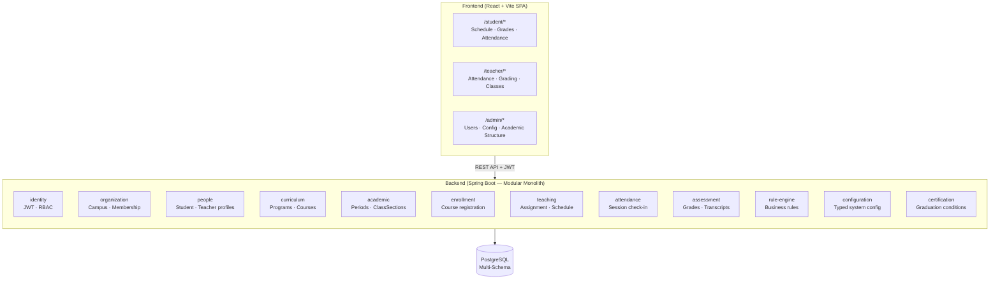

# School Management System

> A modular monolith platform for educational institution management — handling identity, people, curriculum, academic scheduling, enrollment, teaching assignment, attendance, and assessment across role-based portals.

[](https://spring.io/projects/spring-boot)
[](https://react.dev)
[](https://www.postgresql.org)
[](https://www.docker.com)
[](https://www.typescriptlang.org)
[](https://www.archunit.org)

> 🚧 **Active Development** — Architecture design complete (Phase 1). Multi-schema database, Shared Kernel, Identity core, and Organization core completed (Phase 2.1–2.5). Security & JWT integration (Phase 2.6) in progress.

---

## Overview

School operations are fragmented across spreadsheets, paper forms, and disconnected tools. This platform centralizes everything: enrollment, scheduling, grade management, attendance tracking, and notifications — into a single deployable application accessible by students, teachers, and administrators.

Built on a **Modular Monolith** architecture — one Spring Boot application with 12 independently bounded modules, each owning its own database schema, communicating only through well-defined Java interfaces or Application Events.

---

## Architecture

### System Overview



### Backend Modules

| Module | Responsibility | Priority |
|:-------|:--------------|:--------:|
| `identity` | Authentication, JWT, RBAC, token management | Must Have |
| `organization` | Organization, campus units, memberships | Must Have |
| `people` | Person profile, student profile, teacher profile | Must Have |
| `curriculum` | Academic programs, program versions, course catalog | Must Have |
| `academic` | Academic periods, class sections, course offerings | Must Have |
| `enrollment` | Student enrollment into courses and class sections | Must Have |
| `teaching` | Teacher assignment to course offerings and classes | Must Have |
| `attendance` | Session attendance recording and tracking | Must Have |
| `assessment` | Grade entry, assessment categories, transcripts | Must Have |
| `rule-engine` | Versioned business rule evaluation | Must Have |
| `configuration` | Typed system configuration management | Should Have |
| `certification` | Graduation conditions and certification | Should Have |

### User Roles

All roles are **organization-scoped** — there are no global privileges.

| Role | Description |
|:-----|:------------|
| `ORG_ADMIN` | Manages institution configuration, academic structure, and personnel |
| `TEACHER` | Manages assigned classes, records attendance, enters grades |
| `STUDENT` | Views personal enrollments, grades, attendance, and schedule |

### Frontend Portals

One SPA with role-based routing after authentication:
- `/student/*` — View schedule, grades, attendance history
- `/teacher/*` — Record attendance, enter grades, view classes
- `/admin/*` — Manage users, configure academic structure

---

## Tech Stack

```
Frontend      React · TypeScript · Vite
              React Router · Axios · TailwindCSS

Backend       Java 21 · Spring Boot 3.4.3
              Spring Security · JWT
              Spring Data JPA · Hibernate
              PostgreSQL (per-module schema)
              ArchUnit 1.4.1 (architecture enforcement)

Build         Maven Multi-Module (reactor build)

Infrastructure  Docker + Docker Compose
                Nginx (reverse proxy)
```

---

## Project Structure

```
Edu/
├── backend/
│   ├── pom.xml                          # Root parent POM (com.edu, Java 21)
│   ├── boot/                            # Composition Root — EduApplication
│   ├── shared/
│   │   └── shared-kernel/               # Base domain abstractions
│   ├── modules/                         # 12 business modules
│   │   ├── identity/
│   │   ├── organization/
│   │   ├── configuration/
│   │   ├── people/
│   │   ├── curriculum/
│   │   ├── academic/
│   │   ├── enrollment/
│   │   ├── teaching/
│   │   ├── attendance/
│   │   ├── assessment/
│   │   ├── certification/
│   │   └── rule-engine/
│   ├── tests/
│   │   └── architecture-tests/          # ArchUnit enforcement
│   └── docs-be/                         # Architecture documentation
├── frontend/
│   └── src/
│       ├── features/                    # Feature-based modules
│       └── shared/                      # API client · shared components
├── infrastructure/
│   ├── docker-compose.yml
│   └── nginx/
└── docs/
```

---

## Quick Start

### Prerequisites

- Java 21+
- Maven 3.9+
- Node.js 20+
- Docker + Docker Compose

### Run

```bash
# Clone
git clone https://github.com/ho4ngTien/Edu.git
cd Edu
git checkout develop

# Start database
cd infrastructure && docker-compose up -d

# Backend — build and run
cd ../backend
mvn clean verify          # verify full build (19 modules)
mvn -pl boot -am spring-boot:run

# Frontend
cd ../frontend && npm install && npm run dev
```

---

## Development Status

### Backend

| Module / Area | Status | Notes |
|:-------|:------:|:------|
| Architecture docs (Phase 1.1–1.8) | ✅ Complete | Specifications and ADRs complete |
| Maven multi-module scaffold (Phase 2.1) | ✅ Complete | 19 modules, parent POM, Java 21 |
| Spring Boot & Profiles (Phase 2.2) | ✅ Complete | Spring Boot 3.4.3, local/test/prod profiles |
| PostgreSQL & Flyway Multi-Schema (Phase 2.3) | ✅ Complete | Docker Compose, schemas per module |
| `shared-kernel` & Domain Foundation (Phase 2.4) | ✅ Complete | Base entities, typed IDs, global error response |
| `identity` — Core Identity (Phase 2.5) | 🚧 Core Complete | Account registration, BCrypt, public query port; JWT in Phase 2.6 |
| `organization` — Multi-Tenancy (Phase 2.5) | ✅ Complete | Organizations, memberships, RBAC & REST APIs |
| `tests/architecture-tests` | ✅ Complete | 9 ArchUnit rules enforcing boundaries & security |
| `people` — student, teacher profiles | ⏳ Planned | Phase 5 |
| `curriculum` — programs, courses | ⏳ Planned | Phase 5 |
| `academic` — periods, class sections | ⏳ Planned | Phase 5 |
| `enrollment` | ⏳ Planned | Phase 5 |
| `teaching` | ⏳ Planned | Phase 6 |
| `attendance` | ⏳ Planned | Phase 6 |
| `assessment` — grades, transcripts | ⏳ Planned | Phase 6 |
| `rule-engine` | ⏳ Planned | Phase 6 |
| `configuration` | ⏳ Planned | Phase 4/5 |
| `certification` | ⏳ Planned | Phase 6 |

### Frontend

| Feature | Status |
|:--------|:------:|
| Auth flow (login / token) | 🚧 In Progress |
| Student portal | 🚧 In Progress |
| Teacher portal | ⏳ Planned |
| Admin portal | ⏳ Planned |

---

## Documentation

Architecture and implementation specifications in `backend/docs-be/`:

| Document | Content |
|:---------|:--------|
| [MVP Scope & User Roles](backend/docs-be/MVP-SCOPE-AND-USER-ROLES.md) | Feature scope, user roles, acceptance criteria |
| [Backend Roadmap](backend/docs-be/backend-roadmap.md) | Implementation milestones, phase breakdown and checklist |
| [Phase 1.1](backend/docs-be/phase1.1.md) | Domain model and entity relationships |
| [Phase 1.2](backend/docs-be/phase1.2.md) | Module boundaries and dependency rules |
| [Phase 1.3](backend/docs-be/phase1.3.md) | Core architecture decisions and ADRs |
| [Phase 1.4](backend/docs-be/phase1.4.md) | Module structure and dependency rules |
| [Phase 1.5](backend/docs-be/phase1.5.md) | Persistence and database design |
| [Phase 1.6](backend/docs-be/phase1.6.md) | API contracts and cross-module communication |
| [Phase 1.7](backend/docs-be/phase1.7.md) | Security architecture and authorization model |
| [Phase 1.8](backend/docs-be/phase1.8.md) | Application bootstrap, configuration and observability |
| [Phase 2.1](backend/docs-be/phase2.1.md) | Maven multi-module project scaffold |
| [Phase 2.2](backend/docs-be/phase2.2.md) | Java 21, Spring Boot 3.4 & application profiles |
| [Phase 2.3](backend/docs-be/phase2.3.md) | Docker Compose, PostgreSQL & Flyway multi-schema |
| [Phase 2.4](backend/docs-be/phase2.4.md) | Shared Kernel, domain primitives & exception handling |
| [Phase 2.5](backend/docs-be/phase2.5.md) | Identity & Organization core, public ports & ArchUnit rules |
