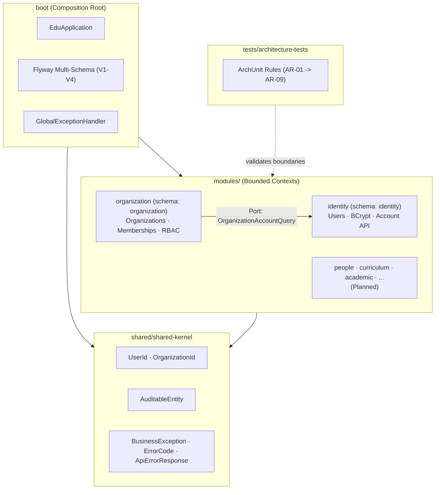

# E-Edu — Backend Service

> A Modular Monolith educational management platform built with Java 21, Spring Boot 3.4, and PostgreSQL Multi-Schema.

[](https://openjdk.org/projects/jdk/21/)
[](https://spring.io/projects/spring-boot)
[](https://www.postgresql.org/)
[](https://flywaydb.org/)
[](https://www.archunit.org/)

---

## 1. Kiến trúc Tổng quan (Architecture Overview)

Backend E-Edu được xây dựng theo phong cách **Modular Monolith** kết hợp nguyên lý **Domain-Driven Design (DDD)** và **Clean/Hexagonal Architecture**:

- **Độc lập ranh giới (Bounded Contexts)**: Mỗi module nghiệp vụ sở hữu ranh giới domain riêng và ánh xạ trực tiếp đến một database schema riêng biệt trong PostgreSQL.
- **Không Foreign Key xuyên schema (No Cross-Schema Physical FK)**: Liên kết giữa các module dựa trên Logical Identifier (`UUID` / Value Objects) và được xác thực qua **Public Ports/Facades**.
- **Giao tiếp lỏng (Loose Coupling)**: Các module giao tiếp với nhau bằng Java interfaces công khai (ports) hoặc Spring Application Events (`DomainEvent`), tuyệt đối không import trực tiếp JPA Entity hay Repository của module khác.
- **Kiểm soát kiến trúc tự động (ArchUnit Enforcement)**: 9 quy tắc kiểm tra ràng buộc module được thực thi tự động trong quá trình Maven build.



---

## 2. Cấu trúc Module & Thư mục (Directory Structure)

Hệ thống được tổ chức thành dự án Maven Multi-Module (`com.edu:parent`):

```text
backend/
├── pom.xml                               # Root parent POM (quản lý dependency & plugins)
├── boot/                                 # Ứng dụng Spring Boot chính & Flyway migrations
│   └── src/main/
│       ├── java/com/edu/boot/            # EduApplication, Exception handlers, Web config
│       └── resources/
│           ├── application.yml           # Profile cấu hình (local, test, prod)
│           └── db/migration/             # V1..V4 SQL migration scripts
├── shared/
│   └── shared-kernel/                    # Nền tảng dùng chung (Domain primitives, Exceptions)
├── modules/                              # 12 business modules độc lập
│   ├── identity/                         # Tài khoản, định danh, mã hóa BCrypt
│   ├── organization/                     # Tổ chức, thành viên, đa người thuê (Multi-Tenancy)
│   ├── people/                           # Hồ sơ sinh viên, giảng viên (Planned)
│   ├── curriculum/                       # Chương trình khung, học phần, môn học (Planned)
│   ├── academic/                         # Năm học, học kỳ, lớp biên chế, lớp học phần (Planned)
│   ├── enrollment/                       # Đăng ký môn học, ghi danh (Planned)
│   ├── teaching/                         # Phân công giảng dạy, thời khóa biểu (Planned)
│   ├── attendance/                       # Điểm danh, chuyên cần (Planned)
│   ├── assessment/                       # Điểm số, bảng điểm, đánh giá (Planned)
│   ├── rule-engine/                      # Động cơ thẩm định quy chế, điều kiện tiên quyết (Planned)
│   ├── configuration/                    # Cấu hình tham số hệ thống theo tenant (Planned)
│   └── certification/                    # Xét điều kiện tốt nghiệp, chứng chỉ (Planned)
├── tests/
│   └── architecture-tests/               # Kiểm tra quy tắc kiến trúc bằng ArchUnit 1.4.1
└── docs-be/                              # Toàn bộ tài liệu kiến trúc & đặc tả kỹ thuật
```

---

## 3. Tiến độ Triển khai theo Phase (Roadmap & Status)

| Phase | Trọng tâm | Trạng thái | Tài liệu đặc tả |
| :---: | :--- | :---: | :--- |
| **Phase 1** | Kiến trúc tổng quan, Bounded Contexts, Naming, ADRs | ✅ Hoàn thành | [phase-1/](docs-be/phase-1/README.md) ([1.1](docs-be/phase-1/phase1.1.md) – [1.8](docs-be/phase-1/phase1.8.md)) |
| **Phase 2.1** | Maven Multi-Module Scaffold (19 modules) | ✅ Hoàn thành | [phase2.1.md](docs-be/phase-2/phase2.1.md) |
| **Phase 2.2** | Cấu hình Java 21, Spring Boot 3.4.3 & Profiles | ✅ Hoàn thành | [phase2.2.md](docs-be/phase-2/phase2.2.md) |
| **Phase 2.3** | Docker Compose PostgreSQL & Flyway Multi-Schema | ✅ Hoàn thành | [phase2.3.md](docs-be/phase-2/phase2.3.md) |
| **Phase 2.4** | Shared Kernel, Strongly Typed IDs, Error Handling | ✅ Hoàn thành | [phase2.4.md](docs-be/phase-2/phase2.4.md) |
| **Phase 2.5** | Core `identity` & `organization`, Public Ports, ArchUnit | ✅ Hoàn thành | [phase2.5/](docs-be/phase-2/phase2.5/README.md) |
| **Phase 2.6** | Spring Security 6 stateless filter & JWT Token flow | 🚧 Tiếp theo | [phase2.6/](docs-be/phase-2/phase2.6/README.md) |
| **Phase 3+** | Education Core (`people`, `curriculum`, `academic`, ...) | ⏳ Kế hoạch | [MVP-SCOPE-AND-USER-ROLES.md](docs-be/MVP-SCOPE-AND-USER-ROLES.md) |

---

## 4. Các REST API đã triển khai (Implemented Endpoints)

### Identity Module (`/api/v1/identity`)

| Method | Endpoint | Mô tả | Request Body / Params | Phản hồi |
| :---: | :--- | :--- | :--- | :---: |
| `POST` | `/api/v1/identity/accounts` | Đăng ký tài khoản người dùng mới (mã hóa mật khẩu BCrypt) | `RegisterAccountRequest` (`username`, `email`, `password`) | `201 Created` (`AccountView`) |
| `GET` | `/api/v1/identity/accounts/{id}` | Lấy thông tin tài khoản theo ID | Path param: `UUID id` | `200 OK` (`AccountView`) |

### Organization Module (`/api/v1/organizations`)

| Method | Endpoint | Mô tả | Request Body / Params | Phản hồi |
| :---: | :--- | :--- | :--- | :---: |
| `POST` | `/api/v1/organizations` | Tạo mới một tổ chức/cơ sở giáo dục | `CreateOrganizationRequest` (`code`, `name`) | `201 Created` (`OrganizationView`) |
| `GET` | `/api/v1/organizations/{organizationId}` | Xem chi tiết thông tin tổ chức | Path param: `UUID organizationId` | `200 OK` (`OrganizationView`) |
| `POST` | `/api/v1/organizations/{organizationId}/memberships` | Mời / Thêm thành viên vào tổ chức | `AddMembershipRequest` (`userId`, `role`) | `201 Created` (`MembershipView`) |
| `GET` | `/api/v1/organizations/{organizationId}/memberships` | Danh sách thành viên của tổ chức | Path param: `UUID organizationId` | `200 OK` (`List<MembershipView>`) |
| `PATCH` | `/api/v1/organizations/{organizationId}/memberships/{membershipId}/status` | Cập nhật trạng thái thành viên (`ACTIVE`, `SUSPENDED`) | `UpdateMembershipStatusRequest` (`status`) | `200 OK` (`MembershipView`) |

---

## 5. Quy tắc Kiểm soát Kiến trúc (ArchUnit Rules)

Module `tests/architecture-tests` thực thi 9 quy tắc kiểm tra tự động:

1. **AR-01 (`NoCyclicDependenciesBetweenModules`)**: Không có chu trình phụ thuộc vòng giữa các module.
2. **AR-02 (`SharedKernelDoesNotDependOnBusinessModules`)**: `shared-kernel` không được phụ thuộc vào bất kỳ business module nào.
3. **AR-03 (`ModulesDoNotDependOnBootInternal`)**: Các business module không phụ thuộc vào `boot`.
4. **AR-04 (`InternalPackagesNotDirectlyAccessed`)**: Các class trong package `..internal..` không được truy cập từ bên ngoài module.
5. **AR-05 (`DomainEventsMustBeRecords`)**: Mọi domain event phải được định nghĩa bằng Java `record` bất biến.
6. **AR-06 (`ExceptionsMustExtendBusinessException`)**: Mọi exception nghiệp vụ tùy chỉnh phải kế thừa từ `BusinessException`.
7. **AR-07 (`NoCrossSchemaDirectEntityAccess`)**: `organization` không được phụ thuộc vào entity/repository của `identity`.
8. **AR-08 (`PublicPortDependencyOnly`)**: Giao tiếp liên module phải thông qua public ports (`com.edu.organization.application.port..`).
9. **AR-09 (`NoPasswordLeakageInDTOs`)**: DTO trong `identity` tuyệt đối không chứa trường `passwordHash` hoặc `rawPassword`.

---

## 6. Hướng dẫn Khởi chạy & Kiểm thử (Getting Started)

### Yêu cầu môi trường

- **Java**: OpenJDK 21 LTS trở lên.
- **Maven**: 3.9 trở lên.
- **Docker & Docker Compose**: Để chạy PostgreSQL container.

### Bước 1: Khởi động Database

```powershell
# Chuyển vào thư mục infrastructure
cd infrastructure
docker-compose up -d

# Xác nhận edu-postgres đang chạy ở cổng 5432
docker ps
```

### Bước 2: Build & Kiểm tra toàn bộ Reactor (19 modules)

```powershell
cd ../backend
mvn clean verify
```

Lệnh này sẽ biên dịch toàn bộ source code, chạy unit tests, mock WebMvc slice tests và toàn bộ 9 bộ quy tắc ArchUnit.

### Bước 3: Chạy ứng dụng Spring Boot

```powershell
mvn -pl boot -am spring-boot:run
```

Ứng dụng sẽ tự động áp dụng các Flyway migration (`V1`, `V2`, `V3`, `V4`) và lắng nghe tại cổng `http://localhost:8080`.

---

## 7. Tài liệu Tham khảo (Documentation Index)

Toàn bộ tài liệu chi tiết nằm tại thư mục [`docs-be/`](docs-be/):

- [MVP Scope & User Roles](docs-be/MVP-SCOPE-AND-USER-ROLES.md): Phạm vi tính năng, nhóm người dùng, quyền hạn.
- [Backend Roadmap](docs-be/backend-roadmap.md): Lộ trình chi tiết từng phase và checklist tiến độ.
- [Phase 1 Index](docs-be/phase-1/README.md): Toàn bộ tài liệu kiến trúc nền tảng Phase 1.
  - [Phase 1.1 — Domain Model](docs-be/phase-1/phase1.1.md): Sơ đồ thực thể và quan hệ nghiệp vụ tổng thể.
  - [Phase 1.2 — Module Boundaries](docs-be/phase-1/phase1.2.md): Bounded context và ma trận giao tiếp liên module.
  - [Phase 1.3 — ADRs](docs-be/phase-1/phase1.3.md): Bảng ghi nhận các quyết định kiến trúc cốt lõi.
  - [Phase 1.4 — Module Structure](docs-be/phase-1/phase1.4.md): Cấu trúc tầng nội bộ (Clean Architecture).
  - [Phase 1.5 — Persistence Design](docs-be/phase-1/phase1.5.md): Quy chuẩn lưu trữ và phân vùng multi-schema.
  - [Phase 1.6 — API Contracts](docs-be/phase-1/phase1.6.md): Chuẩn thiết kế REST API, mã lỗi và events.
  - [Phase 1.7 — Security Architecture](docs-be/phase-1/phase1.7.md): Mô hình xác thực, phân quyền RBAC và tenant isolation.
  - [Phase 1.8 — Bootstrap & Observability](docs-be/phase-1/phase1.8.md): Quản lý profile cấu hình, logging và giám sát.
- [Phase 2 Index](docs-be/phase-2/README.md): Toàn bộ tài liệu hạ tầng và core domain Phase 2.
  - [Phase 2.1 — Maven Multi-Module](docs-be/phase-2/phase2.1.md): Thiết lập khung dự án 19 modules.
  - [Phase 2.2 — Spring Boot & Profiles](docs-be/phase-2/phase2.2.md): Cấu hình runtime và application profiles.
  - [Phase 2.3 — Multi-Schema & Flyway](docs-be/phase-2/phase2.3.md): Docker Compose và Flyway multi-schema.
  - [Phase 2.4 — Shared Kernel](docs-be/phase-2/phase2.4.md): Domain primitives, base entity và exception handling.
  - [Phase 2.5 — Identity & Organization Core](docs-be/phase-2/phase2.5/README.md): Entities, Services, REST APIs, Public Ports và ArchUnit.
  - [Phase 2.6 — Security & JWT Management](docs-be/phase-2/phase2.6/README.md): Stateless filter chain, JWT, Refresh Token & RBAC.
