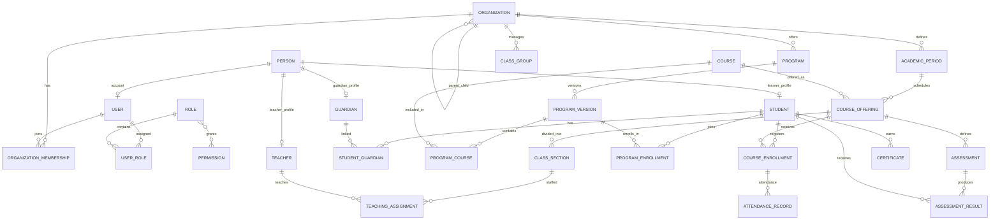

# E-Edu — Phase 1.1: Domain Model & Entity Relationships

Mục tiêu của giai đoạn này là thiết kế mô hình dữ liệu cốt lõi cho E-Edu theo kiến trúc Modular Monolith, Java 21, Spring Boot và PostgreSQL, đồng thời không khóa hệ thống vào riêng giáo dục phổ thông.

**Nguyên tắc thiết kế quan trọng nhất:**
> Mô hình hóa những khái niệm giáo dục dùng chung thành các entity rõ ràng; những khác biệt giữa các chương trình giáo dục được biểu diễn bằng cấu hình và quy tắc nghiệp vụ riêng.

Ta sẽ chưa vội viết Java Entity hoặc tạo database migration. Trước tiên cần xác định đúng domain, quan hệ và quyền sở hữu dữ liệu để tránh phải tái cấu trúc khi E-Edu mở rộng.

---

## 1. Phạm vi Domain Model
Chia domain thành 8 nhóm nghiệp vụ chính:

- **Identity & Access**: Users, Roles, Permissions
- **Organization**: Organizations, Units, Campuses
- **People**: Students, Teachers, Guardians
- **Curriculum**: Programs, Courses, Requirements
- **Academic Structure**: Periods, Classes, Sections
- **Learning & Assessment**: Enrollments, Attendance, Grades
- **Completion**: Achievements, Certificates
- **Configuration**: Assessment schemes, Rules

> Đây là các nhóm nghiệp vụ. Một nhóm có thể chứa nhiều entity và được tổ chức thành một hoặc nhiều module kỹ thuật tùy theo dependency graph cuối cùng.

---

## 2. Mô hình tổng quát: Organization → Program → Learning

E-Edu cần phân biệt ba khái niệm thường bị nhầm lẫn:
- **Organization**: Tổ chức sở hữu và vận hành hoạt động giáo dục, chẳng hạn một trường hoặc trung tâm.
- **Program**: Chương trình đào tạo, chẳng hạn chương trình THPT, chương trình cử nhân hoặc lộ trình tiếng Anh.
- **Course**: Đơn vị học tập thuộc một chương trình hoặc được cung cấp độc lập, tùy cấu hình.

```
Organization (Trường học, đại học, trung tâm)
      │
      ▼
Program (Curriculum, learning outcomes, completion rules)
      │
      ▼
ProgramCourse (Course + thứ tự + yêu cầu + số tín chỉ hoặc thời lượng)
      │
      ▼
Course Offering (Một lần tổ chức dạy học cụ thể trong một khoảng thời gian)
```

- **ProgramCourse** là entity liên kết, không chỉ là một collection đơn giản: cùng một Course có thể xuất hiện trong nhiều chương trình với số tín chỉ, thứ tự hoặc điều kiện hoàn thành khác nhau.
- **CourseOffering** biểu diễn lần triển khai cụ thể của một khóa học hoặc môn học. Nó có thể được phân thành nhiều **ClassSection** để tổ chức người học, giảng viên và lịch học.
- Cách phân biệt này giúp hỗ trợ cả lớp cố định ở phổ thông lẫn đăng ký học phần ở đại học.

---

## 3. Danh sách entity cốt lõi

### 3.1. Identity & Organization

| Entity | Trách nhiệm | Quan hệ chính |
| :--- | :--- | :--- |
| `User` | Tài khoản đăng nhập | Có thể liên kết với nhiều hồ sơ |
| `Role` | Nhóm quyền | Được gán cho user theo phạm vi |
| `Permission` | Quyền thực hiện hành động | Được nhóm trong role |
| `UserRole` | Liên kết user và role | Có thể giới hạn theo tổ chức |
| `Organization` | Đơn vị vận hành giáo dục | Có thể có đơn vị con |
| `OrganizationMembership` | Quan hệ giữa người dùng và tổ chức | Xác định vai trò, trạng thái thành viên |
| `OrganizationalUnit` | Khoa, phòng ban, bộ môn | Thuộc một tổ chức hoặc đơn vị cha |

> **Lưu ý:** `User` không đồng nghĩa với `Student` hoặc `Teacher`. Một người có thể vừa là giáo viên vừa là học viên ở các chương trình khác nhau. Hồ sơ nghiệp vụ và tài khoản cần được tách biệt.

### 3.2. People

| Entity | Trách nhiệm |
| :--- | :--- |
| `Person` | Thông tin định danh cơ bản của một người |
| `Student` | Hồ sơ người học |
| `Teacher` | Hồ sơ người giảng dạy |
| `Guardian` | Hồ sơ người giám hộ |
| `StudentGuardian` | Quan hệ giữa người học và người giám hộ |

**Mối quan hệ đề xuất:**
- Một `Person` có thể có tài khoản `User` hoặc không.
- Một `Person` có thể có hồ sơ `Student`, `Teacher` hoặc cả hai.
- Một `Student` có thể có nhiều `Guardian`.
- Một `Guardian` có thể liên kết với nhiều `Student`.

*Cách thiết kế này cho phép quản lý người học chưa có tài khoản và giáo viên chưa được cấp quyền đăng nhập.*

### 3.3. Curriculum & Academic Structure

| Entity | Trách nhiệm |
| :--- | :--- |
| `Program` | Chương trình đào tạo |
| `ProgramVersion` | Phiên bản chương trình theo thời gian |
| `Course` | Đơn vị học tập |
| `ProgramCourse` | Course thuộc một phiên bản chương trình |
| `AcademicPeriod` | Khoảng thời gian học tập |
| `ClassGroup` | Lớp hoặc nhóm học ổn định |
| `CourseOffering` | Lần tổ chức giảng dạy cụ thể |
| `ClassSection` | Nhóm lớp cụ thể trong một offering |
| `Room` | Phòng học hoặc không gian học tập |
| `TeachingAssignment` | Phân công người dạy cho lớp/nhóm học |

Vì "Class" trong giáo dục có nhiều nghĩa, sử dụng các tên cụ thể:
- `ClassGroup`: lớp chủ nhiệm hoặc nhóm học ổn định.
- `ClassSection`: nhóm học được mở cho một CourseOffering.
- `Room`: phòng học vật lý hoặc không gian được quản lý.

### 3.4. Enrollment & Learning

| Entity | Trách nhiệm |
| :--- | :--- |
| `ProgramEnrollment` | Người học tham gia chương trình |
| `CourseEnrollment` | Người học đăng ký một khóa học |
| `AttendanceRecord` | Ghi nhận chuyên cần |
| `Assessment` | Bài kiểm tra hoặc hoạt động đánh giá |
| `AssessmentScheme` | Cấu hình cách đánh giá |
| `AssessmentResult` | Kết quả đánh giá của người học |
| `Certificate` | Chứng chỉ hoặc văn bằng được cấp |

- `ProgramEnrollment` và `CourseEnrollment` cần tách riêng: một người có thể được ghi danh vào chương trình dài hạn rồi đăng ký nhiều khóa học trong quá trình học.
- Không thiết kế Grade là một trường số đơn giản trong bảng Student: Điểm số phải gắn với hoạt động đánh giá, người học, thang điểm và ngữ cảnh học tập.

---

## 4. Sơ đồ quan hệ entity — ERD mức khái niệm



---

## 5. Thiết kế Grade và Assessment để hỗ trợ nhiều chương trình

Cách đánh giá giữa các mô hình giáo dục rất khác nhau:
- **THPT**: Điểm thường xuyên, giữa kỳ, cuối kỳ.
- **Đại học**: Điểm thành phần, điểm thi, điểm tổng kết, tín chỉ.
- **Trung tâm ngoại ngữ**: Điểm nghe, nói, đọc, viết hoặc đánh giá theo cấp độ.
- **Đào tạo nghề**: Đánh giá lý thuyết, thực hành và năng lực đầu ra.

**Mô hình cấu hình:**
- `AssessmentScheme`: Cấu hình thang điểm và phương pháp đánh giá.
- `Assessment`: Một bài thi, bài kiểm tra hoặc hoạt động đánh giá.
- `AssessmentResult`: Kết quả của một người học (`score`, `maxScore`, `gradeValue`, `gradeType`).
- `Completion Rules`: Quyết định đạt, chưa đạt hoặc hoàn thành chương trình.

---

## 6. Các quyết định database cần chốt

| Vấn đề | Đề xuất ban đầu |
| :--- | :--- |
| **Primary key** | UUID |
| **Database** | PostgreSQL |
| **Table naming** | `snake_case`, số nhiều |
| **Java entity** | `PascalCase`, số ít |
| **Audit fields** | `created_at`, `updated_at` |
| **Soft delete** | Chỉ áp dụng khi có yêu cầu nghiệp vụ rõ ràng |
| **Tenant isolation** | Kiểm tra quyền truy cập theo tổ chức ở phía server |
| **Database migrations**| Flyway, không tự động cập nhật schema trong production |
| **Entity relationships**| Không tạo quan hệ JPA chỉ vì hai bảng có liên quan; cân nhắc ranh giới module |
| **Configuration** | Có kiểu dữ liệu và validation, không cho phép cấu hình tùy ý không kiểm soát |

### Multi-tenancy: Lưu ý quan trọng
- Không phải mọi bảng đều cần `organization_id`, nhưng mọi dữ liệu thuộc phạm vi một tổ chức phải có cách xác định quyền sở hữu và truy cập.
- Một người có thể tham gia nhiều tổ chức, vì vậy không nên mặc định `User` chỉ thuộc duy nhất một tổ chức.

---

## 7. Ánh xạ Domain Model vào Modular Monolith

| Module | Entity chính |
| :--- | :--- |
| `identity` | User, Role, Permission, UserRole |
| `organization` | Organization, OrganizationMembership, OrganizationalUnit |
| `people` | Person, Student, Teacher, Guardian |
| `curriculum` | Program, ProgramVersion, Course, ProgramCourse |
| `academic` | AcademicPeriod, ClassGroup, CourseOffering, ClassSection, Room |
| `enrollment` | ProgramEnrollment, CourseEnrollment |
| `teaching` | TeachingAssignment |
| `attendance` | AttendanceRecord |
| `assessment` | AssessmentScheme, Assessment, AssessmentResult |
| `certification` | Certificate |

---

## 8. Tiêu chí hoàn thành Phase 1.1

**Domain Model checklist (6/6)**

- [x] Phân biệt được Organization, Program, Course và CourseOffering
- [x] Phân biệt được User, Person, Student và Teacher
- [x] Mô hình hóa được ghi danh chương trình và đăng ký khóa học riêng biệt
- [x] Hỗ trợ nhiều cấu trúc đào tạo và phương pháp đánh giá
- [x] Xác định quyền sở hữu dữ liệu và tenant isolation
- [x] Xác định module sở hữu từng entity và các dependency được phép

---

### Bước tiếp theo: Phase 1.2 — Module Boundaries & Dependency Rules
Sau khi thống nhất Domain Model, bước tiếp theo:
1. Module nào được phép gọi module nào.
2. Module nào sở hữu từng bảng và repository.
3. Các module giao tiếp bằng public interface, application service hay domain event.
4. Cấu trúc Maven multi-module tương ứng với dependency graph.
5. Những quy tắc cần kiểm thử tự động để ngăn kiến trúc bị phá vỡ.
