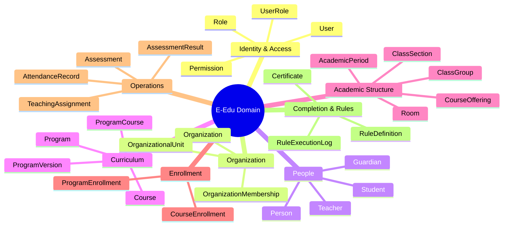

# Phase 1.1 — Thành phần 01: Domain Scope & Entities

Tài liệu này xác định phạm vi 8 nhóm nghiệp vụ chủ chốt của E-Edu và danh mục thực thể tương ứng, làm nền tảng cho việc phân chia Bounded Contexts.

---

## 1. Tám Nhóm Nghiệp vụ Cốt lõi

### 1.1. Identity & Access
Chịu trách nhiệm về định danh tài khoản, chứng thực mật khẩu và ủy quyền hệ thống:
- **`User`**: Tài khoản đăng nhập, chứa email, username, mật khẩu mã hóa BCrypt, trạng thái kích hoạt.
- **`Role`**: Nhóm các quyền hạn (`Platform Admin`, `Tenant Admin`, `Instructor`, `Learner`).
- **`Permission`**: Quyền nguyên tử xác định hành động cho phép (`user:create`, `course:publish`, `grade:submit`).
- **`UserRole`**: Liên kết tài khoản với vai trò trong ngữ cảnh tương ứng.

### 1.2. Organization
Mô hình hóa pháp nhân giáo dục và cơ cấu tổ chức:
- **`Organization`**: Trường học, học viện, trung tâm hoặc doanh nghiệp sở hữu hoạt động giáo dục.
- **`OrganizationalUnit`**: Khoa, phòng ban, bộ môn hoặc chi nhánh trực thuộc.
- **`OrganizationMembership`**: Quan hệ ràng buộc giữa tài khoản người dùng và tổ chức, quy định trạng thái thành viên.

### 1.3. People
Hồ sơ thực tế của con người, hoàn toàn tách biệt khỏi tài khoản hệ thống:
- **`Person`**: Thông tin nhân khẩu học (họ tên, ngày sinh, giới tính, CCCD/CMND, liên hệ).
- **`Student`**: Hồ sơ người học (mã số học viên/sinh viên, ngày nhập học, trạng thái học tập).
- **`Teacher`**: Hồ sơ người giảng dạy (mã giảng viên, học vị, chuyên ngành, trạng thái công tác).
- **`Guardian`**: Hồ sơ người giám hộ/phụ huynh.
- **`StudentGuardian`**: Mối quan hệ giữa người học và người giám hộ (cha, mẹ, người bảo hộ).

### 1.4. Curriculum
Đặc tả khung chương trình đào tạo chuẩn và các học phần:
- **`Program`**: Chương trình đào tạo tổng quát (ví dụ: "Cử nhân Công nghệ Thông tin", "Luyện thi IELTS 6.5+").
- **`ProgramVersion`**: Phiên bản chương trình theo thời gian/khóa tuyển sinh (áp dụng quy định tín chỉ/môn học theo năm).
- **`Course`**: Đơn vị học tập/môn học (Toán cao cấp, Nhập môn Lập trình, IELTS Reading).
- **`ProgramCourse`**: Thực thể liên kết xác định vị trí môn học trong phiên bản chương trình, số tín chỉ, môn tiên quyết.

### 1.5. Academic Structure
Không gian và thời gian triển khai giảng dạy:
- **`AcademicPeriod`**: Năm học, học kỳ, quý học hoặc đợt đào tạo.
- **`ClassGroup`**: Lớp niên chế / lớp sinh hoạt ổn định (ví dụ: Lớp 12A1, Khóa K21-CNTT).
- **`CourseOffering`**: Một lần tổ chức giảng dạy cụ thể của Course trong một AcademicPeriod.
- **`ClassSection`**: Lớp học phần cụ thể được chia từ CourseOffering để sắp xếp lịch trình và sĩ số.
- **`Room`**: Phòng học vật lý hoặc phòng học trực tuyến.

### 1.6. Enrollment & Learning
Ghi danh và theo dõi tiến trình học tập:
- **`ProgramEnrollment`**: Quyết định tiếp nhận người học vào một chương trình đào tạo dài hạn.
- **`CourseEnrollment`**: Đăng ký của người học vào một CourseOffering/ClassSection cụ thể.

### 1.7. Academic Operations
Hoạt động diễn ra trong quá trình dạy và học:
- **`TeachingAssignment`**: Phân công giảng viên cho từng ClassSection.
- **`AttendanceRecord`**: Ghi nhận chuyên cần từng buổi học (Có mặt, Đi trễ, Vắng có phép, Vắng không phép).
- **`Assessment`**: Hoạt động kiểm tra, đánh giá (Bài tập, Quiz, Giữa kỳ, Cuối kỳ, Báo cáo đồ án).
- **`AssessmentScheme`**: Cấu hình cơ cấu điểm và tỷ trọng của môn học.
- **`AssessmentResult`**: Điểm số cụ thể của từng học viên trên từng bài đánh giá.

### 1.8. Completion & Rule Engine
Điều kiện công nhận và thẩm định kết quả:
- **`Certificate`**: Chứng chỉ, chứng nhận hoặc văn bằng được cấp khi đạt chuẩn đầu ra.
- **`RuleDefinition`**: Đặc tả biểu thức quy tắc xét duyệt điều kiện tiên quyết, chuyên cần hoặc tốt nghiệp.
- **`RuleExecutionLog`**: Nhật ký lưu vết việc chạy quy tắc thẩm định.
