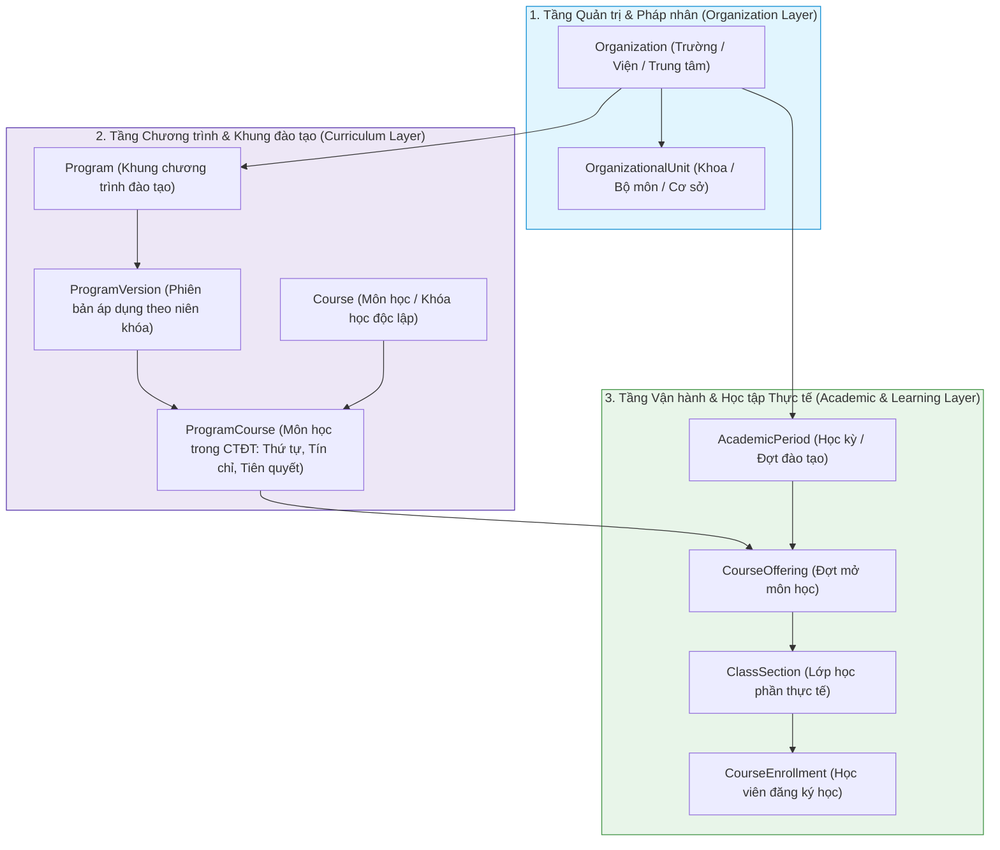

# Phase 1.1 — Thành phần 02: Mô hình Tổng quát Organization → Program → Learning

Tài liệu này phân tích kiến trúc phân tầng 3 cấp độ: **Organization**, **Program** và **Learning**, giải quyết bài toán cốt lõi giúp hệ thống E-Edu hỗ trợ cả mô hình lớp học niên chế (K-12) lẫn đăng ký học phần tín chỉ (Đại học, Cao đẳng, Trung tâm).

---

## 1. Sự Khác biệt giữa Ba Khái niệm Cốt lõi

---

## 2. Chi tiết Từng Tầng Khái niệm

### 2.1. Tầng 1: Organization (Pháp nhân và Đơn vị Vận hành)
- Một **`Organization`** là một tenant độc lập về dữ liệu và quyền điều hành.
- Có thể phân nhánh thành các **`OrganizationalUnit`** cấp con (ví dụ: Trường ĐH Bách Khoa $\to$ Khoa Công nghệ Thông tin $\to$ Bộ môn Kỹ thuật Phần mềm).
- Người học và giảng viên có thể thuộc một hoặc nhiều tổ chức khác nhau với vai trò riêng biệt.

### 2.2. Tầng 2: Program & Curriculum (Chương trình đào tạo)
- **`Program`** là định nghĩa trừu tượng về mục tiêu đào tạo.
- **`ProgramVersion`**: Cho phép một chương trình biến đổi theo thời gian mà không làm ảnh hưởng đến học viên khóa cũ.
  - Ví dụ: Khóa 2023 học theo Version 1 (130 tín chỉ); Khóa 2024 học theo Version 2 (125 tín chỉ).
- **`ProgramCourse`**: Đóng vai trò là thực thể liên kết giàu nghiệp vụ (Rich Association Entity). Cùng một môn học `CS101 - Nhập môn Lập trình`:
  - Trong Chương trình CNTT: Bắt buộc, 4 tín chỉ, học ở Kỳ 1.
  - Trong Chương trình Quản trị Kinh doanh: Tự chọn, 2 tín chỉ, học ở Kỳ 3.

### 2.3. Tầng 3: CourseOffering & ClassSection (Đợt triển khai thực tế)
- **`CourseOffering`**: Một lần tổ chức giảng dạy môn học trong một thời gian cụ thể (`AcademicPeriod`).
  - Ví dụ: Học kỳ 1 năm học 2026-2027 mở môn `CS101`.
- **`ClassSection`**: Nhóm lớp chia nhỏ từ `CourseOffering` để phân ca học, xếp phòng và chỉ định giảng viên.
  - Ví dụ: Môn `CS101` có 3 lớp học phần: Lớp 01 (Thứ 2, Tiết 1-3, GV Tuấn), Lớp 02 (Thứ 4, Tiết 7-9, GV Lan).
- **`ClassGroup`** (Lớp niên chế):
  - Ở trường THPT hoặc năm đầu đại học, học sinh được gom vào một `ClassGroup` (ví dụ: Lớp 10A1). Hệ thống có thể tự động ghi danh toàn bộ thành viên của `ClassGroup` vào các `ClassSection` tương ứng của học kỳ.

---

## 3. Giá trị Thiết kế Đạt được

1. **Tính tổng quát cao**: Mô hình hóa được cả hình thức đào tạo tín chỉ linh hoạt (sinh viên tự đăng ký môn học và lớp học phần) lẫn đào tạo niên chế cố định (nhà trường gán toàn bộ lớp học phần cho một tập thể học sinh).
2. **Bảo toàn lịch sử đào tạo**: Việc thay đổi môn học trong chương trình mới không làm sai lệch học bạ hay chứng nhận của học viên thuộc các khóa học trước đó.
3. **Phân quyền và tài nguyên rõ ràng**: Giảng viên được phân công theo `ClassSection`, phòng học được đặt theo lịch trình của `ClassSection`, điểm số được tính theo `CourseOffering`.
