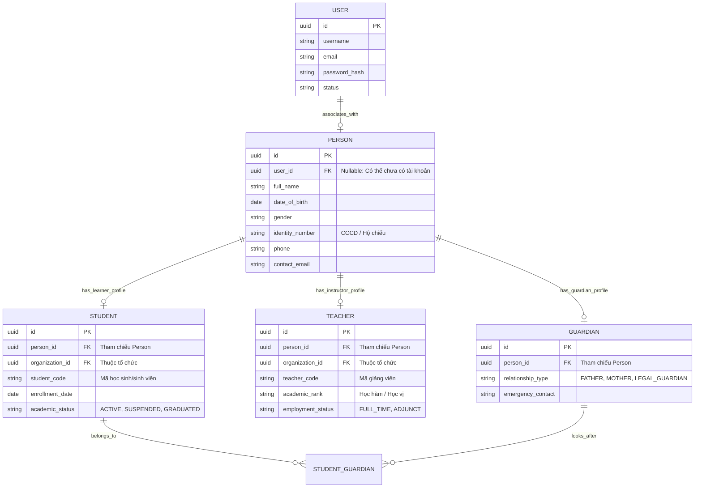

# Phase 1.1 — Thành phần 03: Phân Tách People & Identity

Tài liệu này giải thích chi tiết nguyên tắc phân tách giữa **Identity (Tài khoản & Xác thực)**, **Person (Hồ sơ Con người)** và các **Vai trò Nghiệp vụ (Student, Teacher, Guardian)**.

---

## 1. Vấn đề của Cách Tiếp cận Truyền thống

Nhiều hệ thống giáo dục gộp chung bảng `users` với thông tin học sinh hoặc giáo viên (ví dụ bảng `users` chứa cả `student_code`, `major`, `gpa`, `salary`...). Cách làm này gây ra các bất cập nghiêm trọng:
1. **Một người có nhiều vai trò**: Một trợ giảng vừa là người dạy môn này (`Teacher`), vừa là học viên cao học môn khác (`Student`).
2. **Đối tượng chưa có tài khoản**: Học sinh tiểu học, mầm non hoặc phụ huynh có thể chưa cần hoặc chưa được cấp tài khoản đăng nhập hệ thống, nhưng nhà trường vẫn cần lưu hồ sơ nhân khẩu và điểm số.
3. **Một tài khoản tham gia nhiều tổ chức**: Một giáo viên có thể dạy ở Trung tâm A vào buổi tối và thỉnh giảng ở Trường B vào ban ngày.

---

## 2. Mô hình Thiết kế Chuẩn Hóa của E-Edu

---

## 3. Các Quy Tắc Nghiệp Vụ Bắt Buộc

1. **Tính Độc Lập của Tài khoản (`User`)**:
   - `User` chỉ thuộc về module `identity`. Trách nhiệm duy nhất: Lưu trữ thông tin đăng nhập, xác thực credentials, mã hóa mật khẩu và tạo token.
   - `User` không biết về nghiệp vụ đào tạo, tín chỉ hay môn học.

2. **Hồ sơ Con Người (`Person`)**:
   - Thuộc về module `people`. Quản lý thông tin định danh cá nhân độc lập với hệ thống CNTT.
   - Trường `user_id` trong `Person` là **Nullable**: Cho phép tạo hồ sơ học sinh, trẻ em hoặc phụ huynh trước, kích hoạt tài khoản đăng nhập sau.

3. **Hồ sơ Nghiệp vụ Đa Tổ Chức (`Student`, `Teacher`)**:
   - Đều liên kết với `Person` và có cột `organization_id`.
   - Một `Person` có thể có hồ sơ `Student` tại Organization X và hồ sơ `Teacher` tại Organization Y.
   - Việc chuyển trường hoặc tốt nghiệp chỉ cập nhật trạng thái của `Student` trong tổ chức đó, không làm xóa danh tính `Person`.

4. **Mối Quan Hệ Giám Hộ (`StudentGuardian`)**:
   - Hỗ trợ quan hệ nhiều-nhiều ($N-N$): Một phụ huynh có thể giám hộ nhiều con em đang theo học cùng trường hoặc khác trường; một học sinh có thể có cả cha, mẹ và người bảo trợ pháp lý.
