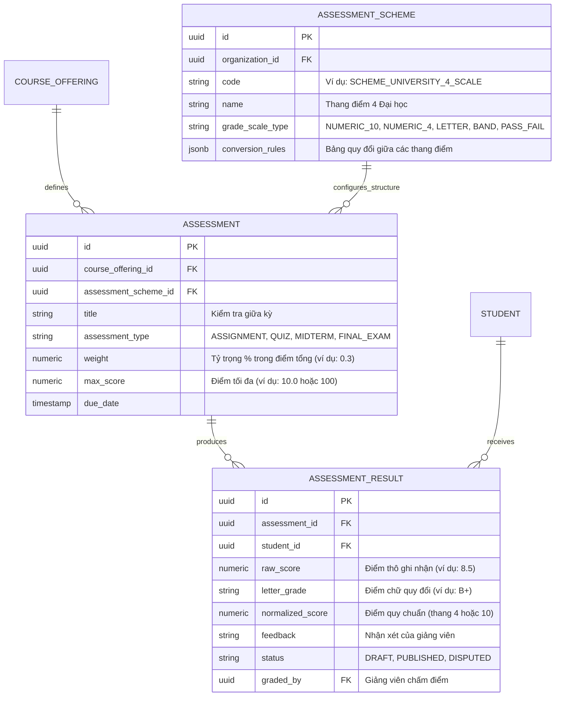

# Phase 1.1 — Thành phần 04: Assessment & Grading Models

Tài liệu này đặc tả mô hình đánh giá và thang điểm hỗ trợ đa dạng phương thức khảo sát kết quả học tập trong các hệ thống giáo dục khác nhau.

---

## 1. Yêu Cầu Thực Tế của Các Mô Hình Giáo Dục

| Mô hình | Phương pháp đánh giá đặc trưng | Thang điểm | Yêu cầu nghiệp vụ |
| :--- | :--- | :---: | :--- |
| **THPT (K-12)** | Điểm thường xuyên, kiểm tra giữa kỳ, thi cuối kỳ | Thang điểm 10 (thập phân) | Tính điểm trung bình môn học kỳ, cả năm; xếp loại học lực (Giỏi, Khá, Đạt). |
| **Đại học** | Điểm chuyên cần (10%), bài tập lớn (20%), thi cuối kỳ (70%) | Thang 10 $\to$ Thang chữ (A, B, C, D, F) $\to$ Thang 4.0 | Tính điểm trung bình tích lũy GPA, số tín chỉ tích lũy, cảnh báo học vụ. |
| **Trung tâm Ngoại ngữ** | Đánh giá 4 kỹ năng: Nghe (Listening), Nói (Speaking), Đọc (Reading), Viết (Writing) | Band điểm (IELTS 1.0 - 9.0) hoặc CEFR (A1, A2, B1, B2, C1, C2) | Đạt chứng chỉ cấp độ hoặc thi lại kỹ năng không đạt. |
| **Đào tạo Nghề** | Đánh giá năng lực thực hành (Competency-Based) | Đạt / Chưa đạt (Pass / Fail) | Bắt buộc đạt 100% tiêu chí an toàn và thao tác thực hành. |

---

## 2. Thiết Kế Thực Thể Đánh Giá Linh Hoạt

Hệ thống không lưu trữ điểm dưới dạng một cột `grade` đơn giản trong bảng người học mà tách thành 4 thực thể có quan hệ chặt chẽ:

---

## 3. Các Nguyên Tắc Xử Lý Dữ Liệu Điểm Số

1. **Độ Chính Xác Thập Phân**:
   - Trong Java: Bắt buộc dùng `java.math.BigDecimal`, tuyệt đối không dùng `double` hoặc `float` để tránh lỗi sai số dấu phẩy động khi tính toán trung bình hoặc trọng số.
   - Trong PostgreSQL: Dùng kiểu dữ liệu `NUMERIC(5, 2)` (ví dụ lưu điểm tối đa `100.00` hoặc `10.00`).

2. **Truy Vết và Khóa Điểm (Audit & Immutability)**:
   - Khi điểm số đã ở trạng thái `PUBLISHED`, mọi thao tác sửa đổi điểm số (phúc khảo, sửa sai sót) bắt buộc phải tạo bản ghi kiểm toán ghi rõ: người sửa, mốc thời gian, lý do sửa và điểm trước khi sửa.

3. **Tách Biệt Đánh Giá và Công Nhận Hoàn Thành**:
   - `AssessmentResult` chỉ ghi nhận điểm của môn học/bài thi.
   - Việc sinh viên có đủ điều kiện tốt nghiệp hoặc nhận bằng cấp hay không do module `certification` và `rule-engine` thẩm định dựa trên toàn bộ kết quả tích lũy.
