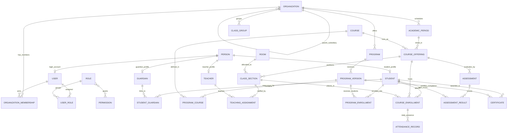

# Phase 1.1 — Thành phần 05: Sơ đồ ERD Mức Khái niệm

Tài liệu này tổng hợp toàn bộ các thực thể cốt lõi trong sơ đồ quan hệ thực thể (ERD) mức khái niệm, thể hiện rõ các ràng buộc then chốt giữa các phân hệ của E-Edu.

---

## 1. Sơ đồ Quan hệ Thực thể Toàn diện (Mermaid ERD)

---

## 2. Quy Tắc Ràng Buộc Quan Hệ

### 2.1. Phân tầng Chương trình và Khóa học
1. **`PROGRAM` $\to$ `PROGRAM_VERSION`**: Quan hệ $1 - N$. Một chương trình có thể có nhiều phiên bản. Học sinh nhập học vào niên khóa nào sẽ gắn với phiên bản của niên khóa đó.
2. **`PROGRAM_VERSION` $\leftrightarrow$ `COURSE` thông qua `PROGRAM_COURSE`**: Quan hệ $N - N$ qua thực thể trung gian. `PROGRAM_COURSE` lưu thêm `credits`, `semester_index`, `is_compulsory`, `prerequisite_course_id`.

### 2.2. Phân công và Lịch trình
1. **`COURSE_OFFERING` $\to$ `CLASS_SECTION`**: Quan hệ $1 - N$. Một môn học mở trong học kỳ có thể tách thành nhiều lớp học phần khác nhau về phòng học và giảng viên phụ trách.
2. **`CLASS_SECTION` $\to$ `TEACHING_ASSIGNMENT` $\leftarrow$ `TEACHER`**: Quan hệ $N - N$ qua thực thể phân công. Hỗ trợ trường hợp một lớp học phần có giảng viên chính (Lecturer) và trợ giảng (Teaching Assistant).

### 2.3. Đăng ký và Đánh giá
1. **`PROGRAM_ENROLLMENT`**: Ghi nhận thời điểm học viên trúng tuyển vào một chương trình đào tạo.
2. **`COURSE_ENROLLMENT`**: Ghi nhận việc đăng ký cụ thể vào một lớp học phần của học kỳ. Một học viên chỉ có tối đa một `COURSE_ENROLLMENT` hợp lệ trên mỗi `COURSE_OFFERING`.
3. **`ASSESSMENT` $\to$ `ASSESSMENT_RESULT` $\leftarrow$ `STUDENT`**: Mỗi kết quả đánh giá phải thuộc về một học viên đã đăng ký học phần tương ứng.
