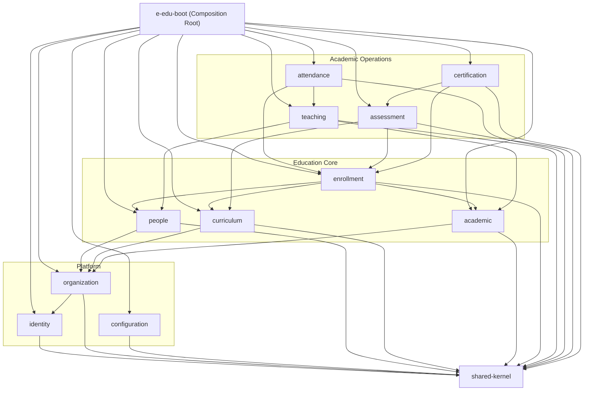

# E-Edu — Phase 1.2: Module Boundaries & Dependency Rules

Mục tiêu của phase này là xác định module nào sở hữu nghiệp vụ nào, module được phép phụ thuộc vào đâu và các module giao tiếp với nhau như thế nào.

Với E-Edu sử dụng **Java 21**, **Spring Boot**, **PostgreSQL** và **Maven**, thiết kế tuân thủ các nguyên tắc:
- **Modular Monolith**: Một ứng dụng có nhiều module nghiệp vụ độc lập.
- **Domain ownership**: Mỗi module chịu trách nhiệm về dữ liệu và quy tắc nghiệp vụ của mình.
- **Explicit dependencies**: Mọi phụ thuộc giữa module đều phải có chủ đích và có hướng.
- **Database consistency**: Dùng chung PostgreSQL nhưng không đồng nghĩa với việc module nào cũng được truy cập mọi bảng.
- **Configurable education**: Quy tắc riêng của THPT, đại học, trường nghề và trung tâm không được làm ô nhiễm domain cốt lõi.

---

## 1. Danh sách module chính thức đề xuất

Hệ thống được chia thành ba nhóm nghiệp vụ chính:

### 1.1. Platform Modules (Nền tảng và quản trị)
- `identity`: Authentication, roles, permissions.
- `organization`: Organizations, organizational units, memberships, campuses.
- `configuration`: Settings, policies, assessment schemes, business rules.

### 1.2. Education Core (Khái niệm dùng chung giữa các mô hình giáo dục)
- `people`: Person, Student, Teacher, Guardian.
- `curriculum`: Program, Course, ProgramVersion, ProgramCourse.
- `academic`: AcademicPeriod, ClassGroup, CourseOffering, ClassSection, Room.
- `enrollment`: ProgramEnrollment, CourseEnrollment.

### 1.3. Academic Operations (Nghiệp vụ diễn ra trong quá trình học tập)
- `teaching`: Teaching assignments, teacher scheduling.
- `attendance`: Attendance records.
- `assessment`: Assessments, results, grading.
- `certification`: Completion records, certificates.

> **Lưu ý:** Đây là 11 module nghiệp vụ đề xuất, cùng với `e-edu-boot` (composition root), `shared-kernel` (kiểu dữ liệu dùng chung tối thiểu) và `architecture-tests`. Mỗi module được triển khai theo thứ tự dependency.

---

## 2. Dependency Graph — Ranh giới & Quy tắc phụ thuộc

Nguyên tắc quan trọng: **Dependency phải có hướng (DAG), tuyệt đối không tạo vòng phụ thuộc (Cyclic Dependency).**



### Quy tắc bất biến:
1. `e-edu-boot` là composition root, có nhiệm vụ lắp ráp các module và cấu hình ứng dụng; không chứa nghiệp vụ.
2. `shared-kernel` phải cực kỳ nhỏ gọn, chỉ chứa các kiểu thực sự dùng chung (Base Entity, Result/Value Objects, Common Exceptions). Không biến nó thành nơi chứa rác.
3. Không cho phép phụ thuộc chéo: `students → courses → grades → students`. Nếu hai module cần tương tác, phải qua Public Application Interface hoặc Domain Events.

---

## 3. Quyền sở hữu dữ liệu (Data Ownership)

Mỗi module toàn quyền quản lý dữ liệu nghiệp vụ của mình. Module khác chỉ được tham chiếu qua Identifier (`UUID`), không dùng JPA Relationship liên module.

| Module | Sở hữu dữ liệu | Không được tự ý quản lý / thay đổi |
| :--- | :--- | :--- |
| `identity` | User, Role, Permission, UserRole | Hồ sơ học tập, thông tin người học |
| `organization` | Organization, OrganizationalUnit, Membership | Tài khoản xác thực |
| `configuration` | Cấu hình thang điểm, chính sách hệ thống | Quy tắc nghiệp vụ cứng của từng module |
| `people` | Person, Student, Teacher, Guardian | Tài khoản đăng nhập (chỉ lưu `userId` tham chiếu) |
| `curriculum` | Program, ProgramVersion, Course, ProgramCourse | Kết quả học tập, điểm số |
| `academic` | AcademicPeriod, ClassGroup, CourseOffering, ClassSection, Room | Hồ sơ người học gốc |
| `enrollment` | ProgramEnrollment, CourseEnrollment | Điểm số và kết quả đánh giá |
| `teaching` | TeachingAssignment | Hồ sơ giáo viên gốc (chỉ lưu `teacherId`) |
| `attendance` | AttendanceRecord | Đăng ký khóa học gốc |
| `assessment` | Assessment, AssessmentResult, AssessmentScheme | Hồ sơ người học gốc |
| `certification` | Certificate, CompletionRecord | Quy tắc chấm điểm gốc |

---

## 4. Phương thức giao tiếp giữa các Module

### A. Public Application Interface (Facade / Service Contract)
- **Mục đích**: Truy vấn đồng bộ dữ liệu giữa các module.
- **Quy tắc**: Module gọi qua public interface (`*PublicService` hoặc `*Api`), dữ liệu trả về là **DTO / Value Object bất biến**, tuyệt đối không trả về JPA Entity nội bộ.

### B. Domain Events (Asynchronous / Decoupled Notification)
- **Mục đích**: Phản ứng theo sự kiện nghiệp vụ (ví dụ: `CourseEnrollmentCompletedEvent` kích hoạt kiểm tra điều kiện tốt nghiệp).
- **Quy tắc**: Ban đầu dùng Spring Application Events (`ApplicationEventPublisher` / `@TransactionalEventListener`). Nếu cần đảm bảo độ tin cậy giao dịch thì bổ sung mẫu Transactional Outbox.

### C. Database Access (Ràng buộc ranh giới DB)
- **Mục đích**: Ngăn chặn cross-module table coupling.
- **Quy tắc**: Mỗi module chỉ quản lý Repository và Entity của chính mình. Tuyệt đối không `@ManyToOne` hay `@JoinTable` qua bảng của module khác; chỉ lưu trường ID tham chiếu (`UUID studentId`).

---

## 5. Cấu trúc Maven Multi-Module

Cấu trúc dự án chính thức:

```
e-edu/
├── pom.xml                               # Root parent POM (Quản lý dependency & plugin versions)
├── e-edu-boot/                           # Composition root (Spring Boot Application runner)
│   ├── pom.xml
│   └── src/main/java/com/eedu/
│       └── EeduApplication.java
│
├── e-edu-shared/
│   └── shared-kernel/                    # Common DTOs, Base Entities, Custom Exceptions
│       └── pom.xml
│
├── e-edu-modules/
│   ├── identity/                         # Auth, JWT, Roles, Permissions
│   ├── organization/                     # Tenants, Campuses, Units
│   ├── configuration/                    # System policies & Assessment schemes
│   ├── people/                           # Person, Student, Teacher, Guardian
│   ├── curriculum/                       # Program, Course, Versions
│   ├── academic/                         # Period, ClassGroup, Offering, Room
│   ├── enrollment/                       # ProgramEnrollment, CourseEnrollment
│   ├── teaching/                         # Teacher assignments
│   ├── attendance/                       # Attendance tracking
│   ├── assessment/                       # Tests, Exams, Grades
│   └── certification/                    # Completion & Certificates
│
└── e-edu-tests/
    └── architecture-tests/               # ArchUnit tests enforcing module boundaries
        └── pom.xml
```

### Cấu trúc package chuẩn bên trong từng module:
```
com.eedu.<module_name>/
├── api/                    # Public API interfaces & DTOs (module khác được phép gọi)
├── internal/               # Package private implementation (nội bộ module)
│   ├── controller/         # Web REST Controllers
│   ├── service/            # Core business logic
│   ├── domain/             # Entities, Aggregate roots, Value objects
│   └── repository/         # Spring Data JPA repositories
```

---

## 6. Cách cưỡng chế kiến trúc (Architecture Enforcement)

Để bảo đảm kiến trúc không bị phá vỡ trong quá trình code:
1. **Maven Dependencies**: Module A không khai báo dependency tới Module B thì trình biên dịch Java sẽ chặn đứng mọi truy cập trái phép.
2. **Java Package Visibility**: Sử dụng package-private cho internal services/entities; chỉ public các class trong package `api/`.
3. **ArchUnit**: Bộ unit test kiến trúc chạy tự động trong CI.
   ```java
   noClasses()
       .that().resideInAPackage("com.eedu.assessment..")
       .should().dependOnClassesThat()
       .resideInAPackage("com.eedu.people.internal..");
   ```
4. **CI/CD Quality Gate**: Chặn pull request nếu vi phạm bất kỳ rule nào của ArchUnit.

---

## 7. Checklist hoàn thành Phase 1.2

**Phase 1.2 — Acceptance checklist (6/6)**

- [x] Chốt danh sách module và trách nhiệm nghiệp vụ
- [x] Chốt module sở hữu từng entity và bảng dữ liệu
- [x] Phê duyệt dependency graph, không có vòng phụ thuộc
- [x] Xác định public interfaces và event contracts
- [x] Chốt cấu trúc Maven multi-module
- [x] Xác định các architecture tests cần chạy trong CI

---

## 8. Quyết định kiến trúc chính thức đã chốt (Phase 1.3 Decisions)

Sau khi đánh giá các phương án, dự án thống nhất các quyết định nền tảng:

| Hạng mục | Quyết định chính thức | Lý do & Ràng buộc triển khai |
| :--- | :--- | :--- |
| **Database Engine** | **PostgreSQL** duy nhất | Cơ sở dữ liệu quan hệ mạnh mẽ, hỗ trợ UUID, JSONB và transaction vững chắc. |
| **Schema Organization**| **Schema được tổ chức rõ ràng** | Tổ chức schema nhất quán, đặt tên bảng số nhiều snake_case. |
| **Multi-Tenancy** | **Shared Database / Shared Schema** | Bắt đầu với mô hình dùng chung có kiểm soát chặt chẽ ở tầng server-side (tenant filter / context), chỉ áp dụng khi yêu cầu cách ly, bảo mật và vận hành cho phép; sẵn sàng phương án nâng cấp khi có yêu cầu nghiêm ngặt hơn. |
| **Module Enforcement** | **Maven Multi-Module + ArchUnit** | Cưỡng chế ranh giới ở cả mức build-time (Maven pom) lẫn test-time (ArchUnit trong CI). |
| **Configuration Model**| **Cấu hình nghiệp vụ có kiểu dữ liệu cụ thể** | Dùng các entity và typed configuration có validation rõ ràng, không sử dụng rule engine tùy ý gây khó kiểm soát. |