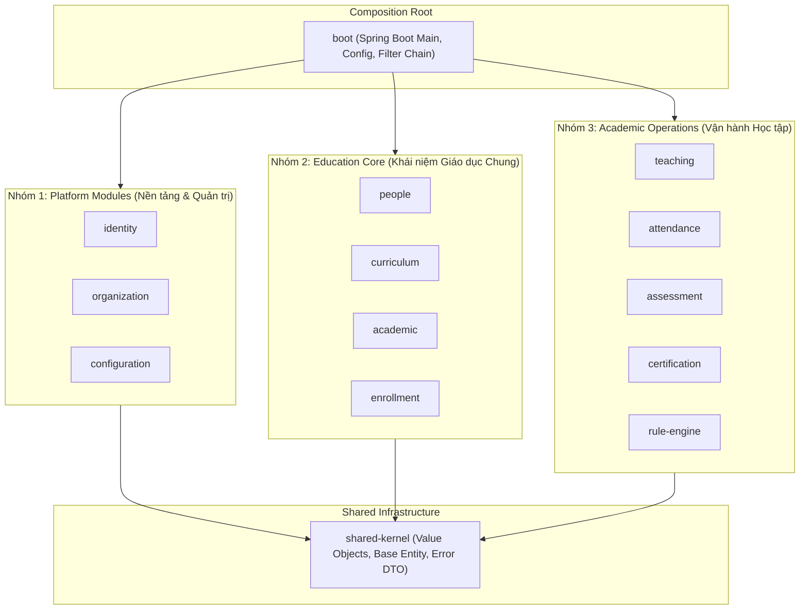

# Phase 1.2 — Thành phần 01: Bounded Contexts & Module Categorization

Tài liệu này xác định ranh giới ngữ cảnh (Bounded Contexts) và phân loại 11 module nghiệp vụ của hệ thống E-Edu thành 3 phân nhóm chức năng.

---

## 1. Ba Nhóm Module Chính

---

## 2. Chi Tiết Trách Nhiệm Từng Module

### 2.1. Nhóm 1: Platform Modules
1. **`identity`**:
   - Trách nhiệm: Quản lý người dùng (`users`), xác thực thông tin đăng nhập (BCrypt), quản lý trạng thái tài khoản (`ACTIVE`, `SUSPENDED`), phát hành và thu hồi Refresh Token.
   - Không chứa: Nghiệp vụ đào tạo, hồ sơ học sinh/giáo viên.
2. **`organization`**:
   - Trách nhiệm: Quản lý pháp nhân trường học/học viện (`organizations`), đơn vị trực thuộc (`organizational_units`), quan hệ thành viên (`organization_memberships`) và phân quyền vai trò theo tổ chức (`OWNER`, `ADMIN`, `MEMBER`).
   - Cung cấp: Public Port `OrganizationAccountQuery` để tra cứu thông tin tài khoản mà không phụ thuộc trực tiếp entity của `identity`.
3. **`configuration`**:
   - Trách nhiệm: Quản lý các cấu hình nghiệp vụ có kiểu (typed policies), mẫu cài đặt hệ thống, định dạng tham số của từng tổ chức.

### 2.2. Nhóm 2: Education Core
1. **`people`**:
   - Trách nhiệm: Quản lý thông tin nhân khẩu học (`Person`), hồ sơ người học (`Student`), hồ sơ giáo viên (`Teacher`), thông tin người giám hộ (`Guardian`).
2. **`curriculum`**:
   - Trách nhiệm: Quản lý khung chương trình đào tạo (`Program`), các phiên bản khung chương trình (`ProgramVersion`), danh mục môn học (`Course`) và mối quan hệ môn học trong chương trình (`ProgramCourse`).
3. **`academic`**:
   - Trách nhiệm: Quản lý niên khóa/học kỳ (`AcademicPeriod`), lớp niên chế (`ClassGroup`), đợt mở môn học (`CourseOffering`), lớp học phần (`ClassSection`) và phòng học (`Room`).
4. **`enrollment`**:
   - Trách nhiệm: Quản lý việc ghi danh của học sinh vào chương trình đào tạo (`ProgramEnrollment`) và đăng ký học phần (`CourseEnrollment`).

### 2.3. Nhóm 3: Academic Operations
1. **`teaching`**:
   - Trách nhiệm: Phân công giảng dạy của giáo viên vào các lớp học phần (`TeachingAssignment`) và theo dõi thời khóa biểu của giảng viên.
2. **`attendance`**:
   - Trách nhiệm: Ghi nhận và thống kê điểm danh chuyên cần của học viên theo từng buổi học.
3. **`assessment`**:
   - Trách nhiệm: Quản lý cấu trúc bài đánh giá (`Assessment`), cơ cấu thang điểm (`AssessmentScheme`), nhập và công bố kết quả điểm số (`AssessmentResult`).
4. **`certification`**:
   - Trách nhiệm: Thẩm định điều kiện hoàn thành khóa học/chương trình đào tạo và cấp phát chứng nhận/văn bằng (`Certificate`).
5. **`rule-engine`**:
   - Trách nhiệm: Bộ thẩm định quy tắc có thể cấu hình linh hoạt (điều kiện tiên quyết, điều kiện tốt nghiệp, giới hạn tín chỉ).
