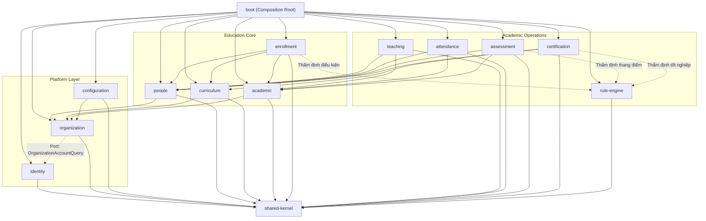

# Phase 1.2 — Thành phần 02: Dependency Graph & Rules

Tài liệu này đặc tả đồ thị phụ thuộc giữa các module trong E-Edu và các quy tắc kiến trúc bắt buộc để ngăn chặn sự xói mòn kiến trúc (Architectural Erosion).

---

## 1. Đồ Thị Phụ Thuộc Hợp Lệ (Mermaid DAG)

---

## 2. Các Quy Tắc Phụ Thuộc Bất Biến

1. **Tuyệt đối không có phụ thuộc vòng (No Cyclic Dependencies)**:
   - Module A phụ thuộc Module B thì Module B **nghiêm cấm** phụ thuộc trực tiếp hoặc gián tiếp ngược lại Module A.
   - Nếu phát hiện nhu cầu giao tiếp 2 chiều: phải chuyển sang sử dụng **Domain Events** (bất đồng bộ) hoặc tách một abstraction dùng chung vào `shared-kernel` hoặc sử dụng **Inversion of Control (Public Ports / SPI)**.

2. **Quy tắc về `shared-kernel`**:
   - `shared-kernel` chỉ chứa các giá trị định danh bất biến (Strongly Typed IDs: `UserId`, `OrganizationId`), Base Entities (`AuditableEntity`), Domain Event contracts (`DomainEvent`), và DTO lỗi (`ApiErrorResponse`).
   - `shared-kernel` **tuyệt đối không được phụ thuộc vào bất kỳ module nghiệp vụ nào**.

3. **Quy tắc về `boot` (Composition Root)**:
   - Module `boot` là nơi chứa hàm `main()`, cấu hình Spring Security Filter Chain, Flyway migrations tập hợp và khởi tạo Spring Context.
   - `boot` phụ thuộc vào tất cả các module nghiệp vụ. Các module nghiệp vụ **tuyệt đối không được phụ thuộc vào `boot`**.

4. **Quy tắc Package Visibility**:
   - Chỉ các class/interface nằm trong package `api` của mỗi module mới có phạm vi `public`.
   - Toàn bộ các class trong package `application`, `domain`, `infrastructure` phải là `package-private` hoặc không được expose ra ngoài Maven module boundary.
