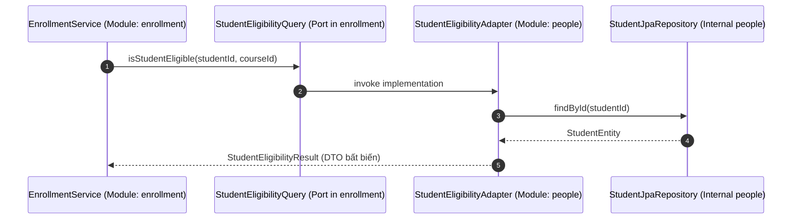
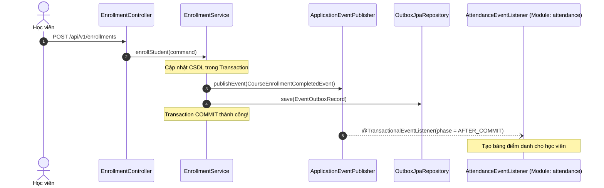

# Phase 1.2 — Thành phần 03: Communication Patterns & Events

Tài liệu này đặc tả hai mô hình giao tiếp chủ đạo giữa các module trong E-Edu: **Synchronous Public Facades (Đồng bộ)** và **Asynchronous Domain Events (Bất đồng bộ)**.

---

## 1. Mô Hình 1: Giao Tiếp Đồng Bộ (Synchronous Public Facades / Ports)

Áp dụng khi use case ở Module gọi (Caller) bắt buộc phải nhận kết quả ngay lập tức để tiếp tục xử lý nghiệp vụ (ví dụ: xác thực tài khoản, kiểm tra sức chứa lớp học phần, thẩm định điều kiện tiên quyết).

### Nguyên Tắc Bắt Buộc:
1. **Chỉ trả về DTO bất biến (Immutable Record / DTO)**: Tuyệt đối không trả về Hibernate Entity được quản lý bởi Hibernate Session.
2. **Không ném ngoại lệ nội bộ của module bị gọi**: Ngoại lệ trả về phải là domain exception hoặc kết quả đóng gói trong Result Object.
3. **Tuân thủ Dependency Inversion Principle (DIP)**: Module gọi định nghĩa Interface (Port) trong chính module của nó; Module cung cấp triển khai Adapter, hoặc gọi Interface công khai đặt tại package `api` của module cung cấp.

---

## 2. Mô Hình 2: Giao Tiếp Bất Đồng Bộ (Asynchronous Domain Events)

Áp dụng khi một sự kiện nghiệp vụ đã diễn ra thành công trong một module và các module khác cần phản ứng mà không làm ảnh hưởng trực tiếp đến transaction chính (ví dụ: Sinh viên hoàn tất đăng ký học phần $\to$ Module `attendance` tự tạo danh sách điểm danh; Module thông báo gửi email).

### Nguyên Tắc Bắt Buộc:
1. **Tính Bất Biến (Immutability)**: Mọi Event phải là Java Record kế thừa `DomainEvent`.
2. **Nội Dung Event Tinh Gọn**: Chỉ chứa các ID liên quan (`enrollmentId`, `studentId`, `offeringId`, `occurredAt`), không đính kèm toàn bộ dữ liệu cồng kềnh.
3. **Phân Pha Transaction (@TransactionalEventListener)**: Bắt buộc dùng `phase = TransactionPhase.AFTER_COMMIT` để đảm bảo consumer chỉ xử lý khi dữ liệu nguồn đã được commit thành công vào CSDL.
