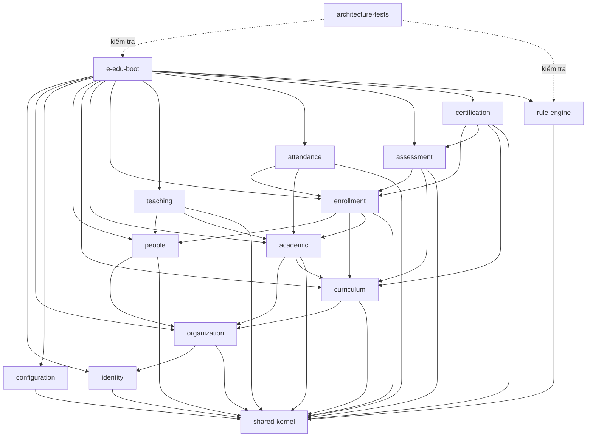

# E-Edu — Phase 1.4: Module Structure & Dependency Rules

Mục tiêu của phase này là chuyển các quyết định kiến trúc thành cấu trúc mã nguồn cụ thể, xác định module nào được phụ thuộc vào module nào và module nào chịu trách nhiệm với dữ liệu nào.

---

## 1. Cấu trúc Maven đề xuất

```
e-edu/
├── pom.xml                               # Root Parent POM (dependencyManagement, pluginManagement)
├── e-edu-boot/                           # Composition Root: Khởi chạy Spring Boot và kết nối các module
│   ├── pom.xml
│   └── src/main/java/com/eedu/
│       └── EEduApplication.java
│
├── e-edu-shared/
│   └── shared-kernel/                    # Abstraction & Value Objects dùng chung tối thiểu
│       └── pom.xml
│
├── e-edu-modules/
│   ├── identity/                         # Xác thực, User, Role, Permission
│   ├── organization/                     # Tổ chức, đơn vị trực thuộc, thành viên
│   ├── configuration/                    # Cấu hình hệ thống và chính sách nghiệp vụ có kiểu
│   ├── people/                           # Person, Student, Teacher, Guardian
│   ├── curriculum/                       # Program, ProgramVersion, Course, ProgramCourse
│   ├── academic/                         # AcademicPeriod, ClassGroup, CourseOffering, ClassSection, Room
│   ├── enrollment/                       # ProgramEnrollment, CourseEnrollment
│   ├── teaching/                         # Phân công giáo viên, giảng viên
│   ├── attendance/                       # Điểm danh và lịch sử chuyên cần
│   ├── assessment/                       # Bài đánh giá, thang điểm, kết quả thi
│   ├── certification/                    # Điều kiện hoàn thành, chứng chỉ
│   └── rule-engine/                      # Định nghĩa, kiểm tra, thẩm định và versioning quy tắc (AD-04)
│
└── e-edu-tests/
    └── architecture-tests/               # ArchUnit automated architecture tests
        └── pom.xml
```

> **Vì sao có thêm module `rule-engine`?**  
> Theo quyết định kiến trúc AD-04, hệ thống cần một rule engine tổng quát. Module này có API, mô hình quy tắc, cơ chế đánh giá và kiểm thử độc lập để nhiều module khác (`assessment`, `enrollment`, `certification`) có thể tái sử dụng mà không làm phình to `configuration`.

---

## 2. Trách nhiệm & Schema của từng Module

Mỗi module chịu trách nhiệm về dữ liệu và sở hữu schema PostgreSQL riêng biệt:

| Module | Trách nhiệm chính | Schema PostgreSQL |
| :--- | :--- | :--- |
| `identity` | User, Role, Permission, xác thực và phân quyền | `identity` |
| `organization` | Tổ chức, đơn vị trực thuộc, thành viên tổ chức | `organization` |
| `configuration` | Cấu hình hệ thống và cấu hình nghiệp vụ có kiểu rõ ràng | `configuration` |
| `people` | Person, Student, Teacher, Guardian | `people` |
| `curriculum` | Program, ProgramVersion, Course, ProgramCourse | `curriculum` |
| `academic` | AcademicPeriod, ClassGroup, CourseOffering, ClassSection, Room | `academic` |
| `enrollment` | Đăng ký chương trình và khóa học | `enrollment` |
| `teaching` | Phân công giáo viên, giảng viên | `teaching` |
| `attendance` | Điểm danh và lịch sử điểm danh | `attendance` |
| `assessment` | Assessment, AssessmentResult, AssessmentScheme | `assessment` |
| `certification` | Điều kiện hoàn thành, CompletionRecord, Certificate | `certification` |
| `rule-engine` | Định nghĩa, kiểm tra, đánh giá và versioning quy tắc | `rule_engine` |

---

## 3. Quy tắc Dependency & Dependency Graph

Nguyên tắc quan trọng: **Dependency một chiều (DAG), tuyệt đối không circular dependency.**



### Các nguyên tắc cần tuân thủ:
- **Không circular dependency**: Nếu A phụ thuộc B thì B không được phụ thuộc ngược lại A.
- **Chỉ dùng Public API**: Giao tiếp liên module bắt buộc qua Facade/Public Service và DTO bất biến.
- **Không chia sẻ JPA entity**: `assessment` không import `StudentEntity` nội bộ của `people`.
- **Không truy cập repository xuyên module**: `enrollment` không được gọi trực tiếp `CourseRepository` của `curriculum`.
- **Không dùng shared-kernel để né ranh giới**: Tránh đưa business logic hoặc entity vào `shared-kernel`.

---

## 4. Cấu trúc bên trong một Module

Ví dụ chuẩn áp dụng cho module `assessment`:

```
assessment/
├── pom.xml
└── src/
    ├── main/
    │   ├── java/com/eedu/assessment/
    │   │   ├── api/                              # Contract công khai cho module khác
    │   │   │   ├── AssessmentFacade.java
    │   │   │   └── dto/
    │   │   ├── application/                      # Điều phối use case & transaction
    │   │   │   ├── CreateAssessmentService.java
    │   │   │   └── EvaluateAssessmentService.java
    │   │   ├── domain/                           # Entity & Aggregate root nội bộ
    │   │   │   ├── Assessment.java
    │   │   │   └── AssessmentResult.java
    │   │   └── infrastructure/                   # Persistence & tích hợp framework
    │   │       └── persistence/
    │   │           ├── AssessmentEntity.java
    │   │           └── AssessmentRepository.java
    │   └── resources/
    │       └── db/migration/                     # Flyway scripts riêng của module
    └── test/
        └── java/com/eedu/assessment/
```

- `api`: Hợp đồng công khai dành cho module khác gọi.
- `application`: Điều phối use case, orchestration, transaction boundaries.
- `domain`: Mô hình và quy tắc nghiệp vụ cốt lõi.
- `infrastructure`: Persistence, Spring Data JPA repositories và adapter kỹ thuật.

---

## 5. Tổ chức Flyway cho Schema riêng theo Module

Mỗi module tự quản lý schema migration của mình:

```
assessment/src/main/resources/db/migration/
├── V1__create_assessment_schema.sql
├── V2__create_assessments_table.sql
└── V3__create_assessment_results_table.sql
```

Trong migration đầu tiên của mỗi module:
```sql
CREATE SCHEMA IF NOT EXISTS assessment;
```

Mọi bảng trong schema đều được khai báo tường minh:
```sql
CREATE TABLE assessment.assessments (
    id UUID PRIMARY KEY,
    organization_id UUID NOT NULL,
    course_offering_id UUID NOT NULL,
    name VARCHAR(255) NOT NULL,
    created_at TIMESTAMP WITH TIME ZONE DEFAULT CURRENT_TIMESTAMP,
    updated_at TIMESTAMP WITH TIME ZONE DEFAULT CURRENT_TIMESTAMP
);
```

> **Lưu ý Multi-Tenancy**: Mọi bảng chứa dữ liệu thuộc phạm vi tổ chức phải có cột `organization_id` và chỉ mục (index) tương ứng để phục vụ truy vấn và cách ly dữ liệu.

---

## 6. Quy tắc ArchUnit tối thiểu

Bộ test kiến trúc tự động chạy trong module `architecture-tests` kiểm soát:
1. Domain không phụ thuộc infrastructure.
2. Không có cyclic dependency giữa các module.
3. Module khác không import package `infrastructure` hay `domain` nội bộ của nhau (chỉ được gọi qua package `api`).
4. Các lớp giao tiếp liên module chỉ sử dụng DTO/Facade công khai.

```java
@AnalyzeClasses(packages = "com.eedu")
class ModuleBoundaryArchitectureTest {

    @ArchTest
    static final ArchRule domainMustNotDependOnInfrastructure =
        noClasses()
            .that().resideInAPackage("..domain..")
            .should().dependOnClassesThat()
            .resideInAPackage("..infrastructure..");

    @ArchTest
    static final ArchRule internalPackagesMustNotBeAccessedByOtherModules =
        noClasses()
            .that().resideInAPackage("com.eedu.assessment..")
            .should().dependOnClassesThat()
            .resideInAPackage("com.eedu.people.internal..");
}
```

---

## 7. Checklist nghiệm thu Phase 1.4

**Tiến độ Phase 1.4 (6/6)**

- [x] Chốt danh sách module và trách nhiệm dữ liệu của từng module
- [x] Xác nhận dependency graph không có vòng phụ thuộc
- [x] Quy định public API và package nội bộ cho từng module
- [x] Xác định module sở hữu schema và migration
- [x] Xác định contract tích hợp với rule-engine
- [x] Bổ sung ArchUnit tests vào quy trình CI

---

### Bước kế tiếp: Phase 1.5 — Persistence & Database Design
Sau khi Phase 1.4 được nghiệm thu, dự án sẽ tiến hành chốt chi tiết các Entity, khóa ngoại, ràng buộc tenant isolation và migration scripts trong PostgreSQL trước khi dựng skeleton Spring Boot ở Phase 2.
