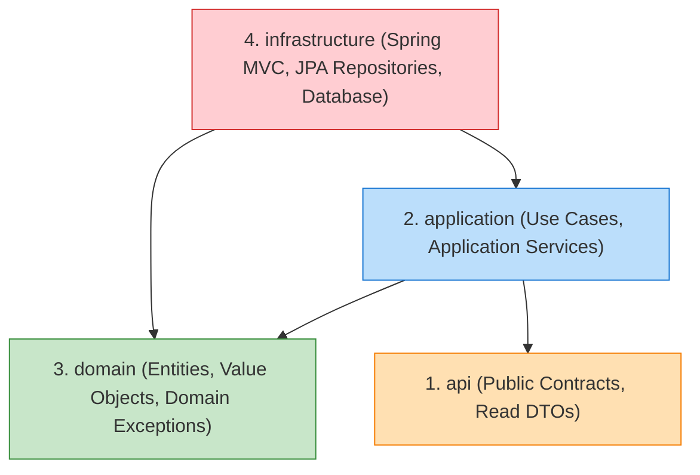

# Phase 1.4 — Thành phần 02: Clean / Hexagonal Layering

Tài liệu này đặc tả cấu trúc phân tầng 4 lớp áp dụng đồng nhất cho mỗi module nghiệp vụ trong E-Edu.

---

## 1. Kiến Trúc Phân Tầng Nội Bộ Của Mỗi Module

```
com.edu.<module_name>/
├── api/                                  # Tầng 1: Contract công khai (Public Facade / DTOs)
│   ├── dto/                              # Immutable Records / DTOs
│   └── <Module>PublicQuery.java          # Public Interface cho module khác gọi
│
├── application/                          # Tầng 2: Use Cases & Orchestration
│   ├── command/                          # Command DTOs
│   ├── port/                             # Outbound Ports / SPI interfaces
│   └── service/                          # Application Services (@Service, @Transactional)
│
├── domain/                               # Tầng 3: Pure Domain Model & Business Logic
│   ├── model/                            # Domain Entities, Value Objects, Enums
│   ├── exception/                        # Domain Exceptions
│   └── repository/                       # Domain Repository Interfaces
│
└── infrastructure/                       # Tầng 4: Adapters, Frameworks & Web
    ├── persistence/                      # JPA Entities, Spring Data Repositories
    │   ├── entity/
    │   └── repository/
    ├── security/                         # Module-specific security config
    └── web/                              # Spring MVC REST Controllers (@RestController)
```

---

## 2. Nguyên Tắc Phụ Thuộc Giữa Các Tầng (Dependency Rule)



### Quy tắc bất biến:
1. **Tầng `domain` là trung tâm**:
   - Hoàn toàn độc lập với Spring framework, Hibernate/JPA và cơ sở dữ liệu.
   - Chứa logic nghiệp vụ thuần túy, các quy tắc kiểm tra tính hợp lệ và domain models.
2. **Tầng `application` điều phối nghiệp vụ**:
   - Tiếp nhận command/query từ web controller hoặc module khác.
   - Mở transaction (`@Transactional`), gọi repository để nạp entity, gọi logic domain và phát sinh Domain Events.
3. **Tầng `infrastructure` phụ thuộc vào bên trong**:
   - Chứa các adapter kỹ thuật: Spring Data JPA Repository, PostgreSQL persistence entity (`@Entity`), Spring MVC REST Controller (`@RestController`).
4. **Tầng `api`**:
   - Chứa các interface và Java Record DTO mà các module khác được phép gọi.
