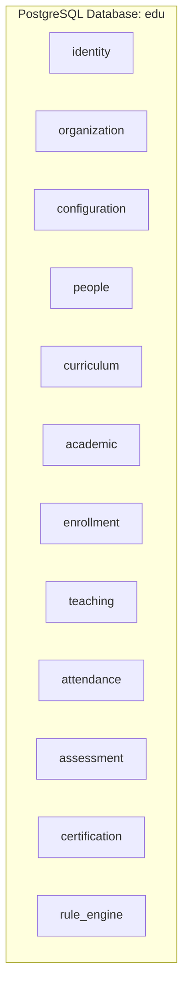

# Phase 1.5 — Thành phần 02: Schema Separation & Table Catalog

Tài liệu này cung cấp danh mục 12 schema PostgreSQL độc lập và các bảng chính thuộc quyền sở hữu của từng module trong E-Edu.

---

## 1. Bản Đồ 12 PostgreSQL Schemas

---

## 2. Danh Mục Các Bảng Cốt Lõi Theo Từng Schema

### 2.1. `identity`
- `users`: Thông tin tài khoản, username, email, password_hash, status.
- `roles`: Nhóm quyền (Platform vs Organization roles).
- `permissions`: Quyền nguyên tử (`resource:action`).
- `user_roles`: Phân quyền tài khoản.
- `refresh_tokens`: Lưu trữ băm SHA-256 của Refresh Token, `family_id`, thời hạn hết hạn (`expires_at`), trạng thái thu hồi (`revoked`).

### 2.2. `organization`
- `organizations`: Tên trường/học viện, mã định danh, cấp độ, trạng thái hoạt động.
- `organizational_units`: Khoa, bộ môn, phòng ban, chi nhánh trực thuộc.
- `organization_memberships`: Quan hệ giữa người dùng và tổ chức, vai trò tổ chức (`OWNER`, `ADMIN`, `MEMBER`), trạng thái (`ACTIVE`, `SUSPENDED`).

### 2.3. `configuration`
- `system_settings`: Cấu hình tham số hệ thống.
- `organization_policies`: Chính sách đào tạo, quy định điểm danh, thang điểm riêng của từng trường.

### 2.4. `people`
- `persons`: Hồ sơ con người (họ tên, ngày sinh, giới tính, CCCD, thông tin liên lạc).
- `students`: Hồ sơ học sinh/sinh viên theo từng trường (`student_code`, `enrollment_date`).
- `teachers`: Hồ sơ giáo viên/giảng viên theo từng trường (`teacher_code`, học vị, chuyên ngành).
- `guardians`: Hồ sơ người giám hộ.
- `student_guardians`: Mối quan hệ giữa học sinh và người giám hộ.

### 2.5. `curriculum`
- `programs`: Chương trình đào tạo.
- `program_versions`: Phiên bản chương trình đào tạo theo năm tuyển sinh.
- `courses`: Môn học / học phần chuẩn.
- `program_courses`: Môn học thuộc phiên bản chương trình (số tín chỉ, thứ tự, tiên quyết).

### 2.6. `academic`
- `academic_periods`: Năm học, học kỳ, đợt học.
- `class_groups`: Lớp niên chế / lớp cố định.
- `course_offerings`: Đợt mở lớp cho một môn học trong học kỳ.
- `class_sections`: Lớp học phần cụ thể (ca học, lịch học).
- `rooms`: Phòng học vật lý hoặc phòng học trực tuyến.

### 2.7. `enrollment`
- `program_enrollments`: Tiếp nhận và ghi danh học viên vào chương trình đào tạo.
- `course_enrollments`: Đăng ký của học viên vào lớp học phần cụ thể.

### 2.8. `teaching`
- `teaching_assignments`: Phân công giáo viên đứng lớp hoặc trợ giảng.
- `teacher_schedules`: Lịch giảng dạy chi tiết.

### 2.9. `attendance`
- `attendance_records`: Ghi nhận điểm danh từng buổi (Có mặt, Đi trễ, Vắng).
- `attendance_summaries`: Thống kê tỷ lệ chuyên cần theo môn học.

### 2.10. `assessment`
- `assessment_schemes`: Cấu hình thang điểm và cơ cấu điểm.
- `assessments`: Bài đánh giá (quiz, bài tập, thi giữa kỳ, cuối kỳ).
- `assessment_results`: Điểm số của từng học viên.

### 2.11. `certification`
- `certificates`: Chứng chỉ, văn bằng công nhận hoàn thành.
- `graduation_records`: Hồ sơ xét tốt nghiệp.

### 2.12. `rule_engine`
- `rule_definitions`: Biểu thức điều kiện nghiệp vụ dạng AST/JSON.
- `rule_execution_logs`: Nhật ký theo dõi lịch sử thực thi và kết quả thẩm định.
