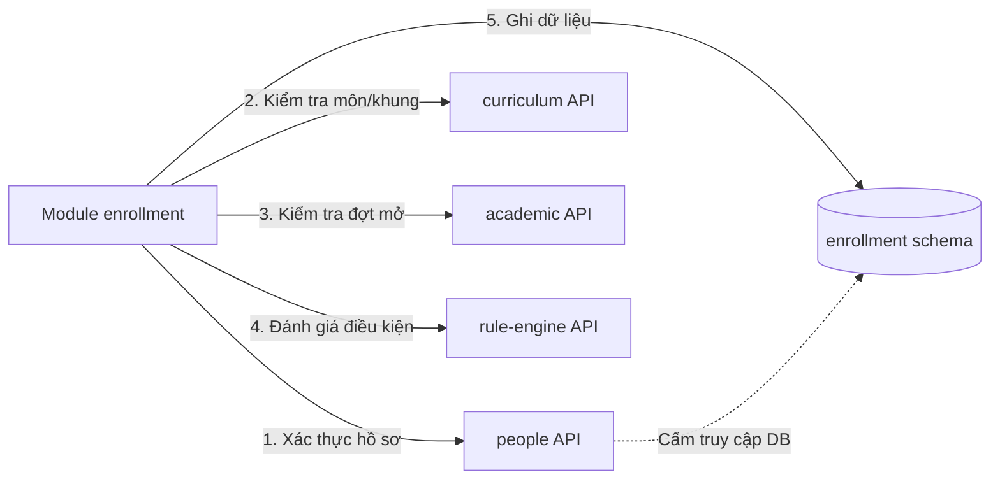
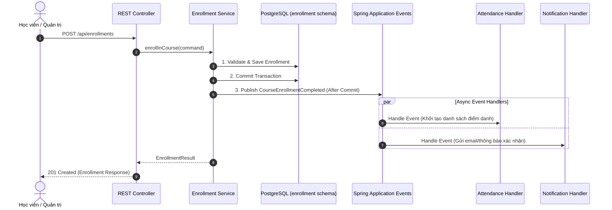
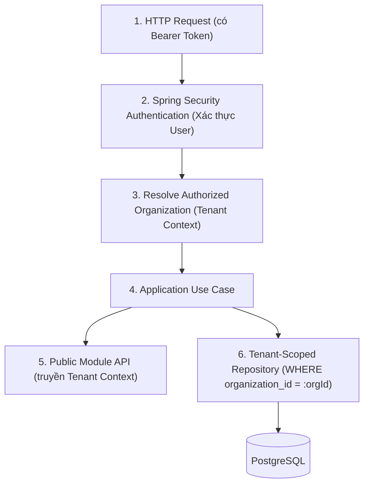

# E-Edu — Phase 1.6: API Contracts & Cross-Module Communication

Trong phase này, dự án thiết kế cách các module của E-Edu giao tiếp với nhau mà không phá vỡ kiến trúc **Modular Monolith**.

Mục tiêu cốt lõi: Mỗi module phát triển nghiệp vụ độc lập, không truy cập trực tiếp repository hoặc JPA entity nội bộ của module khác, hỗ trợ đa mô hình đào tạo và bảo đảm cách ly dữ liệu nhiều tổ chức (**Multi-Tenancy**).

---

## 1. Nguyên tắc Giao tiếp Giữa các Module

Dự án áp dụng 3 cơ chế giao tiếp chính:

1. **Synchronous (Đồng bộ)**: Gọi trực tiếp qua Java Interface (Public Facade / Query API) khi use case bắt buộc cần kết quả ngay (ví dụ: `enrollment` gọi `people` xác minh hồ sơ học viên, hoặc gọi `rule-engine` thẩm định điều kiện).
2. **Asynchronous (Bất đồng bộ)**: Phát và lắng nghe **Domain / Application Events** khi thông báo sự kiện nghiệp vụ đã hoàn thành (ví dụ: `CourseEnrollmentCompleted` kích hoạt tạo bảng điểm danh hoặc gửi thông báo).
3. **Security & Tenant Context**: Mọi lời gọi API bắt buộc đính kèm ngữ cảnh người dùng và tổ chức đã được xác thực (`TenantContext`). Module nhận không được tin cậy `organizationId` do client tự truyền.

### Bảng tiêu chí chọn cơ chế:

| Nhu cầu nghiệp vụ | Cơ chế lựa chọn | Lưu ý triển khai |
| :--- | :--- | :--- |
| **Cần kết quả ngay trong cùng use case** | Public Application API / Facade | Trả về DTO bất biến, không trả JPA Entity. |
| **Thông báo nghiệp vụ cho module khác** | Spring Application Event | Tách rời phụ thuộc, xử lý trong cùng tiến trình. |
| **Bảo đảm sự kiện không bị mất khi crash** | Transactional Outbox Pattern | Ghi outbox table trong cùng DB transaction, retry & idempotent. |
| **Giao tiếp hệ thống bên ngoài** | REST API / Integration Adapter | Đặt trong layer infrastructure của module sở hữu. |
| **Đọc dữ liệu do module khác sở hữu** | Public Query API / Read DTO | Chỉ lấy các trường được phép công khai. |

> [!WARNING]
> Spring Application Event mặc định chạy đồng bộ trong cùng thread hoặc bất đồng bộ nhưng **không có lưu trữ bền vững**. Nếu consumer chỉ được phép chạy sau khi transaction đã commit thành công, bắt buộc dùng `@TransactionalEventListener(phase = TransactionPhase.AFTER_COMMIT)`.

---

## 2. Thiết kế Public API cho Từng Module

Mỗi module chỉ công khai hợp đồng trong package `api/`. Toàn bộ implementation nằm trong `application/`, `domain/`, `infrastructure/` là package-private.

```
com.eedu.enrollment/
├── api/                                  # Hợp đồng công khai cho module khác
│   ├── EnrollmentFacade.java
│   └── dto/
│       ├── CreateEnrollmentCommand.java
│       └── EnrollmentResult.java
├── application/                          # Internal: Orchestration & Use cases
│   ├── CreateEnrollmentService.java
│   └── CancelEnrollmentService.java
├── domain/                               # Internal: Domain entities & Rules
│   ├── ProgramEnrollment.java
│   └── CourseEnrollment.java
└── infrastructure/                       # Internal: Spring Data JPA & Adapters
    └── persistence/
        ├── ProgramEnrollmentEntity.java
        └── ProgramEnrollmentRepository.java
```

### Ví dụ Contract Interface:

```java
package com.eedu.enrollment.api;

import com.eedu.enrollment.api.dto.CreateEnrollmentCommand;
import com.eedu.enrollment.api.dto.EnrollmentResult;

public interface EnrollmentFacade {

    EnrollmentResult enrollInProgram(CreateEnrollmentCommand command);
}
```

### DTO Đầu vào và Đầu ra:

```java
package com.eedu.enrollment.api.dto;

import java.util.UUID;

public record CreateEnrollmentCommand(
    UUID studentId,
    UUID programVersionId
) {}
```

```java
package com.eedu.enrollment.api.dto;

import java.util.UUID;

public record EnrollmentResult(
    UUID enrollmentId,
    String status
) {}
```

> [!NOTE]
> `organizationId` không nằm trong command DTO đầu vào vì phạm vi tổ chức phải được resolver tự động trích xuất từ `SecurityContext` / `TenantContext` đã xác thực, tránh việc client can thiệp ID tổ chức.

---

## 3. Public API Tiêu biểu của các Module Cốt lõi

| Module | Public API tiêu biểu | Trách nhiệm chính |
| :--- | :--- | :--- |
| `identity` | `IdentityQueryApi` | Xác minh tài khoản, user ID, trạng thái kích hoạt |
| `organization` | `OrganizationAccessApi` | Kiểm tra quyền thành viên và quyền truy cập tổ chức |
| `people` | `StudentQueryApi`, `TeacherQueryApi` | Tra cứu hồ sơ và trạng thái người học / giảng viên |
| `curriculum` | `CurriculumQueryApi` | Kiểm tra tính hợp lệ của chương trình, môn học, phiên bản |
| `academic` | `AcademicQueryApi` | Kiểm tra kỳ học, đợt mở khóa học (`CourseOffering`), nhóm lớp |
| `enrollment` | `EnrollmentFacade` | Đăng ký, hủy đăng ký và tra cứu trạng thái ghi danh |
| `teaching` | `TeachingAssignmentApi` | Tra cứu và quản lý phân công giảng dạy |
| `attendance` | `AttendanceFacade` | Ghi nhận và truy vấn dữ liệu điểm danh, chuyên cần |
| `assessment` | `AssessmentFacade` | Tạo bài thi, ghi nhận điểm và xuất kết quả đánh giá |
| `rule-engine` | `RuleEvaluationApi` | Thẩm định các biểu thức quy tắc theo phiên bản |
| `certification` | `CertificationFacade` | Đánh giá điều kiện hoàn thành và cấp chứng nhận/bằng |

---

## 4. Luồng Xử lý Use Case & Phụ thuộc API Một Chiều



### Các bước trong use case Đăng ký môn học:
1. **Xác thực Context**: Kiểm tra quyền của người dùng trong tổ chức hiện tại.
2. **Gọi `people API`**: Kiểm tra học viên có tồn tại và đang ở trạng thái `ACTIVE`.
3. **Gọi `curriculum API`**: Xác minh môn học thuộc chương trình và còn hiệu lực.
4. **Gọi `rule-engine API`**: Đánh giá các điều kiện tiên quyết (môn tiên quyết, số tín chỉ tích lũy tối thiểu).
5. **Ghi dữ liệu nội bộ**: Lưu bản ghi vào schema `enrollment`.
6. **Phát Event**: Bắn `CourseEnrollmentCompleted` sau khi transaction commit thành công.

---

## 5. Cross-Module Domain Events

Event thông báo về sự kiện nghiệp vụ đã xảy ra trong quá khứ.

| Tên Event | Module phát | Module có thể lắng nghe (Consumers) |
| :--- | :--- | :--- |
| `StudentCreated` | `people` | `enrollment`, `notification` |
| `CourseEnrollmentCompleted` | `enrollment` | `attendance`, `notification` |
| `AttendanceRecorded` | `attendance` | `assessment`, `reporting` |
| `AssessmentResultPublished` | `assessment` | `certification`, `notification` |
| `ProgramCompleted` | `certification` | `notification`, `reporting` |

### Ví dụ Contract Event:

```java
package com.eedu.enrollment.api.event;

import java.time.Instant;
import java.util.UUID;

public record CourseEnrollmentCompleted(
    UUID eventId,
    UUID enrollmentId,
    UUID studentId,
    UUID courseOfferingId,
    UUID organizationId,
    Instant occurredAt
) {}
```

### Biểu đồ Luồng Xử lý Sự kiện (Sequence Diagram):



---

## 6. Hợp đồng Xử lý Lỗi & Validation

Hệ thống thống nhất chuẩn mã lỗi nghiệp vụ rõ ràng, không để lộ exception nội bộ ra ngoài module:

| Mã lỗi nghiệp vụ | Ý nghĩa | HTTP Status tương ứng |
| :--- | :--- | :--- |
| `STUDENT_NOT_FOUND` | Không tìm thấy hồ sơ học sinh trong tổ chức | `404 Not Found` |
| `PROGRAM_VERSION_UNAVAILABLE` | Phiên bản chương trình đào tạo đã hết hạn | `400 Bad Request` |
| `ENROLLMENT_ALREADY_EXISTS` | Học viên đã đăng ký môn học này trước đó | `409 Conflict` |
| `ENROLLMENT_RULE_REJECTED` | Không đủ điều kiện (nợ môn tiên quyết, thiếu tín chỉ) | `422 Unprocessable Entity` |
| `ORGANIZATION_ACCESS_DENIED` | Không có quyền thao tác trong tổ chức | `403 Forbidden` |
| `RULE_VERSION_NOT_FOUND` | Không tìm thấy phiên bản quy tắc yêu cầu | `500 / 404 Internal/Not Found` |

### 3 Lớp Validation:
1. **Input Formatting**: Kiểm tra `@NotNull`, `@Size`, format UUID ở tầng DTO / Web.
2. **Business Rules**: Kiểm tra ràng buộc domain (trùng lặp, trạng thái, rule engine).
3. **Tenant Authorization**: Kiểm tra quyền truy cập tổ chức trước khi thực thi.

---

## 7. Rule Engine API Contract (AD-04)

```java
package com.eedu.ruleengine.api;

import java.util.Map;
import java.util.UUID;

public record RuleEvaluationRequest(
    UUID ruleId,
    Integer ruleVersion,
    String rulePurpose,
    Map<String, Object> facts
) {}
```

```java
package com.eedu.ruleengine.api;

import java.util.List;

public record RuleEvaluationResult(
    boolean matched,
    List<String> reasonCodes
) {}
```

> [!IMPORTANT]
> **Yêu cầu an toàn đối với Rule Engine:**
> - `facts` phải được kiểm tra schema trước khi thẩm định.
> - Kết quả đánh giá phải có tính xác định (cùng input + cùng rule version = cùng kết quả).
> - Giới hạn thời gian thực thi (timeout) để tránh vòng lặp hoặc quá tải CPU.

---

## 8. Quy tắc Bảo mật Xuyên suốt (Security & Tenant Pipeline)



### 6 Nguyên tắc bảo mật bắt buộc:
1. Xác thực danh tính người dùng qua JWT trước khi cho phép vào use case.
2. Xác minh người dùng có tư cách thành viên hợp lệ (`OrganizationMembership`) trong tổ chức mục tiêu.
3. Truyền `TenantContext` đã được xác thực an toàn qua các ranh giới module.
4. Bắt buộc áp dụng điều kiện `organization_id` trên mọi câu lệnh truy vấn/cập nhật dữ liệu.
5. Kiểm tra tính toàn vẹn ID giữa các entity để tránh liên kết dữ liệu chéo tổ chức.
6. Viết automated tests kiểm thử các trường hợp giả mạo `organization_id` hoặc truy cập tài nguyên của tenant khác.

---

## 9. Checklist Nghiệm thu Phase 1.6

**Tiến độ Nghiệm thu Phase 1.6 (7/7)**

- [x] Mỗi module có public API và DTO được công khai có chủ đích
- [x] Không phụ thuộc repository hoặc JPA entity nội bộ của module khác
- [x] Xác định module nào dùng synchronous API và module nào phát event
- [x] Chốt quy ước event, transaction và xử lý lỗi
- [x] Xác định tenant context và quy tắc authorization xuyên module
- [x] Thiết kế RuleEvaluation API có kiểu dữ liệu và giới hạn an toàn
- [x] Bổ sung ArchUnit tests để kiểm tra các dependency rules

---

### Bước tiếp theo: Phase 1.7 — Security Architecture & Authorization Model
Chốt chi tiết cơ chế Authentication & Authorization với Spring Security, phân quyền RBAC đa tổ chức, quản lý JWT token và các kịch bản kiểm thử bảo mật trước khi bước vào Phase 2.
