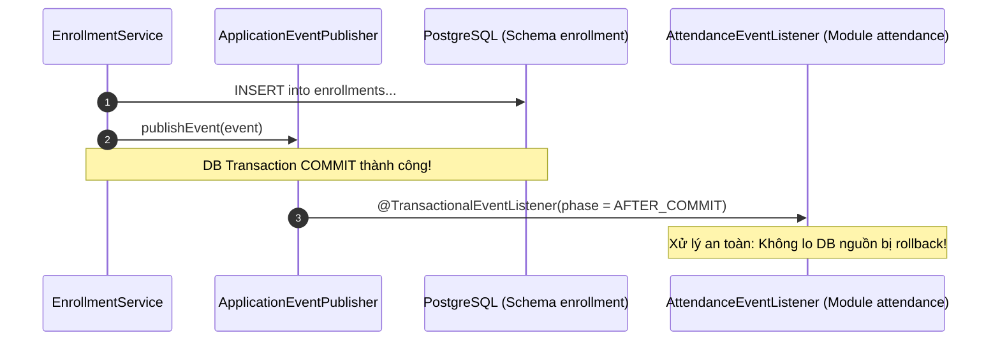

# Phase 1.6 — Thành phần 02: Asynchronous Domain Events

Tài liệu này đặc tả cơ chế phát và lắng nghe sự kiện nghiệp vụ (Domain Events) trong kiến trúc Modular Monolith của E-Edu bằng Spring Framework Application Events.

---

## 1. Hợp Đồng `DomainEvent` Chuẩn Hóa

Mọi Domain Event trong hệ thống đều phải thực thi interface chuẩn từ `shared-kernel`:

```java
package com.edu.shared.kernel.domain.event;

import java.time.Instant;
import java.util.UUID;

public interface DomainEvent {
    UUID eventId();       // Mã định danh duy nhất của sự kiện (UUID v4)
    Instant occurredAt(); // Thời điểm sự kiện phát sinh (UTC)
    String eventType();   // Tên định danh loại sự kiện (e.g., "CourseEnrollmentCompleted")
}
```

### Ví dụ định nghĩa một sự kiện cụ thể:
```java
package com.edu.enrollment.domain.event;

import com.edu.shared.kernel.domain.event.DomainEvent;
import com.edu.shared.kernel.domain.identifier.OrganizationId;
import java.time.Instant;
import java.util.UUID;

public record CourseEnrollmentCompletedEvent(
    UUID eventId,
    Instant occurredAt,
    OrganizationId organizationId,
    UUID enrollmentId,
    UUID studentId,
    UUID offeringId
) implements DomainEvent {
    public String eventType() {
        return "CourseEnrollmentCompleted";
    }
}
```

---

## 2. Quy Tắc Phát và Lắng Nghe Sự Kiện An Toàn



### Nguyên tắc bất biến:
1. **Bắt buộc dùng `@TransactionalEventListener(phase = TransactionPhase.AFTER_COMMIT)`**:
   - Nếu transaction chính bị lỗi (rollback), Event Listener sẽ **không bao giờ được kích hoạt**, ngăn chặn việc gửi thông báo hoặc tạo bản ghi giả mạo khi thao tác chính thất bại.
2. **Xử lý lỗi tại Event Listener**:
   - Nếu consumer gặp lỗi, không được làm rollback transaction đã commit của producer.
   - Bắt buộc phải log lỗi và nếu cần thiết phải ghi vào bảng Dead Letter / Failed Event để xử lý lại.
