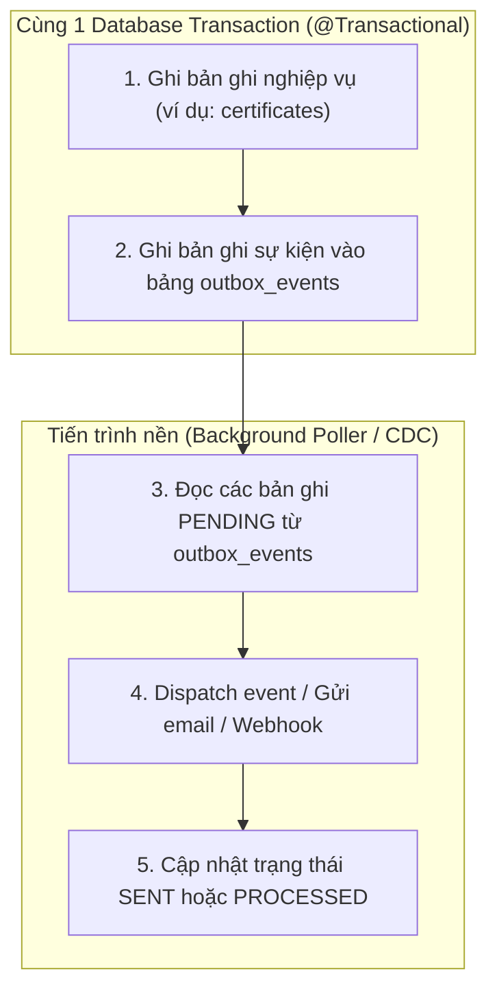

# Phase 1.6 — Thành phần 03: Transactional Outbox Pattern

Tài liệu này đặc tả mô hình Transactional Outbox Pattern nhằm đảm bảo tính nguyên tử (Atomicity) giữa việc ghi nhận trạng thái cơ sở dữ liệu và việc phát tán sự kiện ra các hệ thống hàng đợi hoặc tiến trình nền trong E-Edu.

---

## 1. Vấn Đề Dual-Write

Trong các use case quan trọng (như thu học phí, xác nhận hoàn thành khóa học, cấp văn bằng tốt nghiệp), nếu ứng dụng vừa ghi CSDL vừa gửi tin nhắn qua Message Broker (Kafka/RabbitMQ) hoặc gọi webhook bên ngoài:
- Nếu ghi DB thành công nhưng mạng chập chờn $\to$ Tin nhắn không được gửi $\to$ Mất sự kiện!
- Nếu gửi tin nhắn trước nhưng ghi DB lỗi $\to$ Sự kiện giả mạo đã phát tán!

---

## 2. Giải Pháp Transactional Outbox



### Cấu Trúc Bảng Outbox Mẫu:
```sql
CREATE TABLE public.outbox_events (
    id UUID PRIMARY KEY,
    aggregate_type VARCHAR(64) NOT NULL,
    aggregate_id UUID NOT NULL,
    event_type VARCHAR(128) NOT NULL,
    payload JSONB NOT NULL,
    status VARCHAR(32) NOT NULL DEFAULT 'PENDING',
    retry_count INT NOT NULL DEFAULT 0,
    created_at TIMESTAMPTZ NOT NULL DEFAULT CURRENT_TIMESTAMP,
    processed_at TIMESTAMPTZ
);

CREATE INDEX idx_outbox_pending ON public.outbox_events (status, created_at)
WHERE status = 'PENDING';
```

---

## 3. Tính Idempotency Của Consumer

Khi sử dụng hàng đợi hoặc xử lý lại sự kiện bị lỗi (Retry), một sự kiện có thể được gửi nhiều hơn một lần (At-least-once delivery).
Do đó, các Consumer lắng nghe bắt buộc phải có cơ chế **Idempotent Handling**:
- Kiểm tra xem `eventId` đã từng được xử lý hay chưa thông qua bảng `processed_events (event_id, processed_at)`.
- Nếu đã xử lý, bỏ qua và trả về kết quả thành công ngay lập tức để tránh trùng lặp dữ liệu.
