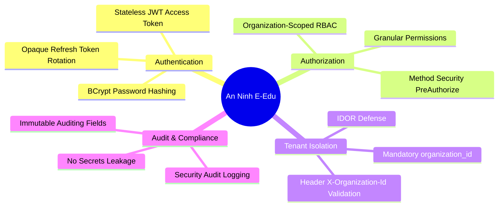

# Phase 1.7 — Thành phần 01: Security Principles & Threat Model

Tài liệu này đặc tả 4 trụ cột an ninh, phân tích các vector tấn công phổ biến theo OWASP API Security Top 10 và các nguyên tắc phòng ngừa áp dụng cho E-Edu.

---

## 1. Bốn Trụ Cột An Ninh

---

## 2. Phân Tích Mô Hình Đe Dọa (Threat Model - OWASP API Top 10)

| Mã OWASP | Nguy cơ đe dọa | Kịch bản tấn công trong hệ thống giáo dục | Biện pháp phòng vệ trong E-Edu |
| :--- | :--- | :--- | :--- |
| **API1: BOLA / IDOR** | Truy cập đối tượng bị lỗi phân quyền | Học sinh trường A thay đổi `id` trên URL thành `id` bài thi của trường B. | Bắt buộc kiểm tra `organization_id` của bản ghi khớp với `TenantContext` đã xác thực; cấm dùng ID client truyền mà không kiểm tra quyền sở hữu. |
| **API2: Broken Authentication** | Lỗ hổng xác thực | Kẻ tấn công đánh cắp Refresh Token cũ để duy trì phiên đăng nhập trái phép. | Refresh Token Rotation: Mỗi lần refresh sẽ vô hiệu hóa token cũ; phát hiện tái sử dụng (Reuse Detection) và hủy toàn bộ phiên làm việc (`family_id`). |
| **API3: BOPLA** | Rò rỉ thuộc tính đối tượng | API trả về toàn bộ JPA Entity chứa cả `password_hash` hoặc thông tin lương bổng. | Luôn chuyển đổi sang Record Read DTO; chỉ bao gồm các trường được phép công khai; cấm expose JPA Entity ra REST controller. |
| **API5: Broken Function Level Auth** | Leo thang đặc quyền | Học sinh gửi request gọi API phê duyệt điểm số (`POST /api/v1/assessments/approve`). | Kiểm tra quyền nghiêm ngặt với `@PreAuthorize("hasAuthority('assessment:approve')")` và xác minh vai trò thành viên tại trường học đó. |
| **API7: Server-Side Request Forgery** | Tấn công SSRF | Người dùng nhập URL webhook độc hại để quét mạng nội bộ. | Giới hạn danh sách IP/Domain an toàn; kiểm tra URL whitelist trước khi gửi request. |
