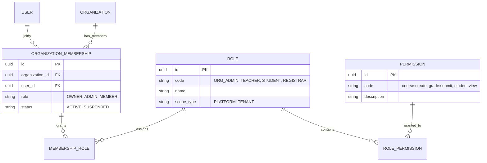

# Phase 1.7 — Thành phần 02: Organization-Scoped RBAC

Tài liệu này đặc tả chi tiết mô hình phân quyền dựa trên vai trò theo phạm vi tổ chức (**Organization-Scoped RBAC**), giải quyết bài toán cốt lõi: cùng một người dùng có thể nắm giữ các vai trò và quyền hạn hoàn toàn khác nhau ở các tổ chức khác nhau.

---

## 1. Quyết Định Thiết Kế Then Chốt

> [!IMPORTANT]
> **Tuyệt đối không gán Role tổ chức trực tiếp vào bảng `UserRole` toàn cục!**  
> Việc gán role toàn cục sẽ khiến người dùng là `OWNER` hoặc `ADMIN` tại Trường A nghiễm nhiên có quyền quản trị tại Trường B.  
> Vai trò của người dùng trong một trường học bắt buộc phải được gắn thông qua **`OrganizationMembership`**.



---

## 2. Quy Chuẩn Đặt Mã Quyền (Permission Syntax)

Mọi quyền nguyên tử trong hệ thống tuân thủ cú pháp chuẩn:
```
<resource>:<action>
```
Ví dụ:
- `organization:update` — Cập nhật thông tin tổ chức.
- `course:create` — Mở khóa học/môn học mới.
- `class:manage` — Phân công giáo viên và xếp lịch học phần.
- `assessment:grade` — Chấm điểm và nhập điểm bài thi.
- `certificate:issue` — Cấp chứng chỉ / bằng tốt nghiệp.

---

## 3. Ba Vai Trò Thành Viên Tổ Chức Cốt Lõi (Membership Roles)

1. **`OWNER` (Chủ sở hữu tổ chức)**:
   - Toàn quyền quản trị tổ chức: đổi tên trường, phân quyền quản trị viên, ngừng hoạt động tổ chức, xóa dữ liệu nhạy cảm.
2. **`ADMIN` (Quản trị viên trường / Giáo vụ)**:
   - Quản lý học sinh, giáo viên, mở học kỳ, mở lớp học phần, duyệt điểm số.
3. **`MEMBER` (Thành viên / Giáo viên / Học viên)**:
   - Quyền hạn phụ thuộc vào các Role cụ thể (`TEACHER`, `STUDENT`) được gán trong tổ chức.
