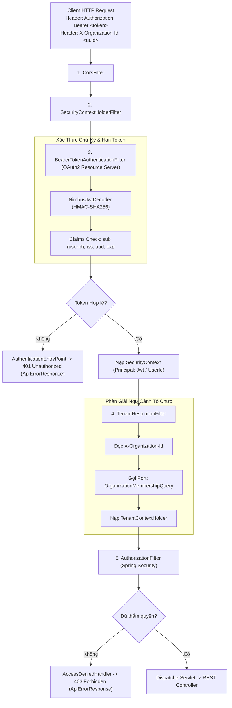

# Phase 1.7 — Thành phần 03: Security Filter Chain & Request Pipeline

Tài liệu này đặc tả quy trình thực thi của chuỗi bộ lọc bảo mật **Spring Security 6** cho các yêu cầu HTTP trong E-Edu.

---

## 1. Sơ Đồ Xử Lý Của Security Filter Chain

---

## 2. Cấu Hình Endpoint Mở Công Khai (PermitAll)

Hệ thống tuân thủ nguyên tắc **Mặc định Đóng (Deny-by-default)**: 100% endpoint yêu cầu xác thực Bearer Token, ngoại trừ các endpoint sau được cấu hình `permitAll()`:

1. **Endpoint Xác thực & Tài khoản**:
   - `POST /api/v1/auth/login`: Đăng nhập cấp phát Access Token & Refresh Token.
   - `POST /api/v1/auth/refresh`: Xoay vòng Refresh Token.
   - `POST /api/v1/auth/logout`: Thu hồi token.
   - `POST /api/v1/identity/accounts/register`: Đăng ký tài khoản người dùng mới.
2. **Endpoint Giám sát Hạ tầng**:
   - `GET /actuator/health`: Kiểm tra sức khỏe hệ thống (Liveness & Readiness probe cho Docker/Kubernetes).
   - `GET /actuator/info`: Thông tin phiên bản ứng dụng.
