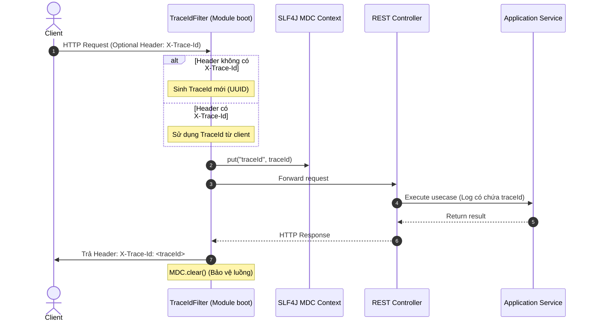

# Phase 1.8 — Thành phần 03: Observability: Logging & Distributed Tracing

Tài liệu này đặc tả cơ chế ghi log có cấu trúc (Structured Logging) và truy vết phân tán (Distributed Tracing) bằng Correlation ID trong E-Edu.

---

## 1. Cơ Chế Truy Vết Yêu Cầu Bằng Correlation ID (`TraceIdFilter`)

Mỗi yêu cầu HTTP đi vào hệ thống được gán một mã `Trace ID` duy nhất (UUID v4) để theo dõi toàn bộ đường đi của request qua các service, repository và log messages:



---

## 2. Chuẩn Hóa Cấu Trúc Log Message

Mọi thông báo log được định dạng chuẩn JSON để phục vụ việc thu thập và phân tích bởi ELK Stack (Elasticsearch, Logstash, Kibana) hoặc Grafana Loki:

```json
{
  "timestamp": "2026-10-25T12:45:00.123Z",
  "level": "INFO",
  "traceId": "c8a415a7-96a1-432d-9442-df21bb271a39",
  "userId": "e4b52df5-911f-4424-bcae-e722aa046342",
  "organizationId": "a0eebc99-9c0b-4ef8-bb6d-6bb9bd380a11",
  "logger": "com.edu.identity.application.service.IdentityService",
  "message": "User login successful for username=admin",
  "executionTimeMs": 24
}
```

### Quy tắc an toàn thông tin khi log:
1. **Tuyệt đối không log thông tin nhạy cảm**: Cấm log mật khẩu dạng plain-text, token bí mật, số thẻ thanh toán hoặc mã OTP.
2. **Che giấu dữ liệu định danh (Masking)**: Email và số điện thoại cần được che giấu một phần khi ghi vào log thông thường (ví dụ: `ad***@e-edu.vn`).
