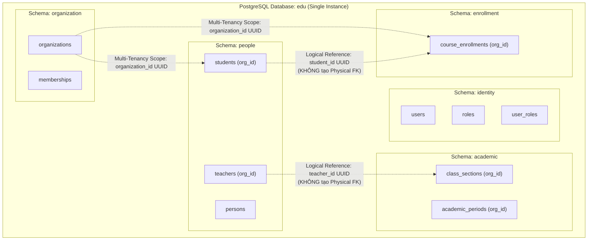

# E-Edu — Phase 2.3: PostgreSQL & Flyway

Mục tiêu của phase này là kết nối E-Edu với **PostgreSQL** đang chạy trong Docker container, thiết lập cơ chế quản lý migration theo phiên bản bằng **Flyway**, cấu hình datasource an toàn qua biến môi trường, và **chuẩn hóa thiết kế database theo đúng kiến trúc Modular Monolith** (AD-01: Multi-Tenancy & AD-02: Multi-Schema Strategy).

Kế thừa các quyết định kiến trúc đã thống nhất:

- **Java**: 21 (LTS).
- **Framework**: Spring Boot 3.4.3.
- **Build tool**: Maven Multi-Module (`boot`, `modules/*`, `shared/*`, `tests/*`).
- **Database Engine**: PostgreSQL 15 Alpine (chạy qua Docker Compose tại `backend/infrastructure/docker-compose.yml`, container `edu-postgres`).
- **Kiến trúc Dữ liệu**: **Modular Monolith Multi-Schema** — 1 Database vật lý, phân tách thành 12 Schema độc lập theo module.
- **Migration Tool**: Flyway quản lý toàn bộ thay đổi cấu trúc database theo phiên bản (`V{n}__{description}.sql`). Tuyệt đối không dùng Hibernate `ddl-auto: update` hay `create-drop` trong môi trường dùng chung.
- **Bảo mật & Multi-Tenancy**: Không hard-code mật khẩu; cách ly dữ liệu giữa các trường học bằng `organization_id UUID NOT NULL` (Shared Database + Shared Tables).

---

## 1. Tiêu chí Nghiệm thu Phase 2.3

| STT | Mã tiêu chí | Tiêu chí | Bằng chứng cần có |
| :---: | :---: | :--- | :--- |
| 1 | **AC-2.3.1** | PostgreSQL Docker sẵn sàng | Container `edu-postgres` hoạt động ổn định, mở cổng 5432 và nhận kết nối TCP |
| 2 | **AC-2.3.2** | Maven dependencies chuẩn xác | Khai báo PostgreSQL JDBC Driver, Flyway Core và Flyway PostgreSQL trong `boot/pom.xml`; build resolve thành công |
| 3 | **AC-2.3.3** | Cấu hình Datasource an toàn | `application.yml` nạp thông tin kết nối qua biến môi trường (`DB_URL`, `DB_USERNAME`, `DB_PASSWORD`), hỗ trợ giá trị mặc định cho local dev |
| 4 | **AC-2.3.4** | Flyway migration ban đầu | Script migration đầu tiên (`V1__create_initial_schemas.sql`) chạy thành công; bảng `flyway_schema_history` được tạo và ghi nhận phiên bản |
| 5 | **AC-2.3.5** | Chuẩn hóa Database Modular Monolith | Khởi tạo đầy đủ 12 Schema độc lập; tuân thủ quy tắc No Cross-Schema Foreign Keys và Multi-Tenancy Isolation |
| 6 | **AC-2.3.6** | Tính Idempotent của Migration | Khởi động lại ứng dụng không thực thi lại các migration đã áp dụng, không sinh lỗi trùng lặp |
| 7 | **AC-2.3.7** | Kiểm soát kịch bản lỗi | Ứng dụng báo lỗi rõ ràng khi sai mật khẩu, cơ sở dữ liệu chưa sẵn sàng hoặc script migration bị lỗi cú pháp |
| 8 | **AC-2.3.8** | Kiểm thử tự động | Chạy `mvn clean verify` thành công, kiểm thử Spring Context và kết nối DataSource không gặp sự cố |

> [!IMPORTANT]
> Các tiêu chí trên là chuẩn nghiệm thu kỹ thuật bắt buộc. Chỉ đánh dấu hoàn thành khi có bằng chứng kiểm chứng thực tế từ log ứng dụng, database và kết quả build Maven.

---

## 2. Quyết định Kiến trúc Phase 2.3 (Architectural Decisions)

| Mã quyết định | Chủ đề | Nội dung chi tiết |
| :--- | :--- | :--- |
| **DEC-2.3-01** | **Database Engine** | PostgreSQL chạy bằng Docker trong môi trường phát triển (`edu-postgres` qua port host `5432`). Backend chạy trực tiếp trên máy host ở giai đoạn hiện tại để tối ưu tốc độ debug. |
| **DEC-2.3-02** | **Schema-per-Module (AD-02)** | Mỗi module nghiệp vụ sở hữu một PostgreSQL schema riêng biệt (`identity`, `organization`, `academic`,...). Module tuyệt đối không tự ý truy cập trực tiếp hay sửa đổi bảng thuộc schema của module khác. |
| **DEC-2.3-03** | **No Cross-Schema Foreign Keys** | Giữa các schema khác nhau, **không tạo Foreign Key vật lý (Physical FK)**. Mọi liên kết liên module đều dùng **Logical ID Reference (UUID)** và xác thực tính hợp lệ ở tầng ứng dụng hoặc qua Domain Events. |
| **DEC-2.3-04** | **Multi-Tenancy Isolation (AD-01)** | Áp dụng mô hình *Shared Database, Shared Tables*. Các bảng thuộc phạm vi tổ chức bắt buộc có cột `organization_id UUID NOT NULL` và ràng buộc composite unique. |
| **DEC-2.3-05** | **Migration Tool & Ownership** | Sử dụng Flyway để quản lý toàn bộ thay đổi cấu trúc database. Mỗi module sở hữu tài nguyên migration của chính mình (`src/main/resources/db/migration/`). Module `boot` đóng vai trò Composition Root điều phối thực thi. |
| **DEC-2.3-06** | **Schema Validation (No DDL Auto)** | Flyway chịu trách nhiệm tạo và nâng cấp schema trước. Khi tích hợp JPA ở Phase 2.4, Hibernate chỉ được dùng ở chế độ `ddl-auto: validate` để đối soát entity với schema thực tế. |

---

## 3. Quy tắc Thiết kế Database chuẩn Modular Monolith

Để bảo đảm ứng dụng có thể phát triển bền vững, giữ vững tính độc lập giữa các module và sẵn sàng tách thành các dịch vụ độc lập trong tương lai (nếu cần), cơ sở dữ liệu của E-Edu bắt buộc tuân theo **5 nguyên tắc vàng** sau:



---

### Nguyên tắc 1: Phân tách Schema theo Module (AD-02)

Dự án sử dụng chung 1 database PostgreSQL nhưng phân chia thành **12 Schema riêng biệt**. Mỗi schema phản ánh đúng ranh giới của một Bounded Context trong Modular Monolith:

| Schema | Module sở hữu | Trách nhiệm dữ liệu cốt lõi | Các bảng chính dự kiến (Phase 1.5) |
| :--- | :--- | :--- | :--- |
| `identity` | `identity` | Tài khoản, đăng nhập, bảo mật, vai trò, quyền hạn | `users`, `roles`, `permissions`, `user_roles`, `role_permissions` |
| `organization` | `organization` | Trường học, phân hiệu, phòng ban, tư cách thành viên | `organizations`, `organization_units`, `memberships` |
| `configuration` | `configuration` | Cấu hình tham số hệ thống và thiết lập theo từng tổ chức | `system_configurations`, `organization_settings` |
| `people` | `people` | Danh tính công dân (Person), hồ sơ học sinh, giáo viên | `persons`, `students`, `teachers`, `guardians` |
| `curriculum` | `curriculum` | Chương trình đào tạo, môn học, phiên bản chương trình | `programs`, `program_versions`, `courses`, `program_courses` |
| `academic` | `academic` | Niên khóa, học kỳ, đợt mở môn, lớp học phần | `academic_periods`, `course_offerings`, `class_sections` |
| `enrollment` | `enrollment` | Đăng ký chương trình học, đăng ký môn học/lớp | `program_enrollments`, `course_enrollments` |
| `teaching` | `teaching` | Phân công giảng dạy, lịch trình, thời khóa biểu | `teaching_assignments`, `class_schedules` |
| `attendance` | `attendance` | Phiên điểm danh, bản ghi điểm danh và chuyên cần | `attendance_sessions`, `attendance_records` |
| `assessment` | `assessment` | Thang điểm, đầu điểm kiểm tra, bài thi, kết quả đánh giá | `assessment_schemes`, `assessments`, `assessment_results` |
| `certification` | `certification` | Xét điều kiện hoàn thành, tốt nghiệp, cấp chứng nhận | `completion_records`, `certificates` |
| `rule_engine` | `rule-engine` | Định nghĩa quy tắc (AD-04), phiên bản quy tắc, lịch sử thẩm định | `rule_definitions`, `rule_versions`, `rule_bindings`, `rule_evaluations` |

---

### Nguyên tắc 2: Ranh giới Khóa ngoại (NO Physical Cross-Schema Foreign Keys)

> [!WARNING]
> **Anti-Pattern cấm kỵ**: Tạo `FOREIGN KEY` nối từ bảng ở Schema A sang bảng ở Schema B.

#### Tại sao không dùng Foreign Key giữa các Schema?
1. **Khớp nối cơ sở dữ liệu cứng (Database Coupling)**: Tạo khóa ngoại vật lý sẽ khiến schema của hai module bị dính chặt vào nhau ở tầng database engine.
2. **Xung đột thứ tự Migration**: Khi module `enrollment` có FK trỏ sang `people.students`, migration của `enrollment` sẽ chết nếu `people` chưa tạo bảng hoặc khi thay đổi cấu trúc bảng.
3. **Phá hủy khả năng tách độc lập**: Trong tương lai, nếu một module (như `identity` hoặc `assessment`) cần tách ra thành microservice hoặc sử dụng database riêng, bạn sẽ không thể tách được vì các ràng buộc foreign key chéo.

#### Quy tắc chuẩn: Sử dụng Logical Reference (UUID)
- **Trong cùng một Schema**: Được phép tạo Foreign Key bình thường (ví dụ: `identity.user_roles` tạo FK trỏ sang `identity.users(id)` và `identity.roles(id)`).
- **Khác Schema**: Bảng chỉ lưu `UUID` thuần túy của đối tượng liên quan (ví dụ: `enrollment.course_enrollments` lưu cột `student_id UUID NOT NULL`, không tạo constraint foreign key sang `people.students(id)`).

```sql
-- ❌ SAI: Tạo FK chéo schema (Vi phạm Modular Monolith)
CREATE TABLE enrollment.course_enrollments (
    id UUID PRIMARY KEY,
    student_id UUID NOT NULL REFERENCES people.students(id) -- CẤM!
);

-- ✅ ĐÚNG: Lưu Logical ID Reference và đánh Index
CREATE TABLE enrollment.course_enrollments (
    id UUID PRIMARY KEY,
    organization_id UUID NOT NULL,
    student_id UUID NOT NULL,                              -- Logical ID
    class_section_id UUID NOT NULL,                        -- Logical ID
    status VARCHAR(30) NOT NULL,
    created_at TIMESTAMPTZ NOT NULL DEFAULT now(),
    updated_at TIMESTAMPTZ NOT NULL DEFAULT now()
);

CREATE INDEX idx_course_enrollments_student 
    ON enrollment.course_enrollments (organization_id, student_id);
```

#### Đảm bảo tính toàn vẹn dữ liệu như thế nào?
1. **Kiểm tra nghiệp vụ ở Application Layer**: Trước khi lưu `course_enrollment`, `EnrollmentService` gọi qua `PeopleFacade.validateStudentActive(studentId)` thông qua hợp đồng Java Interface của module `people`.
2. **Sử dụng Domain Events**: Khi một Student bị xóa/vô hiệu hóa, module `people` phát ra sự kiện `StudentDeactivatedEvent`, module `enrollment` bắt sự kiện để hủy hoặc đóng băng đăng ký tương ứng.

---

### Nguyên tắc 3: Cách ly Multi-Tenancy (AD-01: Shared Database, Shared Tables)

E-Edu phục vụ nhiều trường học/tổ chức giáo dục trên cùng một cơ sở dữ liệu. Để đảm bảo không bao giờ rò rỉ dữ liệu giữa các trường:

1. **Cột bắt buộc**: Mọi bảng thuộc dữ liệu nghiệp vụ của tổ chức bắt buộc phải có cột:
   ```sql
   organization_id UUID NOT NULL
   ```
2. **Ràng buộc duy nhất theo Tenant (Composite Unique Constraint)**:
   Mã sinh viên, mã môn học hay số hiệu lớp chỉ cần duy nhất trong phạm vi một trường:
   ```sql
   CONSTRAINT uq_students_org_number UNIQUE (organization_id, student_number)
   ```
3. **Composite Index phục vụ truy vấn**: Mọi câu query đều filter theo tenant, do đó index phải có `organization_id` ở vị trí đầu tiên:
   ```sql
   CREATE INDEX idx_students_org_status ON people.students (organization_id, status);
   ```

---

### Nguyên tắc 4: Cấm Cross-Schema SQL JOIN trong JPA / Hibernate

Trong mã nguồn backend:
- **JPA Repository của Module nào chỉ truy vấn Schema của Module đó**: `people` không được inject `StudentRepository` vào `enrollment`.
- **Cấm quan hệ ORM xuyên Module**: Tuyệt đối không dùng `@ManyToOne`, `@OneToMany` giữa các entity khác module:
  ```java
  // ❌ SAI: Entity CourseEnrollment nối trực tiếp sang Entity Student của module khác
  @Entity
  @Table(schema = "enrollment", name = "course_enrollments")
  public class CourseEnrollment {
      @ManyToOne
      private Student student; // CẤM!
  }

  // ✅ ĐÚNG: Chỉ lưu ID
  @Entity
  @Table(schema = "enrollment", name = "course_enrollments")
  public class CourseEnrollment {
      @Column(name = "student_id", nullable = false)
      private UUID studentId;
  }
  ```
- Khi cần lấy thông tin sinh viên kèm theo lượt đăng ký để hiển thị lên UI, tầng Application Service của `enrollment` sẽ lấy danh sách `studentId`, gọi sang `PeopleFacade.getStudentSummaries(studentIds)` rồi tổng hợp thành DTO trả về.

---

### Nguyên tắc 5: Chuẩn hóa Kiểu Dữ liệu & Naming Convention

Bám sát chuẩn hóa đã chốt tại Phase 1.5:

| Hạng mục | Quy ước chuẩn | Ví dụ minh họa |
| :--- | :--- | :--- |
| **Primary Key** | Luôn dùng `UUID` | `id UUID PRIMARY KEY DEFAULT gen_random_uuid()` |
| **Tên Schema** | `snake_case`, số ít | `identity`, `academic`, `rule_engine` |
| **Tên Bảng** | `snake_case`, số nhiều | `users`, `class_sections`, `assessments` |
| **Tên Cột** | `snake_case` | `organization_id`, `student_number`, `created_at` |
| **Thời gian có múi giờ** | `TIMESTAMPTZ` (lưu UTC) | `created_at TIMESTAMPTZ NOT NULL DEFAULT now()` |
| **Ngày không có giờ** | `DATE` | `birth_date DATE`, `start_date DATE` |
| **Điểm số & Tiền tệ** | `NUMERIC(p,s)` (Không dùng Float/Double) | `score NUMERIC(5,2)`, `amount NUMERIC(12,2)` |
| **Optimistic Locking** | Cột `version BIGINT` | `version BIGINT NOT NULL DEFAULT 0` |
| **Audit Columns** | Bắt buộc cho mọi entity | `created_at`, `updated_at` |

---

## 4. Cấu trúc Thư mục Mục tiêu

```text
backend/
├── pom.xml                                   # Root Parent POM (quản lý Spring Boot 3.4.3 BOM)
├── infrastructure/
│   └── docker-compose.yml                    # Định nghĩa container PostgreSQL (edu-postgres)
├── boot/
│   ├── pom.xml                               # Khai báo postgresql, flyway-core, flyway-database-postgresql
│   └── src/
│       ├── main/
│       │   ├── java/
│       │   │   └── com/edu/boot/
│       │   │       └── EduApplication.java   # Spring Boot Entry Point
│       │   └── resources/
│       │       ├── application.yml           # Cấu hình DataSource, Flyway Multi-Schema, Actuator
│       │       ├── application-local.yml     # Profile local phát triển
│       │       ├── application-test.yml      # Profile test tự động
│       │       └── db/
│       │           └── migration/
│       │               └── V1__create_initial_schemas.sql  # Migration khởi tạo 12 Schema cốt lõi
│       └── test/
│           └── java/
│               └── com/edu/boot/
│                   └── EduApplicationTests.java
└── modules/
    ├── identity/src/main/resources/db/migration/
    ├── organization/src/main/resources/db/migration/
    ├── people/src/main/resources/db/migration/
    ├── academic/src/main/resources/db/migration/
    └── ... (các module còn lại)
```

> [!NOTE]
> Đường dẫn module trong dự án là `boot/` và `modules/{name}/`, package gốc là `com.edu`. Tuyệt đối không dùng tiền tố `e-edu` trong tên thư mục hay mã nguồn.

---

## 5. Hướng dẫn Triển khai Chi tiết

### 5.1. Xác nhận PostgreSQL Docker

Trước khi sửa đổi cấu hình backend, cần đảm bảo container PostgreSQL đã sẵn sàng trên máy host.

Tệp cấu hình hiện hữu tại `backend/infrastructure/docker-compose.yml`:

```yaml
services:
  postgres:
    image: postgres:15-alpine
    container_name: edu-postgres
    ports:
      - "5432:5432"
    environment:
      POSTGRES_DB: edu
      POSTGRES_USER: postgres
      POSTGRES_PASSWORD: postgres
    volumes:
      - postgres_data:/var/lib/postgresql/data
    networks:
      - edu-network
    restart: unless-stopped
```

Các bước kiểm tra bằng PowerShell:

```powershell
# 1. Kiểm tra trạng thái container edu-postgres
docker ps --filter "name=edu-postgres"

# 2. Nếu container chưa chạy, khởi động bằng docker compose
cd backend/infrastructure
docker compose up -d postgres
cd ../..

# 3. Kiểm tra log khởi động của PostgreSQL
docker logs edu-postgres --tail 30

# 4. Xác nhận port 5432 đang lắng nghe kết nối
Test-NetConnection localhost -Port 5432

# 5. Kiểm tra trạng thái sẵn sàng bên trong container
docker exec edu-postgres pg_isready -U postgres -d edu
```

---

### 5.2. Tích hợp Dependency Maven

Trong dự án dùng Spring Boot 3.4.3, các dependency database được quản lý phiên bản tự động thông qua `spring-boot-starter-parent` tại root `pom.xml`. Do đó, ta chỉ cần khai báo dependency trong `boot/pom.xml` mà **không cần ghi cứng thẻ `<version>`**.

Cập nhật `boot/pom.xml`:

```xml
<dependencies>
    <!-- Các dependencies hiện có (starter-web, validation, actuator, modules)... -->

    <!-- PostgreSQL JDBC Driver -->
    <dependency>
        <groupId>org.postgresql</groupId>
        <artifactId>postgresql</artifactId>
        <scope>runtime</scope>
    </dependency>

    <!-- Flyway Core Migration Engine -->
    <dependency>
        <groupId>org.flywaydb</groupId>
        <artifactId>flyway-core</artifactId>
    </dependency>

    <!-- Flyway Database Extension cho PostgreSQL (Bắt buộc từ Flyway 10+) -->
    <dependency>
        <groupId>org.flywaydb</groupId>
        <artifactId>flyway-database-postgresql</artifactId>
    </dependency>
</dependencies>
```

> [!IMPORTANT]
> Từ Flyway version 10 trở đi (đi kèm Spring Boot 3.2+), module `flyway-database-postgresql` là **bắt buộc**. Nếu chỉ khai báo `flyway-core`, Flyway sẽ không thể nạp driver dialect cho PostgreSQL và gây lỗi `FlywayException: Unsupported Database: PostgreSQL`.

---

### 5.3. Cấu hình Datasource & Flyway Multi-Schema

Cập nhật tệp `boot/src/main/resources/application.yml` để tiếp nhận thông tin kết nối qua biến môi trường và cấu hình Flyway quản lý toàn bộ các schema của Modular Monolith:

```yaml
spring:
  application:
    name: edu

  profiles:
    default: local

  datasource:
    url: ${DB_URL:jdbc:postgresql://localhost:5432/edu}
    username: ${DB_USERNAME:postgres}
    password: ${DB_PASSWORD:postgres}
    driver-class-name: org.postgresql.Driver
    hikari:
      pool-name: EduHikariPool
      maximum-pool-size: 10
      minimum-idle: 2
      connection-timeout: 20000
      idle-timeout: 300000
      max-lifetime: 1200000

  flyway:
    enabled: true
    baseline-on-migrate: true
    validate-on-migrate: true
    # Schema mặc định chứa bảng lịch sử flyway_schema_history
    default-schema: public
    # Danh sách các schema thuộc quyền quản lý của Flyway
    schemas:
      - public
      - identity
      - organization
      - configuration
      - people
      - curriculum
      - academic
      - enrollment
      - teaching
      - attendance
      - assessment
      - certification
      - rule_engine
    locations:
      - classpath:db/migration

management:
  endpoints:
    web:
      exposure:
        include: health,info
  endpoint:
    health:
      show-details: when-authorized
      probes:
        enabled: true

logging:
  level:
    root: INFO
    com.edu: INFO
    org.flywaydb: INFO
```

Thiết lập biến môi trường khi chạy ứng dụng trên Windows PowerShell:

```powershell
$env:DB_URL = "jdbc:postgresql://localhost:5432/edu"
$env:DB_USERNAME = "postgres"
$env:DB_PASSWORD = "postgres"
```

---

### 5.4. Thiết kế & Khởi tạo Migration Ban Đầu (Baseline Schemas)

Tạo tệp migration đầu tiên tại `boot/src/main/resources/db/migration/V1__create_initial_schemas.sql`.

Mục đích của migration này là tạo sẵn toàn bộ 12 schema PostgreSQL để chuẩn bị ranh giới lưu trữ độc lập cho từng module:

```sql
-- =============================================================================
-- E-Edu Migration V1: Khởi tạo các Schema cho Kiến trúc Modular Monolith (AD-02)
-- =============================================================================

CREATE SCHEMA IF NOT EXISTS identity;
CREATE SCHEMA IF NOT EXISTS organization;
CREATE SCHEMA IF NOT EXISTS configuration;
CREATE SCHEMA IF NOT EXISTS people;
CREATE SCHEMA IF NOT EXISTS curriculum;
CREATE SCHEMA IF NOT EXISTS academic;
CREATE SCHEMA IF NOT EXISTS enrollment;
CREATE SCHEMA IF NOT EXISTS teaching;
CREATE SCHEMA IF NOT EXISTS attendance;
CREATE SCHEMA IF NOT EXISTS assessment;
CREATE SCHEMA IF NOT EXISTS certification;
CREATE SCHEMA IF NOT EXISTS rule_engine;

COMMENT ON SCHEMA identity IS 'Module Quản lý người dùng, tài khoản, vai trò và phân quyền';
COMMENT ON SCHEMA organization IS 'Module Quản lý cơ cấu trường, phân hiệu, phòng ban và membership';
COMMENT ON SCHEMA configuration IS 'Module Quản lý thiết lập hệ thống và quy tắc nghiệp vụ có kiểu';
COMMENT ON SCHEMA people IS 'Module Quản lý thông tin định danh Person, sinh viên, giảng viên';
COMMENT ON SCHEMA curriculum IS 'Module Quản lý chương trình đào tạo, môn học và khung kiến thức';
COMMENT ON SCHEMA academic IS 'Module Quản lý niên khóa, học kỳ, lớp học phần và thời khóa biểu';
COMMENT ON SCHEMA enrollment IS 'Module Quản lý quy trình đăng ký môn học và nhập học';
COMMENT ON SCHEMA teaching IS 'Module Quản lý phân công giảng dạy và hoạt động sư phạm';
COMMENT ON SCHEMA attendance IS 'Module Quản lý điểm danh và theo dõi chuyên cần';
COMMENT ON SCHEMA assessment IS 'Module Quản lý đầu điểm, kỳ thi và đánh giá kết quả';
COMMENT ON SCHEMA certification IS 'Module Quản lý điều kiện tốt nghiệp và cấp chứng nhận';
COMMENT ON SCHEMA rule_engine IS 'Module Động cơ thẩm định quy tắc nghiệp vụ theo phiên bản (AD-04)';
```

#### Quy tắc đặt tên file migration:
- Định dạng: `V{Version}__{Description}.sql` (ví dụ: `V1__create_initial_schemas.sql`, `V2__create_identity_tables.sql`).
- Hai dấu gạch dưới `__` ngăn cách giữa version và mô tả.
- Migration đã commit và chạy vào database môi trường dùng chung là **bất biến**; nếu cần điều chỉnh schema phải tạo script migration version mới.

---

### 5.5. Chiến lược Phân chia Migration theo Module

Trong mô hình Modular Monolith:
- **Phase 2.3**: Tập trung tạo baseline schemas (`V1__create_initial_schemas.sql` đặt tại `boot`).
- **Từ Phase 2.4 trở đi**: Khi từng module định nghĩa Entity và Table của mình, script migration sẽ được đặt ngay trong chính module đó:
  ```text
  modules/
  ├── identity/src/main/resources/db/migration/
  │   └── V2__create_identity_tables.sql
  ├── people/src/main/resources/db/migration/
  │   └── V3__create_people_tables.sql
  └── academic/src/main/resources/db/migration/
      └── V4__create_academic_tables.sql
  ```

Điều này bảo đảm **Data Ownership**: Developer khi làm việc trên module nào chỉ cần quan tâm đến thư mục và migration của module đó.

---

### 5.6. Kiểm thử Tình huống Lỗi & Độ Ổn Định

Một thiết lập cơ sở dữ liệu chất lượng phải xử lý và phản ánh chính xác các tình huống ngoại lệ:

1. **Sai thông tin xác thực (Bad Credentials)**:
   - Thử nghiệm: Truyền sai `$env:DB_PASSWORD = "wrongpassword"`.
   - Kết quả mong đợi: Ứng dụng dừng khởi động ngay tại bước kết nối Datasource/Flyway với log `org.postgresql.util.PSQLException: password authentication failed for user "postgres"`.
2. **PostgreSQL chưa sẵn sàng / Service Down**:
   - Thử nghiệm: Tắt container `docker stop edu-postgres` rồi khởi chạy backend.
   - Kết quả mong đợi: HikariCP log lỗi `Connection refused` và ứng dụng fail-fast, không tự ý bỏ qua bước kiểm tra database.
3. **Migration script lỗi cú pháp**:
   - Thử nghiệm: Chèn cú pháp SQL sai vào script migration.
   - Kết quả mong đợi: Flyway dừng thực thi, đánh dấu `success = false` trong `flyway_schema_history` và chặn đứng quá trình bootstrap ứng dụng.
4. **Kiểm tra tính Idempotent**:
   - Thử nghiệm: Khởi động lại ứng dụng lần 2 sau khi migration thành công.
   - Kết quả mong đợi: Flyway xác nhận `Current version of schema "public": 1`, in log `Schema "public" is up to date. No migration necessary.` và không chạy lại script cũ.

---

## 6. Runbook Thực thi & Nghiệm thu

### Bước 1 — Build và kiểm tra Dependencies
Từ thư mục root `backend/`:

```powershell
mvn clean install -DskipTests
```

Đảm bảo toàn bộ 19 module build thành công (`BUILD SUCCESS`).

### Bước 2 — Khởi động Ứng dụng
Khởi chạy module boot bằng Spring Boot Maven Plugin:

```powershell
mvn -pl boot spring-boot:run
```

Kiểm tra log console hiển thị các dòng tương tự:
```text
o.f.c.i.database.base.BaseDatabaseType   : Database: jdbc:postgresql://localhost:5432/edu (PostgreSQL 15.x)
o.f.core.internal.command.DbValidate     : Successfully validated 1 migration (execution time 00:00.015s)
o.f.core.internal.command.DbMigrate      : Current version of schema "public": << Empty Schema >>
o.f.core.internal.command.DbMigrate      : Migrating schema "public" to version "1 - create initial schemas"
o.f.core.internal.command.DbMigrate      : Successfully applied 1 migration to schema "public", now at version v1
c.z.h.HikariDataSource                   : EduHikariPool - Start completed.
c.e.b.EduApplication                     : Started EduApplication in 2.854 seconds
```

### Bước 3 — Kiểm tra Health Endpoint
Mở cửa sổ PowerShell mới:

```powershell
curl.exe http://localhost:8080/actuator/health
```

Kết quả mong đợi trả về trạng thái UP bao gồm chi tiết `db` (khi đã expose):

```json
{"status":"UP","components":{"db":{"status":"UP","details":{"database":"PostgreSQL","validationQuery":"isValid()"}},"diskSpace":{"status":"UP"},"ping":{"status":"UP"}}}
```

### Bước 4 — Kiểm tra Bảng Lịch sử Migration trong PostgreSQL
Truy vấn trực tiếp cơ sở dữ liệu để xác minh:

```powershell
docker exec -it edu-postgres psql -U postgres -d edu -c "SELECT installed_rank, version, description, type, script, execution_time, success FROM flyway_schema_history;"
```

Kết quả mong đợi:
```text
 installed_rank | version |      description       | type |             script             | execution_time | success 
----------------+---------+------------------------+------+--------------------------------+----------------+---------
              1 | 1       | create initial schemas | SQL  | V1__create_initial_schemas.sql |             25 | t
(1 row)
```

Kiểm tra danh sách schema đã được tạo:
```powershell
docker exec -it edu-postgres psql -U postgres -d edu -c "\dn"
```

Tất cả 12 schema (`identity`, `organization`, `academic`, `people`, `curriculum`, `enrollment`, `teaching`, `attendance`, `assessment`, `certification`, `configuration`, `rule_engine`) phải xuất hiện trong kết quả truy vấn.

---

## 7. Checklist Nghiệm thu Phase 2.3

**Tiến độ Nghiệm thu Phase 2.3 (8/8) — ĐÃ HOÀN THÀNH**

- [x] **AC-2.3.1: PostgreSQL sẵn sàng** — Container Docker `edu-postgres` UP, mở cổng 5432 và nhận kết nối (`pg_isready -d edu`).
- [x] **AC-2.3.2: Maven dependencies** — Thêm PostgreSQL driver, Flyway Core, Flyway PostgreSQL và Starter JDBC vào `boot/pom.xml`, build resolve thành công.
- [x] **AC-2.3.3: Datasource cấu hình qua Env** — `application.yml` nhận `DB_URL`, `DB_USERNAME`, `DB_PASSWORD` an toàn và kết nối được HikariCP.
- [x] **AC-2.3.4: Migration đầu tiên** — Script `V1__create_initial_schemas.sql` chạy thành công, tạo bảng `flyway_schema_history`.
- [x] **AC-2.3.5: Chuẩn hóa DB Modular Monolith** — Khởi tạo đủ 12 schema riêng; tuân thủ nghiêm ngặt nguyên tắc No Cross-Schema Foreign Keys và Multi-Tenancy Isolation.
- [x] **AC-2.3.6: Idempotent migration** — Khởi động lại ứng dụng không thực thi lại migration cũ, giữ nguyên tính toàn vẹn.
- [x] **AC-2.3.7: Kiểm soát kịch bản lỗi** — Ứng dụng fail-fast và báo lỗi rõ ràng khi sai thông tin xác thực hoặc script migration lỗi.
- [x] **AC-2.3.8: Tự động hóa kiểm thử** — Chạy `mvn clean verify` thành công 19/19 module, bộ 5 tests trong `EduApplicationTests` pass 100%.

> [!NOTE]
> Sau khi Phase 2.3 hoàn tất nghiệm thu, toàn bộ nền tảng lưu trữ và cơ chế migration đã sẵn sàng để chuyển sang **Phase 2.4 — Persistence Layer & Core Data Model** (Spring Data JPA, Entity mapping, Base Repository).
