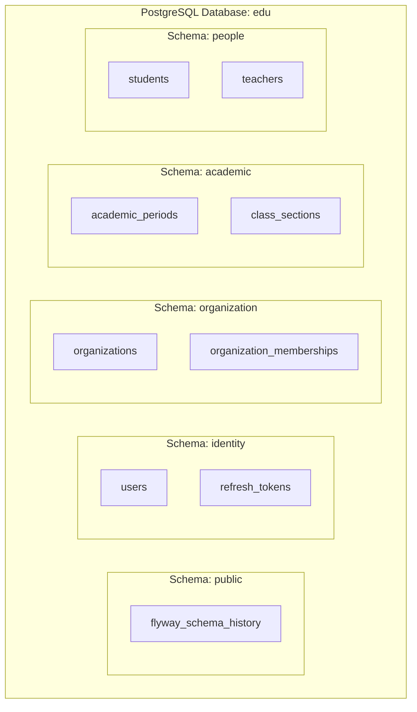

# Phase 2.3 — Thành phần 02: Multi-Schema Architecture & Isolation Rules

Tài liệu này đặc tả kiến trúc cơ sở dữ liệu Multi-Schema trong Modular Monolith và các nguyên tắc bảo vệ ranh giới dữ liệu.

---

## 1. Sơ Đồ Kiến Trúc Cơ Sở Dữ Liệu Multi-Schema

---

## 2. Năm Nguyên Tắc Vàng Trong Thiết Kế Database Modular Monolith

1. **Schema-per-Module (Độc quyền sở hữu)**:
   - Mỗi module chỉ được phép đọc và ghi dữ liệu trong schema của chính mình.
   - Cấm module A viết câu lệnh SQL truy cập trực tiếp schema của module B.
2. **No Cross-Schema Foreign Keys (Cấm khóa ngoại vật lý liên schema)**:
   - Giữa các bảng thuộc 2 schema khác nhau, chỉ lưu trữ `UUID` (Logical Reference).
   - Kiểm tra ràng buộc hợp lệ thông qua tầng ứng dụng (Public Ports / Facades).
3. **Multi-Tenancy Isolation (Cô lập tổ chức)**:
   - Tất cả các bảng thuộc phạm vi tổ chức bắt buộc có `organization_id UUID NOT NULL`.
   - Các chỉ mục duy nhất phải kết hợp với `organization_id`.
4. **Không dùng Hibernate Auto-DDL**:
   - `ddl-auto: validate` là chế độ bắt buộc.
   - Toàn bộ cấu trúc CSDL do Flyway kiểm soát.
5. **Auditing Fields Thống Nhất**:
   - Mọi bảng đều chứa `created_at` và `updated_at` kiểu `TIMESTAMPTZ` (UTC).
