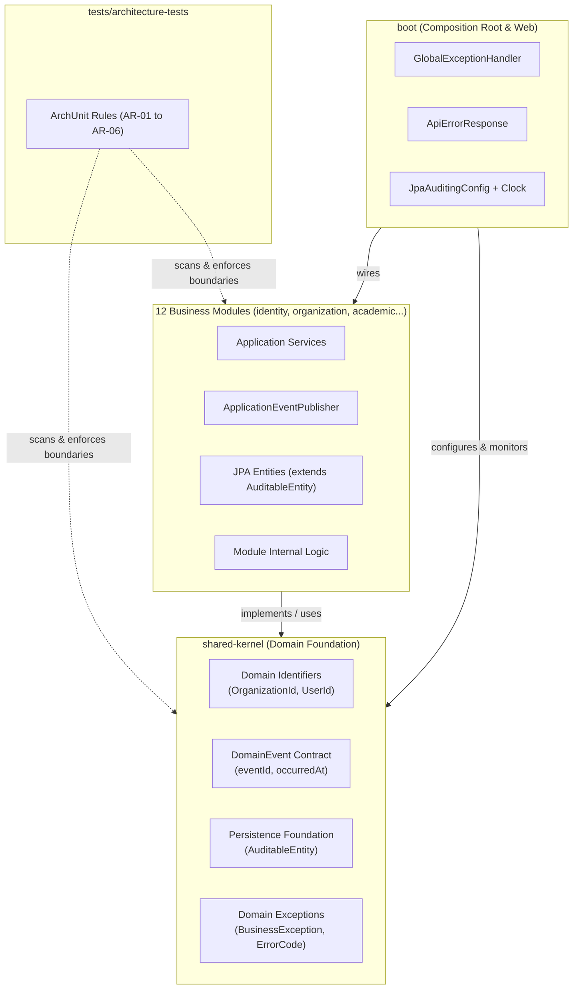

# E-Edu — Phase 2.4: Shared Kernel & Domain Foundation

Mục tiêu của Phase 2.4 là thiết lập nền tảng kỹ thuật dùng chung (**Shared Kernel**) và các **Domain Primitives** cốt lõi cho 12 module nghiệp vụ của E-Edu. 

Phase này bảo đảm tính nhất quán toàn hệ thống trước khi triển khai thực thể (JPA Entities) và logic nghiệp vụ chi tiết cho các module `identity` và `organization` ở Phase 2.5:

- **Java**: 21 (LTS).
- **Framework**: Spring Boot 3.4.3.
- **Build tool**: Maven Multi-Module (`com.edu:parent`).
- **Persistence Foundation**: Quy chuẩn JPA/Hibernate, Auditing, Optimistic Locking và tương thích với PostgreSQL Multi-Schema (Phase 2.3).
- **Inter-Module Decoupling**: Giao tiếp lỏng (loose coupling) qua Domain Events và public facades/interfaces, không phụ thuộc chéo vào implementation nội bộ.
- **Error Handling**: Chuẩn hóa cấu trúc phản hồi lỗi REST API, bảo mật thông tin và phân loại mã lỗi có kiểu.
- **Kiểm soát Kiến trúc**: Tự động hóa kiểm tra ranh giới phụ thuộc bằng ArchUnit 1.4.1 trong quá trình build Maven.

---

## 1. Tiêu chí Nghiệm thu Phase 2.4 (Acceptance Criteria)

| STT | Mã tiêu chí | Tiêu chí | Bằng chứng cần có |
| :---: | :---: | :--- | :--- |
| 1 | **AC-2.4.1** | Domain Primitives & Strongly Typed IDs | Các định danh `OrganizationId`, `UserId` được triển khai bằng Java Record bất biến; có unit test kiểm tra tính toàn vẹn và validation. |
| 2 | **AC-2.4.2** | Persistence Foundation & Auditing | `AuditableEntity` cung cấp `createdAt`, `updatedAt` tự động qua Spring Data JPA Auditing; cấu hình `@EnableJpaAuditing` và `Clock` chuẩn UTC. |
| 3 | **AC-2.4.3** | Domain Events & Inter-Module Communication | Hợp đồng `DomainEvent` được chuẩn hóa; cơ chế phát sự kiện qua `ApplicationEventPublisher`; consumer lắng nghe không phụ thuộc entity nội bộ. |
| 4 | **AC-2.4.4** | Global Exception Handling | `GlobalExceptionHandler` bắt lỗi validation (trả `fieldErrors`), `HttpMessageNotReadableException`, `BusinessException` và lỗi hệ thống không làm lộ stack trace. |
| 5 | **AC-2.4.5** | Error Response Thống nhất | `ApiErrorResponse` chuẩn hóa cấu trúc JSON (timestamp, status, code, message, path, fieldErrors) trên toàn bộ endpoints. |
| 6 | **AC-2.4.6** | Thực thi Kiểm thử Kiến trúc ArchUnit | Bộ test ArchUnit kiểm soát thành công các quy tắc: `shared` không phụ thuộc business modules, không có cyclic dependencies giữa các module, bảo vệ internal package. |
| 7 | **AC-2.4.7** | Tích hợp Build & Reactor Verification | `mvn clean verify` chạy thành công toàn bộ reactor gồm 19 modules; toàn bộ unit tests và architecture tests pass. |

> [!IMPORTANT]
> Các tiêu chí trên là chuẩn nghiệm thu kỹ thuật bắt buộc. Chỉ đánh dấu hoàn thành khi có bằng chứng kiểm chứng thực tế từ log ứng dụng, kết quả chạy test và lệnh build Maven.

---

## 2. Quyết định Kiến trúc Phase 2.4 (Architectural Decisions)

| Mã quyết định | Chủ đề | Nội dung chi tiết |
| :--- | :--- | :--- |
| **DEC-2.4-01** | **Strongly Typed IDs** | Sử dụng Java Record để bọc `UUID` cho các định danh chính (`OrganizationId`, `UserId`). Tránh truyền nhầm ID giữa các đối tượng khác loại ở tầng domain/service. |
| **DEC-2.4-02** | **Timestamp & Clock Injection** | Sử dụng `java.time.Instant` cho toàn bộ mốc thời gian lưu trữ persistence. Ứng dụng inject `java.time.Clock` bean (mặc định UTC) để phục vụ kiểm thử determinism. |
| **DEC-2.4-03** | **Persistence Auditing** | `AuditableEntity` là `@MappedSuperclass` cung cấp `created_at` và `updated_at`. Không bắt buộc mọi entity phải kế thừa ID từ một BaseEntity cứng nhắc để giữ tính linh hoạt của từng module. |
| **DEC-2.4-04** | **Schema Validation (No DDL Auto)** | Khi tích hợp JPA Starter, Hibernate bắt buộc cấu hình `ddl-auto: validate`. Toàn bộ cấu trúc bảng và schema do Flyway quản lý theo Phase 2.3. |
| **DEC-2.4-05** | **Domain Events Contract** | Domain Event là hợp đồng bất biến (Record), chỉ truyền tải ID và giá trị cần thiết, tuyệt đối không đính kèm JPA entity được quản lý bởi Hibernate Session. |
| **DEC-2.4-06** | **Global Error Specification** | Toàn bộ API trả lỗi theo cấu trúc `ApiErrorResponse`. Lỗi hệ thống trả mã `INTERNAL_ERROR` (HTTP 500) và log chi tiết tại server, không trả stack trace ra ngoài. |
| **DEC-2.4-07** | **Automated Architectural Enforcement** | Quy chuẩn hóa các quy tắc phụ thuộc module thành mã kiểm thử thực thi bằng ArchUnit 1.4.1 trong module `tests/architecture-tests`. |

---

## 3. Cấu trúc Package Mục tiêu

```text
backend/
├── shared/
│   └── shared-kernel/
│       ├── pom.xml
│       └── src/
│           ├── main/java/com/edu/shared/kernel/
│           │   ├── domain/
│           │   │   ├── identifier/
│           │   │   │   ├── OrganizationId.java
│           │   │   │   └── UserId.java
│           │   │   └── event/
│           │   │       └── DomainEvent.java
│           │   ├── persistence/
│           │   │   └── AuditableEntity.java
│           │   └── exception/
│           │       ├── ErrorCode.java
│           │       ├── BusinessException.java
│           │       └── ResourceNotFoundException.java
│           └── test/java/com/edu/shared/kernel/
│               └── domain/
│                   └── identifier/
│                       └── OrganizationIdTest.java
│
├── boot/
│   ├── pom.xml
│   └── src/
│       ├── main/java/com/edu/boot/
│       │   ├── EduApplication.java
│       │   ├── config/
│       │   │   ├── DateTimeConfig.java
│       │   │   └── JpaAuditingConfig.java
│       │   └── web/
│       │       ├── ApiErrorResponse.java
│       │       └── GlobalExceptionHandler.java
│       └── test/java/com/edu/boot/
│           └── web/
│               └── GlobalExceptionHandlerTest.java
│
└── tests/
    └── architecture-tests/
        ├── pom.xml
        └── src/test/java/com/edu/architecture/
            ├── ArchitectureTestsSmokeTest.java
            ├── ModuleDependencyArchitectureTest.java
            └── SharedKernelArchitectureTest.java
```

---

## 4. Chi tiết Thiết kế & Triển khai Kỹ thuật



---

### 4.1. Common Types & Domain Primitives

Các module nghiệp vụ cần các kiểu định danh nhất quán để tránh lỗi truyền sai đối số (primitive obsession) và hỗ trợ multi-tenancy.

#### 1. Định danh tổ chức: `OrganizationId`

```java
package com.edu.shared.kernel.domain.identifier;

import java.io.Serializable;
import java.util.Objects;
import java.util.UUID;

public record OrganizationId(UUID value) implements Serializable {

    public OrganizationId {
        Objects.requireNonNull(value, "OrganizationId value must not be null");
    }

    public static OrganizationId generate() {
        return new OrganizationId(UUID.randomUUID());
    }

    public static OrganizationId of(UUID value) {
        return new OrganizationId(value);
    }

    public static OrganizationId fromString(String value) {
        Objects.requireNonNull(value, "OrganizationId string must not be null");
        return new OrganizationId(UUID.fromString(value));
    }

    @Override
    public String toString() {
        return value.toString();
    }
}
```

#### 2. Định danh người dùng: `UserId`

```java
package com.edu.shared.kernel.domain.identifier;

import java.io.Serializable;
import java.util.Objects;
import java.util.UUID;

public record UserId(UUID value) implements Serializable {

    public UserId {
        Objects.requireNonNull(value, "UserId value must not be null");
    }

    public static UserId generate() {
        return new UserId(UUID.randomUUID());
    }

    public static UserId of(UUID value) {
        return new UserId(value);
    }

    public static UserId fromString(String value) {
        Objects.requireNonNull(value, "UserId string must not be null");
        return new UserId(UUID.fromString(value));
    }

    @Override
    public String toString() {
        return value.toString();
    }
}
```

#### 3. Quy chuẩn sử dụng kiểu định danh

```java
// Bad: Dùng UUID nguyên thủy, dễ nhầm lẫn vị trí tham số
public void assignUserToOrg(UUID organizationId, UUID userId) { ... }
// Nguy cơ gọi nhầm: assignUserToOrg(userId, orgId); // Compiler không bắt được lỗi

// Good: Sử dụng Domain Primitives có kiểu rõ ràng
public void assignUserToOrg(OrganizationId organizationId, UserId userId) { ... }
// Trình biên dịch ngăn chặn ngay lập tức nếu truyền sai vị trí
```

#### 4. Cấu hình `Clock` bean chuẩn hóa thời gian

Trong `boot/src/main/java/com/edu/boot/config/DateTimeConfig.java`:

```java
package com.edu.boot.config;

import org.springframework.context.annotation.Bean;
import org.springframework.context.annotation.Configuration;

import java.time.Clock;

@Configuration
public class DateTimeConfig {

    @Bean
    public Clock clock() {
        return Clock.systemUTC();
    }
}
```

#### 5. Kiểm thử Unit Test cho `OrganizationId`

Trong `shared/shared-kernel/src/test/java/com/edu/shared/kernel/domain/identifier/OrganizationIdTest.java`:

```java
package com.edu.shared.kernel.domain.identifier;

import org.junit.jupiter.api.DisplayName;
import org.junit.jupiter.api.Test;

import java.util.UUID;

import static org.junit.jupiter.api.Assertions.assertEquals;
import static org.junit.jupiter.api.Assertions.assertNotEquals;
import static org.junit.jupiter.api.Assertions.assertNotNull;
import static org.junit.jupiter.api.Assertions.assertThrows;

class OrganizationIdTest {

    @Test
    @DisplayName("Nên tạo hai OrganizationId ngẫu nhiên khác nhau")
    void shouldGenerateUniqueIds() {
        OrganizationId id1 = OrganizationId.generate();
        OrganizationId id2 = OrganizationId.generate();

        assertNotNull(id1);
        assertNotNull(id2);
        assertNotEquals(id1, id2);
    }

    @Test
    @DisplayName("Nên từ chối giá trị UUID null")
    void shouldRejectNullValue() {
        NullPointerException exception = assertThrows(
                NullPointerException.class,
                () -> new OrganizationId(null)
        );
        assertEquals("OrganizationId value must not be null", exception.getMessage());
    }

    @Test
    @DisplayName("Nên khởi tạo thành công từ UUID hợp lệ")
    void shouldCreateIdFromExistingUuid() {
        UUID rawUuid = UUID.randomUUID();
        OrganizationId id = OrganizationId.of(rawUuid);

        assertEquals(rawUuid, id.value());
        assertEquals(rawUuid.toString(), id.toString());
    }
}
```

---

### 4.2. Persistence Foundation & Auditing

Nhằm bảo đảm tính đồng bộ với PostgreSQL schemas đã khởi tạo ở Phase 2.3, toàn bộ entity persistence trong hệ thống phải tuân theo các quy ước:

1. **Primary Key**: Sử dụng `UUID` cho toàn bộ các bảng nghiệp vụ.
2. **Audit Timestamps**: Bắt buộc có `created_at` (bất biến) và `updated_at` (cập nhật khi sửa).
3. **Optimistic Locking**: Các entity có nguy cơ xung đột ghi đồng thời (concurrent update) sử dụng `@Version private Long version`.
4. **No Physical Cross-Schema Foreign Keys**: Giữa các schema khác nhau, tham chiếu chỉ lưu dưới dạng `UUID` logic (ví dụ `organization_id UUID NOT NULL`).

#### 1. Lớp cơ sở: `AuditableEntity`

Trong `shared/shared-kernel/src/main/java/com/edu/shared/kernel/persistence/AuditableEntity.java`:

```java
package com.edu.shared.kernel.persistence;

import jakarta.persistence.Column;
import jakarta.persistence.EntityListeners;
import jakarta.persistence.MappedSuperclass;
import org.springframework.data.annotation.CreatedDate;
import org.springframework.data.annotation.LastModifiedDate;
import org.springframework.data.jpa.domain.support.AuditingEntityListener;

import java.time.Instant;

@MappedSuperclass
@EntityListeners(AuditingEntityListener.class)
public abstract class AuditableEntity {

    @CreatedDate
    @Column(name = "created_at", nullable = false, updatable = false)
    private Instant createdAt;

    @LastModifiedDate
    @Column(name = "updated_at", nullable = false)
    private Instant updatedAt;

    protected AuditableEntity() {
    }

    public Instant getCreatedAt() {
        return createdAt;
    }

    public void setCreatedAt(Instant createdAt) {
        this.createdAt = createdAt;
    }

    public Instant getUpdatedAt() {
        return updatedAt;
    }

    public void setUpdatedAt(Instant updatedAt) {
        this.updatedAt = updatedAt;
    }
}
```

#### 2. Kích hoạt JPA Auditing

Trong `boot/src/main/java/com/edu/boot/config/JpaAuditingConfig.java`:

```java
package com.edu.boot.config;

import org.springframework.context.annotation.Configuration;
import org.springframework.data.jpa.repository.config.EnableJpaAuditing;

@Configuration
@EnableJpaAuditing
public class JpaAuditingConfig {
}
```

#### 3. Cấu hình kiểm tra Schema trong `application.yml`

```yaml
spring:
  jpa:
    hibernate:
      ddl-auto: validate
    open-in-view: false
    properties:
      hibernate:
        format_sql: true
        jdbc:
          time_zone: UTC
```

> [!NOTE]
> Tuyệt đối không dùng `ddl-auto: update` hoặc `create-drop`. Hibernate chỉ thực hiện xác thực (`validate`) cấu trúc entity khớp với migration do Flyway quản lý.

---

### 4.3. Domain Events & Inter-Module Communication

Trong kiến trúc Modular Monolith, các module giao tiếp thông qua hai phương thức tùy theo yêu cầu nghiệp vụ:

| Hình thức | Cơ chế | Mục đích | Ví dụ |
| :--- | :--- | :--- | :--- |
| **Đồng bộ (Synchronous)** | Java Interface / Facade công khai | Cần dữ liệu trả về ngay lập tức để tiếp tục luồng | `identity` gọi `OrganizationFacade` để kiểm tra trạng thái hoạt động của trường học |
| **Bất đồng bộ / Báo hiệu (Asynchronous)** | Spring Application Events | Thông báo một hành động đã hoàn tất trong domain; giảm thiểu phụ thuộc trực tiếp | `organization` phát sự kiện `OrganizationCreatedEvent` để các module khác khởi tạo dữ liệu mặc định |

#### 1. Hợp đồng cơ sở: `DomainEvent`

Trong `shared/shared-kernel/src/main/java/com/edu/shared/kernel/domain/event/DomainEvent.java`:

```java
package com.edu.shared.kernel.domain.event;

import java.time.Instant;
import java.util.UUID;

public interface DomainEvent {

    UUID eventId();

    Instant occurredAt();
}
```

#### 2. Ví dụ Sự kiện cụ thể thuộc Public API của Module `organization`

```java
package com.edu.organization.api.event;

import com.edu.shared.kernel.domain.event.DomainEvent;

import java.time.Instant;
import java.util.UUID;

public record OrganizationCreatedEvent(
        UUID eventId,
        Instant occurredAt,
        UUID organizationId,
        String organizationCode,
        String organizationName
) implements DomainEvent {

    public OrganizationCreatedEvent {
        if (eventId == null) {
            eventId = UUID.randomUUID();
        }
        if (occurredAt == null) {
            occurredAt = Instant.now();
        }
    }
}
```

#### 3. Quy chuẩn phát và lắng nghe sự kiện

```java
// Bad: Phát event chứa nguyên đối tượng JPA Entity được Hibernate quản lý
public void publishEvent(OrganizationJpaEntity entity) {
    eventPublisher.publishEvent(entity); // Rò rỉ persistence context, gây dirty check hoặc lazy loading ngoại lai
}

// Good: Phát event dạng immutable Record chỉ chứa dữ liệu nguyên thủy hoặc IDs
public void publishOrganizationCreated(UUID orgId, String code, String name) {
    eventPublisher.publishEvent(new OrganizationCreatedEvent(
            UUID.randomUUID(),
            Instant.now(clock),
            orgId,
            code,
            name
    ));
}
```

Ở phía Consumer lắng nghe:
```java
// Bad: Consumer truy cập trực tiếp bảng hoặc repository nội bộ của module khác
@Component
public class IdentityListener {
    @Autowired
    private OrganizationRepository orgRepo; // VI PHẠM RANH GIỚI KIẾN TRÚC
}

// Good: Consumer chỉ lắng nghe Public Event và lưu thông tin vào schema của chính mình
@Component
public class IdentityOrganizationCreatedListener {

    private final IdentityUserProvisioningService provisioningService;

    public IdentityOrganizationCreatedListener(IdentityUserProvisioningService provisioningService) {
        this.provisioningService = provisioningService;
    }

    @EventListener
    public void onOrganizationCreated(OrganizationCreatedEvent event) {
        provisioningService.initializeDefaultAdminAccount(
                event.organizationId(),
                event.organizationCode()
        );
    }
}
```

> [!NOTE]
> Nếu consumer cần bảo đảm dữ liệu của module phát đã được commit vật lý vào database trước khi xử lý, sử dụng `@TransactionalEventListener(phase = TransactionPhase.AFTER_COMMIT)`.

---

### 4.4. Chuẩn hóa Xử lý Lỗi & REST Exception Handling

Toàn bộ 12 module trả về lỗi REST theo định dạng chuẩn hóa an toàn, không rò rỉ chi tiết hạ tầng (stack trace, câu lệnh SQL, tên bảng).

#### 1. Bảng quy chuẩn mã trạng thái HTTP

| Tình huống nghiệp vụ / Kỹ thuật | HTTP Status | Mã lỗi hệ thống (`code`) |
| :--- | :---: | :--- |
| Dữ liệu đầu vào sai định dạng, vi phạm Bean Validation | `400 Bad Request` | `VALIDATION_FAILED` |
| JSON Body không parse được hoặc sai cấu trúc | `400 Bad Request` | `INVALID_REQUEST_BODY` |
| Chưa xác thực hoặc Token không hợp lệ / hết hạn | `401 Unauthorized` | `UNAUTHORIZED` |
| Đã xác thực nhưng không đủ quyền truy cập | `403 Forbidden` | `ACCESS_DENIED` |
| Bản ghi không tồn tại trong phạm vi tổ chức | `404 Not Found` | `RESOURCE_NOT_FOUND` / `{ENTITY}_NOT_FOUND` |
| Vi phạm ràng buộc duy nhất (trùng mã, trùng email) | `409 Conflict` | `DUPLICATE_RESOURCE` / `{ENTITY}_CONFLICT` |
| Lỗi hệ thống ngoài dự kiến | `500 Internal Server Error` | `INTERNAL_ERROR` |

#### 2. Đối tượng phản hồi: `ApiErrorResponse`

Trong `boot/src/main/java/com/edu/boot/web/ApiErrorResponse.java`:

```java
package com.edu.boot.web;

import com.fasterxml.jackson.annotation.JsonInclude;

import java.time.Instant;
import java.util.Map;

@JsonInclude(JsonInclude.Include.NON_EMPTY)
public record ApiErrorResponse(
        Instant timestamp,
        int status,
        String code,
        String message,
        String path,
        Map<String, String> fieldErrors
) {
    public static ApiErrorResponse of(
            int status,
            String code,
            String message,
            String path
    ) {
        return new ApiErrorResponse(Instant.now(), status, code, message, path, Map.of());
    }

    public static ApiErrorResponse ofValidation(
            int status,
            String code,
            String message,
            String path,
            Map<String, String> fieldErrors
    ) {
        return new ApiErrorResponse(Instant.now(), status, code, message, path, fieldErrors);
    }
}
```

#### 3. Exception Cơ sở cho Nghiệp vụ: `BusinessException`

Trong `shared/shared-kernel/src/main/java/com/edu/shared/kernel/exception/BusinessException.java`:

```java
package com.edu.shared.kernel.exception;

public class BusinessException extends RuntimeException {

    private final String code;
    private final int httpStatus;

    public BusinessException(String code, String message, int httpStatus) {
        super(message);
        this.code = code;
        this.httpStatus = httpStatus;
    }

    public BusinessException(String code, String message) {
        this(code, message, 400);
    }

    public String getCode() {
        return code;
    }

    public int getHttpStatus() {
        return httpStatus;
    }
}
```

Lớp con thường dùng `ResourceNotFoundException`:
```java
package com.edu.shared.kernel.exception;

public class ResourceNotFoundException extends BusinessException {

    public ResourceNotFoundException(String resourceName, String identifier) {
        super(
                "RESOURCE_NOT_FOUND",
                String.format("%s not found with identifier: %s", resourceName, identifier),
                404
        );
    }
}
```

#### 4. Triển khai `GlobalExceptionHandler`

Trong `boot/src/main/java/com/edu/boot/web/GlobalExceptionHandler.java`:

```java
package com.edu.boot.web;

import com.edu.shared.kernel.exception.BusinessException;
import jakarta.servlet.http.HttpServletRequest;
import org.slf4j.Logger;
import org.slf4j.LoggerFactory;
import org.springframework.http.HttpStatus;
import org.springframework.http.ResponseEntity;
import org.springframework.http.converter.HttpMessageNotReadableException;
import org.springframework.validation.FieldError;
import org.springframework.web.bind.MethodArgumentNotValidException;
import org.springframework.web.bind.annotation.ExceptionHandler;
import org.springframework.web.bind.annotation.RestControllerAdvice;

import java.time.Instant;
import java.util.LinkedHashMap;
import java.util.Map;

@RestControllerAdvice
public class GlobalExceptionHandler {

    private static final Logger log = LoggerFactory.getLogger(GlobalExceptionHandler.class);

    @ExceptionHandler(MethodArgumentNotValidException.class)
    public ResponseEntity<ApiErrorResponse> handleValidationException(
            MethodArgumentNotValidException ex,
            HttpServletRequest request
    ) {
        Map<String, String> fieldErrors = new LinkedHashMap<>();
        for (FieldError error : ex.getBindingResult().getFieldErrors()) {
            fieldErrors.putIfAbsent(error.getField(), error.getDefaultMessage() != null ? error.getDefaultMessage() : "Invalid value");
        }

        ApiErrorResponse body = new ApiErrorResponse(
                Instant.now(),
                HttpStatus.BAD_REQUEST.value(),
                "VALIDATION_FAILED",
                "Request validation failed",
                request.getRequestURI(),
                fieldErrors
        );

        return ResponseEntity.status(HttpStatus.BAD_REQUEST).body(body);
    }

    @ExceptionHandler(HttpMessageNotReadableException.class)
    public ResponseEntity<ApiErrorResponse> handleUnreadableBody(
            HttpMessageNotReadableException ex,
            HttpServletRequest request
    ) {
        ApiErrorResponse body = ApiErrorResponse.of(
                HttpStatus.BAD_REQUEST.value(),
                "INVALID_REQUEST_BODY",
                "Malformed JSON request body",
                request.getRequestURI()
        );
        return ResponseEntity.status(HttpStatus.BAD_REQUEST).body(body);
    }

    @ExceptionHandler(BusinessException.class)
    public ResponseEntity<ApiErrorResponse> handleBusinessException(
            BusinessException ex,
            HttpServletRequest request
    ) {
        ApiErrorResponse body = ApiErrorResponse.of(
                ex.getHttpStatus(),
                ex.getCode(),
                ex.getMessage(),
                request.getRequestURI()
        );
        return ResponseEntity.status(ex.getHttpStatus()).body(body);
    }

    @ExceptionHandler(Exception.class)
    public ResponseEntity<ApiErrorResponse> handleUnexpectedException(
            Exception ex,
            HttpServletRequest request
    ) {
        log.error("Unhandled exception processing request to {}", request.getRequestURI(), ex);

        ApiErrorResponse body = ApiErrorResponse.of(
                HttpStatus.INTERNAL_SERVER_ERROR.value(),
                "INTERNAL_ERROR",
                "An unexpected server error occurred",
                request.getRequestURI()
        );
        return ResponseEntity.status(HttpStatus.INTERNAL_SERVER_ERROR).body(body);
    }
}
```

---

### 4.5. Thực thi Kiểm thử Kiến trúc với ArchUnit 1.4.1

Module `tests/architecture-tests` đóng vai trò là chốt chặn tự động ngăn chặn việc phá vỡ thiết kế Modular Monolith trong suốt vòng đời dự án.

#### Bảng quy tắc kiến trúc bắt buộc (Architectural Rules)

| Mã Rule | Tên quy tắc | Nội dung kiểm soát |
| :---: | :--- | :--- |
| **AR-01** | `SharedKernelIndependence` | `com.edu.shared..` tuyệt đối không được phụ thuộc vào bất kỳ business module nào (`com.edu.modules..`). |
| **AR-02** | `NoCyclicDependencies` | Không tồn tại bất kỳ vòng phụ thuộc (cyclic dependencies) nào giữa các business modules. |
| **AR-03** | `InternalPackageEncapsulation` | Các business module không được phép truy cập trực tiếp vào các package nội bộ (`..internal..`) của module khác. |
| **AR-04** | `CompositionRootResponsibility` | Chỉ có module `com.edu.boot..` được phép tích hợp và wiring tất cả các module lại với nhau. |
| **AR-05** | `NoEntityLeakageInEvents` | Các lớp triển khai `DomainEvent` không được phụ thuộc vào package `jakarta.persistence..` hoặc các entity persistence. |
| **AR-06** | `ReactorVerificationInclusion` | Toàn bộ kiểm thử ArchUnit phải chạy tự động trong pha `mvn test` và `mvn verify`. |

#### Triển khai Test ArchUnit cho Shared Kernel

Trong `tests/architecture-tests/src/test/java/com/edu/architecture/SharedKernelArchitectureTest.java`:

```java
package com.edu.architecture;

import com.tngtech.archunit.core.domain.JavaClasses;
import com.tngtech.archunit.core.importer.ClassFileImporter;
import com.tngtech.archunit.lang.ArchRule;
import org.junit.jupiter.api.BeforeAll;
import org.junit.jupiter.api.DisplayName;
import org.junit.jupiter.api.Test;

import static com.tngtech.archunit.lang.syntax.ArchRuleDefinition.noClasses;

class SharedKernelArchitectureTest {

    private static JavaClasses importedClasses;

    @BeforeAll
    static void setup() {
        importedClasses = new ClassFileImporter().importPackages("com.edu");
    }

    @Test
    @DisplayName("AR-01: Shared Kernel không được phụ thuộc vào các Business Modules")
    void sharedKernelMustNotDependOnBusinessModules() {
        ArchRule rule = noClasses()
                .that().resideInAPackage("com.edu.shared..")
                .should().dependOnClassesThat()
                .resideInAnyPackage(
                        "com.edu.identity..",
                        "com.edu.organization..",
                        "com.edu.people..",
                        "com.edu.curriculum..",
                        "com.edu.academic..",
                        "com.edu.enrollment..",
                        "com.edu.teaching..",
                        "com.edu.attendance..",
                        "com.edu.assessment..",
                        "com.edu.ruleengine..",
                        "com.edu.configuration..",
                        "com.edu.certification.."
                );

        rule.check(importedClasses);
    }

    @Test
    @DisplayName("AR-05: Domain Events không được phụ thuộc vào JPA Entities")
    void domainEventsMustNotDependOnJpa() {
        ArchRule rule = noClasses()
                .that().implement("com.edu.shared.kernel.domain.event.DomainEvent")
                .should().dependOnClassesThat()
                .resideInAPackage("jakarta.persistence..");

        rule.check(importedClasses);
    }
}
```

#### Triển khai Test ArchUnit kiểm tra Dependency Cycles giữa các Module

Trong `tests/architecture-tests/src/test/java/com/edu/architecture/ModuleDependencyArchitectureTest.java`:

```java
package com.edu.architecture;

import com.tngtech.archunit.core.domain.JavaClasses;
import com.tngtech.archunit.core.importer.ClassFileImporter;
import org.junit.jupiter.api.BeforeAll;
import org.junit.jupiter.api.DisplayName;
import org.junit.jupiter.api.Test;

import static com.tngtech.archunit.library.dependencies.SlicesRuleDefinition.slices;

class ModuleDependencyArchitectureTest {

    private static JavaClasses importedClasses;

    @BeforeAll
    static void setup() {
        importedClasses = new ClassFileImporter().importPackages("com.edu");
    }

    @Test
    @DisplayName("AR-02: Không được có chu trình phụ thuộc vòng (cycles) giữa các modules")
    void modulesMustBeFreeOfCycles() {
        slices()
                .matching("com.edu.(*)..")
                .should()
                .beFreeOfCycles()
                .check(importedClasses);
    }
}
```

---

## 5. Quy trình Kiểm thử & Xác minh (Verification Guide)

### Bước 1 — Kiểm tra Cấu trúc Maven Reactor
Mở cửa sổ PowerShell tại thư mục `backend/`:

```powershell
mvn validate
```

Kết quả mong đợi: Toàn bộ 19 modules được nhận diện chính xác và sắp xếp theo đúng thứ tự dependency hierarchy.

### Bước 2 — Chạy Kiểm thử Đơn vị trong Shared Kernel
```powershell
mvn -pl shared/shared-kernel test
```

Xác nhận các unit test của `OrganizationIdTest`, `UserIdTest` chạy thành công 100%.

### Bước 3 — Chạy Bộ Kiểm thử Kiến trúc ArchUnit
```powershell
mvn -pl tests/architecture-tests -am test
```

Bộ quy tắc AR-01 đến AR-05 được thực thi; không có vi phạm ranh giới package hoặc rò rỉ JPA entities vào Shared Kernel.

### Bước 4 — Kiểm thử Toàn diện Toàn bộ Dự án
```powershell
mvn clean verify
```

Kết quả mong đợi: `BUILD SUCCESS` trên toàn bộ 19 modules mà không gặp lỗi compilation, lỗi context hoặc lỗi kiến trúc.

#### Bảng xử lý sự cố thường gặp (Troubleshooting Matrix)

| Nhóm lỗi | Biểu hiện thường gặp | Cách xử lý chuẩn |
| :--- | :--- | :--- |
| **Compilation Error** | Không tìm thấy class `AuditableEntity` hoặc `OrganizationId` | Kiểm tra khai báo dependency `shared-kernel` trong module tương ứng; kiểm tra đúng package `com.edu.shared.kernel`. |
| **ArchUnit Failure** | `Architecture violation: ... should not depend on ...` | Đọc kỹ dependency path trong log; thay thế direct import bằng Public Event hoặc ID tham chiếu; không xóa rule để vượt qua test. |
| **Auditing Failure** | `createdAt` hoặc `updatedAt` bị `null` khi persist | Kiểm tra cấu hình `@EnableJpaAuditing` trong cấu hình boot; bảo đảm entity đã gắn `@EntityListeners(AuditingEntityListener.class)`. |
| **Flyway Conflict** | Hibernate báo lỗi không khớp schema | Kiểm tra `ddl-auto: validate` so với file migration `V1__create_initial_schemas.sql`; đảm bảo đúng schema search path. |

---

## 6. Checklist Nghiệm thu Phase 2.4

**Tiến độ Nghiệm thu Phase 2.4 (7/7 tiêu chí) — ĐÃ HOÀN THÀNH**

| Tiêu chí | Mô tả | Trạng thái |
| :--- | :--- | :---: |
| **AC-2.4.1** | Domain Primitives (`OrganizationId`, `UserId`) triển khai bằng Record có unit test | Yes |
| **AC-2.4.2** | Persistence Foundation (`AuditableEntity`, Auditing, Clock UTC, JPA validate) | Yes |
| **AC-2.4.3** | Domain Events contract (`DomainEvent`), publisher và listener decoupler | Yes |
| **AC-2.4.4** | Global Exception Handling (`GlobalExceptionHandler`, `BusinessException`) | Yes |
| **AC-2.4.5** | Error response chuẩn hóa theo `ApiErrorResponse` | Yes |
| **AC-2.4.6** | Bộ kiểm thử kiến trúc ArchUnit (AR-01 đến AR-06) hoạt động ổn định | Yes |
| **AC-2.4.7** | `mvn clean verify` build thành công 19/19 module với đầy đủ test passes | Yes |

> [!NOTE]
> Nghiệm thu hoàn tất: Lệnh `mvn clean verify` thực thi thành công 19/19 modules trong 20.393 giây, toàn bộ 22 bài kiểm thử (8 test trong `shared-kernel`, 10 test trong `boot`, 4 test trong `architecture-tests`) đạt 100% pass rate.

---

## 7. Kế hoạch Chuyển giao sang Phase 2.5 (Identity & Organization)

Sau khi Phase 2.4 hoàn tất nghiệm thu và toàn bộ Shared Kernel cùng các quy tắc kiểm thử kiến trúc đã sẵn sàng, hệ thống sẽ bước vào triển khai hai module nền tảng đầu tiên trong **Phase 2.5 — Identity & Organization**:

1. **Module `organization`**:
   - Thiết kế Entity và Schema migration cho `organizations`, `organization_units`, `memberships`.
   - Cơ chế thiết lập multi-tenancy context dựa trên `organization_id`.
   - Public API Facade và Domain Events khi một tổ chức/cơ sở đào tạo được tạo lập hoặc kích hoạt.

2. **Module `identity`**:
   - Thiết kế Entity và Schema migration cho `users`, `roles`, `permissions`, `user_roles`.
   - Tích hợp Spring Security 6, Password Hashing (BCrypt), JWT Token Provider (Access Token 15 phút, Refresh Token 7 ngày).
   - Triển khai `JwtAuthenticationFilter` và RBAC theo ngữ cảnh từng tổ chức (`organization_id`).

3. **Tích hợp Liên Module**:
   - `identity` lắng nghe sự kiện từ `organization` để tạo tài khoản quản trị viên mặc định (`ORG_ADMIN`).
   - Kiểm thử cô lập dữ liệu (tenant isolation) giữa các trường học độc lập.
