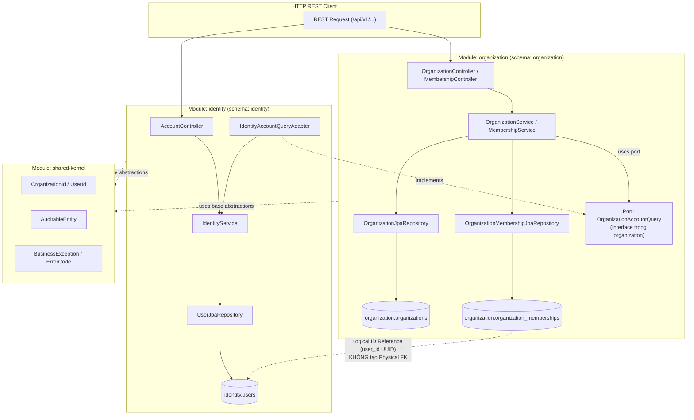

# E-Edu — Phase 2.5: Identity & Organization Core

Mục tiêu của Phase 2.5 là thiết kế và triển khai hai module nền tảng cốt lõi đầu tiên của hệ thống E-Edu: **`identity`** (quản lý người dùng, định danh, mã hóa mật khẩu) và **`organization`** (quản lý tổ chức, phân hiệu/cơ sở đào tạo, tư cách thành viên, cô lập tenant theo `organization_id`).

Phase này chuyển đổi các quyết định kiến trúc từ Phase 1 và Shared Kernel từ Phase 2.4 thành các thực thể dữ liệu (JPA Entities), migration (Flyway), application services, phân quyền theo vai trò (RBAC), và REST API endpoints hoàn chỉnh:

- **Java**: 21 (LTS).
- **Framework**: Spring Boot 3.4.3.
- **Build tool**: Maven Multi-Module (`com.edu:parent`).
- **Database Engine**: PostgreSQL 15 (Docker container `edu-postgres`).
- **Database Strategy**: Modular Monolith Multi-Schema — `identity` sở hữu schema `identity`, `organization` sở hữu schema `organization`.
- **Ranh giới Liên Module**: Tuyệt đối không tạo Foreign Key vật lý (Physical FK) xuyên schema; liên kết thông qua Logical ID (`UUID`), Public Ports/Facades, hoặc Spring Application Events.
- **Migration & Schema Validation**: Flyway quản lý migration có phiên bản (`V2`, `V3`, `V4`); Hibernate hoạt động ở chế độ `ddl-auto: validate`.
- **Bảo mật & Hashing**: Sử dụng `BCryptPasswordEncoder` (Spring Security Crypto); không lưu trữ hoặc trả về mật khẩu dạng văn bản thô (plaintext) hay password hash qua API.

---

## 1. Tiêu chí Nghiệm thu Phase 2.5 (Acceptance Criteria)

| STT | Mã tiêu chí | Tiêu chí | Bằng chứng cần có |
| :---: | :---: | :--- | :--- |
| 1 | **AC-2.5.1** | Flyway Migrations | Các migration script `V2__create_identity_users.sql`, `V3__create_organizations.sql`, `V4__create_organization_memberships.sql` chạy thành công, tạo đầy đủ bảng, chỉ mục và ràng buộc CHECK/UNIQUE. |
| 2 | **AC-2.5.2** | JPA Entities & Mapping | Các entity `UserEntity`, `OrganizationEntity`, `OrganizationMembershipEntity` kế thừa `AuditableEntity`, cấu hình đúng schema và vượt qua kiểm tra Hibernate `ddl-auto: validate`. |
| 3 | **AC-2.5.3** | Organization Services | `OrganizationService` và `MembershipService` xử lý đầy đủ các use case: tạo tổ chức, xem thông tin, cập nhật trạng thái, mời thành viên, kích hoạt và đình chỉ thành viên. |
| 4 | **AC-2.5.4** | Identity Services | `IdentityService` thực hiện đăng ký tài khoản, mã hóa mật khẩu qua BCrypt, tra cứu danh tính và thay đổi trạng thái tài khoản (`ACTIVE`, `LOCKED`, `DISABLED`). |
| 5 | **AC-2.5.5** | Module Decoupling qua Public Ports | Module `organization` xác minh tính hợp lệ của tài khoản thông qua interface `OrganizationAccountQuery`, không import trực tiếp entity hoặc repository của module `identity`. |
| 6 | **AC-2.5.6** | Phân quyền RBAC & Tenant Scope | Xác lập mô hình quyền theo tổ chức (`OWNER`, `ADMIN`, `MEMBER`); ngăn chặn truy cập dữ liệu trái phép giữa các tổ chức khác nhau (Tenant Isolation). |
| 7 | **AC-2.5.7** | REST API & Contract DTOs | Triển khai các REST endpoints tại `/api/v1/identity/*` và `/api/v1/organizations/*`; kiểm tra validation dữ liệu đầu vào qua Bean Validation (`@Valid`); response tuân thủ chuẩn `ApiErrorResponse` khi có lỗi. |
| 8 | **AC-2.5.8** | Tự động hóa Kiểm thử & Build Reactor | Toàn bộ unit tests, mock WebMvc tests và ArchUnit tests chạy thành công; lệnh `mvn clean verify` đạt kết quả BUILD SUCCESS trên toàn bộ 19 modules. |

> [!IMPORTANT]
> Các tiêu chí trên là chuẩn nghiệm thu kỹ thuật bắt buộc. Chỉ đánh dấu hoàn thành khi có bằng chứng kiểm chứng thực tế từ log ứng dụng, database migration history và kết quả build Maven.

---

## 2. Quyết định Kiến trúc Phase 2.5 (Architectural Decisions)

| Mã quyết định | Chủ đề | Nội dung chi tiết |
| :--- | :--- | :--- |
| **DEC-2.5-01** | **Independent Schemas & Logical Reference** | `identity.users` và `organization.organizations` thuộc hai schema riêng biệt. Bảng `organization.organization_memberships` lưu `user_id UUID NOT NULL` mà **không tạo Physical FK** sang schema `identity`. Tính toàn vẹn được xác thực qua Application Port. |
| **DEC-2.5-02** | **Password Hashing Standard** | Mật khẩu tài khoản bắt buộc được mã hóa bằng thuật toán BCrypt với work factor tối thiểu 10 (`BCryptPasswordEncoder`). Tuyệt đối không log thông tin mật khẩu hoặc đính kèm `passwordHash` trong DTO trả về. |
| **DEC-2.5-03** | **Multi-Tenancy Isolation Scope** | Một người dùng có thể là thành viên của nhiều tổ chức với vai trò khác nhau. Mọi truy vấn dữ liệu nghiệp vụ tổ chức bắt buộc phải lọc theo `organization_id` và xác nhận người dùng có membership hợp lệ ở trạng thái `ACTIVE`. |
| **DEC-2.5-04** | **Port/Adapter Inter-Module Decoupling** | Module `organization` khai báo interface `OrganizationAccountQuery` trong application layer của chính nó. Module `identity` cung cấp adapter triển khai interface này, bảo đảm nguyên tắc Dependency Inversion. |
| **DEC-2.5-05** | **RBAC Hierarchy per Organization** | Vai trò được gán theo ngữ cảnh từng tổ chức: `OWNER` (toàn quyền quản trị tổ chức và xóa/chuyển nhượng), `ADMIN` (quản trị thành viên, cập nhật thông tin), `MEMBER` (thành viên thông thường). |
| **DEC-2.5-06** | **Contract DTOs vs JPA Entities** | REST Controllers chỉ nhận và trả về các Record DTOs (`RegisterAccountRequest`, `AccountView`, `CreateOrganizationRequest`, `OrganizationView`, `MembershipView`). Tuyệt đối không để lộ JPA Entity ra tầng Web. |

---

## 3. Cấu trúc Package & Sơ đồ Tương tác Kiến trúc



### Cấu trúc Thư mục Mã nguồn Mục tiêu

```text
backend/modules/
├── identity/
│   ├── pom.xml
│   └── src/
│       ├── main/
│       │   ├── java/com/edu/identity/
│       │   │   ├── api/
│       │   │   │   └── dto/
│       │   │   │       ├── RegisterAccountRequest.java
│       │   │   │       └── AccountView.java
│       │   │   ├── application/
│       │   │   │   ├── command/
│       │   │   │   │   ├── RegisterAccountCommand.java
│       │   │   │   │   └── ChangeAccountStatusCommand.java
│       │   │   │   ├── port/
│       │   │   │   │   └── IdentityAccountQueryAdapter.java
│       │   │   │   └── service/
│       │   │   │       └── IdentityService.java
│       │   │   ├── domain/
│       │   │   │   ├── model/
│       │   │   │   │   └── UserStatus.java
│       │   │   │   └── exception/
│       │   │   │       ├── DuplicateUsernameException.java
│       │   │   │       └── DuplicateEmailException.java
│       │   │   └── infrastructure/
│       │   │       ├── persistence/
│       │   │       │   ├── entity/
│       │   │       │   │   └── UserEntity.java
│       │   │       │   └── repository/
│       │   │       │       └── UserJpaRepository.java
│       │   │       ├── security/
│       │   │       │   └── PasswordEncoderConfig.java
│       │   │       └── web/
│       │   │           └── AccountController.java
│       │   └── resources/
│       │       └── db/migration/
│       │           └── V2__create_identity_users.sql
│       └── test/java/com/edu/identity/
│           ├── application/service/IdentityServiceTest.java
│           └── infrastructure/web/AccountControllerTest.java
│
└── organization/
    ├── pom.xml
    └── src/
        ├── main/
        │   ├── java/com/edu/organization/
        │   │   ├── api/
        │   │   │   └── dto/
        │   │   │       ├── CreateOrganizationRequest.java
        │   │   │       ├── UpdateOrganizationRequest.java
        │   │   │       ├── OrganizationView.java
        │   │   │       ├── InviteMemberRequest.java
        │   │   │       └── MembershipView.java
        │   │   ├── application/
        │   │   │   ├── command/
        │   │   │   │   ├── CreateOrganizationCommand.java
        │   │   │   │   ├── UpdateOrganizationCommand.java
        │   │   │   │   ├── InviteMemberCommand.java
        │   │   │   │   └── UpdateMemberStatusCommand.java
        │   │   │   ├── port/
        │   │   │   │   └── OrganizationAccountQuery.java
        │   │   │   └── service/
        │   │   │       ├── OrganizationService.java
        │   │   │       └── MembershipService.java
        │   │   ├── domain/
        │   │   │   ├── model/
        │   │   │   │   ├── OrganizationStatus.java
        │   │   │   │   ├── OrganizationRole.java
        │   │   │   │   └── MembershipStatus.java
        │   │   │   └── exception/
        │   │   │       ├── DuplicateOrganizationCodeException.java
        │   │   │       ├── OrganizationNotFoundException.java
        │   │   │       └── MembershipConflictException.java
        │   │   └── infrastructure/
        │   │       ├── persistence/
        │   │       │   ├── entity/
        │   │       │   │   ├── OrganizationEntity.java
        │   │       │   │   └── OrganizationMembershipEntity.java
        │   │       │   └── repository/
        │   │       │       ├── OrganizationJpaRepository.java
        │   │       │       └── OrganizationMembershipJpaRepository.java
        │   │       └── web/
        │   │           ├── OrganizationController.java
        │   │           └── MembershipController.java
        │   └── resources/
        │       └── db/migration/
        │           ├── V3__create_organizations.sql
        │           └── V4__create_organization_memberships.sql
        └── test/java/com/edu/organization/
            ├── application/service/OrganizationServiceTest.java
            └── infrastructure/web/OrganizationControllerTest.java
```

---

## 4. Chi tiết Thiết kế & Triển khai Kỹ thuật (Tài liệu Thành phần)

Nội dung kỹ thuật chi tiết của Phase 2.5 được tách thành các tài liệu chuyên biệt dưới đây để dễ theo dõi và tra cứu:

| STT | Tài liệu | Nội dung chính |
| :---: | :--- | :--- |
| **01** | [Database Schemas & Flyway Migrations](01-database-migrations.md) | V2 (Identity), V3 (Organization), V4 (Memberships) SQL migrations |
| **02** | [JPA Entities & Repositories](02-jpa-entities-and-repositories.md) | UserEntity, OrganizationEntity, OrganizationMembershipEntity & Repositories |
| **03** | [Organization Application Services](03-organization-services.md) | Public Port OrganizationAccountQuery, OrganizationService, MembershipService |
| **04** | [Identity Application Services](04-identity-services.md) | IdentityService, OrganizationAccountQueryAdapter (Decoupling) |
| **05** | [Phân quyền RBAC & Cô lập Tenant](05-rbac-and-tenant-isolation.md) | Ma trận phân quyền tổ chức, quy chuẩn kiểm tra quyền Application layer |
| **06** | [REST API Controllers & DTOs](06-rest-api-controllers.md) | Account registration API, Organization CRUD & Membership management APIs |
| **07** | [ArchUnit & Verification Guide](07-archunit-and-verification.md) | ArchUnit rules, hướng dẫn xác minh Docker/PostgreSQL, checklist nghiệm thu |

---

> Quay lại [Phase 2 Index](../README.md) hoặc [Backend Roadmap](../../backend-roadmap.md).
