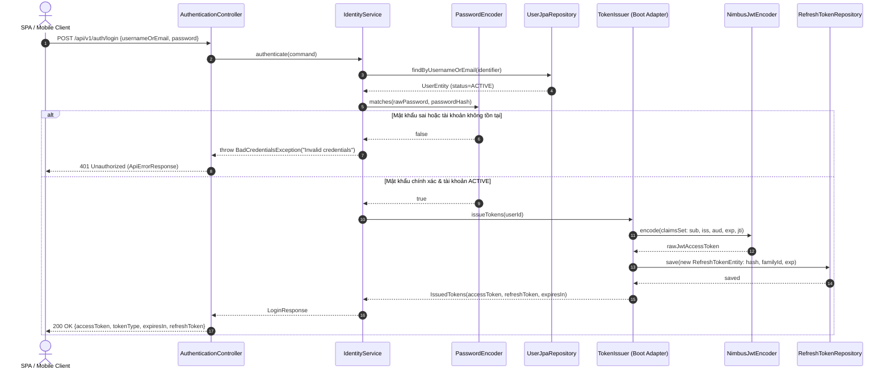
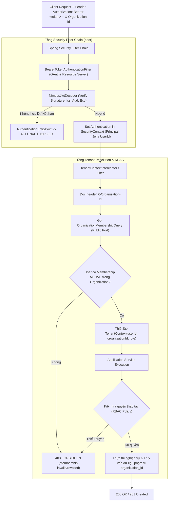

# E-Edu — Phase 2.6: Security & JWT Token Management

Mục tiêu của Phase 2.6 là thiết kế, đặc tả kỹ thuật và triển khai toàn diện hệ thống bảo mật **Spring Security 6** và cơ chế quản lý **JWT Access Token / Opaque Refresh Token** cho nền tảng E-Edu. 

Phase này hiện thực hóa các quyết định kiến trúc bảo mật trong mô hình **Modular Monolith Multi-Schema**, bảo đảm ranh giới độc lập giữa các module `identity` (xác thực danh tính, quản lý refresh token), `organization` (quản lý membership, phân quyền RBAC theo tenant), `shared-kernel` (tenant context, lỗi chuẩn hóa) và `boot` (security filter chain, token validation wiring):

- **Java**: 21 (LTS).
- **Framework**: Spring Boot 3.4.3 & Spring Security 6.
- **Security Architecture**: Stateless Session (`SessionCreationPolicy.STATELESS`), xác thực Bearer Token (JWT).
- **Token Strategy**:
  - **Access Token**: JWT ký số bằng thuật toán HMAC-SHA256 (HS256) với khóa bí mật tối thiểu 256-bit (32 bytes), thời hạn ngắn (10–15 phút), chứa claims định danh (`sub`, `iss`, `aud`, `iat`, `exp`, `jti`).
  - **Refresh Token**: Chuỗi ngẫu nhiên bảo mật (Cryptographically Secure Opaque Token, 256-bit entropy), lưu trữ dạng mã băm SHA-256 (`token_hash`) trong schema `identity`, có cơ chế **Rotation** bắt buộc, nhóm phiên (**Token Family**), và tự động thu hồi toàn chuỗi khi phát hiện hành vi tái sử dụng (**Reuse Detection**).
- **Multi-Tenancy & RBAC**: Tenant Resolution qua header `X-Organization-Id`; xác minh membership hiệu lực và quyền hạn (Role-Based Access Control) thông qua Public Port của module `organization`, ngăn chặn tuyệt đối lỗi IDOR (Insecure Direct Object Reference) và rò rỉ dữ liệu chéo tenant.
- **Error Handling**: Chuẩn hóa phản hồi lỗi 401 Unauthorized và 403 Forbidden theo hợp đồng JSON `ApiErrorResponse` thống nhất toàn hệ thống.
- **Database Strategy**: Bổ sung bảng `identity.refresh_tokens` thông qua Flyway migration `V5__create_identity_refresh_tokens.sql`; bảo đảm Hibernate `ddl-auto: validate`.

---

## 1. Tiêu chí Nghiệm thu Phase 2.6 (Acceptance Criteria)

| STT | Mã tiêu chí | Tiêu chí | Bằng chứng cần có |
| :---: | :---: | :--- | :--- |
| 1 | **AC-2.6.1** | **Security Architecture & ADR** | Chốt và tài liệu hóa 4 Architecture Decision Records: ADR-013 (Stateless Auth & JWT), ADR-014 (Refresh Token Rotation), ADR-015 (Tenant-scoped RBAC), ADR-016 (Module Boundaries & Ports). |
| 2 | **AC-2.6.2** | **Security Dependencies & Configuration** | Tích hợp `spring-boot-starter-security` và `spring-boot-starter-oauth2-resource-server` vào `boot/pom.xml`; cấu hình properties có validation (`issuer`, `audience`, `secret-base64`, `access-token-ttl`, `refresh-token-ttl`). |
| 3 | **AC-2.6.3** | **Authentication API (Login)** | Triển khai endpoint `POST /api/v1/auth/login`; xác thực tài khoản qua BCrypt; trả về bộ token (`accessToken`, `refreshToken`, `expiresIn`); ngăn chặn timing attack và không để lộ trạng thái tồn tại của tài khoản. |
| 4 | **AC-2.6.4** | **JWT Access Token Lifecycle** | Phát hành JWT bằng `NimbusJwtEncoder`, xác minh bằng `NimbusJwtDecoder`; kiểm tra nghiêm ngặt chữ ký số, issuer, audience và expiration time; tích hợp `Clock` UTC từ `shared-kernel`. |
| 5 | **AC-2.6.5** | **Refresh Token Management & Storage** | Migration `V5__create_identity_refresh_tokens.sql`; lưu trữ hash SHA-256; triển khai `POST /api/v1/auth/refresh` và `POST /api/v1/auth/logout`; xử lý rotation an toàn đa luồng (concurrency lock); phát hiện reuse và thu hồi token family. |
| 6 | **AC-2.6.6** | **Stateless Security Filter Chain** | Cấu hình `SecurityFilterChain` chỉ mở các endpoint công khai hợp lệ (`/api/v1/auth/login`, `/api/v1/auth/refresh`, `/api/v1/auth/logout`, `/api/v1/identity/accounts/register`); cấu hình custom `AuthenticationEntryPoint` (401) và `AccessDeniedHandler` (403) trả về `ApiErrorResponse`. |
| 7 | **AC-2.6.7** | **Tenant Resolution & RBAC** | Trích xuất `X-Organization-Id` vào `TenantContext`; kiểm tra membership qua Public Port `OrganizationMembershipQuery`; thực thi kiểm soát phân quyền (`OWNER`, `ADMIN`, `MEMBER`) trước khi thực thi nghiệp vụ; cô lập dữ liệu theo tenant. |
| 8 | **AC-2.6.8** | **Security Integration Tests & Verification** | Toàn bộ kiểm thử unit tests, WebMvc slice tests, và integration tests (chạy với PostgreSQL Testcontainers) thành công; kiểm tra vi phạm ranh giới module bằng ArchUnit; lệnh `mvn clean verify` đạt BUILD SUCCESS. |
| 9 | **AC-2.6.9** | **Security Hardening & Audit Checklist** | Rà soát cấu hình bí mật môi trường, chống timing attack, phòng chống brute-force, ngăn chặn token leakage trong log/error response và rà soát lỗ hổng theo OWASP API Security Top 10. |

> [!IMPORTANT]
> Toàn bộ các tiêu chí trên là chuẩn nghiệm thu kỹ thuật bắt buộc. Không đánh dấu hoàn thành chỉ dựa trên khai báo lý thuyết mà phải có kiểm chứng qua mã nguồn, kiểm thử tự động và kết quả build Maven reactor.

---

## 2. Quyết định Kiến trúc Phase 2.6 (Architectural Decisions)

| Mã quyết định | Chủ đề | Tình trạng | Nội dung chi tiết |
| :--- | :--- | :---: | :--- |
| **ADR-013 / DEC-2.6-01** | **Stateless Authentication & JWT** | **Approved** | Ứng dụng Spring Security 6 với `SessionCreationPolicy.STATELESS`. Access Token là JWT được ký số HMAC-SHA256, truyền qua header `Authorization: Bearer <token>`. Không lưu trữ session trên server; không chứa dữ liệu nhạy cảm hoặc role không thể thu hồi trong payload JWT. |
| **ADR-014 / DEC-2.6-02** | **Refresh Token Rotation & Reuse Detection** | **Approved** | Refresh Token là chuỗi ngẫu nhiên bảo mật 256-bit (Opaque Token). Database chỉ lưu trữ SHA-256 hash. Khi refresh thành công, token cũ bị vô hiệu hóa ngay lập tức và cấp mới token khác trong cùng `family_id`. Nếu token đã thu hồi bị gửi lại, hệ thống nhận diện tấn công (Reuse Detection) và lập tức thu hồi toàn bộ `family_id`. |
| **ADR-015 / DEC-2.6-03** | **Organization-Scoped Tenant Resolution & RBAC** | **Approved** | Frontend truyền `X-Organization-Id` cho các request cần ngữ cảnh tổ chức. Backend trích xuất danh tính `userId` từ `SecurityContext` (không tin cậy body/header client tự gửi), xác minh tính hợp lệ của membership qua Public Port của module `organization`, và áp dụng kiểm tra quyền hạn trước khi thao tác dữ liệu. |
| **ADR-016 / DEC-2.6-04** | **Decoupled Module Composition** | **Approved** | Module `identity` chỉ chịu trách nhiệm xác thực credentials và quản lý vòng đời refresh token. Module `organization` sở hữu logic membership và authorization policy. Module `boot` cấu hình security filter chain, JWT decoder/encoder và wiring. Tuyệt đối không import chéo JPA Entity/Repository giữa các module. |
| **DEC-2.6-05** | **Signing Key & Secrets Management** | **Approved** | Khóa ký HS256 (`JWT_SECRET_BASE64`) bắt buộc có độ dài tối thiểu 256-bit (>= 32 bytes) và được nạp từ biến môi trường/Vault/Secret Manager. Nghiêm cấm hardcode chuỗi secret trong mã nguồn, file cấu hình Git, hoặc in ra log. |
| **DEC-2.6-06** | **Uniform Error Contract Mapping** | **Approved** | Toàn bộ lỗi phát sinh tại Security Filter Chain (401 Unauthorized, 403 Forbidden) bắt buộc được ghi đè qua `AuthenticationEntryPoint` và `AccessDeniedHandler` để serialize về định dạng chuẩn `ApiErrorResponse` (chứa timestamp, status, code, message, path). |
| **DEC-2.6-07** | **Concurrency Protection in Token Rotation** | **Approved** | Nghiệp vụ xoay vòng refresh token phải chạy trong một `@Transactional` với cơ chế khóa bi quan (`SELECT ... FOR UPDATE`) hoặc kiểm tra số dòng cập nhật có điều kiện (`conditional update`), ngăn ngừa race condition tạo ra 2 token hợp lệ cùng lúc. |

---

## 3. Sơ đồ Kiến trúc & Tương tác Tổng thể

### 3.1. Sơ đồ Luồng Đăng nhập, Xác thực và Cấp phát Token

---

### 3.2. Sơ đồ Luồng Xác thực Request & Phân quyền Tenant (RBAC)

---

---

## 4. Danh sách các Checkpoints Triển khai (Checkpoints Breakdown)

Tài liệu Phase 2.6 được chia nhỏ thành 9 checkpoints chi tiết để thuận tiện triển khai và kiểm thử từng bước:

| Checkpoint | Tài liệu | Trọng tâm kỹ thuật |
| :---: | :--- | :--- |
| **2.6.1** | [Security Architecture & ADR](checkpoint-2.6.1-architecture-and-adr.md) | Ba tầng bảo mật độc lập, ADR-013 -> ADR-016, ranh giới module. |
| **2.6.2** | [Security Dependencies & Config](checkpoint-2.6.2-dependencies-and-config.md) | Khai báo Maven dependencies, @ConfigurationProperties cho JWT & Security. |
| **2.6.3** | [Authentication API (Login)](checkpoint-2.6.3-authentication-api-login.md) | API login, TokenIssuer port, chống timing attack, controller. |
| **2.6.4** | [JWT Access Token](checkpoint-2.6.4-jwt-access-token.md) | Ký HMAC-SHA256, JwtTokenProvider, claims sub, userId, 
oles. |
| **2.6.5** | [Refresh Token Management](checkpoint-2.6.5-refresh-token-management.md) | Migration V5, RefreshTokenEntity, hash SHA-256, Refresh & Logout API. |
| **2.6.6** | [Security Filter Chain](checkpoint-2.6.6-security-filter-chain.md) | Stateless filter chain, JwtAuthenticationFilter, EntryPoint & AccessDeniedHandler. |
| **2.6.7** | [Tenant Resolution & RBAC](checkpoint-2.6.7-tenant-resolution-rbac.md) | TenantContext, TenantResolutionFilter, OrganizationMembershipQuery port. |
| **2.6.8** | [Security Integration Tests](checkpoint-2.6.8-integration-tests.md) | Test matrix, MockMvc integration tests cho toàn bộ luồng Auth & Multi-Tenancy. |
| **2.6.9** | [Security Hardening & Summary](checkpoint-2.6.9-hardening-and-summary.md) | Checklist rà soát an ninh, tổng kết nghiệm thu và kế hoạch Phase 3/5. |

---

> Quay lại [Phase 2 Index](../README.md) hoặc [Backend Roadmap](../../backend-roadmap.md).
