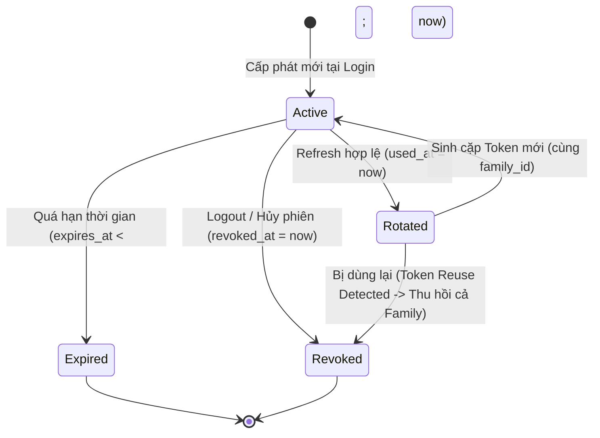

# Phase 2.6: Checkpoint 2.6.1 — Security Architecture & ADR

> Thuộc [Phase 2.6: Security & JWT Token Management](README.md)

## 4. Checkpoint 2.6.1: Security Architecture & ADR

Mục tiêu của checkpoint 2.6.1 là chốt các nguyên tắc thiết kế ranh giới bảo mật và văn bản hóa các Architecture Decision Records (ADRs) làm kim chỉ nam xuyên suốt quá trình triển khai.

### 4.1. Phân định Ba Tầng Bảo mật Độc lập

Hệ thống tách biệt tường minh 3 trách nhiệm bảo mật:
1. **Authentication (Xác thực)**: Xác định danh tính người dùng (`UserId`). Câu hỏi duy nhất: *\"Bạn là ai? Danh tính của bạn có hợp lệ không?\"* — Do module `identity` và JWT Bearer filter xử lý.
2. **Tenant Resolution (Định vị Tenant)**: Xác định tổ chức mà request muốn thao tác thông qua `X-Organization-Id`. Câu hỏi: *\"Bạn có phải là thành viên hợp lệ của tổ chức này không?\"* — Do `TenantContext` kết hợp Public Port của `organization` kiểm tra.
3. **Authorization & RBAC (Phân quyền)**: Xác định hành động cụ thể trên tài nguyên. Câu hỏi: *\"Với vai trò của bạn trong tổ chức này, bạn có được phép thực hiện hành vi này không?\"* — Do RBAC policy và domain logic của module nghiệp vụ đánh giá.

> [!CAUTION]
> Một JWT Access Token hợp lệ **không đồng nghĩa** người dùng có quyền truy cập vào bất kỳ organization nào. Tuyệt đối không nhúng danh sách toàn bộ các organization hoặc role tĩnh vào JWT payload vì điều này sẽ không phản ánh được việc membership bị vô hiệu hóa tức thời.

---

### 4.2. Chi tiết các Quyết định Kiến trúc (ADRs)

#### ADR-013: Stateless Authentication & JWT Specification
- **Trạng thái**: Approved.
- **Quy chuẩn Token**:
  - `sub`: UUID của người dùng (`userId.toString()`).
  - `iss`: Giá trị định danh hệ thống (VD: `https://edu.example.com`).
  - `aud`: Giá trị đối tượng tiếp nhận (VD: `edu-api`).
  - `iat`: Thời điểm phát hành token (UTC Epoch Seconds).
  - `exp`: Thời điểm hết hạn token (`iat + ttl`, mặc định 15 phút).
  - `jti`: Mã định danh duy nhất của token (UUID) chống tấn công replay.
- **Ràng buộc an toàn**: Không lưu thông tin nhạy cảm (mật khẩu, hash, CCCD, thông tin ngân hàng) vào token. Thuật toán ký mặc định: `HS256` với secret tối thiểu 256-bit.

#### ADR-014: Refresh Token Rotation & Opaque Token Storage
- **Trạng thái**: Approved.
- **Cơ chế**: Refresh token là chuỗi ngẫu nhiên sinh bằng `SecureRandom` (32 bytes = 256 bits), encode Base64 URL-safe.
- **Lưu trữ**: Database schema `identity` **chỉ lưu mã băm SHA-256** của refresh token (`token_hash`), không bao giờ lưu plaintext.
- **Vòng đời & Thu hồi**:
  - Khi refresh thành công, token cũ được đánh dấu `used_at = now()`, sinh ra một refresh token mới kế thừa cùng `family_id`.
  - **Phát hiện tái sử dụng (Reuse Detection)**: Nếu một token đã có `used_at IS NOT NULL` được gửi lên để refresh, hệ thống xác định khóa bảo mật bị lộ; ngay lập tức đánh dấu thu hồi toàn bộ các token có cùng `family_id` (`revoked_at = now()`) và trả về 401 Unauthorized.
  - Khi người dùng Logout, token hiện tại được đánh dấu `revoked_at = now()`.

#### ADR-015: Tenant Resolution & RBAC Model
- **Trạng thái**: Approved.
- **Cơ chế**:
  - Request nghiệp vụ gửi header `X-Organization-Id: <UUID>`.
  - Backend lấy `UserId` từ `SecurityContextHolder.getContext().getAuthentication()`.
  - Gọi Public Port `OrganizationMembershipQuery` để tra cứu membership:
    - Nếu không tồn tại hoặc `status != ACTIVE`: Từ chối truy cập với mã lỗi `403 Forbidden` (`ORGANIZATION_ACCESS_DENIED`).
    - Nếu hợp lệ: Cung cấp `OrganizationRole` (`OWNER`, `ADMIN`, `MEMBER`) vào `TenantContext`.
  - Mọi câu lệnh SQL đọc/ghi dữ liệu nghiệp vụ phải gắn chặt điều kiện `WHERE organization_id = :orgId`.

#### ADR-016: Module Boundaries & Separation of Concerns
- **Trạng thái**: Approved.
- **Phân công trách nhiệm**:
  - Module `identity`: Xử lý bảng `identity.users`, `identity.refresh_tokens`, mã hóa mật khẩu BCrypt, service đăng nhập và phát hành token.
  - Module `organization`: Xử lý bảng `organization.organizations`, `organization.organization_memberships`, cung cấp Public Port cho phép kiểm tra membership.
  - Module `shared-kernel`: Khai báo primitive types (`UserId`, `OrganizationId`), `ApiErrorResponse`, exceptions dùng chung, `TenantContext`.
  - Module `boot`: Đóng gói cấu hình Spring Security 6 (`SecurityFilterChain`), cấu hình Nimbus JWT (`JwtDecoder`, `JwtEncoder`), wires dependencies và cấu hình CORS/CSRF.

---

### 4.3. Tiêu chí Hoàn thành Checkpoint 2.6.1

| ID | Tiêu chí | Trạng thái |
| :--- | :--- | :---: |
| **AC-2.6.1.1** | Phân định tường minh Authentication, Tenant Resolution và RBAC | **DONE** |
| **AC-2.6.1.2** | Chốt cấu trúc claims JWT và thời hạn Access Token (15 phút) | **DONE** |
| **AC-2.6.1.3** | Chốt chiến lược Refresh Token Rotation, Opaque Token, SHA-256 Hash và Reuse Detection | **DONE** |
| **AC-2.6.1.4** | Xác lập ranh giới module giữa `identity`, `organization`, `shared-kernel` và `boot` | **DONE** |
| **AC-2.6.1.5** | Quy chuẩn hóa các quyết định thành ADR-013, ADR-014, ADR-015, ADR-016 | **DONE** |

---

