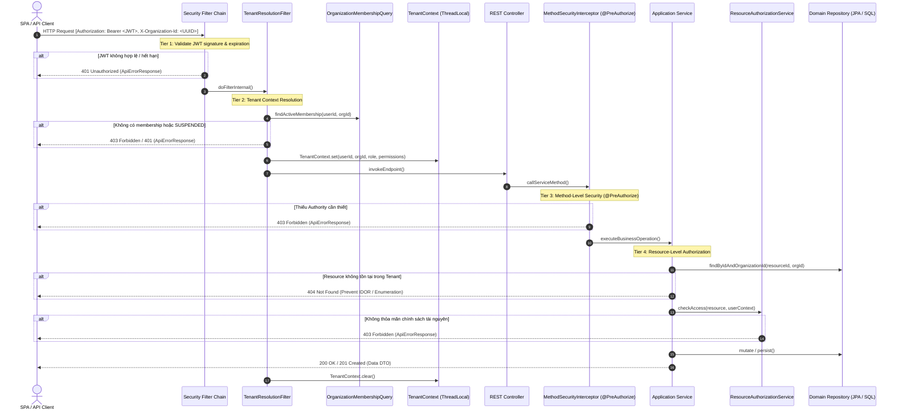

# E-Edu — Phase 2.7: Authorization & Access Control (RBAC, Multi-Tenancy & Permission Enforcement)

Tài liệu thiết kế kiến trúc, đặc tả kỹ thuật và tiêu chí nghiệm thu toàn diện cho phân hệ **Authorization & Access Control** của nền tảng E-Edu. 

Phase 2.7 hiện thực hóa hệ thống phân quyền nâng cao, kết hợp chặt chẽ giữa **Role-Based Access Control (RBAC)** đa tầng, **Multi-Tenancy Isolation** theo tổ chức, **Method-Level Security** và **Resource-Level Authorization** trong kiến trúc **Modular Monolith Multi-Schema**:

- **Nền tảng kỹ thuật**: Java 21 LTS, Spring Boot 3.4.3, Spring Security 6.
- **Mô hình bảo vệ 4 tầng (Four-Tier Defense-in-Depth)**:
  1. **Tier 1 — Identity & Authentication**: Xác minh danh tính người dùng qua JWT Access Token không trạng thái.
  2. **Tier 2 — Tenant Context Resolution**: Trích xuất và thẩm định tính hợp lệ của `X-Organization-Id` từ header, đối chiếu với trạng thái membership còn hoạt động (`ACTIVE`) thông qua Public Port nội bộ.
  3. **Tier 3 — Method-Level Authorization**: Bảo vệ tầng nghiệp vụ với `@EnableMethodSecurity` và `@PreAuthorize("hasAuthority('...')")`, kiểm soát permission tổng quát trước khi thực thi service method.
  4. **Tier 4 — Resource-Level Authorization**: Module sở hữu tài nguyên tự thẩm định quyền truy cập trên từng thực thể nghiệp vụ cụ thể (Course, Class, Student, Grade), triệt tiêu nguy cơ tấn công tráo ID (Insecure Direct Object References - IDOR).
- **Ranh giới Module & Decoupling**: Không bypass module boundaries; không truy vấn trực tiếp bảng nội bộ của module khác; không tạo foreign key vật lý chéo schema.
- **Chuẩn hóa Error Mapping**: Thống nhất mã lỗi 401 Unauthorized, 403 Forbidden và chính sách 404 Not Found (chống lộ thông tin tài nguyên chéo tenant) theo hợp đồng chuẩn `ApiErrorResponse`.

---

## 1. Tiêu chí Nghiệm thu Phase 2.7 (Acceptance Criteria)

| STT | Mã tiêu chí | Tên tiêu chí | Bằng chứng kỹ thuật cần có |
| :---: | :---: | :--- | :--- |
| 1 | **[AC-2.7.1](checkpoint-2.7.1-architecture-and-adr.md)** | **Architecture Decisions & Authorization Model** | Chốt 4 ADRs: ADR-017 (Fine-Grained RBAC & Dynamic Permission Catalog), ADR-018 (Hierarchical Role Assignment), ADR-019 (Multi-Tier Tenant Authorization Pipeline), ADR-020 (Decoupled Resource Policy Ownership). |
| 2 | **[AC-2.7.2](checkpoint-2.7.2-permission-model-and-catalog.md)** | **Permission Model & Canonical Catalog** | Chuẩn hóa danh mục quyền theo cấu trúc `DOMAIN_RESOURCE_ACTION`; phân định System Permission vs Organization Permission; bất biến mã quyền. |
| 3 | **[AC-2.7.3](checkpoint-2.7.3-role-and-permission-persistence.md)** | **Role & Permission Persistence Schema** | Flyway migration `V6__create_organization_roles_and_permissions.sql`; các bảng `roles`, `permissions`, `role_permissions`, `membership_roles` tại schema `organization`; indexes và seed data chuẩn. |
| 4 | **[AC-2.7.4](checkpoint-2.7.4-organization-level-authorization.md)** | **Organization-Level Authorization & Tenant Isolation** | Xác minh `TenantContext` từ server; chặn request khi membership bị `SUSPENDED` hoặc không tồn tại; ngăn ngừa rò rỉ dữ liệu giữa các tổ chức. |
| 5 | **[AC-2.7.5](checkpoint-2.7.5-method-level-security.md)** | **Method-Level Security Enforcement** | Kích hoạt `@EnableMethodSecurity`; kiểm tra quyền hạn trước phương thức bằng `@PreAuthorize`; bảo đảm mọi luồng gọi quan trọng đều qua proxy bảo mật. |
| 6 | **[AC-2.7.6](checkpoint-2.7.6-resource-level-authorization.md)** | **Resource-Level Authorization** | Module sở hữu tài nguyên kiểm tra quyền truy cập thực thể; kết hợp tenant filtering ngay từ câu truy vấn SQL; chặn tấn công tráo UUID tài nguyên. |
| 7 | **[AC-2.7.7](checkpoint-2.7.7-authorization-error-mapping.md)** | **Authorization Error Mapping** | Phân định rành mạch 401, 403 và 404; serialize đồng nhất về `ApiErrorResponse`; xử lý triệt để qua `AuthenticationEntryPoint` và `AccessDeniedHandler`. |
| 8 | **[AC-2.7.8](checkpoint-2.7.8-authorization-integration-tests.md)** | **Authorization Integration Tests** | Ma trận 12 test cases tích hợp (IT-01 -> IT-12); kiểm thử đa tổ chức (Org A, Org B); chạy trên môi trường PostgreSQL; ArchUnit kiểm tra ranh giới. |
| 9 | **[AC-2.7.9](checkpoint-2.7.9-security-review-and-acceptance.md)** | **Security Review & Acceptance Matrix** | Bảng đánh giá 10 tiêu chuẩn R1–R10; bộ quy tắc nghiệm thu (`ACCEPTED`, `ACCEPTED WITH CONDITIONS`, `REJECTED`); checklist rà soát OWASP. |

> [!IMPORTANT]
> Toàn bộ các checkpoint của Phase 2.7 phải được thẩm định bằng mã nguồn, database migration và integration tests thực tế trên PostgreSQL. Không đánh dấu hoàn thành chỉ dựa trên bảng kê lý thuyết.

---

## 2. Quyết định Kiến trúc Phase 2.7 (Architectural Decisions)

| Mã quyết định | Chủ đề | Trạng thái | Tóm tắt nội dung |
| :--- | :--- | :---: | :--- |
| **ADR-017 / DEC-2.7-01** | **Fine-Grained RBAC & Dynamic Permission Catalog** | **Approved** | Phân quyền dựa trên Permission nguyên tử (`hasAuthority`), Role chỉ là tập hợp nhóm các Permissions. Không hardcode logic nghiệp vụ vào Role name trong code. |
| **ADR-018 / DEC-2.7-02** | **Tenant-Scoped Role & Membership Assignment** | **Approved** | Roles và Role Assignments gắn liền với từng `organization_id`. Một User có thể là `ADMIN` ở Tổ chức A nhưng chỉ là `STUDENT` ở Tổ chức B. Hỗ trợ System Role cho quản trị viên nền tảng. |
| **ADR-019 / DEC-2.7-03** | **Multi-Tier Authorization Pipeline** | **Approved** | Luồng thẩm định quyền bắt buộc qua 4 cửa sổ kiểm soát: Token Validity -> Tenant Resolution -> Method Security -> Resource Scope Check. Thất bại ở bất kỳ khâu nào lập tức chấm dứt xử lý. |
| **ADR-020 / DEC-2.7-04** | **Decoupled Resource Policy Ownership** | **Approved** | Module sở hữu dữ liệu chịu trách nhiệm kiểm tra quyền trên tài nguyên đó (Course do `curriculum` kiểm tra, Grade do `assessment` kiểm tra). Không tạo một monolithic AuthorizationService ôm đồm toàn bộ hệ thống. |
| **DEC-2.7-05** | **Query-Level Tenant Filtering** | **Approved** | Luôn đưa điều kiện `organization_id = :orgId` vào mệnh đề `WHERE` của truy vấn database; không tải toàn bộ dữ liệu lên bộ nhớ rồi mới lọc bằng Java logic. |
| **DEC-2.7-06** | **Anti-Information Leakage Error Policy** | **Approved** | Khi truy cập tài nguyên thuộc tenant khác mà user không có quyền, hệ thống ưu tiên trả về `404 Not Found` (thay vì `403 Forbidden`) để tránh tiết lộ sự tồn tại của tài nguyên nội bộ của đối thủ. |

---

## 3. Sơ đồ Kiến trúc Phân quyền Tổng thể

### 3.1. Sơ đồ Luồng Phân quyền Đa tầng (Four-Tier Defense Flow)



---

## 4. Cấu trúc Tài liệu Chi tiết Phase 2.7

Mỗi tài liệu trong thư mục này đại diện cho một checkpoint độc lập và chuyên sâu:

```text
phase2.7/
├── README.md                                           # Tài liệu tổng quan & điều hướng (file này)
├── checkpoint-2.7.1-architecture-and-adr.md            # ADR-017 đến ADR-020, mô hình RBAC & kiến trúc phân quyền
├── checkpoint-2.7.2-permission-model-and-catalog.md    # Danh mục quyền chuẩn hóa, cấu trúc DOMAIN_RESOURCE_ACTION
├── checkpoint-2.7.3-role-and-permission-persistence.md  # Schema V6, migrations, bảng roles/permissions & seed data
├── checkpoint-2.7.4-organization-level-authorization.md# Thẩm định TenantContext, chống rò rỉ dữ liệu chéo tenant
├── checkpoint-2.7.5-method-level-security.md           # @EnableMethodSecurity, @PreAuthorize & Proxy security
├── checkpoint-2.7.6-resource-level-authorization.md    # Bảo vệ tài nguyên theo module, chống IDOR & ID-swapping
├── checkpoint-2.7.7-authorization-error-mapping.md     # Chuẩn hóa lỗi 401, 403, 404 với ApiErrorResponse
├── checkpoint-2.7.8-authorization-integration-tests.md # Ma trận IT-01 đến IT-12 & ArchUnit verification
└── checkpoint-2.7.9-security-review-and-acceptance.md  # Ma trận nghiệm thu 10 tiêu chuẩn R1–R10 & OWASP review
```

---

## 5. Hướng dẫn Triển khai & Kiểm chứng

1. **Chuẩn bị Database**: Chạy migration Flyway `V6` tạo bảng phân quyền trong schema `organization`.
2. **Cấu hình Spring Security**: Bật `@EnableMethodSecurity` trong `SecurityConfig` và tích hợp `CustomPermissionEvaluator` hoặc GrantedAuthoritiesExtractor.
3. **Thực thi Integration Tests**:
   ```bash
   mvn test -pl modules/organization -Dtest=*Authorization*
   mvn test -pl boot -Dtest=*Security*
   mvn test -pl tests/architecture-tests
   ```
4. **Kiểm tra toàn diện**: `mvn clean verify` từ thư mục gốc backend.
