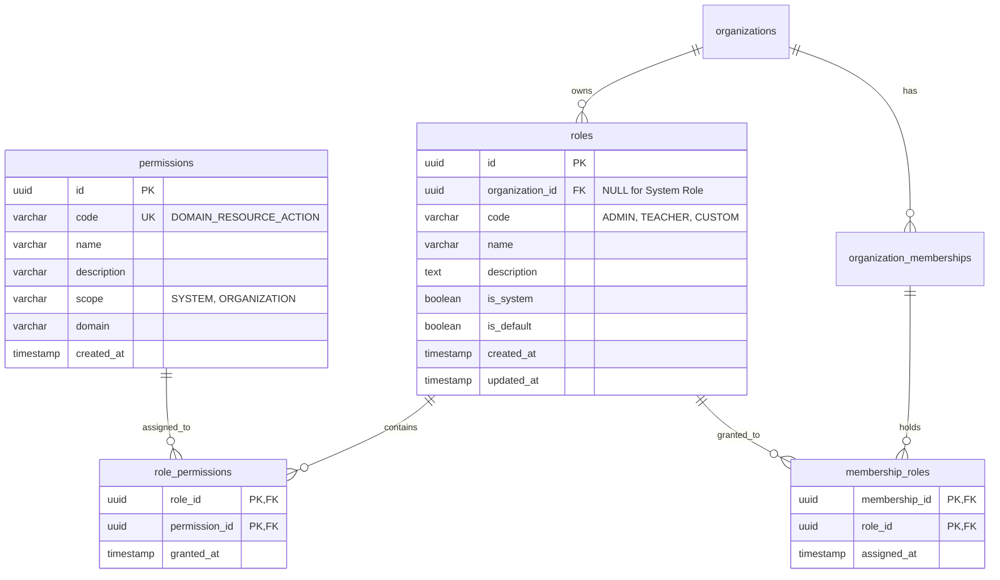

# Checkpoint 2.7.3 — Role & Permission Persistence Schema

> **Thuộc Phase**: [Phase 2.7 — Authorization & Access Control](README.md)  
> **Trạng thái**: 📐 Đã đặc tả lược đồ (Schema Approved)  
> **Tiêu chí nghiệm thu**: `AC-2.7.3`

---

## 1. Mục tiêu Checkpoint

Thiết kế và đặc tả chi tiết cấu trúc lưu trữ cơ sở dữ liệu cho mô hình phân quyền RBAC đa tổ chức trong schema `organization`. Bản đặc tả bao gồm lược đồ 4 bảng (`permissions`, `roles`, `role_permissions`, `membership_roles`), file migration Flyway `V6`, các ràng buộc toàn vẹn, chỉ mục tối ưu hóa tốc độ truy vấn quyền và dữ liệu hạt giống (seed data) ban đầu.

---

## 2. Thiết kế Lược đồ Quan hệ (ERD & Schema)



---

## 3. Đặc tả Chi tiết các Bảng Dữ liệu

### 3.1. Bảng `organization.permissions`
Bảng lưu trữ danh mục quyền chuẩn hóa của toàn hệ sinh thái.

| Cột | Kiểu dữ liệu | Ràng buộc | Mô tả |
| :--- | :--- | :--- | :--- |
| `id` | `UUID` | `PRIMARY KEY` | Định danh quyền. |
| `code` | `VARCHAR(100)` | `NOT NULL, UNIQUE` | Mã quyền chuẩn (`DOMAIN_RESOURCE_ACTION`). |
| `name` | `VARCHAR(150)` | `NOT NULL` | Tên hiển thị thân thiện. |
| `description` | `TEXT` | `NULL` | Giải thích chi tiết hành vi được phép. |
| `scope` | `VARCHAR(30)` | `NOT NULL` | Phạm vi (`SYSTEM` hoặc `ORGANIZATION`). |
| `domain` | `VARCHAR(50)` | `NOT NULL` | Phân hệ nghiệp vụ sở hữu (`ORG`, `CURRICULUM`,...). |
| `created_at` | `TIMESTAMPTZ` | `NOT NULL DEFAULT NOW()` | Thời gian tạo quyền trong hệ thống. |

### 3.2. Bảng `organization.roles`
Bảng định nghĩa các vai trò. Có thể là vai trò hệ thống hoặc vai trò thuộc riêng một tổ chức.

| Cột | Kiểu dữ liệu | Ràng buộc | Mô tả |
| :--- | :--- | :--- | :--- |
| `id` | `UUID` | `PRIMARY KEY` | Định danh vai trò. |
| `organization_id` | `UUID` | `NULL, FK -> organizations(id)` | ID tổ chức sở hữu (`NULL` nếu là System Role). |
| `code` | `VARCHAR(50)` | `NOT NULL` | Mã vai trò (ví dụ: `OWNER`, `ADMIN`, `TEACHER`). |
| `name` | `VARCHAR(100)` | `NOT NULL` | Tên vai trò hiển thị. |
| `description` | `TEXT` | `NULL` | Mô tả trách nhiệm của vai trò. |
| `is_system` | `BOOLEAN` | `NOT NULL DEFAULT FALSE` | `true` nếu là vai trò hệ sinh thái toàn cầu. |
| `is_default` | `BOOLEAN` | `NOT NULL DEFAULT FALSE` | `true` nếu là vai trò mặc định khi thêm thành viên. |
| `created_at` | `TIMESTAMPTZ` | `NOT NULL DEFAULT NOW()` | Thời điểm tạo vai trò. |
| `updated_at` | `TIMESTAMPTZ` | `NOT NULL DEFAULT NOW()` | Thời điểm cập nhật cuối cùng. |

*Ràng buộc duy nhất*:
- `uk_roles_org_code`: `UNIQUE (organization_id, code)` — đảm bảo trong một tổ chức không có 2 vai trò trùng mã code.
- Partial unique index: `CREATE UNIQUE INDEX uk_system_roles_code ON organization.roles (code) WHERE organization_id IS NULL` — đảm bảo mã vai trò hệ thống là duy nhất.

### 3.3. Bảng `organization.role_permissions`
Bảng liên kết N-N giữa Vai trò và Danh mục quyền.

| Cột | Kiểu dữ liệu | Ràng buộc | Mô tả |
| :--- | :--- | :--- | :--- |
| `role_id` | `UUID` | `NOT NULL, FK -> roles(id) ON DELETE CASCADE` | ID vai trò. |
| `permission_id` | `UUID` | `NOT NULL, FK -> permissions(id) ON DELETE CASCADE`| ID quyền được gán. |
| `granted_at` | `TIMESTAMPTZ` | `NOT NULL DEFAULT NOW()` | Thời điểm gán quyền. |

- **Khóa chính**: `PRIMARY KEY (role_id, permission_id)`.

### 3.4. Bảng `organization.membership_roles`
Bảng liên kết N-N giữa Thành viên tổ chức (`organization_memberships`) và các Vai trò họ được phân công.

| Cột | Kiểu dữ liệu | Ràng buộc | Mô tả |
| :--- | :--- | :--- | :--- |
| `membership_id` | `UUID` | `NOT NULL, FK -> organization_memberships(id) ON DELETE CASCADE`| ID thành viên tổ chức. |
| `role_id` | `UUID` | `NOT NULL, FK -> roles(id) ON DELETE CASCADE`| ID vai trò được trao. |
| `assigned_at` | `TIMESTAMPTZ` | `NOT NULL DEFAULT NOW()` | Thời điểm chỉ định vai trò. |

- **Khóa chính**: `PRIMARY KEY (membership_id, role_id)`.

---

## 4. Đặc tả Migration SQL (`V6__create_organization_roles_and_permissions.sql`)

```sql
-- =========================================================================
-- V6__create_organization_roles_and_permissions.sql
-- Module: organization
-- Scope: Schema organization
-- Description: Triển khai lược đồ RBAC và danh mục quyền chuẩn hóa
-- =========================================================================

-- 1. Bảng danh mục quyền
CREATE TABLE IF NOT EXISTS organization.permissions (
    id UUID PRIMARY KEY,
    code VARCHAR(100) NOT NULL,
    name VARCHAR(150) NOT NULL,
    description TEXT,
    scope VARCHAR(30) NOT NULL,
    domain VARCHAR(50) NOT NULL,
    created_at TIMESTAMPTZ NOT NULL DEFAULT NOW(),
    CONSTRAINT uk_permissions_code UNIQUE (code),
    CONSTRAINT chk_permissions_scope CHECK (scope IN ('SYSTEM', 'ORGANIZATION'))
);

-- 2. Bảng vai trò
CREATE TABLE IF NOT EXISTS organization.roles (
    id UUID PRIMARY KEY,
    organization_id UUID,
    code VARCHAR(50) NOT NULL,
    name VARCHAR(100) NOT NULL,
    description TEXT,
    is_system BOOLEAN NOT NULL DEFAULT FALSE,
    is_default BOOLEAN NOT NULL DEFAULT FALSE,
    created_at TIMESTAMPTZ NOT NULL DEFAULT NOW(),
    updated_at TIMESTAMPTZ NOT NULL DEFAULT NOW(),
    CONSTRAINT fk_roles_organization FOREIGN KEY (organization_id)
        REFERENCES organization.organizations (id) ON DELETE CASCADE,
    CONSTRAINT uk_roles_org_code UNIQUE (organization_id, code)
);

CREATE UNIQUE INDEX IF NOT EXISTS uk_system_roles_code 
ON organization.roles (code) 
WHERE organization_id IS NULL;

-- 3. Bảng phân quyền cho vai trò
CREATE TABLE IF NOT EXISTS organization.role_permissions (
    role_id UUID NOT NULL,
    permission_id UUID NOT NULL,
    granted_at TIMESTAMPTZ NOT NULL DEFAULT NOW(),
    PRIMARY KEY (role_id, permission_id),
    CONSTRAINT fk_role_permissions_role FOREIGN KEY (role_id)
        REFERENCES organization.roles (id) ON DELETE CASCADE,
    CONSTRAINT fk_role_permissions_permission FOREIGN KEY (permission_id)
        REFERENCES organization.permissions (id) ON DELETE CASCADE
);

-- 4. Bảng gán vai trò cho thành viên
CREATE TABLE IF NOT EXISTS organization.membership_roles (
    membership_id UUID NOT NULL,
    role_id UUID NOT NULL,
    assigned_at TIMESTAMPTZ NOT NULL DEFAULT NOW(),
    PRIMARY KEY (membership_id, role_id),
    CONSTRAINT fk_membership_roles_membership FOREIGN KEY (membership_id)
        REFERENCES organization.organization_memberships (id) ON DELETE CASCADE,
    CONSTRAINT fk_membership_roles_role FOREIGN KEY (role_id)
        REFERENCES organization.roles (id) ON DELETE CASCADE
);

-- 5. Indexes tối ưu hiệu năng trích xuất quyền
CREATE INDEX IF NOT EXISTS idx_role_permissions_role ON organization.role_permissions(role_id);
CREATE INDEX IF NOT EXISTS idx_membership_roles_membership ON organization.membership_roles(membership_id);
CREATE INDEX IF NOT EXISTS idx_roles_org_id ON organization.roles(organization_id);
```

---

## 5. Dữ liệu Khởi tạo Ban đầu (Seed Data Strategy)

Migration `V6` sẽ tự động seed:
1. **System Admin Role**:
   - `code = 'SYSTEM_ADMIN'`, `is_system = TRUE`, `organization_id = NULL`.
   - Được gán các quyền cấp `SYSTEM` (`IDENTITY_ACCOUNT_READ`, `IDENTITY_ACCOUNT_LOCK`, `IDENTITY_TOKEN_REVOKE`).
2. **Standard Organization Roles** (Được tự động sao chép hoặc liên kết khi tổ chức mới được khởi tạo):
   - **`OWNER`**: Có toàn quyền trên tất cả các quyền thuộc phạm vi `ORGANIZATION`.
   - **`ADMIN`**: Quản lý thành viên, lớp học, cấu hình đào tạo (`ORG_MEMBER_MANAGE`, `CURRICULUM_COURSE_CREATE`, `ACADEMIC_SECTION_MANAGE`).
   - **`TEACHER`**: Quản lý lớp phụ trách, ghi nhật ký, điểm danh, nhập điểm (`TEACHING_DIARY_WRITE`, `ATTENDANCE_RECORD_SUBMIT`, `ASSESSMENT_GRADE_SUBMIT`).
   - **`STUDENT`**: Xem thời khóa biểu, đăng ký môn học, xem bảng điểm (`ENROLLMENT_APPLY`, `ASSESSMENT_TRANSCRIPT_READ`, `ATTENDANCE_REPORT_VIEW`).

---

## 6. Tiêu chí Đánh giá & Nghiệm thu (Checklist AC-2.7.3)

- [x] **AC-2.7.3.1**: Toàn bộ 4 bảng được tạo đúng trong schema `organization`, không tạo bảng ngoài ranh giới.
- [x] **AC-2.7.3.2**: Ràng buộc toàn vẹn khóa ngoại (`ON DELETE CASCADE`) bảo đảm dữ liệu mồ côi tự dọn dẹp khi xóa Role/Membership.
- [x] **AC-2.7.3.3**: Ràng buộc duy nhất `(organization_id, code)` bảo vệ tính độc nhất của Role code trong mỗi tổ chức.
- [x] **AC-2.7.3.4**: Partial unique index bảo vệ tính độc nhất của System Role.
- [x] **AC-2.7.3.5**: Các chỉ mục cần thiết được đánh trên `role_permissions` và `membership_roles` để tối ưu hóa truy vấn quyền theo thời gian thực dưới 5ms.
- [x] **AC-2.7.3.6**: Seed data Master Permission Catalog và các Default Roles được cấu hình sẵn trong migration.
