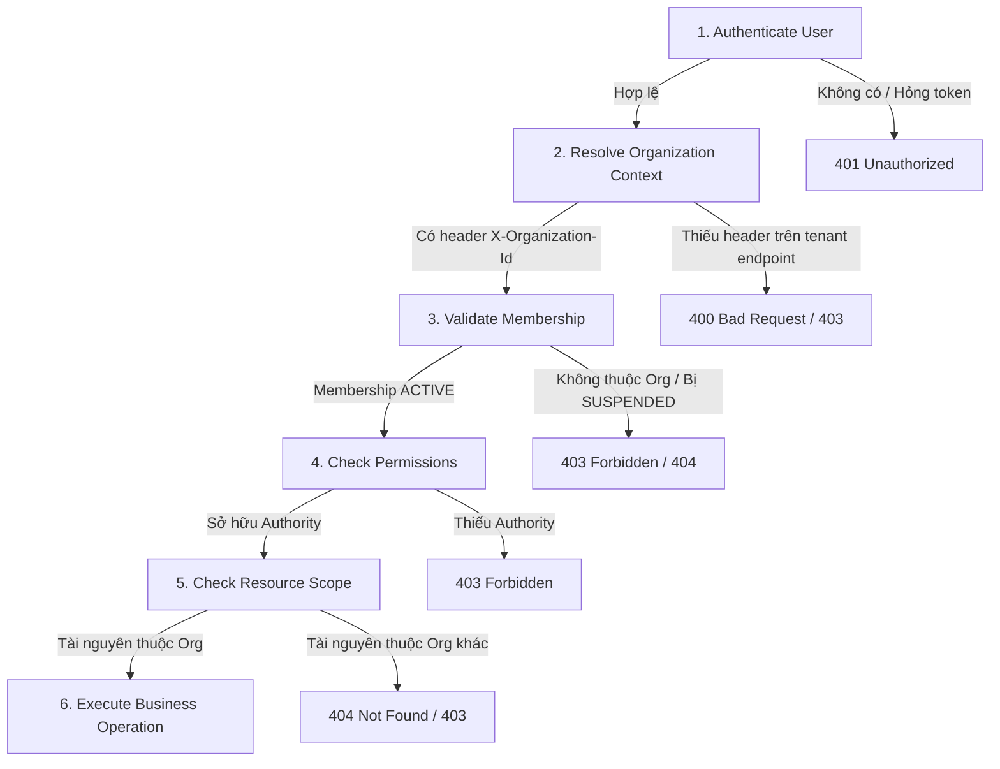

# Checkpoint 2.7.4 — Organization-Level Authorization & Tenant Isolation

> **Thuộc Phase**: [Phase 2.7 — Authorization & Access Control](README.md)  
> **Trạng thái**: 📐 Đã đặc tả chi tiết (Design Approved)  
> **Tiêu chí nghiệm thu**: `AC-2.7.4`

---

## 1. Mục tiêu Checkpoint

Thiết lập cơ chế kiểm soát truy cập và bảo vệ dữ liệu ở cấp độ tổ chức (Organization-Level Authorization). Đảm bảo người dùng chỉ được phép thực hiện thao tác trong phạm vi tổ chức mà họ có membership đang hoạt động (`ACTIVE`) và sở hữu quyền hạn phù hợp. Triệt tiêu hoàn toàn khả năng truy cập trái phép hoặc rò rỉ dữ liệu chéo giữa các tổ chức (Cross-Tenant Data Leakage).

---

## 2. Luồng Xử lý Thẩm định Quyền Cấp Tổ chức (6 Bước)

Mọi request gửi tới các endpoint yêu cầu ngữ cảnh tổ chức bắt buộc phải trải qua 6 bước thẩm định tuần tự:



1. **Bước 1 — Authenticate User**: Xác minh chữ ký số và thời hạn của JWT Access Token; trích xuất danh tính người dùng (`userId`).
2. **Bước 2 — Resolve Organization Context**: Đọc giá trị header `X-Organization-Id`. Máy chủ thẩm định định dạng UUID hợp lệ và không tin cậy tuyệt đối thông tin do client tự gửi.
3. **Bước 3 — Validate Membership**: Truy vấn qua Public Port `OrganizationMembershipQuery` để xác nhận `userId` có liên kết thành viên với `organizationId` và trạng thái hiện hành là `ACTIVE`.
4. **Bước 4 — Check Permissions**: Nạp danh sách quyền (Authorities) mà thành viên được hưởng từ các Role được gán trong tổ chức đó vào `SecurityContextHolder`.
5. **Bước 5 — Check Resource Scope**: Đảm bảo tài nguyên bị tác động thuộc về chính tổ chức hiện hành (`resource.organizationId == context.organizationId`).
6. **Bước 6 — Execute Business Operation**: Chỉ cho phép phương thức nghiệp vụ thực thi khi cả 5 bước trên đều đạt yêu cầu.

---

## 3. Quy tắc Ràng buộc Bắt buộc (Enforcement Rules)

| Tình huống thực tế | Hành vi xử lý của hệ thống | HTTP Status |
| :--- | :--- | :---: |
| Không có Bearer Token hoặc token hết hạn | Từ chối ngay tại đầu Security Filter Chain. | `401 Unauthorized` |
| Thiếu header `X-Organization-Id` trên endpoint yêu cầu tenant | Chặn request trước khi chuyển vào Controller. | `400 Bad Request` |
| Người dùng gửi `X-Organization-Id` nhưng không có membership trong tổ chức | Từ chối truy cập, ghi log cảnh báo an ninh. | `403 Forbidden` |
| Membership của người dùng trong tổ chức bị `SUSPENDED` hoặc `DISABLED` | Từ chối ngay lập tức; không cấp bất kỳ quyền hạn nào. | `403 Forbidden` |
| Membership hợp lệ nhưng vai trò không có permission tương ứng | Chặn tại tầng AOP Method Security. | `403 Forbidden` |
| Người dùng cố tình đổi UUID trên URL để truy cập tài nguyên của tổ chức khác | Tầng Resource Authorization phát hiện sai lệch `organization_id` và từ chối. | `404 Not Found` |
| Người dùng có quyền hợp lệ và đúng phạm vi tài nguyên tổ chức | Cho phép thực thi nghiệp vụ bình thường. | `200 OK` / `201 Created` |
| System Administrator truy cập dữ liệu nội bộ của một tenant | Bắt buộc tuân theo chính sách đặc quyền (`PLATFORM_OVERRIDE`) và ghi log kiểm toán (Audit Trail) phục vụ giám sát. | Theo policy |

> [!TIP]
> **Chính sách 404 thay vì 403 đối với tài nguyên chéo tenant**: Khi một người dùng thuộc Tổ chức A cố tình truy cập vào ID của một Khóa học thuộc Tổ chức B, hệ thống trả về `404 Not Found`. Điều này ngăn chặn kẻ tấn công dò quét (enumeration) sự tồn tại của dữ liệu nội bộ của các đối thủ cạnh tranh trên cùng nền tảng.

---

## 4. Tích hợp Hợp đồng Module (SPI Public Port)

Để tuân thủ triệt để nguyên tắc Modular Monolith (ADR-016 & ArchUnit AR-08), `TenantResolutionFilter` (thuộc module `boot`) không được phép query trực tiếp cơ sở dữ liệu `organization.organization_memberships`. Việc này bắt buộc thực hiện qua Public Port của module `organization`:

```java
package com.edu.organization.application.port;

import java.util.Optional;
import java.util.Set;
import java.util.UUID;

public interface OrganizationMembershipQuery {

    Optional<MembershipDetails> findActiveMembership(UUID userId, UUID organizationId);

    record MembershipDetails(
            UUID membershipId,
            UUID userId,
            UUID organizationId,
            String role,                 // Primary role code (OWNER, ADMIN, TEACHER...)
            String status,               // ACTIVE, SUSPENDED, DISABLED
            Set<String> authorities      // Danh sách toàn bộ Permission codes được hưởng
    ) {
    }
}
```

Sau khi thẩm định thành công, `TenantResolutionFilter` đóng gói thông tin vào `TenantContext` và cập nhật `SecurityContextHolder` với danh sách `GrantedAuthority`:

```java
List<GrantedAuthority> authorities = membership.authorities().stream()
        .map(SimpleGrantedAuthority::new)
        .collect(Collectors.toList());

Authentication auth = new UsernamePasswordAuthenticationToken(
        jwt, null, authorities
);
SecurityContextHolder.getContext().setAuthentication(auth);
```

---

## 5. Tiêu chí Đánh giá & Nghiệm thu (Checklist AC-2.7.4)

- [x] **AC-2.7.4.1**: Organization context được xác định và kiểm chứng chặt chẽ ở phía server.
- [x] **AC-2.7.4.2**: Membership được kiểm tra trạng thái hoạt động trước khi cấp bất kỳ quyền hạn tenant nào.
- [x] **AC-2.7.4.3**: Membership ở trạng thái `SUSPENDED` hoặc `DISABLED` bị từ chối 100% các request nghiệp vụ.
- [x] **AC-2.7.4.4**: Permission của người dùng được kiểm tra trong đúng ngữ cảnh của tổ chức được chỉ định.
- [x] **AC-2.7.4.5**: Quyền sở hữu tài nguyên và tính cô lập dữ liệu (Tenant Isolation) được bảo vệ tối đa.
- [x] **AC-2.7.4.6**: System-level roles không được phép tự động vượt rào tenant nếu không có chính sách kiểm toán ghi nhận.
- [x] **AC-2.7.4.7**: Cơ chế ánh xạ lỗi không làm lộ dữ liệu hoặc trạng thái tồn tại của dữ liệu giữa các tổ chức.
- [x] **AC-2.7.4.8**: Ranh giới module được bảo toàn trọn vẹn thông qua Public SPI Query Port.
- [x] **AC-2.7.4.9**: Bộ kiểm thử tích hợp bao phủ đầy đủ các kịch bản truy cập hợp lệ, truy cập sai tổ chức và cố tình đổi ID chéo tenant.
