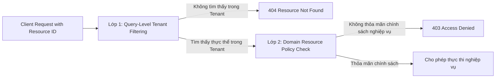

# Checkpoint 2.7.6 — Resource-Level Authorization & Anti-IDOR

> **Thuộc Phase**: [Phase 2.7 — Authorization & Access Control](README.md)  
> **Trạng thái**: 📐 Đã đặc tả bảo vệ tài nguyên (Resource Policy Approved)  
> **Tiêu chí nghiệm thu**: `AC-2.7.6`

---

## 1. Mục tiêu Checkpoint

Thiết lập cơ chế phân quyền chi tiết trên từng thực thể tài nguyên cụ thể (Resource-Level Authorization). Giải quyết bài toán bảo mật: **Có Permission tổng quát chưa đồng nghĩa với việc được phép thao tác trên mọi tài nguyên**. Ngăn chặn triệt để các lỗ hổng Insecure Direct Object References (IDOR), tấn công tráo ID (ID-Swapping Attacks) và rò rỉ dữ liệu giữa các tổ chức hoặc giữa các cá nhân trong cùng tổ chức.

---

## 2. Thách thức Thực tế & Vấn đề Cần Giải quyết

Trong một hệ thống giáo dục đa tổ chức:
- Một người dùng có quyền `ASSESSMENT_GRADE_SUBMIT` (Nhập điểm) không thể được phép sửa điểm của một lớp học do giảng viên khác phụ trách, hoặc điểm của một trường khác mà họ không có lịch dạy.
- Một học viên có quyền `PEOPLE_STUDENT_READ` (Xem hồ sơ học sinh) chỉ được xem hồ sơ của chính mình hoặc các bạn cùng lớp theo chính sách mở, tuyệt đối không được xem hồ sơ học sinh của trường khác kể cả khi tình cờ biết được UUID.
- Một kẻ tấn công cố tình thay đổi `courseId` trên URL từ `id_cua_truong_A` sang `id_cua_truong_B`.

---

## 3. Chiến lược Bảo vệ 2 Lớp (Dual-Layer Resource Defense)



### 3.1. Lớp 1 — Query-Level Tenant Filtering (Chốt chặn Cơ sở dữ liệu)
- **Quy tắc vàng**: Bắt buộc gắn điều kiện `organization_id = :currentOrgId` vào ngay câu lệnh truy vấn database (`SELECT`).
- Không bao giờ thực hiện: `repository.findById(id)` rồi sau đó mới lấy `resource.getOrganizationId()` ra so sánh trong Java.
- **Lý do**:
  1. **Hiệu năng**: Giảm thiểu việc đọc dữ liệu không liên quan từ disk/buffer pool của database.
  2. **Bảo mật tuyệt đối**: Tránh rủi ro developer quên viết câu lệnh `if-else` so sánh tenant ID sau khi đã load thực thể lên bộ nhớ.
  3. **Chống Enumation Attack**: Nếu thực thể thuộc tổ chức khác, câu query trả về `Optional.empty()`, hệ thống ném `ResourceNotFoundException` và trả về mã lỗi **404 Not Found**. Kẻ tấn công không thể phân biệt được ID đó không tồn tại hay thuộc về một tổ chức khác!

### 3.2. Lớp 2 — Domain Resource Policy Check (Chốt chặn Nghiệp vụ Chuyên sâu)
Sau khi đã nạp được thực thể thuộc đúng tổ chức hiện tại, module sở hữu tài nguyên gọi `ResourceAuthorizationService` nội bộ để kiểm tra các chính sách ngữ cảnh:
- **Quan hệ phân công**: Người gọi có phải là giảng viên được chỉ định đứng lớp cho học phần này không?
- **Quyền sở hữu cá nhân**: Học viên có phải là chủ sở hữu của bản ghi điểm/bài nộp không?
- **Trạng thái nghiệp vụ**: Khóa học đã được duyệt xuất bản hay vẫn đang là bản nháp? Kỳ nhập điểm đã bị khóa sổ hay chưa?

---

## 4. Mẫu Thiết kế Chuẩn theo từng Module

Mỗi module nghiệp vụ tự chịu trách nhiệm về chính sách tài nguyên của mình:

### 4.1. Ví dụ: `GradeAuthorizationService` trong module `assessment`
```java
package com.edu.assessment.application.service;

import com.edu.assessment.domain.model.GradeRecord;
import com.edu.shared.kernel.domain.tenant.TenantContext;
import org.springframework.security.access.AccessDeniedException;
import org.springframework.stereotype.Service;

@Service
public class GradeAuthorizationService {

    public void checkCanSubmitGrade(GradeRecord gradeRecord, TenantContext.TenantInfo tenantInfo) {
        // 1. Kiểm tra Organization Scope
        if (!gradeRecord.getOrganizationId().equals(tenantInfo.organizationId())) {
            throw new AccessDeniedException("Access to this grade record is denied");
        }

        // 2. Nếu là Giảng viên (TEACHER), phải là người phụ trách lớp
        if ("TEACHER".equalsIgnoreCase(tenantInfo.role())) {
            if (!gradeRecord.isAssignedTeacher(tenantInfo.userId())) {
                throw new AccessDeniedException("You are not assigned to instruct this class section");
            }
        }

        // 3. Kiểm tra trạng thái kỳ đánh giá (Đã khóa sổ hay chưa)
        if (gradeRecord.isFinalized()) {
            throw new AccessDeniedException("Grade submission period has been finalized and locked");
        }
    }
}
```

---

## 5. Ma trận Ứng phó các Tình huống Tấn công Tài nguyên

| Kịch bản tấn công | Kỹ thuật phát hiện & Ngăn chặn | Kết quả HTTP |
| :--- | :--- | :---: |
| **IDOR xuyên Tenant**: User Org-A gửi request với ID tài nguyên của Org-B | Truy vấn SQL `WHERE id = :id AND organization_id = :orgA` trả về empty. | `404 Not Found` |
| **Tampering ID trong Request Body**: URL gửi `resourceA`, nhưng JSON body gửi `resourceB` | Controller thẩm định tính khớp giữa Path Variable và DTO Body; từ chối ngay. | `400 Bad Request` |
| **Vượt quyền cùng Tenant**: Sinh viên gửi request sửa điểm của chính mình | `@PreAuthorize("hasAuthority('ASSESSMENT_GRADE_SUBMIT')")` chặn ngay tại method. | `403 Forbidden` |
| **Giáo viên sửa điểm lớp khác**: Giáo viên A cố sửa điểm của lớp Giáo viên B phụ trách | `GradeAuthorizationService.checkCanSubmitGrade` phát hiện sai lệch `assignedTeacher`. | `403 Forbidden` |
| **Sửa dữ liệu đã khóa**: Giáo viên cố sửa điểm sau khi đã Finalize | `GradeAuthorizationService` kiểm tra `gradeRecord.isFinalized()` và từ chối. | `403 Forbidden` |

---

## 6. Tiêu chí Đánh giá & Nghiệm thu (Checklist AC-2.7.6)

- [x] **AC-2.7.6.1**: Toàn bộ thao tác nhạy cảm trên tài nguyên đều xác định rõ đối tượng và hành vi cần bảo vệ.
- [x] **AC-2.7.6.2**: Resource authorization bắt buộc kiểm tra organization scope trước tiên.
- [x] **AC-2.7.6.3**: Các quy tắc nghiệp vụ đặc thù do chính module sở hữu tài nguyên quản lý.
- [x] **AC-2.7.6.4**: Mọi truy vấn database đều tích hợp điều kiện lọc tenant (`organization_id = :orgId`).
- [x] **AC-2.7.6.5**: Kiểm thử tự động chứng minh không thể truy cập tài nguyên của tổ chức khác bằng cách thay đổi ID.
- [x] **AC-2.7.6.6**: System-level role không được phép tự động vượt rào kiểm tra phạm vi tài nguyên nếu không có cờ đặc quyền.
- [x] **AC-2.7.6.7**: Lỗi truy cập trả về 404 (thay vì 403) đối với tài nguyên không thuộc quyền sở hữu để tránh lộ thông tin.
- [x] **AC-2.7.6.8**: Tuyệt đối không tạo cross-schema foreign keys để kiểm tra quyền tài nguyên giữa các module.
- [x] **AC-2.7.6.9**: Bộ test cases bao phủ đầy đủ kịch bản truy cập hợp lệ, truy cập trái quyền và tráo đổi ID.
