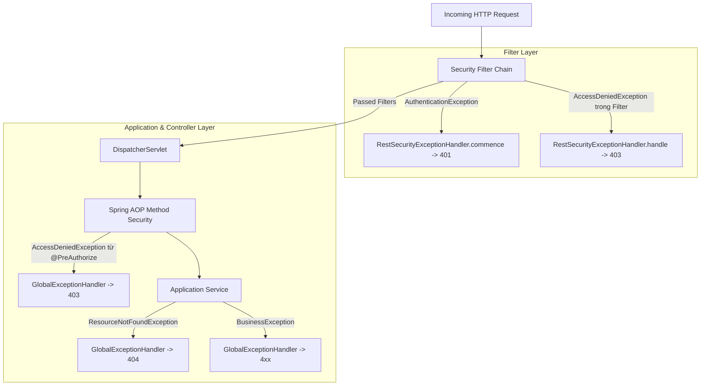

# Checkpoint 2.7.7 — Authorization Error Mapping & Security Exception Handling

> **Thuộc Phase**: [Phase 2.7 — Authorization & Access Control](README.md)  
> **Trạng thái**: 📐 Đã chuẩn hóa lỗi (Contract Approved)  
> **Tiêu chí nghiệm thu**: `AC-2.7.7`

---

## 1. Mục tiêu Checkpoint

Chuẩn hóa toàn diện cơ chế xử lý và ánh xạ lỗi phân quyền (Authorization Error Mapping) trong toàn bộ kiến trúc E-Edu. Đảm bảo phân định rạch ròi giữa lỗi chưa xác thực (401), không đủ quyền (403) và không tìm thấy tài nguyên (404); serialize thống nhất theo hợp đồng JSON `ApiErrorResponse` đã thiết kế ở Phase 1.6; đồng thời loại bỏ nguy cơ rò rỉ thông tin nhạy cảm qua thông điệp lỗi.

---

## 2. Quy ước Mã Phản hồi HTTP (HTTP Status Contract)

Hệ thống tuân thủ nghiêm ngặt chuẩn ngữ nghĩa HTTP theo ma trận sau:

| Tình huống thực tế | HTTP Status | Mã lỗi (`code`) | Thành phần xử lý |
| :--- | :---: | :---: | :--- |
| Không có Bearer Token, token rỗng hoặc không đúng chuẩn | `401 Unauthorized` | `UNAUTHORIZED` | `RestSecurityExceptionHandler.commence` |
| Token hết hạn (`JwtValidationException`) hoặc sai chữ ký số | `401 Unauthorized` | `INVALID_TOKEN` | `RestSecurityExceptionHandler.commence` |
| Tài khoản đăng nhập sai mật khẩu hoặc bị vô hiệu hóa | `401 Unauthorized` | `BAD_CREDENTIALS` | `GlobalExceptionHandler` |
| Đã xác thực nhưng vai trò thiếu Permission cần thiết | `403 Forbidden` | `FORBIDDEN` | `RestSecurityExceptionHandler.handle` / `GlobalExceptionHandler` |
| Membership của user trong tổ chức bị `SUSPENDED` | `403 Forbidden` | `MEMBERSHIP_SUSPENDED` | `RestSecurityExceptionHandler.handle` |
| Thiếu header bắt buộc `X-Organization-Id` trên endpoint tenant | `400 Bad Request` | `MISSING_TENANT_HEADER`| `GlobalExceptionHandler` |
| Tài nguyên không tồn tại trong cơ sở dữ liệu | `404 Not Found` | `RESOURCE_NOT_FOUND` | `GlobalExceptionHandler` |
| Tài nguyên thuộc tổ chức khác (User không có quyền xem) | `404 Not Found` | `RESOURCE_NOT_FOUND` | `GlobalExceptionHandler` (Anti-Enumeration) |

---

## 3. Cấu trúc Phản hồi Lỗi Chuẩn (`ApiErrorResponse`)

Mọi phản hồi lỗi xác thực và phân quyền bắt buộc phải tuân theo cấu trúc JSON `ApiErrorResponse` tại package `com.edu.boot.web`:

```json
{
  "timestamp": "2026-10-28T12:30:45.123456Z",
  "status": 403,
  "code": "FORBIDDEN",
  "message": "Access denied: You do not have permission to perform this action",
  "path": "/api/v1/curriculum/courses",
  "fieldErrors": null
}
```

### Nguyên tắc bắt buộc về nội dung lỗi:
1. **Mã lỗi ổn định (`code`)**: Frontend dựa vào trường `code` (ví dụ: `FORBIDDEN`, `MEMBERSHIP_SUSPENDED`, `UNAUTHORIZED`) để điều hướng màn hình (chuyển sang trang Login, hiển thị modal báo thiếu quyền, v.v.). Tuyệt đối không thay đổi chuỗi `code` ngẫu hứng.
2. **Thông điệp an toàn (`message`)**: Message chỉ chứa mô tả tổng quát, thân thiện với người dùng. Nghiêm cấm đưa stack trace, tên bảng database, tên cột, câu truy vấn SQL hoặc token vào `message`.
3. **Ẩn thông tin tổ chức chéo tenant**: Khi một người dùng không có quyền truy cập một thực thể do khác tổ chức, thông báo trả về tuyệt đối không được ghi: *"Resource belongs to Organization ABC"*, mà phải trả về lỗi 404 tiêu chuẩn: *"Resource not found with identifier: <uuid>"*.

---

## 4. Phân chia Trách nhiệm Xử lý Exception

Do Spring Security hoạt động tại tầng Filter (trước khi vào DispatcherServlet của Spring MVC), việc xử lý exception cần được cấu hình ở 2 nơi:



1. **`AuthenticationEntryPoint`**: Đón bắt các lỗi xác thực xảy ra khi parse token hoặc thiếu token trong Filter Chain. Trả về HTTP 401.
2. **`AccessDeniedHandler`**: Đón bắt các lỗi `AccessDeniedException` bị ném ra bên trong các Filter (ví dụ: `TenantResolutionFilter` phát hiện membership không hợp lệ). Trả về HTTP 403.
3. **`GlobalExceptionHandler` (`@RestControllerAdvice`)**: Đón bắt các `AccessDeniedException` được ném ra từ Spring AOP `@PreAuthorize` tại tầng Service và `ResourceNotFoundException`. Trả về HTTP 403 hoặc 404.

---

## 5. Tiêu chí Đánh giá & Nghiệm thu (Checklist AC-2.7.7)

- [x] **AC-2.7.7.1**: Phân biệt rành mạch và chính xác giữa 401 Unauthorized và 403 Forbidden.
- [x] **AC-2.7.7.2**: `AuthenticationEntryPoint` và `AccessDeniedHandler` serialize đúng 100% định dạng `ApiErrorResponse`.
- [x] **AC-2.7.7.3**: Các exception phát sinh từ AOP `@PreAuthorize` được `GlobalExceptionHandler` ánh xạ nhất quán về HTTP 403.
- [x] **AC-2.7.7.4**: Chính sách 404 Not Found được áp dụng cho tài nguyên chéo tenant, triệt tiêu nguy cơ rò rỉ dữ liệu.
- [x] **AC-2.7.7.5**: Mã `code` trong response là hằng số bất biến phục vụ frontend xử lý logic.
- [x] **AC-2.7.7.6**: Không bao giờ để lộ stack trace, thông tin máy chủ hoặc dữ liệu nhạy cảm trong response môi trường production.
- [x] **AC-2.7.7.7**: Kiểm thử tự động (MockMvc slice test) xác minh chính xác status code, error code và response body cho mọi kịch bản lỗi.
