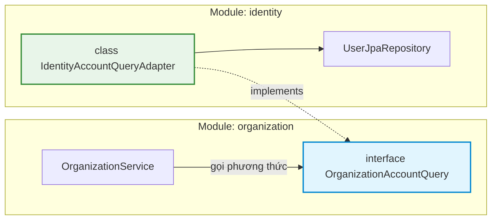

# Phase 4.3 — Public Port Decoupling (`OrganizationAccountQuery`)

Tài liệu thiết kế kiến trúc, đặc tả kỹ thuật và tiêu chí nghiệm thu cho cơ chế phân tách phụ thuộc liên module (Inter-Module Decoupling) thông qua mẫu thiết kế **Ports & Adapters (Hexagonal Architecture)** giữa module `organization` và `identity`.

---

## 1. Mục tiêu & Nguyên lý Kiến trúc

Trong kiến trúc **Modular Monolith**, các module nghiệp vụ cần duy trì ranh giới độc lập cao (loose coupling và high cohesion):
- **Nguyên lý Đảo ngược Phụ thuộc (Dependency Inversion Principle - DIP)**: Module `organization` không bao giờ import trực tiếp các lớp nội bộ (Entity, Repository, Service) của module `identity`.
- **Hợp đồng Công khai (Public Port)**: Module `organization` tự định nghĩa cổng giao tiếp (interface `OrganizationAccountQuery`) tại tầng Application theo đúng nhu cầu nghiệp vụ của chính nó.
- **Bộ chuyển đổi (Adapter Implementation)**: Module `identity` triển khai lớp `IdentityAccountQueryAdapter` để hiện thực hóa hợp đồng của port đó.
- **Bảo đảm Không Chu trình Phụ thuộc (No Cyclic Dependencies)**: Module `organization` chỉ phụ thuộc vào các module chia sẻ nền tảng (`shared-kernel`), không phụ thuộc mã nguồn của module `identity`.



---

## 2. Tiêu chí Nghiệm thu (Acceptance Criteria)

| Mã AC | Tiêu chí | Chi tiết kỹ thuật |
| :---: | :--- | :--- |
| **AC-4.3.1** | **Port Definition trong Organization** | Interface `OrganizationAccountQuery` nằm trong package `com.edu.organization.application.port`, cung cấp phương thức `boolean existsActiveUser(UserId userId)`. |
| **AC-4.3.2** | **Adapter Implementation trong Identity** | Lớp `IdentityAccountQueryAdapter` nằm trong `com.edu.identity.application.port` hoặc infrastructure, implements interface trên và ủy thác tra cứu qua `UserJpaRepository`. |
| **AC-4.3.3** | **ArchUnit Rule AR-07 (No Physical FK / Direct Access)** | Kiểm tra tự động xác nhận mã nguồn của `com.edu.organization..` không chứa bất kỳ import nào trỏ vào `com.edu.identity.infrastructure.persistence..`. |
| **AC-4.3.4** | **ArchUnit Rule AR-08 (Public Port Only)** | Kiểm tra tự động xác nhận module `organization` không phụ thuộc vào `com.edu.identity..` (hoặc chỉ giao tiếp qua public api/port được cấp phép). |
| **AC-4.3.5** | **Unit Test Cách ly (Isolation Mocking)** | `OrganizationServiceTest` có thể kiểm thử toàn bộ use case tạo tổ chức và mời thành viên bằng cách mock `OrganizationAccountQuery` mà không cần khởi động Spring context hay phụ thuộc vào `identity`. |

---

## 3. Chi tiết Mã nguồn Triển khai

### 3.1. Public Port Interface (`OrganizationAccountQuery.java`)

Được đặt trong module `organization`:

```java
package com.edu.organization.application.port;

import com.edu.shared.kernel.domain.identifier.UserId;

public interface OrganizationAccountQuery {

    /**
     * Kiểm tra người dùng có tồn tại trong hệ thống và đang ở trạng thái hoạt động (ACTIVE) hay không.
     *
     * @param userId Định danh người dùng cần kiểm tra
     * @return true nếu người dùng tồn tại và ACTIVE, ngược lại false
     */
    boolean existsActiveUser(UserId userId);
}
```

### 3.2. Adapter Implementation (`IdentityAccountQueryAdapter.java`)

Được đặt trong module `identity`:

```java
package com.edu.identity.application.port;

import com.edu.identity.domain.model.UserStatus;
import com.edu.identity.infrastructure.persistence.repository.UserJpaRepository;
import com.edu.organization.application.port.OrganizationAccountQuery;
import com.edu.shared.kernel.domain.identifier.UserId;
import org.springframework.stereotype.Component;

@Component
public class IdentityAccountQueryAdapter implements OrganizationAccountQuery {

    private final UserJpaRepository userRepository;

    public IdentityAccountQueryAdapter(UserJpaRepository userRepository) {
        this.userRepository = userRepository;
    }

    @Override
    public boolean existsActiveUser(UserId userId) {
        if (userId == null || userId.value() == null) {
            return false;
        }
        return userRepository.findById(userId.value())
                .map(user -> user.getStatus() == UserStatus.ACTIVE)
                .orElse(false);
    }
}
```

---

## 4. Kiểm soát Kiến trúc bằng ArchUnit

Quy tắc kiến trúc tự động chạy trong phase build Maven (`tests/architecture-tests`):

```java
@Test
@DisplayName("AR-07: organization must not depend on identity persistence")
void organizationMustNotDependOnIdentityPersistence() {
    noClasses()
            .that().resideInAPackage("com.edu.organization..")
            .should().dependOnClassesThat()
            .resideInAnyPackage(
                    "com.edu.identity.infrastructure.persistence.entity..",
                    "com.edu.identity.infrastructure.persistence.repository.."
            )
            .allowEmptyShould(true)
            .check(importedClasses);
}

@Test
@DisplayName("AR-08: organization must not depend on identity internal implementation")
void organizationMustNotDependOnIdentity() {
    noClasses()
            .that().resideInAPackage("com.edu.organization..")
            .should().dependOnClassesThat()
            .resideInAPackage("com.edu.identity..")
            .allowEmptyShould(true)
            .check(importedClasses);
}
```

---

## 5. Lợi ích Kỹ thuật Khi Mở rộng Hệ thống

1. **Chuẩn bị sẵn sàng cho Microservices**: Nếu trong tương lai tách `identity` và `organization` thành 2 microservices riêng biệt, chỉ cần thay đổi `IdentityAccountQueryAdapter` sang gọi gRPC/REST client mà không phải sửa một dòng mã nguồn nào trong `OrganizationService`.
2. **Tối ưu Tốc độ Kiểm thử (Testability)**: Các test cases của `organization` chạy hoàn toàn độc lập, không cần mock database của `identity`.
3. **Bảo mật Dữ liệu Nghiêm ngặt**: Module `organization` không có quyền truy cập vào các trường nhạy cảm như `password_hash` hay `salt` của `identity`.

---

## 6. Liên kết Tài liệu Liên quan

- [Phase 4 README](README.md) — Tổng quan phân hệ Identity & Access
- [Phase 4.1: Users & BCrypt Hashing](phase4.1.md) — Module Identity
- [Phase 4.2: Organizations & Memberships](phase4.2.md) — Module Organization
- [Phase 7.2: Architecture Tests với ArchUnit](../phase-7/phase7.2.md) — Bộ quy tắc kiểm soát ranh giới module

