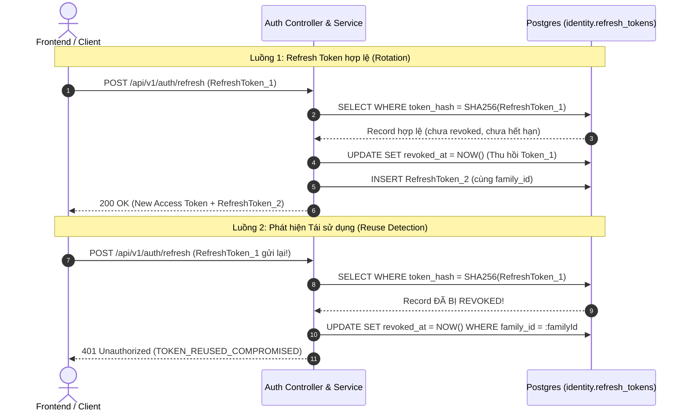

# Phase 4.4 — Spring Security 6 Stateless Filter Chain & JWT Token Management

Tài liệu thiết kế kiến trúc, đặc tả kỹ thuật và tiêu chí nghiệm thu cho hệ thống bảo mật không trạng thái (**Stateless Security**), xác thực Bearer Token (JWT), và cơ chế quản lý **Opaque Refresh Token Rotation** trên nền tảng Spring Boot 3.4 & Spring Security 6.

---

## 1. Mục tiêu & Nguyên tắc Thiết kế

- **Stateless Session Management**: Ứng dụng hoạt động hoàn toàn ở chế độ `SessionCreationPolicy.STATELESS`. Server không lưu trữ `HttpSession`, tạo điều kiện tối ưu để scale ngang (horizontal scaling).
- **Dual-Token Architecture**:
  - **Access Token (JWT)**: Ký số HMAC-SHA256 (HS256) bằng `NimbusJwtEncoder`/`NimbusJwtDecoder`, thời hạn ngắn (15 phút), chứa các claims định danh người dùng.
  - **Refresh Token (Opaque Token)**: Chuỗi ngẫu nhiên 256-bit entropy cao, thời hạn dài (7 ngày). Cơ sở dữ liệu chỉ lưu trữ bản băm SHA-256 (`token_hash`).
- **Cơ chế Refresh Token Rotation & Reuse Detection**:
  - Mỗi khi refresh token được sử dụng để đổi lấy access token mới, token cũ bị thu hồi (`revoked = true`) ngay lập tức và một refresh token mới được cấp phát trong cùng chuỗi (**Token Family**).
  - Nếu phát hiện một token đã bị thu hồi được gửi lại, hệ thống kích hoạt cơ chế phát hiện tái sử dụng (**Reuse Detection**) và lập tức thu hồi toàn bộ token thuộc cùng `family_id` để ngăn chặn kẻ tấn công chiếm quyền.
- **Bảo mật Ranh giới Khóa Ký**: Khóa ký JWT (`JWT_SECRET_BASE64`) được nạp qua cấu hình môi trường, độ dài tối thiểu 256-bit (>= 32 bytes).

---

## 2. Tiêu chí Nghiệm thu (Acceptance Criteria)

| Mã AC | Tiêu chí | Chi tiết kỹ thuật |
| :---: | :--- | :--- |
| **AC-4.4.1** | **Stateless Security Filter Chain** | `SecurityConfig` cấu hình `SecurityFilterChain` vô hiệu hóa CSRF, session stateless, mở các public endpoints (`/api/v1/auth/**`, `/api/v1/identity/accounts/register`), yêu cầu xác thực Bearer Token cho các endpoint còn lại. |
| **AC-4.4.2** | **JWT Access Token Issuance & Verification** | Sử dụng `NimbusJwtEncoder` và `NimbusJwtDecoder`. Access token có đầy đủ claims `sub` (userId), `iss`, `aud`, `iat`, `exp` (15 phút), `jti`. |
| **AC-4.4.3** | **Refresh Token Persistence Migration** | Flyway migration `V5__create_identity_refresh_tokens.sql` tạo bảng `identity.refresh_tokens` lưu trữ `user_id`, `token_hash`, `family_id`, `expires_at`, `revoked_at`. |
| **AC-4.4.4** | **Rotation & Reuse Detection** | Khi cấp mới token, token cũ bị thu hồi. Nếu phát hiện token cũ được gửi lại, toàn bộ token trong `family_id` bị vô hiệu hóa ngay lập tức. |
| **AC-4.4.5** | **Bảo mật Exception Handling** | Cấu hình `RestSecurityExceptionHandler` (triển khai `AuthenticationEntryPoint` và `AccessDeniedHandler`) serialize lỗi 401/403 về chuẩn `ApiErrorResponse`, không in stack trace hay thông tin nhạy cảm. |

---

## 3. Thiết kế Cơ sở dữ liệu & Migration

### Migration `V5__create_identity_refresh_tokens.sql`

```sql
CREATE TABLE IF NOT EXISTS identity.refresh_tokens (
    id UUID PRIMARY KEY,
    user_id UUID NOT NULL,
    token_hash VARCHAR(64) NOT NULL,
    family_id UUID NOT NULL,
    expires_at TIMESTAMP WITH TIME ZONE NOT NULL,
    revoked_at TIMESTAMP WITH TIME ZONE,
    created_at TIMESTAMP WITH TIME ZONE NOT NULL,
    updated_at TIMESTAMP WITH TIME ZONE NOT NULL,
    CONSTRAINT uk_refresh_tokens_hash UNIQUE (token_hash)
);

CREATE INDEX IF NOT EXISTS idx_refresh_tokens_user_id ON identity.refresh_tokens (user_id);
CREATE INDEX IF NOT EXISTS idx_refresh_tokens_family_id ON identity.refresh_tokens (family_id);
```

---

## 4. Luồng Hoạt động Token Rotation & Reuse Detection



---

## 5. Triển khai Cấu hình Spring Security 6

### `SecurityConfig.java`

```java
@Configuration
@EnableWebSecurity
@EnableMethodSecurity
public class SecurityConfig {

    private final RestSecurityExceptionHandler securityExceptionHandler;

    public SecurityConfig(RestSecurityExceptionHandler securityExceptionHandler) {
        this.securityExceptionHandler = securityExceptionHandler;
    }

    @Bean
    public SecurityFilterChain securityFilterChain(
            HttpSecurity http,
            JwtDecoder jwtDecoder,
            TenantResolutionFilter tenantResolutionFilter) throws Exception {

        http
            .csrf(AbstractHttpConfigurer::disable)
            .cors(Customizer.withDefaults())
            .sessionManagement(session -> session.sessionCreationPolicy(SessionCreationPolicy.STATELESS))
            .exceptionHandling(ex -> ex
                .authenticationEntryPoint(securityExceptionHandler)
                .accessDeniedHandler(securityExceptionHandler)
            )
            .authorizeHttpRequests(auth -> auth
                .requestMatchers(
                    "/api/v1/auth/**",
                    "/api/v1/identity/accounts/register",
                    "/actuator/health",
                    "/actuator/info",
                    "/v3/api-docs/**",
                    "/swagger-ui/**",
                    "/swagger-ui.html"
                ).permitAll()
                .anyRequest().authenticated()
            )
            .oauth2ResourceServer(oauth2 -> oauth2
                .jwt(jwt -> jwt.decoder(jwtDecoder))
                .authenticationEntryPoint(securityExceptionHandler)
                .accessDeniedHandler(securityExceptionHandler)
            )
            .addFilterAfter(tenantResolutionFilter, BearerTokenAuthenticationFilter.class);

        return http.build();
    }
}
```

---

## 6. Cấu hình JWT Properties & Beans

### `JwtSecurityConfig.java`

```java
@Configuration
public class JwtSecurityConfig {

    @Bean
    public JwtEncoder jwtEncoder(JwtProperties properties) {
        byte[] keyBytes = Decoders.BASE64.decode(properties.getSecretBase64());
        SecretKey secretKey = new SecretKeySpec(keyBytes, "HmacSHA256");
        JWKSource<SecurityContext> jwkSource = new ImmutableSecret<>(secretKey);
        return new NimbusJwtEncoder(jwkSource);
    }

    @Bean
    public JwtDecoder jwtDecoder(JwtProperties properties) {
        byte[] keyBytes = Decoders.BASE64.decode(properties.getSecretBase64());
        SecretKey secretKey = new SecretKeySpec(keyBytes, "HmacSHA256");
        NimbusJwtDecoder decoder = NimbusJwtDecoder.withSecretKey(secretKey)
                .macAlgorithm(MacAlgorithm.HS256)
                .build();

        OAuth2TokenValidator<Jwt> withIssuer = JwtValidators.createDefaultWithIssuer(properties.getIssuer());
        decoder.setJwtValidator(withIssuer);
        return decoder;
    }
}
```

---

## 7. Liên kết Tài liệu Liên quan

- [Phase 4 README](README.md) — Tổng quan phân hệ Identity & Access
- [Phase 4.5: Authentication Endpoints](phase4.5.md) — Chi tiết các API login, refresh, logout
- [Phase 4.6: Tenant Resolution Context](phase4.6.md) — Bộ lọc trích xuất Organization Context
- [Phase 4.7: Dynamic RBAC & Authorization](phase4.7.md) — Phân quyền dựa trên quyền hạn nguyên tử

