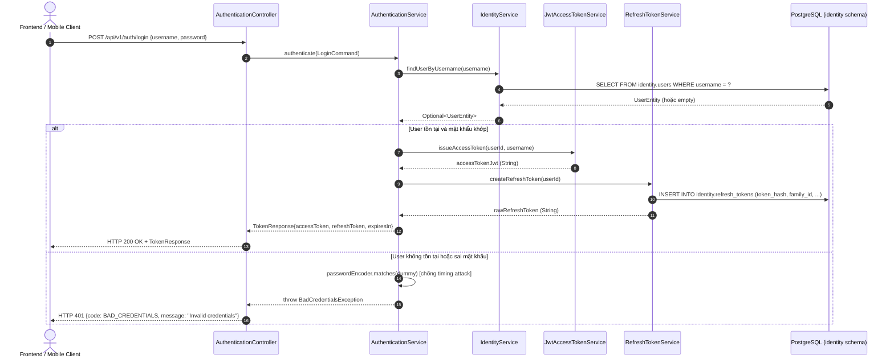

# Phase 4.5 — Authentication Endpoints & REST API

Tài liệu thiết kế kiến trúc, đặc tả kỹ thuật và tiêu chí nghiệm thu cho các endpoint xác thực người dùng: đăng nhập (`login`), làm mới phiên (`refresh token`), và đăng xuất (`logout`).

---

## 1. Mục tiêu & Phạm vi

- Cung cấp bộ 3 endpoint xác thực cốt lõi: `POST /api/v1/auth/login`, `POST /api/v1/auth/refresh`, `POST /api/v1/auth/logout`.
- Đảm bảo bảo mật chống lỗi **Timing Attack**: thời gian phản hồi đồng nhất bất kể tài khoản có tồn tại hay không (sử dụng `passwordEncoder.matches()` luôn chạy đủ thời gian).
- Không để lộ trạng thái bên trong hệ thống: khi tài khoản không tồn tại và khi sai mật khẩu đều trả về cùng mã lỗi `BAD_CREDENTIALS` (HTTP 401).
- Token Response tuân thủ hợp đồng `TokenResponse` Record thống nhất.

---

## 2. Tiêu chí Nghiệm thu (Acceptance Criteria)

| Mã AC | Tiêu chí | Chi tiết kỹ thuật |
| :---: | :--- | :--- |
| **AC-4.5.1** | **Login Endpoint - Happy Path** | `POST /api/v1/auth/login` nhận `{username, password}`, xác thực qua BCrypt, trả về `{accessToken, refreshToken, expiresIn}` HTTP 200. |
| **AC-4.5.2** | **Login - Chống Timing Attack** | Khi `username` không tồn tại, hệ thống vẫn thực thi `passwordEncoder.matches()` trên một dummy hash để đảm bảo thời gian phản hồi tương đương. |
| **AC-4.5.3** | **Login - Thất bại** | Sai credentials trả HTTP 401 với `ErrorCode.BAD_CREDENTIALS`, message mơ hồ ("Invalid credentials"), không tiết lộ username/email có tồn tại hay không. |
| **AC-4.5.4** | **Refresh Endpoint** | `POST /api/v1/auth/refresh` nhận `{refreshToken}`, kiểm tra hash, kiểm tra hạn sử dụng, thực hiện rotation, trả về bộ token mới HTTP 200. |
| **AC-4.5.5** | **Logout Endpoint** | `POST /api/v1/auth/logout` nhận `{refreshToken}`, vô hiệu hóa refresh token và toàn bộ gia đình (`family_id`) nếu cần, trả HTTP 204 No Content. |
| **AC-4.5.6** | **WebMvc Slice Tests** | `AuthenticationControllerTest` với `@WebMvcTest` kiểm tra đầy đủ happy path và error cases, mock `AuthenticationService`. |

---

## 3. Luồng Đăng nhập Chi tiết



---

## 4. Contract DTOs (Record Classes)

### Request DTOs

```java
// com.edu.identity.api.dto.LoginRequest
public record LoginRequest(
    @NotBlank(message = "Username is required") String username,
    @NotBlank(message = "Password is required") String password
) {}

// com.edu.identity.api.dto.RefreshTokenRequest
public record RefreshTokenRequest(
    @NotBlank(message = "Refresh token is required") String refreshToken
) {}

// com.edu.identity.api.dto.LogoutRequest
public record LogoutRequest(
    @NotBlank(message = "Refresh token is required") String refreshToken
) {}
```

### Response DTO

```java
// com.edu.identity.api.dto.TokenResponse
public record TokenResponse(
    String accessToken,
    String refreshToken,
    long expiresIn,           // Seconds until access token expires
    String tokenType          // Always "Bearer"
) {
    public static TokenResponse of(String accessToken, String refreshToken, long expiresIn) {
        return new TokenResponse(accessToken, refreshToken, expiresIn, "Bearer");
    }
}
```

---

## 5. Triển khai Controller

```java
// com.edu.identity.infrastructure.web.AuthenticationController
@RestController
@RequestMapping("/api/v1/auth")
public class AuthenticationController {

    private final AuthenticationService authenticationService;

    public AuthenticationController(AuthenticationService authenticationService) {
        this.authenticationService = authenticationService;
    }

    @PostMapping("/login")
    @ResponseStatus(HttpStatus.OK)
    public TokenResponse login(@Valid @RequestBody LoginRequest request) {
        return authenticationService.authenticate(
                new LoginCommand(request.username(), request.password())
        );
    }

    @PostMapping("/refresh")
    @ResponseStatus(HttpStatus.OK)
    public TokenResponse refresh(@Valid @RequestBody RefreshTokenRequest request) {
        return authenticationService.refreshToken(request.refreshToken());
    }

    @PostMapping("/logout")
    @ResponseStatus(HttpStatus.NO_CONTENT)
    public void logout(@Valid @RequestBody LogoutRequest request) {
        authenticationService.logout(request.refreshToken());
    }
}
```

---

## 6. Triển khai Service (Anti-Timing Attack)

```java
// com.edu.identity.application.service.AuthenticationService
@Service
@Transactional
public class AuthenticationService {

    private static final String DUMMY_HASH =
        "$2a$10$dummyhashforTimingAttackPreventionXXXXXXXXXXXXXXX";

    private final UserJpaRepository userRepository;
    private final PasswordEncoder passwordEncoder;
    private final JwtAccessTokenService jwtService;
    private final RefreshTokenService refreshTokenService;

    public TokenResponse authenticate(LoginCommand command) {
        Optional<UserEntity> userOpt = userRepository.findByUsername(command.username());

        // Luôn chạy passwordEncoder.matches để tránh timing attack
        String hashToVerify = userOpt
                .map(UserEntity::getPasswordHash)
                .orElse(DUMMY_HASH);

        boolean passwordMatches = passwordEncoder.matches(command.rawPassword(), hashToVerify);

        if (userOpt.isEmpty() || !passwordMatches || userOpt.get().getStatus() != UserStatus.ACTIVE) {
            throw new BadCredentialsException("Invalid credentials");
        }

        UserEntity user = userOpt.get();
        UserId userId = new UserId(user.getId());

        String accessToken = jwtService.issueAccessToken(userId, user.getUsername());
        String rawRefreshToken = refreshTokenService.createRefreshToken(userId);

        return TokenResponse.of(
                accessToken,
                rawRefreshToken,
                jwtService.getAccessTokenTtlSeconds()
        );
    }

    public TokenResponse refreshToken(String rawRefreshToken) {
        return refreshTokenService.rotateRefreshToken(rawRefreshToken);
    }

    public void logout(String rawRefreshToken) {
        refreshTokenService.revokeTokenFamily(rawRefreshToken);
    }
}
```

---

## 7. Ví dụ HTTP Request/Response

### Login thành công
```http
POST /api/v1/auth/login HTTP/1.1
Content-Type: application/json

{
  "username": "teacher.nguyen",
  "password": "SecurePassword123!"
}
```
```http
HTTP/1.1 200 OK
Content-Type: application/json

{
  "accessToken": "eyJhbGciOiJIUzI1NiIsInR5cCI6IkpXVCJ9...",
  "refreshToken": "a3f4b5c6d7e8f9a0b1c2d3e4f5a6b7c8...",
  "expiresIn": 900,
  "tokenType": "Bearer"
}
```

### Login thất bại
```http
HTTP/1.1 401 Unauthorized
Content-Type: application/json

{
  "timestamp": "2026-03-30T10:00:00Z",
  "status": 401,
  "code": "BAD_CREDENTIALS",
  "message": "Invalid credentials",
  "path": "/api/v1/auth/login"
}
```

---

## 8. Liên kết Tài liệu Liên quan

- [Phase 4 README](README.md) — Tổng quan phân hệ Identity & Access
- [Phase 4.4: JWT Token Management](phase4.4.md) — Cơ chế JWT và Refresh Token Rotation
- [Phase 4.6: Tenant Resolution Context](phase4.6.md) — Trích xuất Organization Context từ header
- [Phase 3.1: Global Exception Handling](../phase-3/phase3.1.md) — Chuẩn hóa phản hồi lỗi
