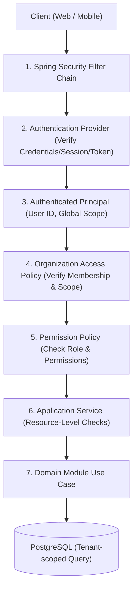
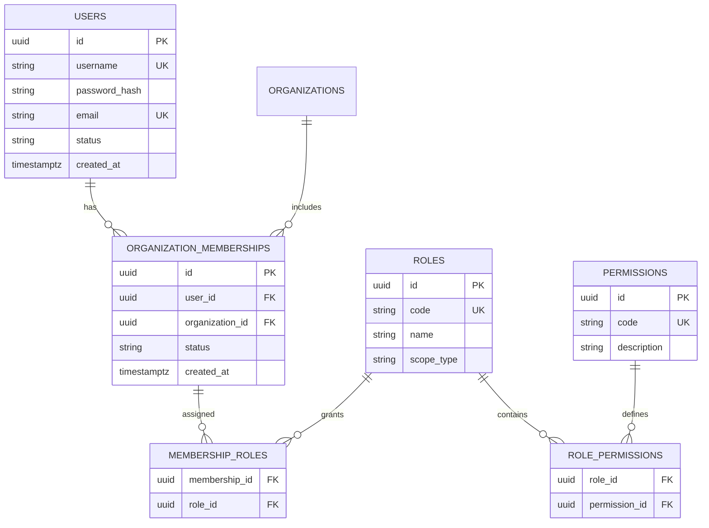

# E-Edu — Phase 1.7: Security Architecture & Authorization Model

Phase này thiết kế toàn diện kiến trúc bảo mật cho E-Edu trước khi bắt đầu dựng bộ khung mã nguồn Spring Boot skeleton.

Với nền tảng giáo dục đa tổ chức (**Multi-Tenancy**), việc xác thực người dùng thành công chỉ là bước khởi đầu. Hệ thống bắt buộc phải giải quyết triệt để 4 câu hỏi trong mỗi thao tác:
1. **Ai** đang thao tác? (Authentication / Principal)
2. Thao tác trong **tổ chức** nào? (Tenant / Organization Scope)
3. Có **vai trò & quyền hạn** gì trong tổ chức đó? (Role / Permission)
4. Có quyền trên **bản ghi / tài nguyên cụ thể** này hay không? (Resource-Level Authorization)

---

## 1. Bốn Trụ cột Bảo mật Cốt lõi

- **Authentication (Xác thực)**: Nhận diện danh tính người dùng thông qua thông tin đăng nhập, hỗ trợ cơ chế bảo mật phiên làm việc an toàn.
- **Authorization (Phân quyền)**: Xác định các hành động được phép thực thi (`student:read`, `class:manage`, `assessment:grade`, `certificate:issue`...).
- **Tenant Isolation (Cô lập tổ chức)**: Ngăn chặn triệt để lỗ hổng IDOR (Insecure Direct Object Reference) — Người dùng Trường A không thể xem hoặc sửa dữ liệu Trường B chỉ bằng cách sửa ID trên URL hoặc payload.
- **Auditability (Kiểm toán)**: Ghi log toàn vẹn các hành động nhạy cảm (cấp quyền, sửa điểm số, thay đổi quy tắc đánh giá, cấp văn bằng).

---

## 2. Mô hình Phân quyền: Organization-Scoped RBAC

E-Edu kết hợp **RBAC (Role-Based Access Control)** với **Phạm vi tổ chức (Scope)** và **Chính sách tài nguyên (Resource Policy)**.

> [!IMPORTANT]
> **Quyết định thiết kế then chốt:**  
> Gán vai trò nghiệp vụ thông qua **`MembershipRole`** (gắn với từng tổ chức), **tuyệt đối không gán Role tổ chức trực tiếp vào `UserRole` toàn cục**.  
> *Lý do:* Một người dùng có thể là `ORG_ADMIN` ở Trường A nhưng chỉ là `TEACHER` hoặc `STUDENT` ở Trường B. Gán role toàn cục sẽ dẫn đến nguy cơ leo thang đặc quyền ngoài ý muốn.

### Các Entity Bảo mật Chính:

| Entity | Trách nhiệm | Ghi chú |
| :--- | :--- | :--- |
| `User` | Tài khoản đăng nhập, mật khẩu mã hóa, trạng thái kích hoạt | Định danh duy nhất toàn hệ thống. |
| `Role` | Nhóm các quyền nghiệp vụ (`ORG_ADMIN`, `TEACHER`, `STUDENT`) | Định nghĩa theo mã (`code`) và loại phạm vi (`scope_type`). |
| `Permission` | Quyền nguyên tử cụ thể (`student:read`, `assessment:grade`) | Mã duy nhất theo chuẩn `resource:action`. |
| `RolePermission` | Bảng liên kết giữa `Role` và `Permission` | Xác định tập quyền của mỗi vai trò. |
| `OrganizationMembership` | Quan hệ thành viên giữa `User` và `Organization` | Chứa trạng thái thành viên (`ACTIVE`, `SUSPENDED`). |
| `MembershipRole` | Gán vai trò cho user cụ thể trong phạm vi tổ chức | `(membership_id, role_id)`. |

---

## 3. Kiến trúc Luồng Xác thực & Phân quyền (Security Pipeline)



### 6 Bước xử lý request được bảo vệ:
1. **Filter Chain**: Bắt request, trích xuất thông tin phiên/token.
2. **Authentication**: Xác thực danh tính người dùng và nạp `Principal` hợp lệ vào `SecurityContext`.
3. **Resolve Tenant Scope**: Trích xuất tổ chức mục tiêu từ request context, kiểm tra membership còn hiệu lực.
4. **Permission Check**: Đối chiếu quyền tối thiểu cần thiết cho endpoint.
5. **Resource-Level Policy**: Kiểm tra mối quan hệ tài nguyên thực tế (ví dụ: giáo viên này có được phân công giảng dạy lớp học này không).
6. **Scoped Persistence**: Repository truy vấn với điều kiện `WHERE organization_id = :currentOrgId`.

---

## 4. Chiến lược Xác thực: Session Cookie vs OAuth 2.0 / Token

| Tiêu chí | Server-Side Session (Cookie HttpOnly) | JWT Access Token + Refresh Token |
| :--- | :--- | :--- |
| **Phù hợp nhất** | Web App đầu tiên (Next.js SSR + Spring Boot) | Mobile App, Microservices, API bên thứ ba |
| **Bảo mật lưu trữ** | Cookie an toàn (`HttpOnly`, `Secure`, `SameSite=Strict/Lax`) | Cookie hoặc Secure Storage thiết bị di động |
| **Thu hồi quyền** | **Tức thì** (xóa session trên server là logout/khóa ngay) | Cần cơ chế blacklist hoặc đợi token hết hạn |
| **Bảo vệ bổ sung** | Bắt buộc bật CSRF protection | Tránh lưu token trong LocalStorage (chống XSS) |

> **Khuyến nghị cho E-Edu:**  
> Bắt đầu với **Spring Security Stateless JWT** có thời hạn ngắn (15 phút) kết hợp **Refresh Token** trong cơ sở dữ liệu để vừa phục vụ tốt REST API / Frontend Next.js, vừa hỗ trợ thu hồi quyền và sẵn sàng cho Mobile App trong tương lai.

---

## 5. Mô hình Dữ liệu Chi tiết (ERD Security)



### Các ràng buộc toàn vẹn bắt buộc:
- `UNIQUE (user_id, organization_id)` trên `organization_memberships`.
- `PRIMARY KEY (membership_id, role_id)` trên `membership_roles`.
- `PRIMARY KEY (role_id, permission_id)` trên `role_permissions`.

---

## 6. Chính sách Kiểm tra Quyền trên Tài nguyên (Resource Policy)

Annotation `@PreAuthorize("hasAuthority('assessment:grade')")` ở controller chỉ là lớp kiểm tra bề mặt. Logic nghiệp vụ bắt buộc phải kiểm tra quyền trên chính thực thể dữ liệu:

```java
public interface ResourceAuthorizationPolicy {

    void requireOrganizationAccess(UUID organizationId);

    void requireTeachingAssignment(UUID teacherId, UUID classSectionId, UUID organizationId);

    void requireStudentAccess(UUID studentId, UUID organizationId);
}
```

### Ví dụ Use Case nhập điểm:
```java
@Service
@RequiredArgsConstructor
public class GradeAssessmentUseCase {

    private final AssessmentAccessPolicy accessPolicy;
    private final AssessmentRepository assessmentRepository;

    @Transactional
    public AssessmentResult execute(GradeAssessmentCommand command) {
        // 1. Kiểm tra quyền của giáo viên đối với lớp học phần cụ thể
        accessPolicy.requireTeachingAssignment(command.teacherId(), command.classSectionId());
        
        // 2. Kiểm tra bài thi có thuộc lớp học phần đó không
        // 3. Thực thi nghiệp vụ chấm điểm
        return performGrading(command);
    }
}
```

---

## 7. Tenant Context Xuyên suốt Runtime

```java
public record TenantContext(
    UUID userId,
    UUID organizationId,
    Set<String> permissions
) {
    private static final ThreadLocal<TenantContext> CURRENT = new ThreadLocal<>();

    public static void set(TenantContext context) { CURRENT.set(context); }
    public static TenantContext get() { return CURRENT.get(); }
    public static void clear() { CURRENT.remove(); }
}
```

> [!CAUTION]
> **Nguyên tắc với ThreadLocal:**
> 1. Bắt buộc gọi `clear()` trong khối `finally` của Filter/Interceptor để tránh rò rỉ context khi thread pool tái sử dụng thread.
> 2. Với các luồng Async / Task Executor, context phải được truyền tường minh hoặc dùng `SecurityContextHolder.MODE_INHERITABLETHREADLOCAL` có kiểm soát.

---

## 8. Quy tắc Bảo mật Chi tiết Toàn hệ thống

1. **Mật khẩu**: Băm bằng **BCrypt** (strength 12) hoặc **Argon2id**; tuyệt đối không log mật khẩu thô hoặc token.
2. **CORS**: Chỉ cho phép origin của frontend (`http://localhost:3000` ở dev, domain chính thức ở prod); cấm `allowCredentials(true)` khi dùng wildcard `*`.
3. **CSRF**: Áp dụng CSRF token cho các request thay đổi trạng thái (`POST`, `PUT`, `DELETE`) nếu dùng xác thực qua Cookie.
4. **Brute-Force & Rate Limiting**: Giới hạn số lần đăng nhập sai (khóa tạm thời tài khoản hoặc IP sau 5 lần thất bại liên tiếp).
5. **Audit Logging**: Ghi log vào bảng audit cho các hành động: đăng nhập, đổi mật khẩu, gán quyền, sửa điểm số, phát hành chứng chỉ.
6. **Error Sanitization**: Global Exception Handler bắt mọi lỗi, ẩn stack trace và thông báo SQL nội bộ đối với response trả về client.

---

## 9. Architecture Decision Records (ADRs cho Phase 1.7)

### ADR-005: Authentication Strategy
- **Status**: Accepted
- **Context**: E-Edu cần xác thực an toàn cho Web App (Next.js) và sẵn sàng mở rộng cho Mobile App / API bên ngoài.
- **Decision**: Sử dụng Spring Security với Access Token (ngắn hạn) + Refresh Token được lưu trữ và kiểm soát trong database.
- **Consequences**: Cho phép thu hồi phiên đăng xuất tức thì, hỗ trợ đa nền tảng client, không bị giới hạn bởi cookie cross-origin.

### ADR-006: Organization-Scoped RBAC
- **Status**: Accepted
- **Context**: Người dùng tham gia nhiều tổ chức giáo dục với các vai trò và quyền hạn khác nhau.
- **Decision**: Áp dụng RBAC theo phạm vi thành viên tổ chức (`MembershipRole`). Không dùng role toàn cục cho các nghiệp vụ tổ chức.
- **Consequences**: Ngăn ngừa hoàn toàn việc dùng quyền của Trường A để thao tác dữ liệu Trường B.

### ADR-007: Tenant Context and Resource Authorization
- **Status**: Accepted
- **Context**: E-Edu dùng shared database / shared tables, bắt buộc cách ly dữ liệu giữa các tổ chức.
- **Decision**: Lấy danh tính người dùng từ SecurityContext đáng tin cậy. Xác minh quyền thành viên và thiết lập `TenantContext` bất biến trước khi đi vào application use case.
- **Consequences**: Cấm tin tưởng `organizationId` từ client input; mọi câu lệnh query đều áp dụng tenant scope.

### ADR-008: Security Audit and Defense in Depth
- **Status**: Accepted
- **Context**: E-Edu quản lý dữ liệu học tập và hồ sơ cá nhân nhạy cảm.
- **Decision**: Triển khai bảo vệ đa tầng: Spring Security + Policy nghiệp vụ + Scoped Repository + Audit Log.
- **Consequences**: Bắt buộc có audit log cho các thao tác điểm số, chứng nhận và phân quyền.

---

## 10. Checklist Nghiệm thu Phase 1.7

**Phase 1.7 — Acceptance Checklist (0/9)**

- [ ] Chốt cơ chế xác thực Access Token + Refresh Token
- [ ] Hoàn thiện mô hình User, Role, Permission và OrganizationMembership
- [ ] Xác định permission codes và phạm vi của từng role
- [ ] Thiết kế OrganizationAccessPolicy và resource-level policies
- [ ] Chuẩn hóa tenant context từ HTTP request đến persistence
- [ ] Xác định CSRF, CORS, password hashing và quản lý secret
- [ ] Thiết kế audit log cho các thao tác nhạy cảm
- [ ] Viết kiểm thử truy cập chéo tenant và truy cập trái phép
- [ ] Thêm ArchUnit rules bảo vệ ranh giới module security

---

### Bước tiếp theo: Phase 1.8 — Application Bootstrap, Configuration & Observability
Thiết lập cấu trúc Spring Boot composition root, quy ước profile môi trường (`dev`, `test`, `prod`), logging correlation ID, health check và exception handling trước khi chính thức bước sang **Phase 2 — Project Setup**.
