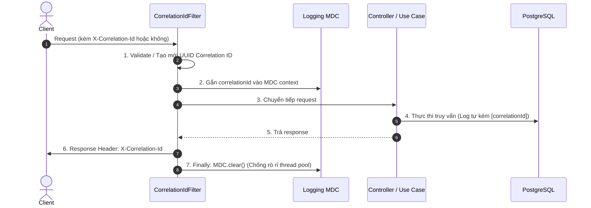

# E-Edu — Phase 1.8: Application Bootstrap, Configuration & Observability

Mục tiêu của phase này là chuẩn hóa toàn bộ cơ chế **khởi động (bootstrap)**, **quản lý cấu hình đa môi trường**, **giám sát vận hành (observability)** và **xử lý lỗi toàn cục** cho E-Edu trước khi bắt tay vào triển khai mã nguồn cụ thể.

Với kiến trúc **Modular Monolith + Java 21 + Spring Boot + PostgreSQL + Maven Multi-Module + ArchUnit**, hệ thống cần một điểm lắp ghép duy nhất, cấu hình tách biệt bảo mật và thông tin giám sát đầy đủ để vận hành tin cậy.

---

## 1. Bốn Quyết định Nền tảng trong Phase 1.8

- **AD-09 — Application Bootstrap**: Xác định Composition Root tại `e-edu-boot`, nguyên tắc lắp ghép module và kiểm soát ranh giới component scanning.
- **AD-10 — Configuration Management**: Quản lý cấu hình đa môi trường (`local`, `test`, `staging`, `prod`) và bảo vệ bí mật (secrets).
- **AD-11 — Observability**: Logging có cấu trúc, Correlation ID tracing, Actuator Health/Readiness probes và Micrometer metrics.
- **AD-12 — Runtime & Database Initialization**: Kết nối PostgreSQL, chiến lược điều phối Flyway migration tập trung và chuẩn hóa xử lý lỗi HTTP.

---

## 2. AD-09 — Application Bootstrap & Composition Root

Module `e-edu-boot` đóng vai trò là **Composition Root** duy nhất — nơi lắp ghép tất cả các module nghiệp vụ và chứa điểm khởi động `main()`.

```
e-edu/
├── pom.xml                               # Root POM
├── e-edu-boot/                           # Composition Root duy nhất
│   ├── pom.xml
│   └── src/main/
│       ├── java/com/eedu/boot/
│       │   ├── EEduApplication.java      # Entry point
│       │   └── config/                   # Global configuration beans
│       └── resources/
│           ├── application.yml
│           └── application-*.yml
├── e-edu-shared/
│   └── shared-kernel/
├── e-edu-modules/
│   ├── identity/
│   ├── organization/
│   ├── people/
│   ├── curriculum/
│   ├── academic/
│   ├── enrollment/
│   ├── teaching/
│   ├── attendance/
│   ├── assessment/
│   ├── certification/
│   ├── configuration/
│   └── rule-engine/
└── e-edu-tests/
    └── architecture-tests/
```

### Nguyên tắc bất biến:
1. **Một chiều duy nhất**: `e-edu-boot` phụ thuộc vào các module nghiệp vụ; các module nghiệp vụ **tuyệt đối không phụ thuộc ngược lại vào boot**.
2. **Không Component Scan tùy tiện**: Không dùng `@SpringBootApplication(scanBasePackages = "com.eedu")` quét bừa bãi. Phải đăng ký cấu hình có chủ đích để bảo vệ package-private của từng module.
3. **Không chứa nghiệp vụ**: `e-edu-boot` không được chứa bất kỳ logic nghiệp vụ, entity hay repository nào.

```java
package com.eedu.boot;

import org.springframework.boot.SpringApplication;
import org.springframework.boot.autoconfigure.SpringBootApplication;

@SpringBootApplication
public class EEduApplication {

    public static void main(String[] args) {
        SpringApplication.run(EEduApplication.class, args);
    }
}
```

---

## 3. AD-10 — Configuration Management & Phân tách Môi trường

Áp dụng cơ chế **Externalized Configuration** và **Spring Profiles**:

| Profile | Mục đích sử dụng | Nguồn nạp cấu hình |
| :--- | :--- | :--- |
| `local` | Phát triển trên máy cá nhân dev | `application-local.yml`, Docker Compose |
| `test` | Unit & Integration tests | `application-test.yml`, Testcontainers PostgreSQL |
| `staging` | Môi trường kiểm thử tiền production | Biến môi trường hệ thống (Env Vars), Secret Store |
| `prod` | Vận hành thực tế trên Production | Kubernetes Secrets, AWS Secrets Manager / Vault |

### Cấu trúc file cấu hình:
```
e-edu-boot/src/main/resources/
├── application.yml               # Cấu hình chung mặc định
├── application-local.yml         # Môi trường local dev
├── application-test.yml          # Môi trường CI / Test
├── application-staging.yml       # Môi trường Staging
└── application-prod.yml          # Môi trường Production
```

### File `application.yml` chuẩn:
```yaml
spring:
  application:
    name: e-edu

  profiles:
    default: local

  datasource:
    url: ${DB_URL:jdbc:postgresql://localhost:5432/eedu}
    username: ${DB_USERNAME:eedu}
    password: ${DB_PASSWORD}
    hikari:
      maximum-pool-size: ${DB_POOL_MAX:10}
      minimum-idle: ${DB_POOL_MIN:5}

  jpa:
    open-in-view: false           # Bắt buộc tắt OSIV để chống N+1 queries và leak connection
    hibernate:
      ddl-auto: validate          # Hibernate chỉ validate, không can thiệp schema

management:
  endpoints:
    web:
      exposure:
        include: health,info,metrics
  endpoint:
    health:
      probes:
        enabled: true             # Kích hoạt /livez và /readyz probes cho Kubernetes

server:
  port: ${SERVER_PORT:8080}
```

### Nguyên tắc bảo mật Secrets:
- **Trong Git**: Chỉ commit tên profile, port mặc định, logging level, timeout.
- **Ngoài Git (Tuyệt đối không commit)**: Database password, JWT secret key, OAuth client secrets, API keys.
- **Startup Validation**: Sử dụng `@ConfigurationProperties` có gắn validation (`@Validated`) để ứng dụng dừng ngay lập tức khi khởi động nếu thiếu các biến môi trường bắt buộc.

---

## 4. AD-11 — Observability: Logging, Correlation ID & Metrics

### 4.1. Logging Chuẩn (SLF4J + Logback)
- **Parameterized Logging**: Luôn dùng cú pháp `log.info("User logged in: userId={}, orgId={}", userId, orgId);` thay vì nối chuỗi.
- **Không Log Dữ liệu Nhạy cảm**: Tuyệt đối không in mật khẩu thô, refresh token, số thẻ, hoặc toàn bộ request body vào log.
- **Structured JSON Logging**: Trong môi trường `staging`/`prod`, log được format dạng JSON để dễ dàng ingestion vào ELK / Loki / CloudWatch.

### 4.2. Correlation ID Pipeline

Mỗi HTTP request được gán một mã định danh duy nhất (`X-Correlation-Id`) để liên kết toàn bộ log từ Controller → Service → Repository.



### 4.3. Health Checks & Metrics
- **Liveness Probe** (`/actuator/health/liveness`): Xác nhận JVM còn sống (không phụ thuộc vào DB bên ngoài để tránh restart-loop).
- **Readiness Probe** (`/actuator/health/readiness`): Xác nhận ứng dụng đã kết nối được PostgreSQL và sẵn sàng nhận traffic.
- **Micrometer Metrics**: Đo lường thời gian phản hồi HTTP, tỉ lệ mã lỗi 5xx/4xx, số kết nối HikariCP đang dùng.

---

## 5. AD-12 — Runtime, PostgreSQL & Flyway Migrations

### 5.1. Bảng Phân chia Schema giữa các Module

| Schema PostgreSQL | Module Nghiệp vụ Sở hữu |
| :--- | :--- |
| `identity` | `identity` (User, Role, Permission) |
| `organization` | `organization` (Organization, Campus, Unit, Membership) |
| `people` | `people` (Person, Student, Teacher, Guardian) |
| `curriculum` | `curriculum` (Program, Course, Version) |
| `academic` | `academic` (Period, Offering, Section, Room) |
| `enrollment` | `enrollment` (ProgramEnrollment, CourseEnrollment) |
| `teaching` | `teaching` (TeachingAssignment) |
| `attendance` | `attendance` (AttendanceRecord) |
| `assessment` | `assessment` (Assessment, Result, Scheme) |
| `certification` | `certification` (Certificate, Completion) |
| `configuration` | `configuration` (Policy, Setting) |
| `rule_engine` | `rule-engine` (RuleDefinition, Version, Binding) |

### 5.2. Chiến lược Điều phối Flyway Tập trung
- Mỗi module lưu trữ file migration của mình trong `src/main/resources/db/migration/<schema>/`.
- `e-edu-boot` đóng vai trò **Migration Coordinator**: Tự động quét và chạy migration tuần tự theo đúng thứ tự phụ thuộc kiến trúc, ghi nhận lịch sử vào bảng quản lý tập trung.

### 5.3. Quy tắc Migration Bất biến:
1. **Không sửa script đã áp dụng**: Khi cần sửa đổi schema, bắt buộc tạo file version mới (ví dụ: `V2__add_student_status.sql`).
2. **Kiểm thử trên PostgreSQL thật**: Mọi script migration phải được kiểm thử tự động với Testcontainers PostgreSQL trong pipeline CI.
3. **Phân định ranh giới Transaction**: Transaction thuộc về tầng Application Service. Nếu use case có bước gửi thông báo bên ngoài, phải commit dữ liệu trước hoặc dùng **Transactional Outbox**.

---

## 6. Xử lý Lỗi Thống nhất (Global Error Response)

Tất cả các lỗi trả về client đều tuân thủ cấu trúc JSON nhất quán:

```json
{
  "code": "STUDENT_NOT_FOUND",
  "message": "Không tìm thấy hồ sơ người học trong tổ chức.",
  "correlationId": "f47ac10b-58cc-4372-a567-0e02b2c3d479",
  "timestamp": "2026-10-15T02:45:00Z",
  "details": []
}
```

### Nguyên tắc `@RestControllerAdvice`:
- **Lỗi Validation (`MethodArgumentNotValidException`)**: Trả mã `VALIDATION_FAILED` (HTTP 400) kèm danh sách trường vi phạm trong `details`.
- **Lỗi Nghiệp vụ (`BusinessException`)**: Trả mã lỗi cụ thể (ví dụ `ENROLLMENT_ALREADY_EXISTS`, HTTP 409).
- **Lỗi Phân quyền (`AccessDeniedException`)**: Trả mã `FORBIDDEN` (HTTP 403).
- **Lỗi Hệ thống không lường trước (`Exception`)**: Trả mã `INTERNAL_SERVER_ERROR` (HTTP 500), **tuyệt đối không để lộ stack trace hay câu lệnh SQL ra ngoài**, ghi log chi tiết kèm correlation ID để điều tra.

---

## 7. Pipeline CI & Quy trình Kiểm thử Tự động

Pipeline GitHub Actions sẽ chạy lệnh build chuẩn:
```bash
mvn clean verify
```

### Các lớp kiểm tra trong CI:
1. **Compilation**: Xác minh toàn bộ các submodule biên dịch thành công.
2. **ArchUnit Tests**: Kiểm tra nghiêm ngặt không có vòng phụ thuộc (Cyclic Dependency) và cấm truy cập package internal xuyên module.
3. **Database Integration Tests**: Khởi tạo Testcontainers PostgreSQL, chạy toàn bộ Flyway migrations và Hibernate validate schema.
4. **Security & Secrets Check**: Đảm bảo không có secret hay private key nào bị commit trong mã nguồn.

---

## 8. Bảng Architecture Decision Records (ADR-009 đến ADR-012)

| ADR | Tiêu đề | Quyết định đã chọn | Trạng thái |
| :--- | :--- | :--- | :--- |
| **ADR-009** | Application Composition Root | Đặt tại `e-edu-boot`, kiểm soát component scan có chủ đích | **Accepted** |
| **ADR-010** | Configuration Management | Spring Profiles (`local`, `test`, `staging`, `prod`) + Secrets ngoài Git | **Accepted** |
| **ADR-011** | Observability Strategy | Structured Logging + Correlation ID Filter + Actuator Probes + Micrometer | **Accepted** |
| **ADR-012** | Database Runtime & Migration | Quản lý schema theo từng module, điều phối Flyway tập trung qua Boot | **Accepted** |

---

## 9. Checklist Nghiệm thu Phase 1.8

**Tiến độ Nghiệm thu Phase 1.8 (0/8)**

- [ ] **Bootstrap**: Một entry point duy nhất tại `e-edu-boot`, module đăng ký rõ ràng, không có dependency ngược.
- [ ] **Configuration**: Phân tách profile rõ ràng (`local`, `test`, `staging`, `prod`), bảo mật secrets ngoài Git.
- [ ] **Database**: Kết nối PostgreSQL ổn định, Flyway chạy tuần tự theo schema, Hibernate validate schema.
- [ ] **Transactions**: Ranh giới transaction use case rõ ràng, không mở transaction tùy tiện.
- [ ] **Observability**: Log format nhất quán, Correlation ID kèm MDC, Actuator health/readiness probes hoạt động.
- [ ] **Error Handling**: `@RestControllerAdvice` trả response chuẩn, ẩn hoàn toàn stack trace với lỗi 500.
- [ ] **CI Pipeline**: Lệnh `mvn clean verify` chạy trơn tru kiểm tra Unit test, Integration test và ArchUnit.
- [ ] **Security**: Endpoint Actuator được phân quyền bảo vệ, log không chứa dữ liệu nhạy cảm.

---

### Kết luận Phase 1 & Sẵn sàng cho Phase 2:
Với việc hoàn tất toàn bộ chuỗi thiết kế từ **Phase 1.1 đến Phase 1.8** (Domain Model, Module Boundaries, Architecture Decisions, Module Structure, Persistence Design, API Contracts, Security Model, và Bootstrap/Observability), toàn bộ nền tảng lý thuyết và ranh giới kiến trúc đã hoàn toàn sáng tỏ.

Dự án đã sẵn sàng bước vào **Phase 2 — Project Setup** để khởi tạo mã nguồn Maven multi-module thực tế!
