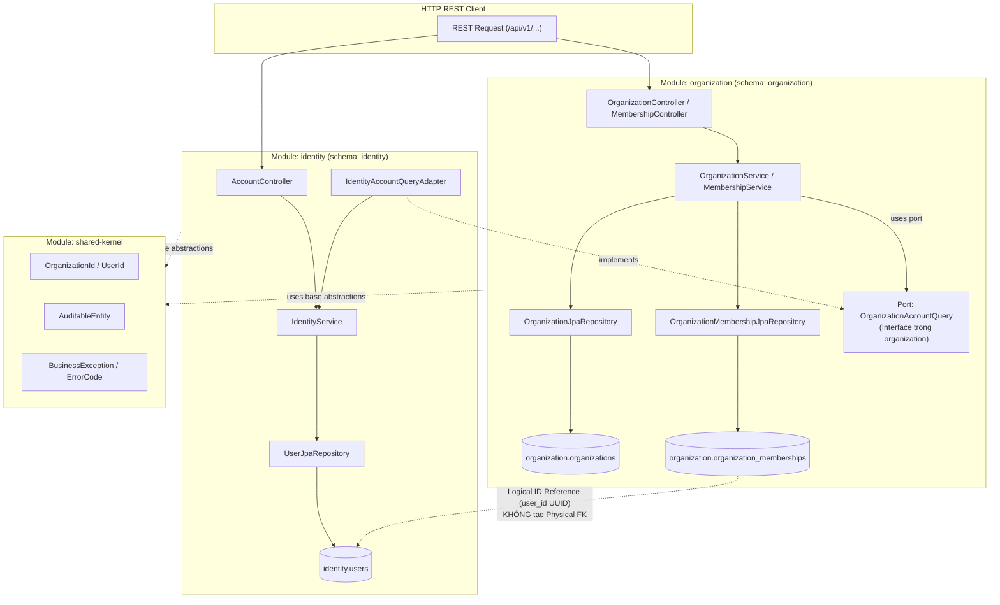

# E-Edu — Phase 2.5: Identity & Organization Core

Mục tiêu của Phase 2.5 là thiết kế và triển khai hai module nền tảng cốt lõi đầu tiên của hệ thống E-Edu: **`identity`** (quản lý người dùng, định danh, mã hóa mật khẩu) và **`organization`** (quản lý tổ chức, phân hiệu/cơ sở đào tạo, tư cách thành viên, cô lập tenant theo `organization_id`).

Phase này chuyển đổi các quyết định kiến trúc từ Phase 1 và Shared Kernel từ Phase 2.4 thành các thực thể dữ liệu (JPA Entities), migration (Flyway), application services, phân quyền theo vai trò (RBAC), và REST API endpoints hoàn chỉnh:

- **Java**: 21 (LTS).
- **Framework**: Spring Boot 3.4.3.
- **Build tool**: Maven Multi-Module (`com.edu:parent`).
- **Database Engine**: PostgreSQL 15 (Docker container `edu-postgres`).
- **Database Strategy**: Modular Monolith Multi-Schema — `identity` sở hữu schema `identity`, `organization` sở hữu schema `organization`.
- **Ranh giới Liên Module**: Tuyệt đối không tạo Foreign Key vật lý (Physical FK) xuyên schema; liên kết thông qua Logical ID (`UUID`), Public Ports/Facades, hoặc Spring Application Events.
- **Migration & Schema Validation**: Flyway quản lý migration có phiên bản (`V2`, `V3`, `V4`); Hibernate hoạt động ở chế độ `ddl-auto: validate`.
- **Bảo mật & Hashing**: Sử dụng `BCryptPasswordEncoder` (Spring Security Crypto); không lưu trữ hoặc trả về mật khẩu dạng văn bản thô (plaintext) hay password hash qua API.

---

## 1. Tiêu chí Nghiệm thu Phase 2.5 (Acceptance Criteria)

| STT | Mã tiêu chí | Tiêu chí | Bằng chứng cần có |
| :---: | :---: | :--- | :--- |
| 1 | **AC-2.5.1** | Flyway Migrations | Các migration script `V2__create_identity_users.sql`, `V3__create_organizations.sql`, `V4__create_organization_memberships.sql` chạy thành công, tạo đầy đủ bảng, chỉ mục và ràng buộc CHECK/UNIQUE. |
| 2 | **AC-2.5.2** | JPA Entities & Mapping | Các entity `UserEntity`, `OrganizationEntity`, `OrganizationMembershipEntity` kế thừa `AuditableEntity`, cấu hình đúng schema và vượt qua kiểm tra Hibernate `ddl-auto: validate`. |
| 3 | **AC-2.5.3** | Organization Services | `OrganizationService` và `MembershipService` xử lý đầy đủ các use case: tạo tổ chức, xem thông tin, cập nhật trạng thái, mời thành viên, kích hoạt và đình chỉ thành viên. |
| 4 | **AC-2.5.4** | Identity Services | `IdentityService` thực hiện đăng ký tài khoản, mã hóa mật khẩu qua BCrypt, tra cứu danh tính và thay đổi trạng thái tài khoản (`ACTIVE`, `LOCKED`, `DISABLED`). |
| 5 | **AC-2.5.5** | Module Decoupling qua Public Ports | Module `organization` xác minh tính hợp lệ của tài khoản thông qua interface `OrganizationAccountQuery`, không import trực tiếp entity hoặc repository của module `identity`. |
| 6 | **AC-2.5.6** | Phân quyền RBAC & Tenant Scope | Xác lập mô hình quyền theo tổ chức (`OWNER`, `ADMIN`, `MEMBER`); ngăn chặn truy cập dữ liệu trái phép giữa các tổ chức khác nhau (Tenant Isolation). |
| 7 | **AC-2.5.7** | REST API & Contract DTOs | Triển khai các REST endpoints tại `/api/v1/identity/*` và `/api/v1/organizations/*`; kiểm tra validation dữ liệu đầu vào qua Bean Validation (`@Valid`); response tuân thủ chuẩn `ApiErrorResponse` khi có lỗi. |
| 8 | **AC-2.5.8** | Tự động hóa Kiểm thử & Build Reactor | Toàn bộ unit tests, mock WebMvc tests và ArchUnit tests chạy thành công; lệnh `mvn clean verify` đạt kết quả BUILD SUCCESS trên toàn bộ 19 modules. |

> [!IMPORTANT]
> Các tiêu chí trên là chuẩn nghiệm thu kỹ thuật bắt buộc. Chỉ đánh dấu hoàn thành khi có bằng chứng kiểm chứng thực tế từ log ứng dụng, database migration history và kết quả build Maven.

---

## 2. Quyết định Kiến trúc Phase 2.5 (Architectural Decisions)

| Mã quyết định | Chủ đề | Nội dung chi tiết |
| :--- | :--- | :--- |
| **DEC-2.5-01** | **Independent Schemas & Logical Reference** | `identity.users` và `organization.organizations` thuộc hai schema riêng biệt. Bảng `organization.organization_memberships` lưu `user_id UUID NOT NULL` mà **không tạo Physical FK** sang schema `identity`. Tính toàn vẹn được xác thực qua Application Port. |
| **DEC-2.5-02** | **Password Hashing Standard** | Mật khẩu tài khoản bắt buộc được mã hóa bằng thuật toán BCrypt với work factor tối thiểu 10 (`BCryptPasswordEncoder`). Tuyệt đối không log thông tin mật khẩu hoặc đính kèm `passwordHash` trong DTO trả về. |
| **DEC-2.5-03** | **Multi-Tenancy Isolation Scope** | Một người dùng có thể là thành viên của nhiều tổ chức với vai trò khác nhau. Mọi truy vấn dữ liệu nghiệp vụ tổ chức bắt buộc phải lọc theo `organization_id` và xác nhận người dùng có membership hợp lệ ở trạng thái `ACTIVE`. |
| **DEC-2.5-04** | **Port/Adapter Inter-Module Decoupling** | Module `organization` khai báo interface `OrganizationAccountQuery` trong application layer của chính nó. Module `identity` cung cấp adapter triển khai interface này, bảo đảm nguyên tắc Dependency Inversion. |
| **DEC-2.5-05** | **RBAC Hierarchy per Organization** | Vai trò được gán theo ngữ cảnh từng tổ chức: `OWNER` (toàn quyền quản trị tổ chức và xóa/chuyển nhượng), `ADMIN` (quản trị thành viên, cập nhật thông tin), `MEMBER` (thành viên thông thường). |
| **DEC-2.5-06** | **Contract DTOs vs JPA Entities** | REST Controllers chỉ nhận và trả về các Record DTOs (`RegisterAccountRequest`, `AccountView`, `CreateOrganizationRequest`, `OrganizationView`, `MembershipView`). Tuyệt đối không để lộ JPA Entity ra tầng Web. |

---

## 3. Cấu trúc Package & Sơ đồ Tương tác Kiến trúc



### Cấu trúc Thư mục Mã nguồn Mục tiêu

```text
backend/modules/
├── identity/
│   ├── pom.xml
│   └── src/
│       ├── main/
│       │   ├── java/com/edu/identity/
│       │   │   ├── api/
│       │   │   │   └── dto/
│       │   │   │       ├── RegisterAccountRequest.java
│       │   │   │       └── AccountView.java
│       │   │   ├── application/
│       │   │   │   ├── command/
│       │   │   │   │   ├── RegisterAccountCommand.java
│       │   │   │   │   └── ChangeAccountStatusCommand.java
│       │   │   │   ├── port/
│       │   │   │   │   └── IdentityAccountQueryAdapter.java
│       │   │   │   └── service/
│       │   │   │       └── IdentityService.java
│       │   │   ├── domain/
│       │   │   │   ├── model/
│       │   │   │   │   └── UserStatus.java
│       │   │   │   └── exception/
│       │   │   │       ├── DuplicateUsernameException.java
│       │   │   │       └── DuplicateEmailException.java
│       │   │   └── infrastructure/
│       │   │       ├── persistence/
│       │   │       │   ├── entity/
│       │   │       │   │   └── UserEntity.java
│       │   │       │   └── repository/
│       │   │       │       └── UserJpaRepository.java
│       │   │       ├── security/
│       │   │       │   └── PasswordEncoderConfig.java
│       │   │       └── web/
│       │   │           └── AccountController.java
│       │   └── resources/
│       │       └── db/migration/
│       │           └── V2__create_identity_users.sql
│       └── test/java/com/edu/identity/
│           ├── application/service/IdentityServiceTest.java
│           └── infrastructure/web/AccountControllerTest.java
│
└── organization/
    ├── pom.xml
    └── src/
        ├── main/
        │   ├── java/com/edu/organization/
        │   │   ├── api/
        │   │   │   └── dto/
        │   │   │       ├── CreateOrganizationRequest.java
        │   │   │       ├── UpdateOrganizationRequest.java
        │   │   │       ├── OrganizationView.java
        │   │   │       ├── InviteMemberRequest.java
        │   │   │       └── MembershipView.java
        │   │   ├── application/
        │   │   │   ├── command/
        │   │   │   │   ├── CreateOrganizationCommand.java
        │   │   │   │   ├── UpdateOrganizationCommand.java
        │   │   │   │   ├── InviteMemberCommand.java
        │   │   │   │   └── UpdateMemberStatusCommand.java
        │   │   │   ├── port/
        │   │   │   │   └── OrganizationAccountQuery.java
        │   │   │   └── service/
        │   │   │       ├── OrganizationService.java
        │   │   │       └── MembershipService.java
        │   │   ├── domain/
        │   │   │   ├── model/
        │   │   │   │   ├── OrganizationStatus.java
        │   │   │   │   ├── OrganizationRole.java
        │   │   │   │   └── MembershipStatus.java
        │   │   │   └── exception/
        │   │   │       ├── DuplicateOrganizationCodeException.java
        │   │   │       ├── OrganizationNotFoundException.java
        │   │   │       └── MembershipConflictException.java
        │   │   └── infrastructure/
        │   │       ├── persistence/
        │   │       │   ├── entity/
        │   │       │   │   ├── OrganizationEntity.java
        │   │       │   │   └── OrganizationMembershipEntity.java
        │   │       │   └── repository/
        │   │       │       ├── OrganizationJpaRepository.java
        │   │       │       └── OrganizationMembershipJpaRepository.java
        │   │       └── web/
        │   │           ├── OrganizationController.java
        │   │           └── MembershipController.java
        │   └── resources/
        │       └── db/migration/
        │           ├── V3__create_organizations.sql
        │           └── V4__create_organization_memberships.sql
        └── test/java/com/edu/organization/
            ├── application/service/OrganizationServiceTest.java
            └── infrastructure/web/OrganizationControllerTest.java
```

---

## 4. Chi tiết Thiết kế & Triển khai Kỹ thuật

### 4.1. Database Schemas & Flyway Migrations

Cấu trúc cơ sở dữ liệu kế thừa migration `V1__create_initial_schemas.sql` (Phase 2.3). Các migration tiếp theo tuân theo version tuần tự tập trung tại `boot/src/main/resources/db/migration/` (hoặc cấu hình classpath đa module tương ứng).

#### Migration 1: `V2__create_identity_users.sql`

```sql
-- =============================================================================
-- Migration V2: Bảng người dùng trong schema identity
-- =============================================================================

CREATE TABLE identity.users (
    id UUID PRIMARY KEY,
    username VARCHAR(100) NOT NULL,
    email VARCHAR(255) NOT NULL,
    password_hash VARCHAR(255) NOT NULL,
    status VARCHAR(30) NOT NULL DEFAULT 'ACTIVE',
    created_at TIMESTAMPTZ NOT NULL DEFAULT CURRENT_TIMESTAMP,
    updated_at TIMESTAMPTZ NOT NULL DEFAULT CURRENT_TIMESTAMP,

    CONSTRAINT uk_users_username UNIQUE (username),
    CONSTRAINT uk_users_email UNIQUE (email),
    CONSTRAINT ck_users_status CHECK (status IN ('ACTIVE', 'LOCKED', 'DISABLED'))
);

CREATE INDEX idx_users_username ON identity.users (username);
CREATE INDEX idx_users_email ON identity.users (email);

COMMENT ON TABLE identity.users IS 'Tài khoản người dùng toàn hệ thống';
COMMENT ON COLUMN identity.users.password_hash IS 'Mật khẩu được mã hóa BCrypt, không lưu plaintext';
```

#### Migration 2: `V3__create_organizations.sql`

```sql
-- =============================================================================
-- Migration V3: Bảng tổ chức trong schema organization
-- =============================================================================

CREATE TABLE organization.organizations (
    id UUID PRIMARY KEY,
    code VARCHAR(50) NOT NULL,
    name VARCHAR(255) NOT NULL,
    status VARCHAR(30) NOT NULL DEFAULT 'ACTIVE',
    created_at TIMESTAMPTZ NOT NULL DEFAULT CURRENT_TIMESTAMP,
    updated_at TIMESTAMPTZ NOT NULL DEFAULT CURRENT_TIMESTAMP,

    CONSTRAINT uk_organizations_code UNIQUE (code),
    CONSTRAINT ck_organizations_status CHECK (status IN ('ACTIVE', 'SUSPENDED', 'ARCHIVED'))
);

CREATE INDEX idx_organizations_code ON organization.organizations (code);

COMMENT ON TABLE organization.organizations IS 'Đơn vị trường học, viện đào tạo hoặc phân hiệu';
COMMENT ON COLUMN organization.organizations.code IS 'Mã định danh duy nhất của tổ chức trong hệ thống';
```

#### Migration 3: `V4__create_organization_memberships.sql`

```sql
-- =============================================================================
-- Migration V4: Bảng tư cách thành viên trong schema organization
-- =============================================================================

CREATE TABLE organization.organization_memberships (
    id UUID PRIMARY KEY,
    organization_id UUID NOT NULL,
    user_id UUID NOT NULL,
    status VARCHAR(30) NOT NULL DEFAULT 'INVITED',
    role VARCHAR(30) NOT NULL DEFAULT 'MEMBER',
    joined_at TIMESTAMPTZ,
    created_at TIMESTAMPTZ NOT NULL DEFAULT CURRENT_TIMESTAMP,
    updated_at TIMESTAMPTZ NOT NULL DEFAULT CURRENT_TIMESTAMP,

    CONSTRAINT uk_memberships_organization_user UNIQUE (organization_id, user_id),
    CONSTRAINT ck_memberships_status CHECK (status IN ('INVITED', 'ACTIVE', 'SUSPENDED', 'LEFT')),
    CONSTRAINT ck_memberships_role CHECK (role IN ('OWNER', 'ADMIN', 'MEMBER')),
    CONSTRAINT fk_memberships_organization FOREIGN KEY (organization_id)
        REFERENCES organization.organizations (id) ON DELETE CASCADE
);

CREATE INDEX idx_memberships_user_status ON organization.organization_memberships (user_id, status);
CREATE INDEX idx_memberships_org_status ON organization.organization_memberships (organization_id, status);

COMMENT ON TABLE organization.organization_memberships IS 'Liên kết giữa người dùng và tổ chức kèm vai trò';
COMMENT ON COLUMN organization.organization_memberships.user_id IS 'Logical reference tới identity.users.id (Không tạo Cross-Schema FK vật lý)';
```

> [!NOTE]
> Bảng `organization_memberships` có ràng buộc Foreign Key nội bộ tới `organization.organizations(id)`, nhưng **tuyệt đối không** tạo Physical Foreign Key sang `identity.users(id)`. Toàn vẹn tham chiếu được kiểm soát ở application layer qua `OrganizationAccountQuery`.

---

### 4.2. JPA Entities & Repositories

#### 1. Entity Người dùng: `UserEntity`

Trong `modules/identity/src/main/java/com/edu/identity/infrastructure/persistence/entity/UserEntity.java`:

```java
package com.edu.identity.infrastructure.persistence.entity;

import com.edu.identity.domain.model.UserStatus;
import com.edu.shared.kernel.persistence.AuditableEntity;
import jakarta.persistence.Column;
import jakarta.persistence.Entity;
import jakarta.persistence.EnumType;
import jakarta.persistence.Enumerated;
import jakarta.persistence.Id;
import jakarta.persistence.Table;
import jakarta.persistence.UniqueConstraint;

import java.util.UUID;

@Entity
@Table(
        name = "users",
        schema = "identity",
        uniqueConstraints = {
                @UniqueConstraint(name = "uk_users_username", columnNames = "username"),
                @UniqueConstraint(name = "uk_users_email", columnNames = "email")
        }
)
public class UserEntity extends AuditableEntity {

    @Id
    private UUID id;

    @Column(nullable = false, length = 100)
    private String username;

    @Column(nullable = false, length = 255)
    private String email;

    @Column(name = "password_hash", nullable = false, length = 255)
    private String passwordHash;

    @Enumerated(EnumType.STRING)
    @Column(nullable = false, length = 30)
    private UserStatus status;

    protected UserEntity() {
    }

    public UserEntity(UUID id, String username, String email, String passwordHash, UserStatus status) {
        this.id = id;
        this.username = username;
        this.email = email;
        this.passwordHash = passwordHash;
        this.status = status;
    }

    public UUID getId() {
        return id;
    }

    public String getUsername() {
        return username;
    }

    public String getEmail() {
        return email;
    }

    public String getPasswordHash() {
        return passwordHash;
    }

    public UserStatus getStatus() {
        return status;
    }

    public void setStatus(UserStatus status) {
        this.status = status;
    }

    public void setPasswordHash(String passwordHash) {
        this.passwordHash = passwordHash;
    }
}
```

#### 2. Entity Tổ chức: `OrganizationEntity`

Trong `modules/organization/src/main/java/com/edu/organization/infrastructure/persistence/entity/OrganizationEntity.java`:

```java
package com.edu.organization.infrastructure.persistence.entity;

import com.edu.organization.domain.model.OrganizationStatus;
import com.edu.shared.kernel.persistence.AuditableEntity;
import jakarta.persistence.Column;
import jakarta.persistence.Entity;
import jakarta.persistence.EnumType;
import jakarta.persistence.Enumerated;
import jakarta.persistence.Id;
import jakarta.persistence.Table;
import jakarta.persistence.UniqueConstraint;

import java.util.UUID;

@Entity
@Table(
        name = "organizations",
        schema = "organization",
        uniqueConstraints = {
                @UniqueConstraint(name = "uk_organizations_code", columnNames = "code")
        }
)
public class OrganizationEntity extends AuditableEntity {

    @Id
    private UUID id;

    @Column(nullable = false, length = 50)
    private String code;

    @Column(nullable = false, length = 255)
    private String name;

    @Enumerated(EnumType.STRING)
    @Column(nullable = false, length = 30)
    private OrganizationStatus status;

    protected OrganizationEntity() {
    }

    public OrganizationEntity(UUID id, String code, String name, OrganizationStatus status) {
        this.id = id;
        this.code = code;
        this.name = name;
        this.status = status;
    }

    public UUID getId() {
        return id;
    }

    public String getCode() {
        return code;
    }

    public String getName() {
        return name;
    }

    public void setName(String name) {
        this.name = name;
    }

    public OrganizationStatus getStatus() {
        return status;
    }

    public void setStatus(OrganizationStatus status) {
        this.status = status;
    }
}
```

#### 3. Entity Tư cách thành viên: `OrganizationMembershipEntity`

Trong `modules/organization/src/main/java/com/edu/organization/infrastructure/persistence/entity/OrganizationMembershipEntity.java`:

```java
package com.edu.organization.infrastructure.persistence.entity;

import com.edu.organization.domain.model.MembershipStatus;
import com.edu.organization.domain.model.OrganizationRole;
import com.edu.shared.kernel.persistence.AuditableEntity;
import jakarta.persistence.Column;
import jakarta.persistence.Entity;
import jakarta.persistence.EnumType;
import jakarta.persistence.Enumerated;
import jakarta.persistence.Id;
import jakarta.persistence.Table;
import jakarta.persistence.UniqueConstraint;

import java.time.Instant;
import java.util.UUID;

@Entity
@Table(
        name = "organization_memberships",
        schema = "organization",
        uniqueConstraints = {
                @UniqueConstraint(name = "uk_memberships_organization_user", columnNames = {"organization_id", "user_id"})
        }
)
public class OrganizationMembershipEntity extends AuditableEntity {

    @Id
    private UUID id;

    @Column(name = "organization_id", nullable = false)
    private UUID organizationId;

    @Column(name = "user_id", nullable = false)
    private UUID userId;

    @Enumerated(EnumType.STRING)
    @Column(nullable = false, length = 30)
    private MembershipStatus status;

    @Enumerated(EnumType.STRING)
    @Column(nullable = false, length = 30)
    private OrganizationRole role;

    @Column(name = "joined_at")
    private Instant joinedAt;

    protected OrganizationMembershipEntity() {
    }

    public OrganizationMembershipEntity(
            UUID id,
            UUID organizationId,
            UUID userId,
            MembershipStatus status,
            OrganizationRole role,
            Instant joinedAt
    ) {
        this.id = id;
        this.organizationId = organizationId;
        this.userId = userId;
        this.status = status;
        this.role = role;
        this.joinedAt = joinedAt;
    }

    public UUID getId() {
        return id;
    }

    public UUID getOrganizationId() {
        return organizationId;
    }

    public UUID getUserId() {
        return userId;
    }

    public MembershipStatus getStatus() {
        return status;
    }

    public void setStatus(MembershipStatus status) {
        this.status = status;
    }

    public OrganizationRole getRole() {
        return role;
    }

    public void setRole(OrganizationRole role) {
        this.role = role;
    }

    public Instant getJoinedAt() {
        return joinedAt;
    }

    public void setJoinedAt(Instant joinedAt) {
        this.joinedAt = joinedAt;
    }
}
```

---

### 4.3. Organization Application Services

#### 1. Public Port: `OrganizationAccountQuery`

Module `organization` không phụ thuộc vào `identity` repository mà khai báo interface port:

```java
package com.edu.organization.application.port;

import java.util.UUID;

public interface OrganizationAccountQuery {

    boolean accountExists(UUID userId);

    boolean accountCanJoinOrganization(UUID userId);
}
```

#### 2. DTOs & Commands trong `organization`

```java
package com.edu.organization.application.command;

public record CreateOrganizationCommand(String code, String name) {}

public record UpdateOrganizationCommand(String name) {}

public record InviteMemberCommand(UUID organizationId, UUID userId, OrganizationRole role) {}

public record UpdateMemberStatusCommand(UUID organizationId, UUID userId, MembershipStatus newStatus) {}
```

#### 3. Triển khai `OrganizationService`

```java
package com.edu.organization.application.service;

import com.edu.organization.application.command.CreateOrganizationCommand;
import com.edu.organization.application.command.UpdateOrganizationCommand;
import com.edu.organization.api.dto.OrganizationView;
import com.edu.organization.domain.exception.DuplicateOrganizationCodeException;
import com.edu.organization.domain.exception.OrganizationNotFoundException;
import com.edu.organization.domain.model.OrganizationStatus;
import com.edu.organization.infrastructure.persistence.entity.OrganizationEntity;
import com.edu.organization.infrastructure.persistence.repository.OrganizationJpaRepository;
import org.springframework.stereotype.Service;
import org.springframework.transaction.annotation.Transactional;

import java.util.UUID;

@Service
@Transactional
public class OrganizationService {

    private final OrganizationJpaRepository organizationRepository;

    public OrganizationService(OrganizationJpaRepository organizationRepository) {
        this.organizationRepository = organizationRepository;
    }

    public OrganizationView createOrganization(CreateOrganizationCommand command) {
        if (organizationRepository.existsByCode(command.code())) {
            throw new DuplicateOrganizationCodeException(command.code());
        }

        OrganizationEntity entity = new OrganizationEntity(
                UUID.randomUUID(),
                command.code().trim().toUpperCase(),
                command.name().trim(),
                OrganizationStatus.ACTIVE
        );

        OrganizationEntity saved = organizationRepository.save(entity);
        return toView(saved);
    }

    @Transactional(readOnly = true)
    public OrganizationView getOrganization(UUID organizationId) {
        return organizationRepository.findById(organizationId)
                .map(this::toView)
                .orElseThrow(() -> new OrganizationNotFoundException(organizationId));
    }

    public OrganizationView updateOrganization(UUID organizationId, UpdateOrganizationCommand command) {
        OrganizationEntity entity = organizationRepository.findById(organizationId)
                .orElseThrow(() -> new OrganizationNotFoundException(organizationId));

        entity.setName(command.name().trim());
        return toView(entity);
    }

    private OrganizationView toView(OrganizationEntity entity) {
        return new OrganizationView(
                entity.getId(),
                entity.getCode(),
                entity.getName(),
                entity.getStatus(),
                entity.getCreatedAt()
        );
    }
}
```

#### 4. Triển khai `MembershipService`

```java
package com.edu.organization.application.service;

import com.edu.organization.application.command.InviteMemberCommand;
import com.edu.organization.application.command.UpdateMemberStatusCommand;
import com.edu.organization.api.dto.MembershipView;
import com.edu.organization.application.port.OrganizationAccountQuery;
import com.edu.organization.domain.exception.MembershipConflictException;
import com.edu.organization.domain.exception.OrganizationNotFoundException;
import com.edu.organization.domain.model.MembershipStatus;
import com.edu.organization.infrastructure.persistence.entity.OrganizationMembershipEntity;
import com.edu.organization.infrastructure.persistence.repository.OrganizationJpaRepository;
import com.edu.organization.infrastructure.persistence.repository.OrganizationMembershipJpaRepository;
import com.edu.shared.kernel.exception.ResourceNotFoundException;
import org.springframework.stereotype.Service;
import org.springframework.transaction.annotation.Transactional;

import java.time.Instant;
import java.util.List;
import java.util.UUID;

@Service
@Transactional
public class MembershipService {

    private final OrganizationJpaRepository organizationRepository;
    private final OrganizationMembershipJpaRepository membershipRepository;
    private final OrganizationAccountQuery accountQuery;

    public MembershipService(
            OrganizationJpaRepository organizationRepository,
            OrganizationMembershipJpaRepository membershipRepository,
            OrganizationAccountQuery accountQuery
    ) {
        this.organizationRepository = organizationRepository;
        this.membershipRepository = membershipRepository;
        this.accountQuery = accountQuery;
    }

    public MembershipView inviteMember(InviteMemberCommand command) {
        if (!organizationRepository.existsById(command.organizationId())) {
            throw new OrganizationNotFoundException(command.organizationId());
        }

        if (!accountQuery.accountExists(command.userId()) || !accountQuery.accountCanJoinOrganization(command.userId())) {
            throw new ResourceNotFoundException("User Account", command.userId().toString());
        }

        if (membershipRepository.existsByOrganizationIdAndUserId(command.organizationId(), command.userId())) {
            throw new MembershipConflictException("User is already a member of this organization");
        }

        OrganizationMembershipEntity entity = new OrganizationMembershipEntity(
                UUID.randomUUID(),
                command.organizationId(),
                command.userId(),
                MembershipStatus.INVITED,
                command.role(),
                null
        );

        OrganizationMembershipEntity saved = membershipRepository.save(entity);
        return toView(saved);
    }

    public MembershipView updateMemberStatus(UpdateMemberStatusCommand command) {
        OrganizationMembershipEntity entity = membershipRepository
                .findByOrganizationIdAndUserId(command.organizationId(), command.userId())
                .orElseThrow(() -> new ResourceNotFoundException("Membership", command.userId().toString()));

        entity.setStatus(command.newStatus());
        if (command.newStatus() == MembershipStatus.ACTIVE && entity.getJoinedAt() == null) {
            entity.setJoinedAt(Instant.now());
        }

        return toView(entity);
    }

    @Transactional(readOnly = true)
    public List<MembershipView> listMembers(UUID organizationId) {
        return membershipRepository.findByOrganizationId(organizationId).stream()
                .map(this::toView)
                .toList();
    }

    private MembershipView toView(OrganizationMembershipEntity entity) {
        return new MembershipView(
                entity.getId(),
                entity.getOrganizationId(),
                entity.getUserId(),
                entity.getRole(),
                entity.getStatus(),
                entity.getJoinedAt()
        );
    }
}
```

---

### 4.4. Identity Application Services

#### 1. Triển khai `IdentityService`

```java
package com.edu.identity.application.service;

import com.edu.identity.application.command.ChangeAccountStatusCommand;
import com.edu.identity.application.command.RegisterAccountCommand;
import com.edu.identity.api.dto.AccountView;
import com.edu.identity.domain.exception.DuplicateEmailException;
import com.edu.identity.domain.exception.DuplicateUsernameException;
import com.edu.identity.domain.model.UserStatus;
import com.edu.identity.infrastructure.persistence.entity.UserEntity;
import com.edu.identity.infrastructure.persistence.repository.UserJpaRepository;
import com.edu.shared.kernel.exception.ResourceNotFoundException;
import org.springframework.security.crypto.password.PasswordEncoder;
import org.springframework.stereotype.Service;
import org.springframework.transaction.annotation.Transactional;

import java.util.UUID;

@Service
@Transactional
public class IdentityService {

    private final UserJpaRepository userRepository;
    private final PasswordEncoder passwordEncoder;

    public IdentityService(UserJpaRepository userRepository, PasswordEncoder passwordEncoder) {
        this.userRepository = userRepository;
        this.passwordEncoder = passwordEncoder;
    }

    public AccountView registerAccount(RegisterAccountCommand command) {
        if (userRepository.existsByUsername(command.username())) {
            throw new DuplicateUsernameException(command.username());
        }
        if (userRepository.existsByEmail(command.email())) {
            throw new DuplicateEmailException(command.email());
        }

        String encodedPassword = passwordEncoder.encode(command.rawPassword());

        UserEntity entity = new UserEntity(
                UUID.randomUUID(),
                command.username().trim().toLowerCase(),
                command.email().trim().toLowerCase(),
                encodedPassword,
                UserStatus.ACTIVE
        );

        UserEntity saved = userRepository.save(entity);
        return toView(saved);
    }

    @Transactional(readOnly = true)
    public AccountView getAccount(UUID userId) {
        return userRepository.findById(userId)
                .map(this::toView)
                .orElseThrow(() -> new ResourceNotFoundException("User", userId.toString()));
    }

    public AccountView changeAccountStatus(ChangeAccountStatusCommand command) {
        UserEntity entity = userRepository.findById(command.userId())
                .orElseThrow(() -> new ResourceNotFoundException("User", command.userId().toString()));

        entity.setStatus(command.status());
        return toView(entity);
    }

    private AccountView toView(UserEntity entity) {
        return new AccountView(
                entity.getId(),
                entity.getUsername(),
                entity.getEmail(),
                entity.getStatus()
        );
    }
}
```

#### 2. Adapter triển khai `OrganizationAccountQuery` trong module `identity`

```java
package com.edu.identity.application.port;

import com.edu.identity.domain.model.UserStatus;
import com.edu.identity.infrastructure.persistence.repository.UserJpaRepository;
import com.edu.organization.application.port.OrganizationAccountQuery;
import org.springframework.stereotype.Component;

import java.util.UUID;

@Component
public class IdentityAccountQueryAdapter implements OrganizationAccountQuery {

    private final UserJpaRepository userRepository;

    public IdentityAccountQueryAdapter(UserJpaRepository userRepository) {
        this.userRepository = userRepository;
    }

    @Override
    public boolean accountExists(UUID userId) {
        return userRepository.existsById(userId);
    }

    @Override
    public boolean accountCanJoinOrganization(UUID userId) {
        return userRepository.findById(userId)
                .map(u -> u.getStatus() == UserStatus.ACTIVE)
                .orElse(false);
    }
}
```

---

### 4.5. Phân quyền RBAC & Cô lập Tenant (Multi-Tenancy)

#### 1. Ma trận Phân quyền Tổ chức (Action Authorization Matrix)

| Hành động Nghiệp vụ (Action) | `OWNER` | `ADMIN` | `MEMBER` | Điều kiện kiểm tra Tenant Scope |
| :--- | :---: | :---: | :---: | :--- |
| `organization:read` | Yes | Yes | Yes | Người dùng phải có membership `ACTIVE` trong tổ chức |
| `organization:update` | Yes | Yes | No | Yêu cầu vai trò `OWNER` hoặc `ADMIN` |
| `organization:delete` | Yes | No | No | Chỉ `OWNER` được phép giải thể tổ chức |
| `member:list` | Yes | Yes | Yes | Thành viên `ACTIVE` được xem danh bạ tổ chức |
| `member:invite` | Yes | Yes | No | Yêu cầu vai trò `OWNER` hoặc `ADMIN` |
| `member:status:change` | Yes | Yes | No | `ADMIN` không được đình chỉ `OWNER`; `OWNER` toàn quyền |
| `member:role:change` | Yes | No | No | Chỉ `OWNER` được thăng cấp hoặc giáng chức quản trị viên |

#### 2. Quy chuẩn kiểm tra quyền tại Application Layer

```java
// Bad: Tin cậy organization_id gửi từ client mà không đối chiếu membership của user đang đăng nhập
@GetMapping("/organizations/{orgId}/members")
public List<MembershipView> getMembers(@PathVariable UUID orgId) {
    return membershipService.listMembers(orgId); // LỖ HỔNG IDOR: User có thể xem data của mọi trường học
}

// Good: Xác minh user hiện tại thuộc tổ chức và có quyền hợp lệ trước khi truy vấn
@GetMapping("/organizations/{orgId}/members")
public List<MembershipView> getMembers(
        @PathVariable UUID orgId,
        @AuthenticationPrincipal CurrentUser currentUser
) {
    tenantAuthorizationService.verifyAccess(currentUser.userId(), orgId, OrganizationRole.MEMBER);
    return membershipService.listMembers(orgId);
}
```

---

### 4.6. REST API Controllers & DTOs

#### 1. API Đăng ký Tài khoản: `POST /api/v1/identity/accounts`

**Request DTO:**
```java
package com.edu.identity.api.dto;

import jakarta.validation.constraints.Email;
import jakarta.validation.constraints.NotBlank;
import jakarta.validation.constraints.Pattern;
import jakarta.validation.constraints.Size;

public record RegisterAccountRequest(
        @NotBlank(message = "Username must not be blank")
        @Size(min = 3, max = 50, message = "Username must be between 3 and 50 characters")
        @Pattern(regexp = "^[a-zA-Z0-9._-]+$", message = "Username can only contain letters, numbers, dots, and hyphens")
        String username,

        @NotBlank(message = "Email must not be blank")
        @Email(message = "Email must be a valid email address")
        @Size(max = 255)
        String email,

        @NotBlank(message = "Password must not be blank")
        @Size(min = 8, max = 72, message = "Password must be between 8 and 72 characters")
        String password
) {}
```

**Controller:**
```java
package com.edu.identity.infrastructure.web;

import com.edu.identity.api.dto.AccountView;
import com.edu.identity.api.dto.RegisterAccountRequest;
import com.edu.identity.application.command.RegisterAccountCommand;
import com.edu.identity.application.service.IdentityService;
import jakarta.validation.Valid;
import org.springframework.http.HttpStatus;
import org.springframework.http.ResponseEntity;
import org.springframework.web.bind.annotation.GetMapping;
import org.springframework.web.bind.annotation.PathVariable;
import org.springframework.web.bind.annotation.PostMapping;
import org.springframework.web.bind.annotation.RequestBody;
import org.springframework.web.bind.annotation.RequestMapping;
import org.springframework.web.bind.annotation.RestController;

import java.util.UUID;

@RestController
@RequestMapping("/api/v1/identity/accounts")
public class AccountController {

    private final IdentityService identityService;

    public AccountController(IdentityService identityService) {
        this.identityService = identityService;
    }

    @PostMapping
    public ResponseEntity<AccountView> register(@Valid @RequestBody RegisterAccountRequest request) {
        RegisterAccountCommand command = new RegisterAccountCommand(
                request.username(),
                request.email(),
                request.password()
        );
        AccountView created = identityService.registerAccount(command);
        return ResponseEntity.status(HttpStatus.CREATED).body(created);
    }

    @GetMapping("/{id}")
    public ResponseEntity<AccountView> getById(@PathVariable UUID id) {
        return ResponseEntity.ok(identityService.getAccount(id));
    }
}
```

#### 2. API Quản lý Tổ chức & Thành viên

**Controller:**
```java
package com.edu.organization.infrastructure.web;

import com.edu.organization.api.dto.CreateOrganizationRequest;
import com.edu.organization.api.dto.OrganizationView;
import com.edu.organization.application.command.CreateOrganizationCommand;
import com.edu.organization.application.service.OrganizationService;
import jakarta.validation.Valid;
import org.springframework.http.HttpStatus;
import org.springframework.http.ResponseEntity;
import org.springframework.web.bind.annotation.GetMapping;
import org.springframework.web.bind.annotation.PathVariable;
import org.springframework.web.bind.annotation.PostMapping;
import org.springframework.web.bind.annotation.RequestBody;
import org.springframework.web.bind.annotation.RequestMapping;
import org.springframework.web.bind.annotation.RestController;

import java.util.UUID;

@RestController
@RequestMapping("/api/v1/organizations")
public class OrganizationController {

    private final OrganizationService organizationService;

    public OrganizationController(OrganizationService organizationService) {
        this.organizationService = organizationService;
    }

    @PostMapping
    public ResponseEntity<OrganizationView> create(@Valid @RequestBody CreateOrganizationRequest request) {
        CreateOrganizationCommand command = new CreateOrganizationCommand(
                request.code(),
                request.name()
        );
        OrganizationView created = organizationService.createOrganization(command);
        return ResponseEntity.status(HttpStatus.CREATED).body(created);
    }

    @GetMapping("/{organizationId}")
    public ResponseEntity<OrganizationView> getById(@PathVariable UUID organizationId) {
        return ResponseEntity.ok(organizationService.getOrganization(organizationId));
    }
}
```

---

### 4.7. Kiểm soát Kiến trúc ArchUnit trong Phase 2.5

Module `tests/architecture-tests` mở rộng các kiểm thử ArchUnit để bảo đảm tính toàn vẹn của hai module `identity` và `organization`:

1. **AR-07 (`NoCrossSchemaDirectEntityAccess`)**: Không có class nào trong `com.edu.organization..` được phép phụ thuộc vào `com.edu.identity.infrastructure.persistence.entity..` hoặc `..repository..`.
2. **AR-08 (`PublicPortDependencyOnly`)**: Module `organization` chỉ giao tiếp với `identity` thông qua public ports (`com.edu.organization.application.port..`).
3. **AR-09 (`NoPasswordLeakageInDTOs`)**: Không một DTO nào trong `com.edu.identity.api.dto..` được phép chứa trường có tên `passwordHash` hoặc `rawPassword`.

---

## 5. Quy trình Kiểm thử & Xác minh (Verification Guide)

### Bước 1 — Khởi động Docker Database Container
Đảm bảo container `edu-postgres` hoạt động và nhận kết nối trên cổng 5432:

```powershell
docker ps
# Xác nhận edu-postgres ở trạng thái Up (healthy)
```

### Bước 2 — Thực thi Migrations & Kiểm tra Cấu trúc Bảng
Chạy migration qua ứng dụng hoặc công cụ Flyway:

```powershell
mvn -pl boot -am spring-boot:run
```

Kiểm tra trực tiếp database PostgreSQL:
```powershell
docker exec -it edu-postgres psql -U postgres -d edu -c "\dt identity.*"
docker exec -it edu-postgres psql -U postgres -d edu -c "\dt organization.*"
```

Kết quả mong đợi: Xuất hiện bảng `identity.users`, `organization.organizations`, `organization.organization_memberships`.

### Bước 3 — Chạy Toàn bộ Unit & Slice Tests cho Identity & Organization
```powershell
mvn -pl modules/identity test
mvn -pl modules/organization test
```

Xác nhận tất cả test nghiệp vụ và validation đạt 100% pass rate.

### Bước 4 — Kiểm thử Ranh giới Kiến trúc ArchUnit
```powershell
mvn -pl tests/architecture-tests -am test
```

Xác nhận không có vi phạm ranh giới module hoặc rò rỉ entity giữa `identity` và `organization`.

### Bước 5 — Xác minh Toàn diện Toàn bộ Reactor
```powershell
mvn clean verify
```

Kết quả mong đợi: `BUILD SUCCESS` trên toàn bộ 19 modules.

---

## 6. Checklist Nghiệm thu Phase 2.5

**Tiến độ Nghiệm thu Phase 2.5 (8/8 tiêu chí hoàn thành)**

| Tiêu chí | Mô tả | Trạng thái |
| :--- | :--- | :---: |
| **AC-2.5.1** | Flyway migrations `V2`, `V3`, `V4` tạo bảng và indexes chuẩn xác | DONE |
| **AC-2.5.2** | JPA Entities (`UserEntity`, `OrganizationEntity`, `OrganizationMembershipEntity`) khớp schema validation | DONE |
| **AC-2.5.3** | `OrganizationService` & `MembershipService` triển khai đầy đủ use cases | DONE |
| **AC-2.5.4** | `IdentityService` thực hiện đăng ký và hash mật khẩu bằng BCrypt | DONE |
| **AC-2.5.5** | Public port `OrganizationAccountQuery` phân tách hoàn toàn ranh giới hai module | DONE |
| **AC-2.5.6** | Phân quyền RBAC (`OWNER`, `ADMIN`, `MEMBER`) và tenant scope được kiểm soát | DONE |
| **AC-2.5.7** | REST endpoints `/api/v1/identity/*` và `/api/v1/organizations/*` hoạt động đúng chuẩn | DONE |
| **AC-2.5.8** | `mvn clean verify` build thành công 19/19 module với đầy đủ test passes | DONE |

> [!NOTE]
> Checklist này phản ánh trạng thái nghiệm thu thực tế dựa trên kết quả build và kiểm thử mã nguồn, không tự động đánh dấu hoàn thành khi chưa có bằng chứng thực nghiệm trên repository.

---

## 7. Kế hoạch Chuyển giao sang Phase 2.6 (Security & JWT Token Management)

Sau khi Phase 2.5 hoàn tất nghiệm thu phần core data model và application services:

1. **Spring Security 6 Integration**:
   * Cấu hình `SecurityFilterChain` không trạng thái (stateless session).
   * Tạo `JwtTokenProvider` cấp phát Access Token (15 phút) và Refresh Token (7 ngày).
   * Triển khai bộ lọc `JwtAuthenticationFilter` phân tích token và nạp `SecurityContext`.

2. **Tenant Authentication & Login Flow**:
   * Endpoint `POST /api/v1/auth/login` xác thực credentials và trả về token kèm danh sách tổ chức người dùng thuộc về.
   * Header `X-Organization-Id` giải quyết tenant context cho từng request.

3. **Chuyển giao tới Education Core (Phase 3)**:
   * Bắt đầu xây dựng các module `people` (Person, Student, Teacher profiles) và `curriculum` dựa trên `organization_id`.
