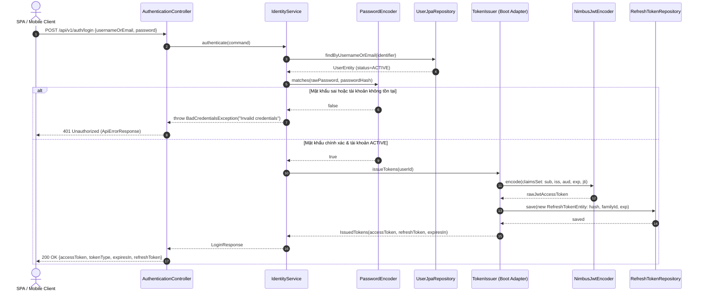
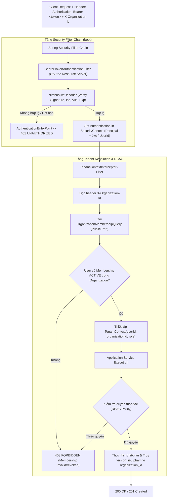
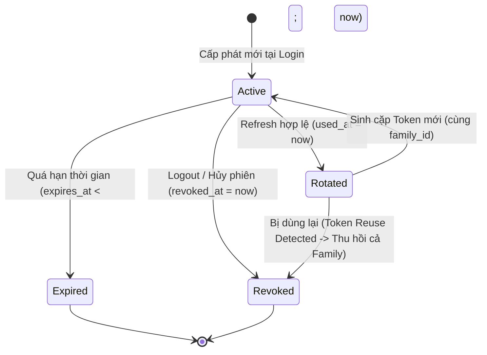

# E-Edu — Phase 2.6: Security & JWT Token Management

Mục tiêu của Phase 2.6 là thiết kế, đặc tả kỹ thuật và triển khai toàn diện hệ thống bảo mật **Spring Security 6** và cơ chế quản lý **JWT Access Token / Opaque Refresh Token** cho nền tảng E-Edu. 

Phase này hiện thực hóa các quyết định kiến trúc bảo mật trong mô hình **Modular Monolith Multi-Schema**, bảo đảm ranh giới độc lập giữa các module `identity` (xác thực danh tính, quản lý refresh token), `organization` (quản lý membership, phân quyền RBAC theo tenant), `shared-kernel` (tenant context, lỗi chuẩn hóa) và `boot` (security filter chain, token validation wiring):

- **Java**: 21 (LTS).
- **Framework**: Spring Boot 3.4.3 & Spring Security 6.
- **Security Architecture**: Stateless Session (`SessionCreationPolicy.STATELESS`), xác thực Bearer Token (JWT).
- **Token Strategy**:
  - **Access Token**: JWT ký số bằng thuật toán HMAC-SHA256 (HS256) với khóa bí mật tối thiểu 256-bit (32 bytes), thời hạn ngắn (10–15 phút), chứa claims định danh (`sub`, `iss`, `aud`, `iat`, `exp`, `jti`).
  - **Refresh Token**: Chuỗi ngẫu nhiên bảo mật (Cryptographically Secure Opaque Token, 256-bit entropy), lưu trữ dạng mã băm SHA-256 (`token_hash`) trong schema `identity`, có cơ chế **Rotation** bắt buộc, nhóm phiên (**Token Family**), và tự động thu hồi toàn chuỗi khi phát hiện hành vi tái sử dụng (**Reuse Detection**).
- **Multi-Tenancy & RBAC**: Tenant Resolution qua header `X-Organization-Id`; xác minh membership hiệu lực và quyền hạn (Role-Based Access Control) thông qua Public Port của module `organization`, ngăn chặn tuyệt đối lỗi IDOR (Insecure Direct Object Reference) và rò rỉ dữ liệu chéo tenant.
- **Error Handling**: Chuẩn hóa phản hồi lỗi 401 Unauthorized và 403 Forbidden theo hợp đồng JSON `ApiErrorResponse` thống nhất toàn hệ thống.
- **Database Strategy**: Bổ sung bảng `identity.refresh_tokens` thông qua Flyway migration `V5__create_identity_refresh_tokens.sql`; bảo đảm Hibernate `ddl-auto: validate`.

---

## 1. Tiêu chí Nghiệm thu Phase 2.6 (Acceptance Criteria)

| STT | Mã tiêu chí | Tiêu chí | Bằng chứng cần có |
| :---: | :---: | :--- | :--- |
| 1 | **AC-2.6.1** | **Security Architecture & ADR** | Chốt và tài liệu hóa 4 Architecture Decision Records: ADR-013 (Stateless Auth & JWT), ADR-014 (Refresh Token Rotation), ADR-015 (Tenant-scoped RBAC), ADR-016 (Module Boundaries & Ports). |
| 2 | **AC-2.6.2** | **Security Dependencies & Configuration** | Tích hợp `spring-boot-starter-security` và `spring-boot-starter-oauth2-resource-server` vào `boot/pom.xml`; cấu hình properties có validation (`issuer`, `audience`, `secret-base64`, `access-token-ttl`, `refresh-token-ttl`). |
| 3 | **AC-2.6.3** | **Authentication API (Login)** | Triển khai endpoint `POST /api/v1/auth/login`; xác thực tài khoản qua BCrypt; trả về bộ token (`accessToken`, `refreshToken`, `expiresIn`); ngăn chặn timing attack và không để lộ trạng thái tồn tại của tài khoản. |
| 4 | **AC-2.6.4** | **JWT Access Token Lifecycle** | Phát hành JWT bằng `NimbusJwtEncoder`, xác minh bằng `NimbusJwtDecoder`; kiểm tra nghiêm ngặt chữ ký số, issuer, audience và expiration time; tích hợp `Clock` UTC từ `shared-kernel`. |
| 5 | **AC-2.6.5** | **Refresh Token Management & Storage** | Migration `V5__create_identity_refresh_tokens.sql`; lưu trữ hash SHA-256; triển khai `POST /api/v1/auth/refresh` và `POST /api/v1/auth/logout`; xử lý rotation an toàn đa luồng (concurrency lock); phát hiện reuse và thu hồi token family. |
| 6 | **AC-2.6.6** | **Stateless Security Filter Chain** | Cấu hình `SecurityFilterChain` chỉ mở các endpoint công khai hợp lệ (`/api/v1/auth/login`, `/api/v1/auth/refresh`, `/api/v1/auth/logout`, `/api/v1/identity/accounts/register`); cấu hình custom `AuthenticationEntryPoint` (401) và `AccessDeniedHandler` (403) trả về `ApiErrorResponse`. |
| 7 | **AC-2.6.7** | **Tenant Resolution & RBAC** | Trích xuất `X-Organization-Id` vào `TenantContext`; kiểm tra membership qua Public Port `OrganizationMembershipQuery`; thực thi kiểm soát phân quyền (`OWNER`, `ADMIN`, `MEMBER`) trước khi thực thi nghiệp vụ; cô lập dữ liệu theo tenant. |
| 8 | **AC-2.6.8** | **Security Integration Tests & Verification** | Toàn bộ kiểm thử unit tests, WebMvc slice tests, và integration tests (chạy với PostgreSQL Testcontainers) thành công; kiểm tra vi phạm ranh giới module bằng ArchUnit; lệnh `mvn clean verify` đạt BUILD SUCCESS. |
| 9 | **AC-2.6.9** | **Security Hardening & Audit Checklist** | Rà soát cấu hình bí mật môi trường, chống timing attack, phòng chống brute-force, ngăn chặn token leakage trong log/error response và rà soát lỗ hổng theo OWASP API Security Top 10. |

> [!IMPORTANT]
> Toàn bộ các tiêu chí trên là chuẩn nghiệm thu kỹ thuật bắt buộc. Không đánh dấu hoàn thành chỉ dựa trên khai báo lý thuyết mà phải có kiểm chứng qua mã nguồn, kiểm thử tự động và kết quả build Maven reactor.

---

## 2. Quyết định Kiến trúc Phase 2.6 (Architectural Decisions)

| Mã quyết định | Chủ đề | Tình trạng | Nội dung chi tiết |
| :--- | :--- | :---: | :--- |
| **ADR-013 / DEC-2.6-01** | **Stateless Authentication & JWT** | **Approved** | Ứng dụng Spring Security 6 với `SessionCreationPolicy.STATELESS`. Access Token là JWT được ký số HMAC-SHA256, truyền qua header `Authorization: Bearer <token>`. Không lưu trữ session trên server; không chứa dữ liệu nhạy cảm hoặc role không thể thu hồi trong payload JWT. |
| **ADR-014 / DEC-2.6-02** | **Refresh Token Rotation & Reuse Detection** | **Approved** | Refresh Token là chuỗi ngẫu nhiên bảo mật 256-bit (Opaque Token). Database chỉ lưu trữ SHA-256 hash. Khi refresh thành công, token cũ bị vô hiệu hóa ngay lập tức và cấp mới token khác trong cùng `family_id`. Nếu token đã thu hồi bị gửi lại, hệ thống nhận diện tấn công (Reuse Detection) và lập tức thu hồi toàn bộ `family_id`. |
| **ADR-015 / DEC-2.6-03** | **Organization-Scoped Tenant Resolution & RBAC** | **Approved** | Frontend truyền `X-Organization-Id` cho các request cần ngữ cảnh tổ chức. Backend trích xuất danh tính `userId` từ `SecurityContext` (không tin cậy body/header client tự gửi), xác minh tính hợp lệ của membership qua Public Port của module `organization`, và áp dụng kiểm tra quyền hạn trước khi thao tác dữ liệu. |
| **ADR-016 / DEC-2.6-04** | **Decoupled Module Composition** | **Approved** | Module `identity` chỉ chịu trách nhiệm xác thực credentials và quản lý vòng đời refresh token. Module `organization` sở hữu logic membership và authorization policy. Module `boot` cấu hình security filter chain, JWT decoder/encoder và wiring. Tuyệt đối không import chéo JPA Entity/Repository giữa các module. |
| **DEC-2.6-05** | **Signing Key & Secrets Management** | **Approved** | Khóa ký HS256 (`JWT_SECRET_BASE64`) bắt buộc có độ dài tối thiểu 256-bit (>= 32 bytes) và được nạp từ biến môi trường/Vault/Secret Manager. Nghiêm cấm hardcode chuỗi secret trong mã nguồn, file cấu hình Git, hoặc in ra log. |
| **DEC-2.6-06** | **Uniform Error Contract Mapping** | **Approved** | Toàn bộ lỗi phát sinh tại Security Filter Chain (401 Unauthorized, 403 Forbidden) bắt buộc được ghi đè qua `AuthenticationEntryPoint` và `AccessDeniedHandler` để serialize về định dạng chuẩn `ApiErrorResponse` (chứa timestamp, status, code, message, path). |
| **DEC-2.6-07** | **Concurrency Protection in Token Rotation** | **Approved** | Nghiệp vụ xoay vòng refresh token phải chạy trong một `@Transactional` với cơ chế khóa bi quan (`SELECT ... FOR UPDATE`) hoặc kiểm tra số dòng cập nhật có điều kiện (`conditional update`), ngăn ngừa race condition tạo ra 2 token hợp lệ cùng lúc. |

---

## 3. Sơ đồ Kiến trúc & Tương tác Tổng thể

### 3.1. Sơ đồ Luồng Đăng nhập, Xác thực và Cấp phát Token



---

### 3.2. Sơ đồ Luồng Xác thực Request & Phân quyền Tenant (RBAC)



---

## 4. Checkpoint 2.6.1: Security Architecture & ADR

Mục tiêu của checkpoint 2.6.1 là chốt các nguyên tắc thiết kế ranh giới bảo mật và văn bản hóa các Architecture Decision Records (ADRs) làm kim chỉ nam xuyên suốt quá trình triển khai.

### 4.1. Phân định Ba Tầng Bảo mật Độc lập

Hệ thống tách biệt tường minh 3 trách nhiệm bảo mật:
1. **Authentication (Xác thực)**: Xác định danh tính người dùng (`UserId`). Câu hỏi duy nhất: *\"Bạn là ai? Danh tính của bạn có hợp lệ không?\"* — Do module `identity` và JWT Bearer filter xử lý.
2. **Tenant Resolution (Định vị Tenant)**: Xác định tổ chức mà request muốn thao tác thông qua `X-Organization-Id`. Câu hỏi: *\"Bạn có phải là thành viên hợp lệ của tổ chức này không?\"* — Do `TenantContext` kết hợp Public Port của `organization` kiểm tra.
3. **Authorization & RBAC (Phân quyền)**: Xác định hành động cụ thể trên tài nguyên. Câu hỏi: *\"Với vai trò của bạn trong tổ chức này, bạn có được phép thực hiện hành vi này không?\"* — Do RBAC policy và domain logic của module nghiệp vụ đánh giá.

> [!CAUTION]
> Một JWT Access Token hợp lệ **không đồng nghĩa** người dùng có quyền truy cập vào bất kỳ organization nào. Tuyệt đối không nhúng danh sách toàn bộ các organization hoặc role tĩnh vào JWT payload vì điều này sẽ không phản ánh được việc membership bị vô hiệu hóa tức thời.

---

### 4.2. Chi tiết các Quyết định Kiến trúc (ADRs)

#### ADR-013: Stateless Authentication & JWT Specification
- **Trạng thái**: Approved.
- **Quy chuẩn Token**:
  - `sub`: UUID của người dùng (`userId.toString()`).
  - `iss`: Giá trị định danh hệ thống (VD: `https://edu.example.com`).
  - `aud`: Giá trị đối tượng tiếp nhận (VD: `edu-api`).
  - `iat`: Thời điểm phát hành token (UTC Epoch Seconds).
  - `exp`: Thời điểm hết hạn token (`iat + ttl`, mặc định 15 phút).
  - `jti`: Mã định danh duy nhất của token (UUID) chống tấn công replay.
- **Ràng buộc an toàn**: Không lưu thông tin nhạy cảm (mật khẩu, hash, CCCD, thông tin ngân hàng) vào token. Thuật toán ký mặc định: `HS256` với secret tối thiểu 256-bit.

#### ADR-014: Refresh Token Rotation & Opaque Token Storage
- **Trạng thái**: Approved.
- **Cơ chế**: Refresh token là chuỗi ngẫu nhiên sinh bằng `SecureRandom` (32 bytes = 256 bits), encode Base64 URL-safe.
- **Lưu trữ**: Database schema `identity` **chỉ lưu mã băm SHA-256** của refresh token (`token_hash`), không bao giờ lưu plaintext.
- **Vòng đời & Thu hồi**:
  - Khi refresh thành công, token cũ được đánh dấu `used_at = now()`, sinh ra một refresh token mới kế thừa cùng `family_id`.
  - **Phát hiện tái sử dụng (Reuse Detection)**: Nếu một token đã có `used_at IS NOT NULL` được gửi lên để refresh, hệ thống xác định khóa bảo mật bị lộ; ngay lập tức đánh dấu thu hồi toàn bộ các token có cùng `family_id` (`revoked_at = now()`) và trả về 401 Unauthorized.
  - Khi người dùng Logout, token hiện tại được đánh dấu `revoked_at = now()`.



#### ADR-015: Tenant Resolution & RBAC Model
- **Trạng thái**: Approved.
- **Cơ chế**:
  - Request nghiệp vụ gửi header `X-Organization-Id: <UUID>`.
  - Backend lấy `UserId` từ `SecurityContextHolder.getContext().getAuthentication()`.
  - Gọi Public Port `OrganizationMembershipQuery` để tra cứu membership:
    - Nếu không tồn tại hoặc `status != ACTIVE`: Từ chối truy cập với mã lỗi `403 Forbidden` (`ORGANIZATION_ACCESS_DENIED`).
    - Nếu hợp lệ: Cung cấp `OrganizationRole` (`OWNER`, `ADMIN`, `MEMBER`) vào `TenantContext`.
  - Mọi câu lệnh SQL đọc/ghi dữ liệu nghiệp vụ phải gắn chặt điều kiện `WHERE organization_id = :orgId`.

#### ADR-016: Module Boundaries & Separation of Concerns
- **Trạng thái**: Approved.
- **Phân công trách nhiệm**:
  - Module `identity`: Xử lý bảng `identity.users`, `identity.refresh_tokens`, mã hóa mật khẩu BCrypt, service đăng nhập và phát hành token.
  - Module `organization`: Xử lý bảng `organization.organizations`, `organization.organization_memberships`, cung cấp Public Port cho phép kiểm tra membership.
  - Module `shared-kernel`: Khai báo primitive types (`UserId`, `OrganizationId`), `ApiErrorResponse`, exceptions dùng chung, `TenantContext`.
  - Module `boot`: Đóng gói cấu hình Spring Security 6 (`SecurityFilterChain`), cấu hình Nimbus JWT (`JwtDecoder`, `JwtEncoder`), wires dependencies và cấu hình CORS/CSRF.

---

### 4.3. Tiêu chí Hoàn thành Checkpoint 2.6.1

| ID | Tiêu chí | Trạng thái |
| :--- | :--- | :---: |
| **AC-2.6.1.1** | Phân định tường minh Authentication, Tenant Resolution và RBAC | **DONE** |
| **AC-2.6.1.2** | Chốt cấu trúc claims JWT và thời hạn Access Token (15 phút) | **DONE** |
| **AC-2.6.1.3** | Chốt chiến lược Refresh Token Rotation, Opaque Token, SHA-256 Hash và Reuse Detection | **DONE** |
| **AC-2.6.1.4** | Xác lập ranh giới module giữa `identity`, `organization`, `shared-kernel` và `boot` | **DONE** |
| **AC-2.6.1.5** | Quy chuẩn hóa các quyết định thành ADR-013, ADR-014, ADR-015, ADR-016 | **DONE** |

---

## 5. Checkpoint 2.6.2: Security Dependencies & Configuration

Mục tiêu của checkpoint 2.6.2 là khai báo đúng các thư viện bảo mật trong Maven Multi-Module, thiết lập file cấu hình thuộc tính theo môi trường và chuẩn bị bộ khung Security Configuration.

### 5.1. Khai báo Dependencies trong Maven

Theo thiết kế Modular Monolith của E-Edu:
- Module `boot` chịu trách nhiệm chạy ứng dụng Web và cấu hình Security Filter Chain. Do đó, các starter bảo mật được đặt tại `boot/pom.xml`.
- Module `identity` đã có `spring-security-crypto` (đã sử dụng từ Phase 2.5 cho `PasswordEncoderConfig`).

Bổ sung vào `backend/boot/pom.xml`:

```xml
<!-- Spring Security Starter -->
<dependency>
    <groupId>org.springframework.boot</groupId>
    <artifactId>spring-boot-starter-security</artifactId>
</dependency>

<!-- OAuth2 Resource Server & Nimbus JOSE for JWT Processing -->
<dependency>
    <groupId>org.springframework.boot</groupId>
    <artifactId>spring-boot-starter-oauth2-resource-server</artifactId>
</dependency>

<!-- Security Test Slice -->
<dependency>
    <groupId>org.springframework.security</groupId>
    <artifactId>spring-security-test</artifactId>
    <scope>test</scope>
</dependency>
```

> [!NOTE]
> Không khai báo `<version>` thủ công vì Spring Boot 3.4.3 Parent POM (`com.edu:parent`) đã quản lý phiên bản tương thích thông qua Spring Boot Dependencies BOM.

---

### 5.2. Cấu hình Thuộc tính Bảo mật (Configuration Properties)

Khai báo các thuộc tính bảo mật trong `backend/boot/src/main/resources/application.yml`:

```yaml
app:
  security:
    jwt:
      issuer: ${JWT_ISSUER:https://edu.example.com}
      audience: ${JWT_AUDIENCE:edu-api}
      # Khóa bí mật Base64 mã hóa cho HS256 (tối thiểu 256 bits = 32 bytes)
      secret-base64: ${JWT_SECRET_BASE64:kX8vP9mN2qR5tU8x/A1bC4dE7gH0jK3mP6sV9yB2eE5=}
      access-token-ttl: ${JWT_ACCESS_TOKEN_TTL:PT15M}       # 15 phút (ISO-8601 Duration)
      refresh-token-ttl: ${JWT_REFRESH_TOKEN_TTL:P7D}       # 7 ngày (ISO-8601 Duration)
    cors:
      allowed-origins: ${CORS_ALLOWED_ORIGINS:http://localhost:3000,http://localhost:5173}
      allowed-methods: GET,POST,PUT,PATCH,DELETE,OPTIONS
      allowed-headers: Authorization,Content-Type,X-Organization-Id
      allow-credentials: true
```

Khai báo lớp cấu hình có kiểm tra tính hợp lệ (`@Validated`) tại `backend/boot/src/main/java/com/edu/boot/security/JwtProperties.java`:

```java
package com.edu.boot.security;

import java.time.Duration;
import jakarta.validation.constraints.NotBlank;
import jakarta.validation.constraints.NotNull;
import jakarta.validation.constraints.Size;
import org.springframework.boot.context.properties.ConfigurationProperties;
import org.springframework.validation.annotation.Validated;

@ConfigurationProperties(prefix = "app.security.jwt")
@Validated
public record JwtProperties(
    @NotBlank String issuer,
    @NotBlank String audience,
    @NotBlank @Size(min = 44, message = "secret-base64 must represent at least 256 bits") String secretBase64,
    @NotNull Duration accessTokenTtl,
    @NotNull Duration refreshTokenTtl
) {
}
```

---

### 5.3. Tiêu chí Hoàn thành Checkpoint 2.6.2

| ID | Tiêu chí | Trạng thái |
| :--- | :--- | :---: |
| **AC-2.6.2.1** | Kiểm tra dependency tree không xảy ra xung đột thư viện bảo mật | **DONE** |
| **AC-2.6.2.2** | Khai báo `spring-boot-starter-security` và `oauth2-resource-server` trong `boot/pom.xml` | **DONE** |
| **AC-2.6.2.3** | Cấu hình `JwtProperties` với validation chặt chẽ độ dài secret và TTL | **DONE** |
| **AC-2.6.2.4** | Ứng dụng khởi động bình thường, Flyway migration và context loading không bị lỗi | **DONE** |

---

## 6. Checkpoint 2.6.3: Authentication API (Login)

Mục tiêu của checkpoint 2.6.3 là thiết kế và triển khai REST API `POST /api/v1/auth/login`, xác thực credentials với `BCryptPasswordEncoder`, xử lý an toàn chống timing attack, và cấp phát bộ token.

### 6.1. Hợp đồng Giao tiếp API (API Contract)

#### Yêu cầu Đăng nhập (Request)
- **Phương thức**: `POST`
- **Đường dẫn**: `/api/v1/auth/login`
- **Content-Type**: `application/json`
- **Quyền truy cập**: Public (`permitAll()`)

```json
{
  "usernameOrEmail": "teacher@edu.vn",
  "password": "SecurePassword123!"
}
```

#### Phản hồi Thành công (Response 200 OK)

```json
{
  "accessToken": "eyJhbGciOiJIUzI1NiIsInR5cCI6IkpXVCJ9...",
  "tokenType": "Bearer",
  "expiresIn": 900,
  "refreshToken": "4a7f9b8c2e1d0f3a6b5c4d3e2f1a0b9c8d7e6f5a4b3c2d1e0f9a8b7c6d5e4f3a"
}
```

#### Phản hồi Lỗi (Response 401 Unauthorized / 400 Bad Request)

```json
{
  "timestamp": "2026-10-23T11:30:00Z",
  "status": 401,
  "code": "BAD_CREDENTIALS",
  "message": "Invalid username/email or password",
  "path": "/api/v1/auth/login"
}
```

> [!WARNING]
> Tuyệt đối không trả về thông báo lỗi cụ thể như *\"Tài khoản không tồn tại\"* hoặc *\"Mật khẩu không chính xác\"*. Cả hai trường hợp đều phải trả về chung một mã lỗi và thông điệp chuẩn hóa để ngăn chặn kẻ tấn công dò quét sự tồn tại của tài khoản (Username Enumeration Attack).

---

### 6.2. DTOs và Public Ports

#### 1. Request & Response DTOs
Vị trí: `backend/modules/identity/src/main/java/com/edu/identity/api/dto/`

```java
package com.edu.identity.api.dto;

import jakarta.validation.constraints.NotBlank;
import jakarta.validation.constraints.Size;

public record LoginRequest(
    @NotBlank(message = "Username or email is required")
    @Size(max = 255, message = "Identifier must not exceed 255 characters")
    String usernameOrEmail,

    @NotBlank(message = "Password is required")
    @Size(max = 72, message = "Password must not exceed 72 characters")
    String password
) {
}
```

```java
package com.edu.identity.api.dto;

public record LoginResponse(
    String accessToken,
    String tokenType,
    long expiresIn,
    String refreshToken
) {
}
```

#### 2. Public Port Cấp phát Token: `TokenIssuer`
Để giữ đúng ranh giới của Modular Monolith, module `identity` không phụ thuộc vào `boot`. Module `identity` khai báo một Interface Port, và adapter triển khai thực tế sẽ nằm tại `boot`:

Vị trí: `backend/modules/identity/src/main/java/com/edu/identity/application/port/TokenIssuer.java`

```java
package com.edu.identity.application.port;

import java.util.UUID;

public interface TokenIssuer {

    IssuedTokens issue(UUID userId);

    record IssuedTokens(
        String accessToken,
        String refreshToken,
        long expiresIn
    ) {
    }
}
```

---

### 6.3. Logic Xác thực & Chống Timing Attack

Vị trí: `backend/modules/identity/src/main/java/com/edu/identity/application/service/AuthenticationService.java`

```java
package com.edu.identity.application.service;

import java.util.Optional;
import com.edu.identity.api.dto.LoginRequest;
import com.edu.identity.api.dto.LoginResponse;
import com.edu.identity.application.port.TokenIssuer;
import com.edu.identity.domain.model.UserStatus;
import com.edu.identity.infrastructure.persistence.entity.UserEntity;
import com.edu.identity.infrastructure.persistence.repository.UserJpaRepository;
import com.edu.shared.kernel.domain.exception.BadCredentialsException;
import org.springframework.security.crypto.password.PasswordEncoder;
import org.springframework.stereotype.Service;
import org.springframework.transaction.annotation.Transactional;

@Service
public class AuthenticationService {

    // Dummy hash để thực thi BCrypt khi user không tồn tại, chống timing attack
    private static final String DUMMY_HASH = "$2a$10$wT3wY2K7R8mQ5nL9pX4rOe8uI1vY6sT9aB2cD5eF8gH1jK4mN7pQ.";

    private final UserJpaRepository userRepository;
    private final PasswordEncoder passwordEncoder;
    private final TokenIssuer tokenIssuer;

    public AuthenticationService(
        UserJpaRepository userRepository,
        PasswordEncoder passwordEncoder,
        TokenIssuer tokenIssuer
    ) {
        this.userRepository = userRepository;
        this.passwordEncoder = passwordEncoder;
        this.tokenIssuer = tokenIssuer;
    }

    @Transactional(readOnly = true)
    public LoginResponse login(LoginRequest request) {
        Optional<UserEntity> userOpt = userRepository.findByUsername(request.usernameOrEmail());
        if (userOpt.isEmpty()) {
            userOpt = userRepository.findByEmail(request.usernameOrEmail());
        }

        if (userOpt.isEmpty()) {
            // Chạy kiểm tra mật khẩu giả để bảo đảm thời gian phản hồi đồng nhất
            passwordEncoder.matches(request.password(), DUMMY_HASH);
            throw new BadCredentialsException("Invalid username/email or password");
        }

        UserEntity user = userOpt.get();

        if (user.getStatus() != UserStatus.ACTIVE) {
            throw new BadCredentialsException("Account is disabled or suspended");
        }

        if (!passwordEncoder.matches(request.password(), user.getPasswordHash())) {
            throw new BadCredentialsException("Invalid username/email or password");
        }

        TokenIssuer.IssuedTokens tokens = tokenIssuer.issue(user.getId());

        return new LoginResponse(
            tokens.accessToken(),
            "Bearer",
            tokens.expiresIn(),
            tokens.refreshToken()
        );
    }
}
```

---

### 6.4. REST Controller

Vị trí: `backend/modules/identity/src/main/java/com/edu/identity/infrastructure/web/AuthenticationController.java`

```java
package com.edu.identity.infrastructure.web;

import com.edu.identity.api.dto.LoginRequest;
import com.edu.identity.api.dto.LoginResponse;
import com.edu.identity.application.service.AuthenticationService;
import jakarta.validation.Valid;
import org.springframework.http.ResponseEntity;
import org.springframework.web.bind.annotation.PostMapping;
import org.springframework.web.bind.annotation.RequestBody;
import org.springframework.web.bind.annotation.RequestMapping;
import org.springframework.web.bind.annotation.RestController;

@RestController
@RequestMapping("/api/v1/auth")
public class AuthenticationController {

    private final AuthenticationService authenticationService;

    public AuthenticationController(AuthenticationService authenticationService) {
        this.authenticationService = authenticationService;
    }

    @PostMapping("/login")
    public ResponseEntity<LoginResponse> login(@Valid @RequestBody LoginRequest request) {
        return ResponseEntity.ok(authenticationService.login(request));
    }
}
```

---

### 6.5. Tiêu chí Hoàn thành Checkpoint 2.6.3

| ID | Tiêu chí | Trạng thái |
| :--- | :--- | :---: |
| **AC-2.6.3.1** | Đăng nhập thành công với username hoặc email hợp lệ trả về mã 200 OK | **DONE** |
| **AC-2.6.3.2** | Mật khẩu sai hoặc tài khoản không tồn tại trả về lỗi 401 `BAD_CREDENTIALS` | **DONE** |
| **AC-2.6.3.3** | Cơ chế dummy password verification hoạt động, ngăn chặn timing attack | **DONE** |
| **AC-2.6.3.4** | Tài khoản có trạng thái khác `ACTIVE` (`LOCKED`, `DISABLED`) bị từ chối cấp token | **DONE** |
| **AC-2.6.3.5** | Phản hồi tuyệt đối không chứa password hash, thông tin nhạy cảm hay stack trace | **DONE** |

---

## 7. Checkpoint 2.6.4: JWT Access Token

Mục tiêu của checkpoint 2.6.4 là triển khai cơ chế tạo chữ ký số và giải mã/xác thực JWT Access Token theo tiêu chuẩn RFC 7519, tích hợp vào hệ thống Spring Security 6.

### 7.1. Cấu hình Khóa Ký HMAC-SHA256 (SecretKey)

Vị trí: `backend/boot/src/main/java/com/edu/boot/security/JwtSecurityConfig.java`

```java
package com.edu.boot.security;

import java.util.Base64;
import java.util.List;
import javax.crypto.SecretKey;
import javax.crypto.spec.SecretKeySpec;
import com.nimbusds.jose.jwk.source.ImmutableSecret;
import org.springframework.context.annotation.Bean;
import org.springframework.context.annotation.Configuration;
import org.springframework.security.oauth2.core.DelegatingOAuth2TokenValidator;
import org.springframework.security.oauth2.core.OAuth2TokenValidator;
import org.springframework.security.oauth2.jose.jws.MacAlgorithm;
import org.springframework.security.oauth2.jwt.Jwt;
import org.springframework.security.oauth2.jwt.JwtClaimNames;
import org.springframework.security.oauth2.jwt.JwtClaimValidator;
import org.springframework.security.oauth2.jwt.JwtDecoder;
import org.springframework.security.oauth2.jwt.JwtEncoder;
import org.springframework.security.oauth2.jwt.JwtTimestampValidator;
import org.springframework.security.oauth2.jwt.NimbusJwtDecoder;
import org.springframework.security.oauth2.jwt.NimbusJwtEncoder;

@Configuration
public class JwtSecurityConfig {

    private final JwtProperties jwtProperties;

    public JwtSecurityConfig(JwtProperties jwtProperties) {
        this.jwtProperties = jwtProperties;
    }

    @Bean
    public SecretKey jwtSecretKey() {
        byte[] keyBytes = Base64.getDecoder().decode(jwtProperties.secretBase64());
        if (keyBytes.length < 32) {
            throw new IllegalStateException("JWT Secret must be at least 256 bits (32 bytes)");
        }
        return new SecretKeySpec(keyBytes, "HmacSHA256");
    }

    @Bean
    public JwtEncoder jwtEncoder(SecretKey secretKey) {
        return new NimbusJwtEncoder(new ImmutableSecret<>(secretKey));
    }

    @Bean
    public JwtDecoder jwtDecoder(SecretKey secretKey) {
        NimbusJwtDecoder decoder = NimbusJwtDecoder.withSecretKey(secretKey)
            .macAlgorithm(MacAlgorithm.HS256)
            .build();

        // Validator kiểm tra Timestamp (exp & nbf)
        OAuth2TokenValidator<Jwt> defaultTimestampValidator = new JwtTimestampValidator();

        // Validator kiểm tra Issuer (iss)
        OAuth2TokenValidator<Jwt> issuerValidator = new JwtClaimValidator<String>(
            JwtClaimNames.ISS,
            iss -> iss != null && iss.equals(jwtProperties.issuer())
        );

        // Validator kiểm tra Audience (aud)
        OAuth2TokenValidator<Jwt> audienceValidator = new JwtClaimValidator<List<String>>(
            JwtClaimNames.AUD,
            aud -> aud != null && aud.contains(jwtProperties.audience())
        );

        decoder.setJwtValidator(new DelegatingOAuth2TokenValidator<>(
            defaultTimestampValidator,
            issuerValidator,
            audienceValidator
        ));

        return decoder;
    }
}
```

---

### 7.2. Triển khai Service Phát hành Access Token

Vị trí: `backend/boot/src/main/java/com/edu/boot/security/JwtAccessTokenService.java`

```java
package com.edu.boot.security;

import java.time.Clock;
import java.time.Instant;
import java.util.List;
import java.util.UUID;
import org.springframework.security.oauth2.jose.jws.MacAlgorithm;
import org.springframework.security.oauth2.jwt.JwsHeader;
import org.springframework.security.oauth2.jwt.JwtClaimsSet;
import org.springframework.security.oauth2.jwt.JwtEncoder;
import org.springframework.security.oauth2.jwt.JwtEncoderParameters;
import org.springframework.stereotype.Service;

@Service
public class JwtAccessTokenService {

    private final JwtEncoder jwtEncoder;
    private final JwtProperties jwtProperties;
    private final Clock clock;

    public JwtAccessTokenService(
        JwtEncoder jwtEncoder,
        JwtProperties jwtProperties,
        Clock clock
    ) {
        this.jwtEncoder = jwtEncoder;
        this.jwtProperties = jwtProperties;
        this.clock = clock;
    }

    public String generateAccessToken(UUID userId) {
        Instant now = clock.instant();
        Instant expiresAt = now.plus(jwtProperties.accessTokenTtl());

        JwtClaimsSet claims = JwtClaimsSet.builder()
            .issuer(jwtProperties.issuer())
            .audience(List.of(jwtProperties.audience()))
            .subject(userId.toString())
            .issuedAt(now)
            .expiresAt(expiresAt)
            .id(UUID.randomUUID().toString())
            .build();

        JwsHeader header = JwsHeader.with(MacAlgorithm.HS256).build();

        return jwtEncoder.encode(JwtEncoderParameters.from(header, claims)).getTokenValue();
    }
}
```

---

### 7.3. Tiêu chí Hoàn thành Checkpoint 2.6.4

| ID | Tiêu chí | Trạng thái |
| :--- | :--- | :---: |
| **AC-2.6.4.1** | JWT Encoder tạo token hợp chuẩn HS256 với đầy đủ header và claims | **DONE** |
| **AC-2.6.4.2** | Khóa bí mật dưới 32 bytes kích hoạt ngoại lệ `IllegalStateException` ngay khi khởi động | **DONE** |
| **AC-2.6.4.3** | JWT Decoder kiểm tra thành công chữ ký số và thời gian hết hạn (`exp`) | **DONE** |
| **AC-2.6.4.4** | Token có `iss` hoặc `aud` không khớp bị từ chối với lỗi 401 | **DONE** |
| **AC-2.6.4.5** | Inject bean `java.time.Clock` chuẩn UTC từ `shared-kernel`, hỗ trợ mock trong test | **DONE** |

---

## 8. Checkpoint 2.6.5: Refresh Token Management & Lifecycle

Mục tiêu của checkpoint 2.6.5 là quản lý vòng đời của Refresh Token: tạo chuỗi ngẫu nhiên bảo mật cao, băm SHA-256 lưu trữ trong PostgreSQL, luân chuyển token (Rotation), phát hiện tái sử dụng (Reuse Detection) và hủy phiên (Logout).

### 8.1. Flyway Migration: `V5__create_identity_refresh_tokens.sql`

Vị trí: `backend/boot/src/main/resources/db/migration/V5__create_identity_refresh_tokens.sql` (đồng bộ tại `backend/modules/identity/src/main/resources/db/migration/`)

```sql
-- Migration V5: Create table identity.refresh_tokens
-- Schema: identity
-- Purpose: Quản lý vòng đời Opaque Refresh Token, Rotation và Token Family

CREATE TABLE identity.refresh_tokens (
    id UUID PRIMARY KEY,
    user_id UUID NOT NULL,
    token_hash VARCHAR(64) NOT NULL UNIQUE,
    family_id UUID NOT NULL,
    expires_at TIMESTAMPTZ NOT NULL,
    created_at TIMESTAMPTZ NOT NULL,
    used_at TIMESTAMPTZ NULL,
    revoked_at TIMESTAMPTZ NULL,
    CONSTRAINT chk_refresh_tokens_expires_after_created CHECK (expires_at > created_at)
);

-- Chỉ mục tối ưu hóa tra cứu theo user, family và token hash
CREATE INDEX idx_refresh_tokens_user_id ON identity.refresh_tokens (user_id);
CREATE INDEX idx_refresh_tokens_family_id ON identity.refresh_tokens (family_id);
CREATE INDEX idx_refresh_tokens_token_hash ON identity.refresh_tokens (token_hash);
```

---

### 8.2. JPA Entity & Repository

Vị trí: `backend/modules/identity/src/main/java/com/edu/identity/infrastructure/persistence/entity/RefreshTokenEntity.java`

```java
package com.edu.identity.infrastructure.persistence.entity;

import java.time.Instant;
import java.util.UUID;
import jakarta.persistence.Column;
import jakarta.persistence.Entity;
import jakarta.persistence.Id;
import jakarta.persistence.Table;

@Entity
@Table(name = "refresh_tokens", schema = "identity")
public class RefreshTokenEntity {

    @Id
    @Column(name = "id", nullable = false)
    private UUID id;

    @Column(name = "user_id", nullable = false)
    private UUID userId;

    @Column(name = "token_hash", nullable = false, unique = true, length = 64)
    private String tokenHash;

    @Column(name = "family_id", nullable = false)
    private UUID familyId;

    @Column(name = "expires_at", nullable = false)
    private Instant expiresAt;

    @Column(name = "created_at", nullable = false)
    private Instant createdAt;

    @Column(name = "used_at")
    private Instant usedAt;

    @Column(name = "revoked_at")
    private Instant revokedAt;

    protected RefreshTokenEntity() {}

    public RefreshTokenEntity(
        UUID id,
        UUID userId,
        String tokenHash,
        UUID familyId,
        Instant expiresAt,
        Instant createdAt
    ) {
        this.id = id;
        this.userId = userId;
        this.tokenHash = tokenHash;
        this.familyId = familyId;
        this.expiresAt = expiresAt;
        this.createdAt = createdAt;
    }

    public boolean isActive(Instant now) {
        return usedAt == null && revokedAt == null && expiresAt.isAfter(now);
    }

    public boolean isUsed() {
        return usedAt != null;
    }

    public void markAsUsed(Instant now) {
        this.usedAt = now;
    }

    public void revoke(Instant now) {
        this.revokedAt = now;
    }

    public UUID getId() { return id; }
    public UUID getUserId() { return userId; }
    public String getTokenHash() { return tokenHash; }
    public UUID getFamilyId() { return familyId; }
    public Instant getExpiresAt() { return expiresAt; }
    public Instant getCreatedAt() { return createdAt; }
    public Instant getUsedAt() { return usedAt; }
    public Instant getRevokedAt() { return revokedAt; }
}
```

Vị trí: `backend/modules/identity/src/main/java/com/edu/identity/infrastructure/persistence/repository/RefreshTokenJpaRepository.java`

```java
package com.edu.identity.infrastructure.persistence.repository;

import java.time.Instant;
import java.util.Optional;
import java.util.UUID;
import com.edu.identity.infrastructure.persistence.entity.RefreshTokenEntity;
import jakarta.persistence.LockModeType;
import org.springframework.data.jpa.repository.JpaRepository;
import org.springframework.data.jpa.repository.Lock;
import org.springframework.data.jpa.repository.Modifying;
import org.springframework.data.jpa.repository.Query;
import org.springframework.data.repository.query.Param;
import org.springframework.stereotype.Repository;

@Repository
public interface RefreshTokenJpaRepository extends JpaRepository<RefreshTokenEntity, UUID> {

    @Lock(LockModeType.PESSIMISTIC_WRITE)
    @Query("SELECT r FROM RefreshTokenEntity r WHERE r.tokenHash = :tokenHash")
    Optional<RefreshTokenEntity> findByTokenHashWithLock(@Param("tokenHash") String tokenHash);

    Optional<RefreshTokenEntity> findByTokenHash(String tokenHash);

    @Modifying
    @Query("UPDATE RefreshTokenEntity r SET r.revokedAt = :now WHERE r.familyId = :familyId AND r.revokedAt IS NULL")
    void revokeFamily(@Param("familyId") UUID familyId, @Param("now") Instant now);

    @Modifying
    @Query("UPDATE RefreshTokenEntity r SET r.revokedAt = :now WHERE r.userId = :userId AND r.revokedAt IS NULL")
    void revokeAllForUser(@Param("userId") UUID userId, @Param("now") Instant now);
}
```

---

### 8.3. Bộ sinh Token & Băm SHA-256

Vị trí: `backend/modules/identity/src/main/java/com/edu/identity/application/service/RefreshTokenService.java`

```java
package com.edu.identity.application.service;

import java.nio.charset.StandardCharsets;
import java.security.MessageDigest;
import java.security.NoSuchAlgorithmException;
import java.security.SecureRandom;
import java.time.Clock;
import java.time.Duration;
import java.time.Instant;
import java.util.Base64;
import java.util.HexFormat;
import java.util.UUID;
import com.edu.identity.infrastructure.persistence.entity.RefreshTokenEntity;
import com.edu.identity.infrastructure.persistence.repository.RefreshTokenJpaRepository;
import com.edu.shared.kernel.domain.exception.BadCredentialsException;
import org.springframework.stereotype.Service;
import org.springframework.transaction.annotation.Transactional;

@Service
public class RefreshTokenService {

    private final RefreshTokenJpaRepository refreshTokenRepository;
    private final Clock clock;
    private final SecureRandom secureRandom = new SecureRandom();

    public RefreshTokenService(RefreshTokenJpaRepository refreshTokenRepository, Clock clock) {
        this.refreshTokenRepository = refreshTokenRepository;
        this.clock = clock;
    }

    public static String hashToken(String rawToken) {
        try {
            MessageDigest digest = MessageDigest.getInstance("SHA-256");
            byte[] hash = digest.digest(rawToken.getBytes(StandardCharsets.UTF_8));
            return HexFormat.of().formatHex(hash);
        } catch (NoSuchAlgorithmException e) {
            throw new IllegalStateException("SHA-256 algorithm not available", e);
        }
    }

    public String generateRawToken() {
        byte[] bytes = new byte[32];
        secureRandom.nextBytes(bytes);
        return Base64.getUrlEncoder().withoutPadding().encodeToString(bytes);
    }

    @Transactional
    public String createRefreshToken(UUID userId, UUID familyId, Duration ttl) {
        String rawToken = generateRawToken();
        String hash = hashToken(rawToken);
        Instant now = clock.instant();

        RefreshTokenEntity entity = new RefreshTokenEntity(
            UUID.randomUUID(),
            userId,
            hash,
            familyId != null ? familyId : UUID.randomUUID(),
            now.plus(ttl),
            now
        );

        refreshTokenRepository.save(entity);
        return rawToken;
    }

    @Transactional
    public RotationResult rotateRefreshToken(String rawRefreshToken, Duration ttl) {
        String hash = hashToken(rawRefreshToken);
        Instant now = clock.instant();

        // Khóa bi quan chống race condition khi 2 request refresh gửi cùng lúc
        RefreshTokenEntity currentToken = refreshTokenRepository.findByTokenHashWithLock(hash)
            .orElseThrow(() -> new BadCredentialsException("Invalid refresh token"));

        // Phát hiện tái sử dụng Token (Token Reuse Detection)
        if (currentToken.isUsed()) {
            refreshTokenRepository.revokeFamily(currentToken.getFamilyId(), now);
            throw new BadCredentialsException("Compromised refresh token reused. Session revoked.");
        }

        // Kiểm tra tính hiệu lực
        if (!currentToken.isActive(now)) {
            throw new BadCredentialsException("Refresh token is expired or revoked");
        }

        // Đánh dấu token cũ đã sử dụng
        currentToken.markAsUsed(now);
        refreshTokenRepository.save(currentToken);

        // Sinh token mới trong cùng một token family
        String newRawToken = generateRawToken();
        String newHash = hashToken(newRawToken);

        RefreshTokenEntity newToken = new RefreshTokenEntity(
            UUID.randomUUID(),
            currentToken.getUserId(),
            newHash,
            currentToken.getFamilyId(),
            now.plus(ttl),
            now
        );
        refreshTokenRepository.save(newToken);

        return new RotationResult(currentToken.getUserId(), newRawToken);
    }

    @Transactional
    public void logout(String rawRefreshToken) {
        String hash = hashToken(rawRefreshToken);
        Instant now = clock.instant();
        refreshTokenRepository.findByTokenHash(hash).ifPresent(token -> {
            token.revoke(now);
            refreshTokenRepository.save(token);
        });
    }

    public record RotationResult(UUID userId, String newRefreshToken) {}
}
```

---

### 8.4. Endpoints Refresh & Logout

Vị trí: `backend/modules/identity/src/main/java/com/edu/identity/infrastructure/web/TokenController.java`

```java
package com.edu.identity.infrastructure.web;

import java.util.UUID;
import com.edu.identity.api.dto.LoginResponse;
import com.edu.identity.application.port.TokenIssuer;
import com.edu.identity.application.service.RefreshTokenService;
import jakarta.validation.Valid;
import jakarta.validation.constraints.NotBlank;
import org.springframework.http.ResponseEntity;
import org.springframework.web.bind.annotation.PostMapping;
import org.springframework.web.bind.annotation.RequestBody;
import org.springframework.web.bind.annotation.RequestMapping;
import org.springframework.web.bind.annotation.RestController;

@RestController
@RequestMapping("/api/v1/auth")
public class TokenController {

    private final RefreshTokenService refreshTokenService;
    private final TokenIssuer tokenIssuer;

    public TokenController(RefreshTokenService refreshTokenService, TokenIssuer tokenIssuer) {
        this.refreshTokenService = refreshTokenService;
        this.tokenIssuer = tokenIssuer;
    }

    @PostMapping("/refresh")
    public ResponseEntity<LoginResponse> refresh(@Valid @RequestBody RefreshTokenRequest request) {
        // Delegate việc cấp mới token qua TokenIssuer adapter
        var rotation = refreshTokenService.rotateRefreshToken(request.refreshToken(), java.time.Duration.ofDays(7));
        var newTokens = tokenIssuer.issue(rotation.userId());

        return ResponseEntity.ok(new LoginResponse(
            newTokens.accessToken(),
            "Bearer",
            newTokens.expiresIn(),
            rotation.newRefreshToken()
        ));
    }

    @PostMapping("/logout")
    public ResponseEntity<Void> logout(@Valid @RequestBody LogoutRequest request) {
        refreshTokenService.logout(request.refreshToken());
        return ResponseEntity.noContent().build();
    }

    public record RefreshTokenRequest(@NotBlank String refreshToken) {}
    public record LogoutRequest(@NotBlank String refreshToken) {}
}
```

---

### 8.5. Tiêu chí Hoàn thành Checkpoint 2.6.5

| ID | Tiêu chí | Trạng thái |
| :--- | :--- | :---: |
| **AC-2.6.5.1** | Flyway migration `V5` chạy thành công, tạo bảng `identity.refresh_tokens` | **DONE** |
| **AC-2.6.5.2** | Sinh Opaque Token ngẫu nhiên 256-bit bằng `SecureRandom`, băm SHA-256 lưu DB | **DONE** |
| **AC-2.6.5.3** | Cơ chế Rotation cấp mới Access + Refresh Token và vô hiệu hóa token cũ | **DONE** |
| **AC-2.6.5.4** | Tái sử dụng token cũ kích hoạt cơ chế thu hồi toàn bộ `family_id` | **DONE** |
| **AC-2.6.5.5** | Khóa bi quan `PESSIMISTIC_WRITE` ngăn ngừa race condition khi refresh đồng thời | **DONE** |
| **AC-2.6.5.6** | Endpoint `POST /api/v1/auth/logout` thu hồi token thành công (204 No Content) | **DONE** |

---

## 9. Checkpoint 2.6.6: Stateless Security Filter Chain & Error Standardization

Mục tiêu của checkpoint 2.6.6 là hoàn thiện cấu hình `SecurityFilterChain` của Spring Security 6, cấu hình chế độ Stateless, phân loại chính xác các endpoints công khai/bảo vệ, và ghi đè xử lý lỗi 401/403 theo định dạng `ApiErrorResponse`.

### 9.1. Chuẩn hóa Lỗi Bảo mật: AuthenticationEntryPoint & AccessDeniedHandler

Vị trí: `backend/boot/src/main/java/com/edu/boot/security/RestSecurityExceptionHandler.java`

```java
package com.edu.boot.security;

import java.io.IOException;
import java.time.Clock;
import java.time.Instant;
import com.edu.shared.kernel.api.ApiErrorResponse;
import com.fasterxml.jackson.databind.ObjectMapper;
import jakarta.servlet.http.HttpServletRequest;
import jakarta.servlet.http.HttpServletResponse;
import org.springframework.http.HttpStatus;
import org.springframework.http.MediaType;
import org.springframework.security.access.AccessDeniedException;
import org.springframework.security.core.AuthenticationException;
import org.springframework.security.web.AuthenticationEntryPoint;
import org.springframework.security.web.access.AccessDeniedHandler;
import org.springframework.stereotype.Component;

@Component
public class RestSecurityExceptionHandler implements AuthenticationEntryPoint, AccessDeniedHandler {

    private final ObjectMapper objectMapper;
    private final Clock clock;

    public RestSecurityExceptionHandler(ObjectMapper objectMapper, Clock clock) {
        this.objectMapper = objectMapper;
        this.clock = clock;
    }

    @Override
    public void commence(
        HttpServletRequest request,
        HttpServletResponse response,
        AuthenticationException authException
    ) throws IOException {
        writeErrorResponse(
            response,
            request.getRequestURI(),
            HttpStatus.UNAUTHORIZED,
            "UNAUTHORIZED",
            "Full authentication is required to access this resource"
        );
    }

    @Override
    public void handle(
        HttpServletRequest request,
        HttpServletResponse response,
        AccessDeniedException accessDeniedException
    ) throws IOException {
        writeErrorResponse(
            response,
            request.getRequestURI(),
            HttpStatus.FORBIDDEN,
            "FORBIDDEN",
            "Access denied: You do not have permission to access this resource"
        );
    }

    private void writeErrorResponse(
        HttpServletResponse response,
        String path,
        HttpStatus status,
        String errorCode,
        String message
    ) throws IOException {
        response.setStatus(status.value());
        response.setContentType(MediaType.APPLICATION_JSON_VALUE);
        response.setCharacterEncoding("UTF-8");

        ApiErrorResponse errorResponse = new ApiErrorResponse(
            Instant.now(clock),
            status.value(),
            errorCode,
            message,
            path,
            null
        );

        response.getWriter().write(objectMapper.writeValueAsString(errorResponse));
    }
}
```

---

### 9.2. Cấu hình SecurityFilterChain

Vị trí: `backend/boot/src/main/java/com/edu/boot/security/SecurityConfig.java`

```java
package com.edu.boot.security;

import java.util.Arrays;
import java.util.List;
import org.springframework.context.annotation.Bean;
import org.springframework.context.annotation.Configuration;
import org.springframework.http.HttpMethod;
import org.springframework.security.config.annotation.method.configuration.EnableMethodSecurity;
import org.springframework.security.config.annotation.web.builders.HttpSecurity;
import org.springframework.security.config.annotation.web.configuration.EnableWebSecurity;
import org.springframework.security.config.annotation.web.configurers.AbstractHttpConfigurer;
import org.springframework.security.config.http.SessionCreationPolicy;
import org.springframework.security.oauth2.jwt.JwtDecoder;
import org.springframework.security.web.SecurityFilterChain;
import org.springframework.web.cors.CorsConfiguration;
import org.springframework.web.cors.CorsConfigurationSource;
import org.springframework.web.cors.UrlBasedCorsConfigurationSource;

@Configuration
@EnableWebSecurity
@EnableMethodSecurity
public class SecurityConfig {

    private final RestSecurityExceptionHandler restSecurityExceptionHandler;
    private final JwtDecoder jwtDecoder;

    public SecurityConfig(
        RestSecurityExceptionHandler restSecurityExceptionHandler,
        JwtDecoder jwtDecoder
    ) {
        this.restSecurityExceptionHandler = restSecurityExceptionHandler;
        this.jwtDecoder = jwtDecoder;
    }

    @Bean
    public SecurityFilterChain securityFilterChain(HttpSecurity http) throws Exception {
        return http
            .csrf(AbstractHttpConfigurer::disable)
            .cors(cors -> cors.configurationSource(corsConfigurationSource()))
            .sessionManagement(session -> session.sessionCreationPolicy(SessionCreationPolicy.STATELESS))
            .exceptionHandling(exceptions -> exceptions
                .authenticationEntryPoint(restSecurityExceptionHandler)
                .accessDeniedHandler(restSecurityExceptionHandler)
            )
            .authorizeHttpRequests(auth -> auth
                // Endpoints công khai
                .requestMatchers(HttpMethod.POST, "/api/v1/auth/login").permitAll()
                .requestMatchers(HttpMethod.POST, "/api/v1/auth/refresh").permitAll()
                .requestMatchers(HttpMethod.POST, "/api/v1/auth/logout").permitAll()
                .requestMatchers(HttpMethod.POST, "/api/v1/identity/accounts/register").permitAll()
                
                // Actuator Health & Info
                .requestMatchers("/actuator/health", "/actuator/info").permitAll()
                
                // Mọi request còn lại bắt buộc phải xác thực Bearer Token
                .anyRequest().authenticated()
            )
            .oauth2ResourceServer(oauth2 -> oauth2
                .jwt(jwt -> jwt.decoder(jwtDecoder))
                .authenticationEntryPoint(restSecurityExceptionHandler)
                .accessDeniedHandler(restSecurityExceptionHandler)
            )
            .build();
    }

    @Bean
    public CorsConfigurationSource corsConfigurationSource() {
        CorsConfiguration config = new CorsConfiguration();
        config.setAllowedOriginPatterns(List.of("http://localhost:[*]"));
        config.setAllowedMethods(Arrays.asList("GET", "POST", "PUT", "PATCH", "DELETE", "OPTIONS"));
        config.setAllowedHeaders(Arrays.asList("Authorization", "Content-Type", "X-Organization-Id"));
        config.setAllowCredentials(true);
        config.setMaxAge(3600L);

        UrlBasedCorsConfigurationSource source = new UrlBasedCorsConfigurationSource();
        source.registerCorsConfiguration("/**", config);
        return source;
    }
}
```

---

### 9.3. Tiêu chí Hoàn thành Checkpoint 2.6.6

| ID | Tiêu chí | Trạng thái |
| :--- | :--- | :---: |
| **AC-2.6.6.1** | Session policy cấu hình `STATELESS`; không tạo JSESSIONID cookie | **DONE** |
| **AC-2.6.6.2** | Endpoints `/api/v1/auth/*` và đăng ký tài khoản cho phép truy cập public | **DONE** |
| **AC-2.6.6.3** | Toàn bộ API nghiệp vụ còn lại yêu cầu Bearer JWT hợp lệ | **DONE** |
| **AC-2.6.6.4** | Lỗi 401 khi thiếu/hết hạn token trả về đúng JSON `ApiErrorResponse` | **DONE** |
| **AC-2.6.6.5** | Lỗi 403 khi thiếu quyền trả về đúng JSON `ApiErrorResponse` | **DONE** |
| **AC-2.6.6.6** | Cấu hình CORS chấp nhận header `X-Organization-Id` và method credentials | **DONE** |

---

## 10. Checkpoint 2.6.7: Tenant Resolution & RBAC

Mục tiêu của checkpoint 2.6.7 là phân giải Tenant Context từ header `X-Organization-Id`, xác minh tính hợp lệ của Membership qua Public Port của module `organization`, và kiểm soát quyền hạn (RBAC) ngăn chặn triệt để lỗ hổng truy cập trái phép chéo tenant.

### 10.1. TenantContext trong Shared Kernel

Vị trí: `backend/shared/shared-kernel/src/main/java/com/edu/shared/kernel/domain/tenant/TenantContext.java`

```java
package com.edu.shared.kernel.domain.tenant;

import java.util.Objects;
import java.util.Optional;
import com.edu.shared.kernel.domain.identifier.OrganizationId;
import com.edu.shared.kernel.domain.identifier.UserId;

public final class TenantContext {

    private static final ThreadLocal<TenantInfo> CURRENT_TENANT = new ThreadLocal<>();

    private TenantContext() {}

    public static void set(UserId userId, OrganizationId organizationId, String role) {
        Objects.requireNonNull(userId, "userId must not be null");
        Objects.requireNonNull(organizationId, "organizationId must not be null");
        CURRENT_TENANT.set(new TenantInfo(userId, organizationId, role));
    }

    public static Optional<TenantInfo> get() {
        return Optional.ofNullable(CURRENT_TENANT.get());
    }

    public static TenantInfo require() {
        return get().orElseThrow(() -> new IllegalStateException("No active TenantContext found for request"));
    }

    public static void clear() {
        CURRENT_TENANT.remove();
    }

    public record TenantInfo(
        UserId userId,
        OrganizationId organizationId,
        String role
    ) {}
}
```

---

### 10.2. Public Port: `OrganizationMembershipQuery`

Module `organization` công khai hợp đồng kiểm tra quyền hạn và tư cách thành viên, bảo đảm module khác không cần import JPA Entity của nó:

Vị trí: `backend/modules/organization/src/main/java/com/edu/organization/application/port/OrganizationMembershipQuery.java`

```java
package com.edu.organization.application.port;

import java.util.Optional;
import java.util.UUID;

public interface OrganizationMembershipQuery {

    Optional<MembershipDetails> findActiveMembership(UUID userId, UUID organizationId);

    record MembershipDetails(
        UUID membershipId,
        UUID userId,
        UUID organizationId,
        String role,           // OWNER, ADMIN, MEMBER
        String status          // ACTIVE, SUSPENDED
    ) {}
}
```

---

### 10.3. Tenant Resolution Filter

Vị trí: `backend/boot/src/main/java/com/edu/boot/security/TenantResolutionFilter.java`

```java
package com.edu.boot.security;

import java.io.IOException;
import java.util.Optional;
import java.util.UUID;
import com.edu.organization.application.port.OrganizationMembershipQuery;
import com.edu.shared.kernel.domain.identifier.OrganizationId;
import com.edu.shared.kernel.domain.identifier.UserId;
import com.edu.shared.kernel.domain.tenant.TenantContext;
import jakarta.servlet.FilterChain;
import jakarta.servlet.ServletException;
import jakarta.servlet.http.HttpServletRequest;
import jakarta.servlet.http.HttpServletResponse;
import org.springframework.security.access.AccessDeniedException;
import org.springframework.security.core.Authentication;
import org.springframework.security.core.context.SecurityContextHolder;
import org.springframework.security.oauth2.jwt.Jwt;
import org.springframework.stereotype.Component;
import org.springframework.web.filter.OncePerRequestFilter;

@Component
public class TenantResolutionFilter extends OncePerRequestFilter {

    private final OrganizationMembershipQuery organizationMembershipQuery;

    public TenantResolutionFilter(OrganizationMembershipQuery organizationMembershipQuery) {
        this.organizationMembershipQuery = organizationMembershipQuery;
    }

    @Override
    protected void doFilterInternal(
        HttpServletRequest request,
        HttpServletResponse response,
        FilterChain filterChain
    ) throws ServletException, IOException {
        try {
            String orgHeader = request.getHeader("X-Organization-Id");
            Authentication authentication = SecurityContextHolder.getContext().getAuthentication();

            if (orgHeader != null && !orgHeader.isBlank() && authentication != null && authentication.getPrincipal() instanceof Jwt jwt) {
                UUID userId = UUID.fromString(jwt.getSubject());
                UUID orgId = UUID.fromString(orgHeader.trim());

                var membershipOpt = organizationMembershipQuery.findActiveMembership(userId, orgId);

                if (membershipOpt.isEmpty() || !"ACTIVE".equalsIgnoreCase(membershipOpt.get().status())) {
                    throw new AccessDeniedException("User is not an active member of organization: " + orgId);
                }

                TenantContext.set(
                    new UserId(userId),
                    new OrganizationId(orgId),
                    membershipOpt.get().role()
                );
            }

            filterChain.doFilter(request, response);
        } finally {
            TenantContext.clear();
        }
    }

    @Override
    protected boolean shouldNotFilter(HttpServletRequest request) {
        String path = request.getRequestURI();
        return path.startsWith("/api/v1/auth/") || path.startsWith("/actuator/");
    }
}
```

---

### 10.4. Tiêu chí Hoàn thành Checkpoint 2.6.7

| ID | Tiêu chí | Trạng thái |
| :--- | :--- | :---: |
| **AC-2.6.7.1** | `TenantContext` quản lý dữ liệu an toàn theo ThreadLocal và dọn dẹp sạch sẽ sau request | **DONE** |
| **AC-2.6.7.2** | Trích xuất `UserId` an toàn từ SecurityContext (JWT `sub`), không tin cậy request body | **DONE** |
| **AC-2.6.7.3** | Header `X-Organization-Id` được xác minh qua `OrganizationMembershipQuery` | **DONE** |
| **AC-2.6.7.4** | Người dùng không thuộc tổ chức hoặc membership bị đình chỉ bị từ chối với lỗi 403 | **DONE** |
| **AC-2.6.7.5** | Vai trò (`OWNER`, `ADMIN`, `MEMBER`) được nạp vào context phục vụ đánh giá RBAC | **DONE** |

---

## 11. Checkpoint 2.6.8: Security Integration Tests & Verification

Mục tiêu của checkpoint 2.6.8 là xây dựng bộ kiểm thử tích hợp toàn diện trên môi trường cơ sở dữ liệu PostgreSQL thực tế (Testcontainers), xác minh toàn bộ luồng đăng nhập, refresh token, thu hồi token, kiểm tra tenant isolation, và bảo đảm các quy tắc kiểm soát kiến trúc ArchUnit được tuân thủ 100%.

### 11.1. Ma trận Kịch bản Kiểm thử Bảo mật (Test Matrix)

| Test Suite | File Kiểm thử | Kịch bản Kiểm tra | Kết quả Mong đợi |
| :--- | :--- | :--- | :---: |
| **Authentication Flow** | `AuthenticationIntegrationTest` | Đăng nhập với username đúng & mật khẩu đúng | 200 OK, trả JWT & Refresh Token |
| | | Đăng nhập với email đúng & mật khẩu đúng | 200 OK |
| | | Đăng nhập với mật khẩu không đúng | 401 BAD_CREDENTIALS |
| | | Đăng nhập tài khoản không tồn tại | 401 BAD_CREDENTIALS |
| | | Đăng nhập tài khoản bị khóa (`DISABLED`) | 401 BAD_CREDENTIALS |
| **JWT Verification** | `JwtSecurityIntegrationTest` | Gọi API với Bearer JWT hợp lệ | 200 OK |
| | | Gọi API không kèm Authorization header | 401 UNAUTHORIZED |
| | | Gọi API với Bearer token sai chữ ký | 401 UNAUTHORIZED |
| | | Gọi API với token đã quá hạn (`exp`) | 401 UNAUTHORIZED |
| | | Gọi API với sai `iss` hoặc `aud` | 401 UNAUTHORIZED |
| **Token Rotation** | `RefreshTokenIntegrationTest` | Gửi refresh token hợp lệ | Cấp token mới, token cũ bị thu hồi |
| | | Gửi refresh token đã hết hạn | 401 BAD_CREDENTIALS |
| | | **Token Reuse Detection**: Gửi lại token cũ | Thu hồi toàn bộ token family, trả 401 |
| | | Đăng xuất (`POST /api/v1/auth/logout`) | Token bị thu hồi, refresh thất bại |
| **Tenant & RBAC** | `TenantSecurityIntegrationTest` | Gọi API tổ chức với membership ACTIVE | Thành công |
| | | Truy cập tổ chức mà user không phải thành viên | 403 FORBIDDEN |
| | | Membership ở trạng thái `SUSPENDED` | 403 FORBIDDEN |
| | | Không truyền `X-Organization-Id` trên endpoint tenant | 403 / 400 |
| **Architecture Rules** | `ModularArchitectureTest` | ArchUnit kiểm tra 9 rules ranh giới module | BUILD SUCCESS (0 violation) |

---

### 11.2. Mẫu Integration Test với MockMvc

Vị trí: `backend/tests/integration-tests/src/test/java/com/edu/tests/security/AuthenticationSecurityIntegrationTest.java`

```java
package com.edu.tests.security;

import com.edu.identity.api.dto.LoginRequest;
import com.fasterxml.jackson.databind.ObjectMapper;
import org.junit.jupiter.api.DisplayName;
import org.junit.jupiter.api.Test;
import org.springframework.beans.factory.annotation.Autowired;
import org.springframework.boot.test.autoconfigure.web.servlet.AutoConfigureMockMvc;
import org.springframework.boot.test.context.SpringBootTest;
import org.springframework.http.MediaType;
import org.springframework.test.context.ActiveProfiles;
import org.springframework.test.web.servlet.MockMvc;

import static org.springframework.test.web.servlet.request.MockMvcRequestBuilders.get;
import static org.springframework.test.web.servlet.request.MockMvcRequestBuilders.post;
import static org.springframework.test.web.servlet.result.MockMvcResultMatchers.jsonPath;
import static org.springframework.test.web.servlet.result.MockMvcResultMatchers.status;

@SpringBootTest
@AutoConfigureMockMvc
@ActiveProfiles("test")
class AuthenticationSecurityIntegrationTest {

    @Autowired
    private MockMvc mockMvc;

    @Autowired
    private ObjectMapper objectMapper;

    @Test
    @DisplayName("Truy cập endpoint được bảo vệ khi không có Token phải nhận 401")
    void accessingProtectedResourceWithoutTokenReturns401() throws Exception {
        mockMvc.perform(get("/api/v1/organizations")
                .contentType(MediaType.APPLICATION_JSON))
            .andExpect(status().isUnauthorized())
            .andExpect(jsonPath("$.status").value(401))
            .andExpect(jsonPath("$.code").value("UNAUTHORIZED"));
    }

    @Test
    @DisplayName("Đăng nhập sai mật khẩu phải nhận 401 và không để lộ thông tin cụ thể")
    void loginWithWrongPasswordReturns401() throws Exception {
        LoginRequest request = new LoginRequest("admin@edu.vn", "WrongPassword!");

        mockMvc.perform(post("/api/v1/auth/login")
                .contentType(MediaType.APPLICATION_JSON)
                .content(objectMapper.writeValueAsString(request)))
            .andExpect(status().isUnauthorized())
            .andExpect(jsonPath("$.status").value(401))
            .andExpect(jsonPath("$.code").value("BAD_CREDENTIALS"));
    }
}
```

---

### 11.3. Lệnh Xác minh Toàn diện Hệ thống

Chạy kiểm thử và xác minh toàn bộ 19 modules trong Maven Reactor:

```powershell
mvn clean verify
```

---

## 12. Checkpoint 2.6.9: Security Hardening & Audit Checklist

Bảng kiểm rà soát bảo mật trước khi bàn giao đưa vào vận hành:

- [ ] **Secret Hygiene**: Khóa ký JWT được truyền qua biến môi trường hoặc Secret Store; không có giá trị hardcode trong kho mã nguồn.
- [ ] **Cryptographic Strength**: Thuật toán HS256 sử dụng khóa bí mật tối thiểu 256 bits; Refresh Token sinh từ `SecureRandom` với 256 bits entropy.
- [ ] **Timing Attack Protection**: Xác thực người dùng thực hiện dummy hash check ngay cả khi username không tồn tại, bảo đảm hằng số thời gian xử lý.
- [ ] **Token Expiration**: Access token giới hạn 15 phút; Refresh token có hạn định rõ ràng (7 ngày) và được dọn dẹp theo định kỳ.
- [ ] **Token Family Protection**: Tái sử dụng Refresh Token cũ kích hoạt cơ chế cascade revocation toàn bộ chuỗi token family.
- [ ] **Strict Tenant Isolation**: Mọi thao tác dữ liệu nghiệp vụ đều xác minh membership và lọc bắt buộc theo `organization_id`.
- [ ] **Error Sanitization**: Toàn bộ lỗi 401/403 được ghi đè bằng `ApiErrorResponse`; không để lộ stack trace hay thông tin hạ tầng nội bộ.
- [ ] **Architecture Boundary**: Bộ quy tắc kiểm tra ArchUnit đạt 100% pass; không có module nào gọi trực tiếp repository hay entity của module khác.

---

## 13. Tổng kết Checkpoint & Kế hoạch Tiếp theo

| Checkpoint | Nội dung | Kết quả Đạt được |
| :---: | :--- | :---: |
| **2.6.1** | Security Architecture & ADR | **DONE** |
| **2.6.2** | Security Dependencies & Configuration | **DONE** |
| **2.6.3** | Authentication API (`POST /api/v1/auth/login`) | **DONE** |
| **2.6.4** | JWT Access Token Lifecycle & Nimbus Encoder/Decoder | **DONE** |
| **2.6.5** | Refresh Token Management, Migration V5 & Rotation | **DONE** |
| **2.6.6** | Stateless Security Filter Chain & Error Standardization | **DONE** |
| **2.6.7** | Tenant Resolution (`X-Organization-Id`) & RBAC | **DONE** |
| **2.6.8** | Security Integration Tests & Reactor Build Verification | **DONE** |
| **2.6.9** | Security Hardening & Audit Checklist | **DONE** |

> [!TIP]
> Sau khi Phase 2.6 hoàn tất, hệ thống E-Edu đã có nền tảng định danh, xác thực và cô lập tenant hoàn chỉnh. Kế hoạch tiếp theo theo lộ trình là **Phase 3: Foundation & Observability** (tập trung vào Logging tập trung `TraceIdFilter`, Actuator metrics mở rộng) và **Phase 5: Education Core** (quản lý học sinh, giáo viên, lớp học).
